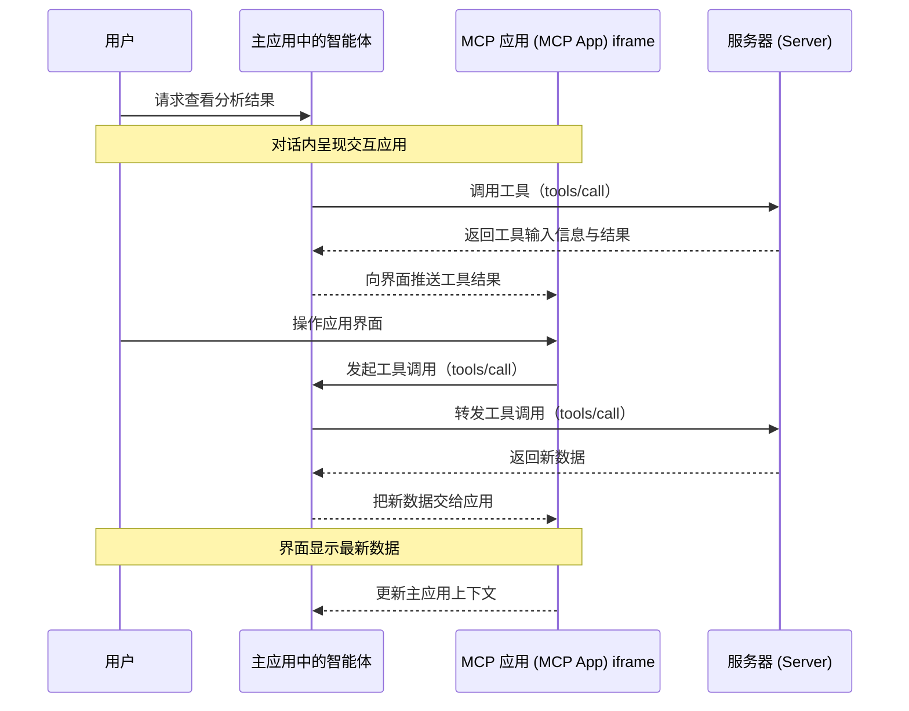
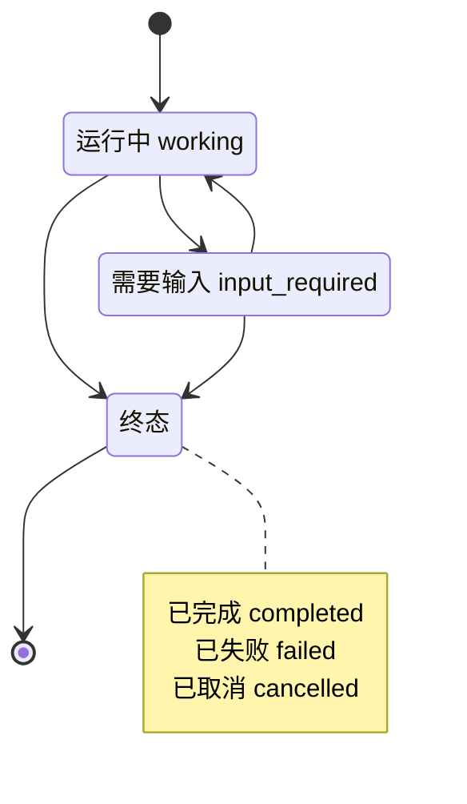
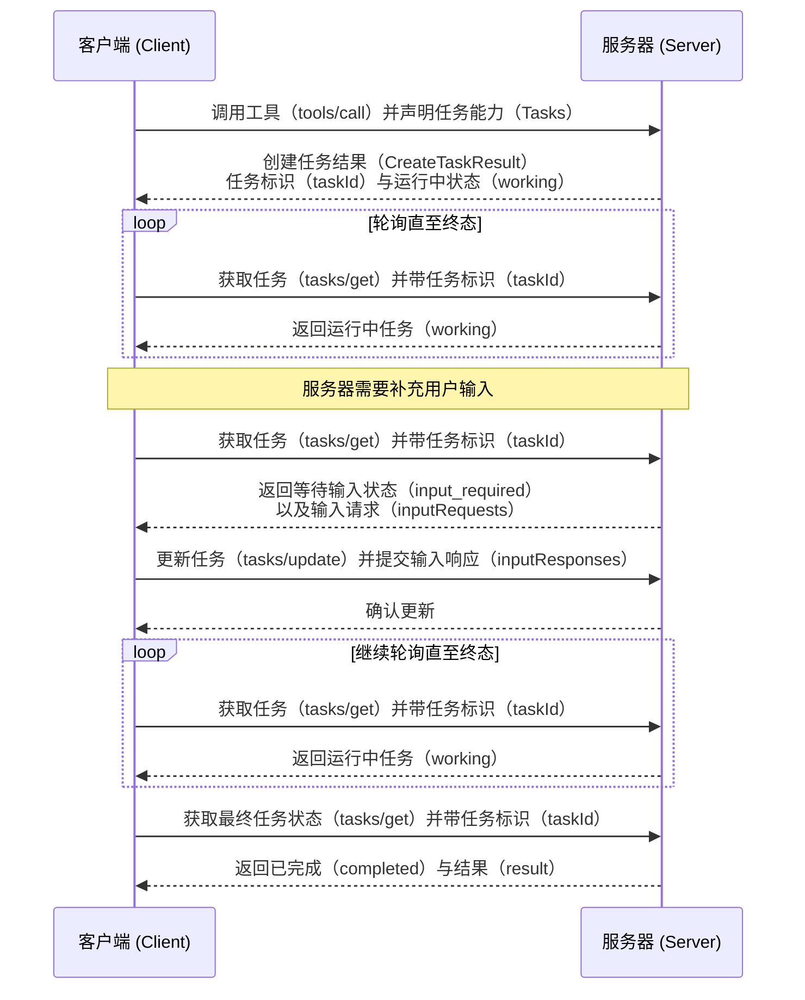
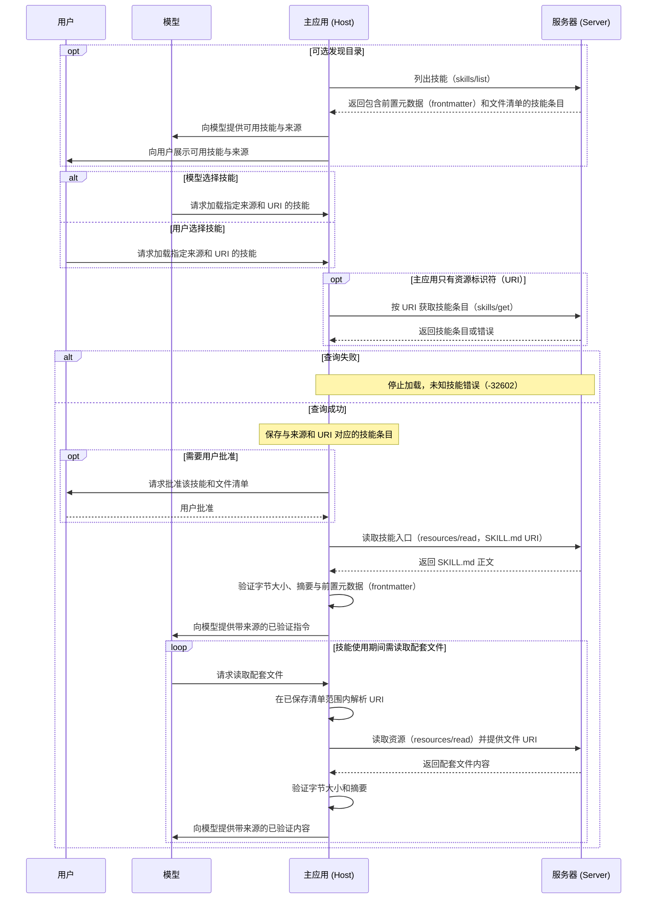
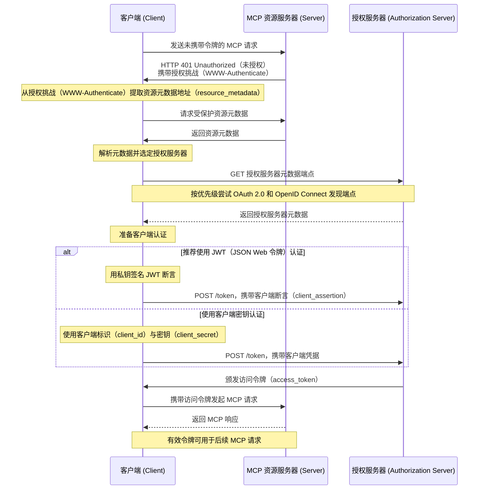
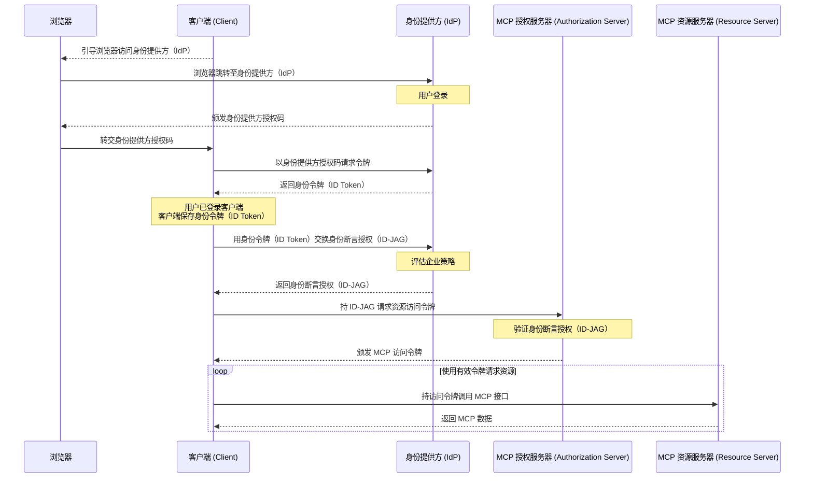

# MCP 扩展

> DefChigga <defchigga@qq.com>
>
> 2026年11月20日

> **来源 (Source)**：本手册为原创学习笔记；协议内容依据 [MCP 官方规范](https://modelcontextprotocol.io/specification)（基线 2026-07-28）整理，示例代码与核验记录由作者编写。

## 前言

本册以第一册的开发实践和第二册的核心协议为前提。开始前，你应能运行和调试 MCP 服务，读懂 JSON-RPC 请求与响应，并能说明逐请求能力、多轮交互、通知及授权边界。

本册在已有工具和资源的基础上实现交互界面、持久任务、技能提供和授权扩展。按项目需求选择路线，先确认主应用、客户端和服务端的能力，再对照消息、程序和失败路径验证扩展行为。浏览器界面共用 HTML 和 TypeScript，服务端给出 Python 与 TypeScript 实现。

## 目录

- [第1章 核心能力之外为什么需要扩展](#第1章-核心能力之外为什么需要扩展)
- [第2章 能力声明、协商与回退](#第2章-能力声明协商与回退)
- [第3章 交互应用的模型与安全](#第3章-交互应用的模型与安全)
- [第4章 构建一个笔记阅读应用](#第4章-构建一个笔记阅读应用)
- [第5章 长时间运行任务](#第5章-长时间运行任务)
- [第6章 通过 MCP 提供技能](#第6章-通过-mcp-提供技能)
- [第7章 机器身份与客户端凭据授权](#第7章-机器身份与客户端凭据授权)
- [第8章 企业托管授权](#第8章-企业托管授权)
- [第9章 扩展组合与工程实践](#第9章-扩展组合与工程实践)
- [第10章 综合项目、练习与答案](#第10章-综合项目练习与答案)

## 第1章 核心能力之外为什么需要扩展

### 1.1 从三个具体需求开始

普通工具调用能完成查询，但有些任务还需要更多交互：查询结果要在对话中用界面展示；复核要等用户确认后慢慢完成；服务还要提供一套可按需加载的检查清单。核心工具、资源和提示模板是基础，可选扩展在其上增加专门机制。

扩展不是“装包后全部生效”的开关。客户端、服务端和主应用都要支持适用部分，并明确启用。一个终端客户端可能会读工具结果，却没有浏览器容器来展示界面；一个服务能保存任务，也不意味着所有客户端都能在断线后继续取结果。

### 1.2 本册讨论的当前扩展

| 扩展          | 标识符                                                     | 解决的问题                       | 当前阶段               |
| :------------ | :--------------------------------------------------------- | :------------------------------- | :--------------------- |
| 交互应用 Apps | `io.modelcontextprotocol/ui`                               | 在主应用中展示受控界面           | 稳定                   |
| 任务 Tasks    | `io.modelcontextprotocol/tasks`                            | 持久句柄、查询状态及运行中输入   | 测试阶段，目标进入核心 |
| 技能 Skills   | `io.modelcontextprotocol/skills`                           | 发现流程指令并按清单读取配套文件 | 测试阶段               |
| 客户端凭据    | `io.modelcontextprotocol/oauth-client-credentials`         | 无用户交互的机器身份访问         | 稳定                   |
| 企业托管授权  | `io.modelcontextprotocol/enterprise-managed-authorization` | 企业身份和集中授权策略           | 稳定                   |

阶段只表示当前使用条件，不保证 SDK 和主应用都已实现。测试阶段应固定可核对的修订；稳定也需要满足对应协议和运行环境。核心基线为 `2026-07-28`，扩展还有自身版本或修订，不能混为一个数字。

服务元数据卡片 Server Cards 用于连接前了解服务元数据，当前处于测试阶段。它与连接后按请求调用的 `server/discover` 解决不同阶段的问题，卡片内容也不能代替身份和访问授权。本册实现范围集中于上表中的机制。

### 1.3 为后续示例准备项目

新建可写的练习目录，例如 `C:\mcp-extensions`。以下完整配置供本册使用；不要把它与其他项目的编译产物混放。Python 3.12、Node.js 24.22.1；Python 用 `.venv`，TypeScript 编译输出到 `dist`。

`requirements.txt`：

```text
mcp==2.3.0
PyYAML==6.0.3
PyJWT[crypto]==2.15.1
```

`package.json`：

```json
{
  "name": "mcp-extension-notes",
  "version": "1.0.0",
  "private": true,
  "type": "module",
  "scripts": {
    "build": "tsc",
    "server": "node dist/server.js",
    "client": "node dist/client.js"
  },
  "dependencies": {
    "@modelcontextprotocol/server": "2.3.1",
    "@modelcontextprotocol/client": "2.3.1",
    "@modelcontextprotocol/node": "2.1.0",
    "zod": "4.2.1",
    "@modelcontextprotocol/ext-apps": "2.0.3",
    "yaml": "2.8.1",
    "jose": "6.1.0"
  },
  "devDependencies": {
    "typescript": "5.9.3",
    "@types/node": "24.10.1",
    "esbuild": "0.25.12"
  }
}
```

`tsconfig.json`：

```json
{
  "compilerOptions": {
    "target": "ES2022",
    "module": "NodeNext",
    "moduleResolution": "NodeNext",
    "strict": true,
    "outDir": "dist",
    "skipLibCheck": true
  },
  "include": ["*.ts"]
}
```

```powershell
New-Item -ItemType Directory -Path C:\mcp-extensions -Force
Set-Location C:\mcp-extensions
python -m venv .venv
& .\.venv\Scripts\python.exe -m pip install -r requirements.txt
npm install
```

Mac/Linux 将解释器改为 `.venv/bin/python`，其余 Node 操作相同。`npm install` 生成锁文件，后续使用同一锁文件时用 `npm ci`。界面构建也用 Node，即使服务端选择 Python；这是浏览器代码的运行和打包要求。

### 1.4 扩展示例的联调前提

沿用第一册的项目结构、异步调用和输入校验。先用固定输入验证工具注册与资源读取，再启用扩展能力。读取到的资源内容仍须按来源和权限处理。

客户端发送 JSON-RPC：`jsonrpc` 固定为2.0，`id` 关联请求响应，`method` 指定动作，`params` 装载参数。每个请求的 `params._meta` 必须包含协议版本和客户端能力。普通完成结果的 `resultType` 为 complete，扩展任务的创建结果为 task。

stdio 由客户端启动子进程，每行交换一条 JSON；stdout 只装协议，诊断用 stderr。HTTP 则由独立服务等待 POST，可返回 JSON 或对应请求的 SSE 流。后面的原生消息示例使 SDK 尚未封装的扩展也能按实际线上结构学习，不把未知接口伪装成现成 API。

### 1.5 练习与答案

**题1**：服务器实现 Apps，是否所有终端客户端都会显示图表？**答案**：不会，主应用还要有界面容器、桥接与权限策略。

**题2**：任务 ID 与请求 ID 有什么区别？**答案**：请求 ID 只匹配一次 RPC；任务 ID 指向持久业务状态，后续独立请求可继续查询。

**本章结果**：能按需求选扩展，分清阶段、版本、能力和实际实现支持。

## 第2章 能力声明、协商与回退

### 2.1 扩展标识符与设置

扩展标识符由供应商前缀和名称组成，例如 `io.modelcontextprotocol/ui`；第三方用自己拥有的反向域名前缀避免冲突。标识符不能因为同名功能就自行复用官方名称。扩展设置对象由该扩展定义，空对象表示没有额外设置，不表示支持所有未知行为。

客户端通过本次请求的能力声明支持。下面是完整工具请求；`mimeTypes` 表示它能够处理应用的 HTML 媒体类型：

```json
{
  "jsonrpc": "2.0",
  "id": 1,
  "method": "tools/call",
  "params": {
    "name": "show_note",
    "arguments": { "note_id": "stdio" },
    "_meta": {
      "io.modelcontextprotocol/protocolVersion": "2026-07-28",
      "io.modelcontextprotocol/clientCapabilities": {
        "extensions": {
          "io.modelcontextprotocol/ui": { "mimeTypes": ["text/html;profile=mcp-app"] }
        }
      }
    }
  }
}
```

服务端通过发现结果中的能力声明扩展。这个发现响应不是对上面的工具调用的回答，而是另一次 `server/discover` 的响应示例：

```json
{
  "jsonrpc": "2.0",
  "id": 2,
  "result": {
    "resultType": "complete",
    "supportedVersions": ["2026-07-28"],
    "capabilities": {
      "tools": {},
      "resources": {},
      "extensions": { "io.modelcontextprotocol/ui": {} }
    },
    "ttlMs": 300000,
    "cacheScope": "public"
  }
}
```

### 2.2 每次请求都以自己的能力为准

协议不依赖之前连接留下的能力状态。服务端处理本次请求时检查本次 `_meta`；不能因为早先某次请求支持任务，就向当前没有声明任务能力的调用返回 task。任务客户端也要准备接收普通工具结果，声明支持不等于强迫服务端一定创建任务。

身份认证、业务授权与协议能力分开判断。任何人都能声称自己支持 UI；这不会使他获得别人的笔记访问权。反过来，一个合法用户可能使用不支持 Tasks 的主应用，此时必须走可用替代路径或明确拒绝。

### 2.3 能力不足时怎样回退

| 情形                                   | 正确做法                                                       |
| :------------------------------------- | :------------------------------------------------------------- |
| 主应用不会显示 UI                      | 返回有意义的文本和结构化结果；不要只给一个空界面引用           |
| 客户端不会处理 Tasks，但业务可立即完成 | 返回正常工具结果                                               |
| 该操作必须依赖 Tasks                   | 返回缺少能力错误，并说明 requiredCapabilities                  |
| 服务端没声明技能目录读取               | 客户端不调用 resources/directory/read；有清单时可按清单定位    |
| 扩展设置修订不认识                     | 不启用不兼容行为，给可操作的错误或回退                         |
| 需要企业授权而客户端不会处理           | 提示使用已获组织配置的受支持客户端，不把普通登录伪装成企业授权 |

缺少能力错误使用 `-32021`，`data.requiredCapabilities` 保留能力树。例如任务能力在 `extensions` 内，表单征询能力在 `elicitation.form` 内。不要把业务拒绝用“客户端不支持”掩盖。

### 2.4 如何核实支持矩阵

矩阵中的一个“支持”不能同时代表界面渲染、服务端扩展、SDK 包和身份服务都可用。检查具体客户端版本、传输、能力设置、扩展修订、允许的操作以及实际演示。空白单元格表示没有该项已记录的支持信息，不直接推断为绝不支持。

Apps 重点核对宿主渲染和应用桥接；Tasks 核对创建、恢复、运行中输入和取消；Skills 核对完整清单、校验、来源与批准；企业授权还需要 IdP 签发与资源授权服务器接收两个角色。记录版本后，用同一输入观察成功和缺能力两个结果。

长任务从 `2025-11-25` 的实验性核心能力变成 `2026-07-28` 的可选扩展。FastMCP 3.x 的内置任务配置迁到 4.x 时，需显式启用扩展。FastMCP 4 使用 `fastmcp[tasks]` 安装扩展并注册 `TasksExtension`，客户端也要启用该扩展。本册使用的 TypeScript 实验按协议声明同一个 `io.modelcontextprotocol/tasks` 能力，并处理对应的任务句柄。无论采用哪种实现，都需要核对本次请求的能力和实际返回的 `resultType`，以及缺少能力时的行为。

### 2.5 练习与答案

**题1**：声明 Tasks 后服务端返回普通 complete 是错误吗？**答案**：不是，是否创建任务由服务端按这一次请求决定。

**题2**：可以为了看到隐藏工具，随意声明自己不会实现的扩展吗？**答案**：不能，能力声明意味着有能力处理相应消息和安全要求。

**速查**：标识符确定是哪种扩展，设置确定支持的形态，逐请求能力确定本次可用行为，身份和权限确定可访问的数据。

## 第3章 交互应用的模型与安全

### 3.1 一次工具结果如何变成界面

工具的 `_meta.ui.resourceUri` 指向 `ui://` 资源。支持 Apps 的主应用先调用工具，再读取该资源，把 HTML 放进受控 iframe，将输入和结果通过桥接交给它。UI 里的按钮通过主应用调用服务端工具，不把服务端凭据直接交给页面。

```text
主应用调用工具 → 工具返回文字、结构化数据及 UI 关联
  → 主应用读取 ui:// 资源 → 在沙盒中加载 HTML
  → UI 与主应用建立消息桥接 → 主应用发送工具结果
  → 用户操作按钮 → UI 请求调用工具 → 主应用核对权限后转发
```

工具、资源、UI 和主应用是四个职责。HTML 资源不能因为来自 MCP 服务就获得主应用全部权限；工具结果也不能因为有 UI 就省略文本回退。

**应用打开后通过主应用调用工具**



### 3.2 工具元数据与资源元数据

工具使用 `_meta.ui.resourceUri` 绑定界面，`visibility` 可控制是否向模型、应用或两者提供工具。UI 资源使用 `text/html;profile=mcp-app`，把渲染策略放在资源内容的 `_meta.ui`，不能把工具和资源的两个元数据位置混用。

| 字段                  | 用途与约束                                       |
| :-------------------- | :----------------------------------------------- |
| `csp.connectDomains`  | 页面 fetch/WebSocket 等外部连接来源              |
| `csp.resourceDomains` | 外部脚本、图片、样式、字体等资源来源             |
| `csp.frameDomains`    | 允许的嵌套 iframe 来源                           |
| `csp.baseUriDomains`  | 页面基地址允许范围                               |
| `permissions`         | 请求相机、麦克风、定位、剪贴板等能力；宿主可拒绝 |
| `domain`              | 专用沙盒来源，具体格式与验证依主应用             |
| `prefersBorder`       | 请求可见边框和背景；不是业务权限                 |

数组为空或未声明外部来源时，不假定可以访问任意域名。CSP 控制页面能否发请求，CORS 是目标服务器是否允许该来源读响应；两者都不能替代 API 的授权。

### 3.3 UI 的生命周期与结果处理

先注册 `ontoolresult`，再 `connect()`，避免桥接建立时错过初始事件。结果到达、用户点击、连接断开和组件销毁是不同阶段；按钮调用工具时显示等待状态，失败后给明确提示，并允许在权限仍有效时重试。

`callServerTool` 返回工具结果，不保证刷新整段会话上下文；需要影响模型上下文的操作按 App 接口明确更新，不能把页面显示当成模型已经知道。文本渲染使用 `textContent`，不要把工具返回的未知字符串直接注入 `innerHTML`。

### 3.4 安全模型与使用条件

沙盒隔离浏览器能力，主应用控制哪些工具可由页面调用；服务端检查每次调用的参数与权限。涉及摄像头、外链或额外网络来源时，以实际请求的权限为准，不能让“阅读笔记”的界面暗中取得无关能力。

将脚本、样式打包为一个 HTML 可减少外部资源请求，但打包不等于可信。第三方依赖仍要固定版本和审查。主应用看不到或不支持界面时，用户应仍能读取工具的文字结果；反过来，普通浏览器直接打开 HTML 没有主应用桥接，也不能证明 Apps 交互完成。

### 3.5 练习与答案

**题1**：配置 connectDomains 后，外部 API 会自动放行吗？**答案**：不会，API 的 CORS 和访问授权仍要满足。

**题2**：页面显示了新结果，模型是否必然已收到？**答案**：不是，界面渲染与模型上下文更新是不同动作。

**本章结果**：能分别指出工具、资源、UI、主应用和服务端的安全责任。

## 第4章 构建一个笔记阅读应用

### 4.1 项目目标与文件职责

实现一个固定笔记阅读器：工具 `show_note` 返回 stdio 笔记，界面显示正文并提供“重新读取”按钮。不接数据库，不接受任意网页，不申请相机或外部网络权限。

所有文件保存在第1章的同一项目目录。浏览器部分为 `app.ts/view.html/build_ui.mjs`，构建生成 `mcp-app.html`；服务端分别保存 `app_server.py/app_server.ts`。TypeScript 编译文件进入 dist，Python 从项目根目录运行。两种服务端读取的是同一个构建后的 HTML。

### 4.2 先构建共同的浏览器界面

HTML 用元素 ID 给程序定位，按钮触发事件；TypeScript 的 `App` 负责与主应用桥接。下面没有框架前置，也不要求 Vue/React。

#### 4.2.1 页面 view.html

```html
<!doctype html>
<html lang="zh-CN">
  <head>
    <meta charset="utf-8" />
    <meta name="viewport" content="width=device-width, initial-scale=1" />
    <title>笔记阅读器</title>
  </head>
  <body>
    <h1>学习笔记</h1>
    <p id="note">等待主应用传入工具结果……</p>
    <button id="refresh" type="button">重新读取笔记</button>
    <script type="module">
      /* APP_BUNDLE */
    </script>
  </body>
</html>
```

#### 4.2.2 交互 app.ts

```typescript
import { App } from '@modelcontextprotocol/ext-apps'

const output = document.querySelector<HTMLParagraphElement>('#note')!
const button = document.querySelector<HTMLButtonElement>('#refresh')!
const app = new App({ name: '笔记阅读器', version: '1.0.0' })
function show(result: { structuredContent?: unknown }): void {
  const data = result.structuredContent
  output.textContent =
    data !== null && typeof data === 'object' && 'text' in data && typeof data.text === 'string'
      ? data.text
      : '没有取得可显示的笔记正文'
}
// 先登记事件，再建立桥接，避免错过主应用发来的初始结果。
app.ontoolresult = (result) => show(result)
button.addEventListener('click', async () => {
  button.disabled = true
  try {
    show(await app.callServerTool({ name: 'show_note', arguments: { note_id: 'stdio' } }))
  } catch {
    output.textContent = '读取失败，请检查主应用连接和权限。'
  } finally {
    button.disabled = false
  }
})
await app.connect()
```

#### 4.2.3 构建 build_ui.mjs

```javascript
import { build } from 'esbuild'
import { readFile, writeFile } from 'node:fs/promises'

const bundle = await build({
  entryPoints: ['app.ts'],
  bundle: true,
  write: false,
  format: 'esm',
  platform: 'browser',
  target: 'es2022',
})
const template = await readFile('view.html', 'utf8')
const script = bundle.outputFiles[0].text.replaceAll('</script', '<\\/script')
await writeFile(
  'mcp-app.html',
  template.replace('/* APP_BUNDLE */', () => script),
)
console.log('已生成 mcp-app.html')
```

运行 `node build_ui.mjs` 后应生成 `mcp-app.html`。构建只把依赖和页面打包，不连接 MCP 主应用。不要把其中的占位注释保留到最终 HTML；由脚本实际替换为构建产物。

### 4.3 服务端实现

#### 4.3.1 Python

保存 `app_server.py`：

```python
import argparse
from pathlib import Path
from typing import Literal
from pydantic import BaseModel
from mcp.server import MCPServer
from mcp.server.apps import Apps, ResourceCsp

apps = Apps()
URI = 'ui://notes/view.html'

class NoteView(BaseModel):
    note_id: Literal['stdio']
    text: str

@apps.tool(resource_uri=URI, description='读取固定笔记，并在支持的主应用中显示阅读界面。', structured_output=True)
def show_note(note_id: Literal['stdio']) -> NoteView:
    return NoteView(note_id=note_id, text='stdio 服务端的日志应写入 stderr。')

apps.add_html_resource(URI, Path(__file__).with_name('mcp-app.html').read_text(encoding='utf-8'),
    name='笔记阅读器', csp=ResourceCsp(connect_domains=[], resource_domains=[], frame_domains=[]),
    prefers_border=True)
mcp = MCPServer('NotesApp', extensions=[apps])

if __name__ == '__main__':
    parser = argparse.ArgumentParser()
    parser.add_argument('--http', action='store_true')
    parser.add_argument('--port', type=int, default=8775)
    args = parser.parse_args()
    if args.http:
        mcp.run(transport='streamable-http', host='127.0.0.1', port=args.port)
    else:
        mcp.run()
```

Python SDK 的 `Apps` 扩展把工具和 HTML 资源绑定起来，并声明扩展。`Literal['stdio']` 限制可接受的笔记 ID。`NoteView` 模型与显式结构化输出使 SDK 同时提供可显示内容和 structuredContent；结果不是直接把任意本地文件交给浏览器。

#### 4.3.2 TypeScript

保存 `app_server.ts`：

```typescript
import { readFile } from 'node:fs/promises'
import { createServer } from 'node:http'
import { McpServer, createMcpHandler } from '@modelcontextprotocol/server'
import { serveStdio } from '@modelcontextprotocol/server/stdio'
import {
  toNodeHandler,
  localhostHostValidation,
  localhostOriginValidation,
} from '@modelcontextprotocol/node'
import {
  registerAppTool,
  registerAppResource,
  RESOURCE_MIME_TYPE,
} from '@modelcontextprotocol/ext-apps/server'
import * as z from 'zod/v4'

const html = await readFile(new URL('../mcp-app.html', import.meta.url), 'utf8')
const uri = 'ui://notes/view.html'
function create(): McpServer {
  const server = new McpServer(
    { name: 'NotesApp', version: '1.0.0' },
    {
      capabilities: { extensions: { 'io.modelcontextprotocol/ui': {} } },
    },
  )
  registerAppTool(
    server,
    'show_note',
    {
      description: '读取固定笔记，并在支持的主应用中显示阅读界面。',
      inputSchema: z.object({ note_id: z.literal('stdio') }),
      _meta: { ui: { resourceUri: uri } },
    },
    async ({ note_id }) => {
      const data = { note_id, text: 'stdio 服务端的日志应写入 stderr。' }
      return { content: [{ type: 'text', text: data.text }], structuredContent: data }
    },
  )
  registerAppResource(server, '笔记阅读器', uri, { mimeType: RESOURCE_MIME_TYPE }, async () => ({
    contents: [
      {
        uri,
        mimeType: RESOURCE_MIME_TYPE,
        text: html,
        _meta: {
          ui: {
            csp: { connectDomains: [], resourceDomains: [], frameDomains: [] },
            prefersBorder: true,
          },
        },
      },
    ],
  }))
  return server
}
if (process.argv.includes('--http')) {
  const index = process.argv.indexOf('--port')
  const port = index < 0 ? 8776 : Number(process.argv[index + 1])
  const handler = createMcpHandler(create)
  const nodeHandler = toNodeHandler(handler)
  const hostOK = localhostHostValidation()
  const originOK = localhostOriginValidation()
  const http = createServer((req, res) => {
    if (!hostOK(req, res) || !originOK(req, res)) return
    if (req.url !== '/mcp') {
      res.writeHead(404).end()
      return
    }
    void nodeHandler(req, res)
  })
  http.listen(port, '127.0.0.1', () => console.error(`MCP: http://127.0.0.1:${port}/mcp`))
  process.on('SIGINT', () => {
    void handler.close().finally(() => http.close())
  })
} else {
  serveStdio(create)
}
```

`registerAppTool` 注册带 UI 关联的工具，`registerAppResource` 提供页面资源。结果同时包含文本和 structuredContent；资源内容声明空的外部来源列表，不申请额外浏览器权限。

### 4.4 编译、连接与结果

先启动服务并检查工具与界面行为，再根据失败现象定位构建、资源或主应用配置。

#### 4.4.1 启动与验证

```powershell
node build_ui.mjs
npm run build
& .\.venv\Scripts\python.exe app_server.py --http
```

另一个终端中可启动 `node dist/app_server.js --http`。两个默认端点分别是 `http://127.0.0.1:8775/mcp` 与 `http://127.0.0.1:8776/mcp`。在支持当前 Apps 扩展与协议的主应用中添加其中一个端点，调用 `show_note`，输入 `note_id=stdio`。

**可观察结果**：工具返回文本“stdio 服务端的日志应写入 stderr。”；有渲染支持时还看到“学习笔记”与按钮。点击后应重新调用同一工具并显示同样正文。只读资源与初次工具结果一致只是协议检查；实际按钮触发、沙盒、主应用批准和界面更新还需要宿主实测。

Inspector 可先检查工具关联、资源媒体类型、HTML、CSP 和结果；能够读取 HTML 不代表主应用已经渲染。仅直接用浏览器打开 HTML 时没有 Apps 桥接，不能将按钮失败归因于 MCP 服务业务代码。

#### 4.4.2 常见失败与定位

构建找不到包：检查当前目录与 node_modules。服务端找不到 HTML：先运行构建脚本，并核对编译产物相对根目录的路径。工具有文字没有界面：查宿主能力、MIME、resourceUri、实际资源返回和权限。界面没有初始内容：查回调是否先注册，以及结构化字段名是否一致。

### 4.5 练习与答案

**题1**：为什么 Python 服务也需要构建 app.ts？**答案**：服务端语言与浏览器执行环境不同；浏览器运行构建后的 JavaScript，两种服务端提供同一页面。

**题2**：可以把任意资源 URI 直接拼成本机文件路径吗？**答案**：不可以，本例只读取固定的构建文件；扩展资源仍需要访问范围限制。

**通过标准**：两种服务均能列出工具、返回正文和正确 UI 资源；具备真实宿主时再验证初始显示与按钮交互。

## 第5章 长时间运行任务

### 5.1 长任务不是更长的请求超时

任务允许服务端尽快返回持久句柄，客户端以后独立查询。适合批处理、工作流或等待人工输入。持续等待某条 HTTP 响应只是阻塞调用，不能自动提供进程重启后的状态恢复。

Tasks 只在双方支持时使用。本册当前扩展支持由 `tools/call` 创建任务；客户端不在请求里强制选择任务形态，服务端按实际工作决定。没有本次任务能力声明时，不能返回 task；能同步完成则回退正常结果，不能回退时返回 `-32021`。

### 5.2 创建结果、状态和字段

`CreateTaskResult` 的 `taskId/status/createdAt/lastUpdatedAt/ttlMs/pollIntervalMs` 与 `resultType` 在同一层，不套入一个额外的 task 字段。下面是一条创建响应：

```json
{
  "jsonrpc": "2.0",
  "id": 1,
  "result": {
    "resultType": "task",
    "taskId": "教学任务标识",
    "status": "working",
    "createdAt": "2026-11-18T00:00:00Z",
    "lastUpdatedAt": "2026-11-18T00:00:00Z",
    "ttlMs": 60000,
    "pollIntervalMs": 200
  }
}
```

这里的任务标识为便于阅读的示意值；真实服务必须使用不可猜测的高熵标识。返回前必须已持久创建，确保客户端马上查询就能找到，不能先发句柄再等待存储最终出现。

| 状态             | 含义                           | 状态专属字段                 |
| :--------------- | :----------------------------- | :--------------------------- |
| `working`        | 工作进行中                     | 可选状态说明                 |
| `input_required` | 需要运行中输入                 | 所有未满足的 `inputRequests` |
| `completed`      | 原请求已完成，包括工具业务错误 | `result`，原方法结果         |
| `failed`         | 执行中发生 JSON-RPC 错误       | `error`，对应错误对象        |
| `cancelled`      | 在完成前取消                   | 不伪造成功结果               |

```text
working ──需要输入──→ input_required ──取得输入──→ working
   └───────────────→ completed / failed / cancelled
input_required 也可能转入终态；终态不再继续推进工作。
```

`ttlMs` 从创建时间计，整数毫秒或 null（不限制）；服务端可调整它。过期后任务可能已被清理。客户端遵守当前 `pollIntervalMs`，不要高速忙轮询；任务 ID 应保存以便恢复，但保存 ID 不保证服务仍保留任务。

**任务状态与终止路径**



### 5.3 三个任务方法

| 方法           | 参数                   | 返回与注意事项                                |
| :------------- | :--------------------- | :-------------------------------------------- |
| `tasks/get`    | taskId                 | resultType=complete，加当前状态及相应 payload |
| `tasks/update` | taskId、inputResponses | complete 的空确认；状态可能稍后才变化         |
| `tasks/cancel` | taskId                 | complete 的空确认；取消是协作式的             |

任务输入通过 get 取得、update 回答，不重试原始 tools/call。问题键在同一任务生命周期内唯一，不可在回答后复用作另一个问题。客户端去重相同键以免重复打扰用户；部分回答可以让任务继续等待其余问题。服务端通常忽略未知或已经满足的回答键，未知任务则返回适当错误。

取消任务用 tasks/cancel，不用普通请求的取消通知。收到空确认不保证已经停下，也不保证最终必为 cancelled；完成可能先于取消到达。取消本身也不自动撤销已提交的外部副作用。

**长任务从创建、补充输入到完成**



### 5.4 通知、HTTP 与错误约束

可选通知名为 `notifications/tasks`。客户端使用 subscriptions/listen 的 notifications.taskIds 选择任务，先观察订阅确认，随后通知携带完整 DetailedTask；它与当时 get 可见状态一致。任务通知不以普通进度或日志通知代替。轮询仍可保留，不必依赖通知可恢复。

HTTP 上 tasks/get、update、cancel 的 `Mcp-Name` 为 taskId，`Mcp-Method` 为方法名，服务端仍校验标头与正文。没有任务能力的客户端调用任务方法或订阅任务通知要得到缺能力错误；未知、无权或失效 taskId 的 get 使用 `-32602`。

工具返回 `isError=true` 应进入 completed，并在 result 中保留工具错误；不能把所有业务失败都标成 failed。failed 专指原请求执行的 RPC 错误，error 保留其代码与信息。

### 5.5 完整服务端

以下教学服务实现当前 stdio 消息，同时为第6章提供技能资源。它用原子替换的本地 JSON 文件持久状态，工作由轮询推进为确定性延迟复核，便于重启后继续演示；没有伪装成生产任务队列。真实耗时业务应换成受控执行器，并保留相同的状态、身份和幂等要求。

同一状态文件只给一个服务进程使用，Python 与 TypeScript 默认使用不同文件。进程的 `DEMO_PRINCIPAL` 表示本机练习主体，模拟同一调用者的持久记录；它不是远程身份认证。多用户部署必须从已验证凭据取得主体，逐任务检查访问权，不能相信请求里自报的用户 ID。

#### 5.5.1 Python：extensions_server.py

```python
"""单用户 stdio 教学服务：实现现行 Tasks/Skills 消息，不依赖 SDK 的旧任务接口。"""
from datetime import datetime, timezone
import hashlib
import json
import os
from pathlib import Path
import secrets
import sys
import time

TASKS = 'io.modelcontextprotocol/tasks'
SKILLS = 'io.modelcontextprotocol/skills'
STATE = Path(os.environ.get('DEMO_TASK_FILE', 'tasks-python.json')).resolve()
OWNER = os.environ.get('DEMO_PRINCIPAL', 'local-user')
URI = 'skill://note-review/SKILL.md'
FRONT = {'name': 'note-review', 'description': '按检查清单复核笔记内容。'}
FILES = {
    URI: '---\nname: note-review\ndescription: 按检查清单复核笔记内容。\n---\n\n# 笔记复核\n\n先读 references/checklist.md，再核对笔记中的结论。\n',
    'skill://note-review/references/checklist.md': '# 检查清单\n\n核对输入、结果、边界和来源。\n',
}

class RPCError(Exception):
    def __init__(self, code, message, data=None):
        self.code, self.message, self.data = code, message, data

def now():
    return datetime.now(timezone.utc).isoformat().replace('+00:00', 'Z')

def save(db):
    temporary = STATE.with_suffix(STATE.suffix + '.tmp')
    with temporary.open('w', encoding='utf-8') as stream:
        json.dump(db, stream, ensure_ascii=False)
        stream.flush(); os.fsync(stream.fileno())
    os.replace(temporary, STATE)

def load():
    return json.loads(STATE.read_text(encoding='utf-8')) if STATE.exists() else {}

def complete(**fields):
    return {'resultType': 'complete', **fields}

def tool_result(text, failed=False):
    return complete(content=[{'type': 'text', 'text': text}], isError=failed)

def entry():
    manifest = [{'uri': uri, 'digest': 'sha256:' + hashlib.sha256(text.encode()).hexdigest(),
                 'size': len(text.encode())} for uri, text in FILES.items()]
    return {'uri': URI, 'frontmatter': FRONT, 'resources': manifest}

def check_cap(params, extension):
    caps = params['_meta']['io.modelcontextprotocol/clientCapabilities']
    if extension not in caps.get('extensions', {}):
        raise RPCError(-32021, '缺少所需扩展能力', {'requiredCapabilities': {'extensions': {extension: {}}}})

def get_task(db, task_id):
    if not isinstance(task_id, str) or not task_id: raise RPCError(-32602, 'taskId 必须是非空字符串')
    task = db.get(task_id)
    if not task or task['_owner'] != OWNER or time.time() * 1000 >= task['_createdMs'] + task['ttlMs']:
        raise RPCError(-32602, '任务不存在、已过期或不可访问')
    return task

def public_task(task):
    return {key: value for key, value in task.items() if not key.startswith('_')}

def handle(method, params):
    meta = params.get('_meta')
    if not isinstance(meta, dict) or 'io.modelcontextprotocol/protocolVersion' not in meta or not isinstance(meta.get('io.modelcontextprotocol/clientCapabilities'), dict):
        raise RPCError(-32602, '缺少必需请求元数据')
    version = meta['io.modelcontextprotocol/protocolVersion']
    if version != '2026-07-28':
        raise RPCError(-32022, '不支持的协议版本', {'requested': version, 'supported': ['2026-07-28']})
    if method == 'server/discover':
        return complete(supportedVersions=['2026-07-28'], capabilities={'tools': {}, 'resources': {},
            'extensions': {TASKS: {}, SKILLS: {'directoryRead': True}}}, ttlMs=300000, cacheScope='public')
    if method == 'tools/list':
        return complete(tools=[{'name': 'start_review', 'description': '启动需要用户确认的延迟笔记复核。',
            'inputSchema': {'type': 'object', 'properties': {'query': {'type': 'string', 'minLength': 1, 'maxLength': 100}},
                            'required': ['query']}}], ttlMs=300000, cacheScope='public')
    if method == 'tools/call':
        if params.get('name') != 'start_review': raise RPCError(-32602, '工具不存在')
        arguments = params.get('arguments', {})
        if not isinstance(arguments, dict): raise RPCError(-32602, 'arguments 必须是对象')
        query = arguments.get('query')
        if not isinstance(query, str) or not 1 <= len(query.strip()) <= 100:
            return tool_result('query 必须为1—100字符的非空文本', True)
        check_cap(params, TASKS)
        caps = meta['io.modelcontextprotocol/clientCapabilities']
        if 'form' not in caps.get('elicitation', {}):
            raise RPCError(-32021, '需要表单征询能力', {'requiredCapabilities': {'elicitation': {'form': {}}}})
        task_id = secrets.token_urlsafe(24)
        stamp = now()
        task = {'taskId': task_id, 'status': 'working', 'createdAt': stamp, 'lastUpdatedAt': stamp,
                'ttlMs': 60000, 'pollIntervalMs': 200, '_owner': OWNER,
                '_query': query.strip(), '_createdMs': time.time() * 1000, '_confirmed': False}
        db = load(); db[task_id] = task; save(db)
        return {'resultType': 'task', **public_task(task)}
    if method.startswith('tasks/'):
        check_cap(params, TASKS)
        db = load(); task = get_task(db, params.get('taskId'))
        if method == 'tasks/get':
            if task['status'] == 'working' and not task['_confirmed']:
                task['status'] = 'input_required'
                task['inputRequests'] = {'confirm-1': {'method': 'elicitation/create', 'params': {
                    'mode': 'form', 'message': '是否复核这条笔记？', 'requestedSchema': {'type': 'object',
                    'properties': {'confirm': {'type': 'boolean'}}, 'required': ['confirm']}}}}
            elif task['status'] == 'working' and time.time() * 1000 >= task['_readyMs']:
                task['status'] = 'completed'
                task['result'] = tool_result('复核完成：' + task['_query'])
        elif method == 'tasks/update':
            responses = params.get('inputResponses', {})
            if not isinstance(responses, dict): raise RPCError(-32602, 'inputResponses 必须是对象')
            answer = responses.get('confirm-1')
            if task['status'] == 'input_required' and answer is not None:
                if not isinstance(answer, dict): raise RPCError(-32602, '输入响应必须是对象')
                if answer.get('action') == 'accept':
                    content = answer.get('content', {})
                    if not isinstance(content, dict): raise RPCError(-32602, '确认内容必须是对象')
                    confirmation = content.get('confirm')
                    if not isinstance(confirmation, bool): raise RPCError(-32602, '确认值必须是布尔值')
                    task['_confirmed'] = True
                    if confirmation:
                        task['status'] = 'working'; task['_readyMs'] = time.time() * 1000 + 300
                    else:
                        task['status'] = 'completed'; task['result'] = tool_result('用户未确认', True)
                elif answer.get('action') in ['decline', 'cancel']:
                    task['status'] = 'cancelled'
                else: raise RPCError(-32602, '不合法的征询动作')
                task.pop('inputRequests', None)
        elif method == 'tasks/cancel':
            if task['status'] in ['working', 'input_required']:
                task['status'] = 'cancelled'; task.pop('inputRequests', None)
        else: raise RPCError(-32601, '方法不存在')
        task['lastUpdatedAt'] = now(); save(db)
        return complete(**public_task(task)) if method == 'tasks/get' else complete()
    if method in ['skills/list', 'skills/get', 'resources/directory/read']:
        check_cap(params, SKILLS)
    if method == 'skills/list':
        return complete(skills=[entry()], ttlMs=300000, cacheScope='public')
    if method == 'skills/get':
        if params.get('uri') != URI: raise RPCError(-32602, '技能不存在')
        return complete(skill=entry(), ttlMs=300000, cacheScope='public')
    if method == 'resources/list':
        return complete(resources=[{'uri': URI, 'name': FRONT['name'], 'description': FRONT['description'],
            'mimeType': 'text/markdown'}], ttlMs=300000, cacheScope='public')
    if method == 'resources/templates/list':
        return complete(resourceTemplates=[], ttlMs=300000, cacheScope='public')
    if method == 'resources/read':
        uri = params.get('uri')
        if not isinstance(uri, str): raise RPCError(-32602, 'uri 必须是字符串')
        if uri not in FILES: raise RPCError(-32602, '技能文件不存在')
        return complete(contents=[{'uri': uri, 'mimeType': 'text/markdown', 'text': FILES[uri]}],
                        ttlMs=300000, cacheScope='public')
    if method == 'resources/directory/read':
        directory = params.get('uri')
        if directory == 'skill://note-review':
            items = [{'uri': URI, 'name': 'SKILL.md', 'mimeType': 'text/markdown'},
                     {'uri': 'skill://note-review/references', 'name': 'references', 'mimeType': 'inode/directory'}]
        elif directory == 'skill://note-review/references':
            items = [{'uri': 'skill://note-review/references/checklist.md', 'name': 'checklist.md', 'mimeType': 'text/markdown'}]
        else: raise RPCError(-32602, '目录不存在')
        return complete(resources=items, ttlMs=300000, cacheScope='public')
    raise RPCError(-32601, '方法不存在')

def main():
    sys.stdin.reconfigure(encoding='utf-8')
    sys.stdout.reconfigure(encoding='utf-8')
    for raw in sys.stdin:
        message = None
        try:
            if len(raw.encode()) > 1024 * 1024: raise RPCError(-32600, '消息过大')
            try: message = json.loads(raw)
            except json.JSONDecodeError: raise RPCError(-32700, 'JSON 解析失败')
            if not isinstance(message, dict) or message.get('jsonrpc') != '2.0' or not isinstance(message.get('method'), str):
                raise RPCError(-32600, '无效请求')
            if 'id' not in message: continue
            if not isinstance(message['id'], (str, int, float)) or isinstance(message['id'], bool):
                raise RPCError(-32600, '请求 ID 必须是字符串或数值')
            params = message.get('params', {})
            if not isinstance(params, dict): raise RPCError(-32602, '参数必须是对象')
            response = {'jsonrpc': '2.0', 'id': message['id'], 'result': handle(message['method'], params)}
        except RPCError as error:
            response = {'jsonrpc': '2.0', 'id': message.get('id') if isinstance(message, dict) else None,
                        'error': {'code': error.code, 'message': error.message}}
            if error.data is not None: response['error']['data'] = error.data
        except Exception:
            response = {'jsonrpc': '2.0', 'id': message.get('id') if isinstance(message, dict) else None,
                        'error': {'code': -32603, 'message': '内部处理失败'}}
        if not isinstance(response.get('id'), (str, int, float)) or isinstance(response.get('id'), bool):
            response.pop('id', None)
        print(json.dumps(response, ensure_ascii=False), flush=True)

if __name__ == '__main__':
    main()
```

#### 5.5.2 TypeScript：extensions_server.ts

```typescript
// 单用户 stdio 教学服务；状态文件是本地练习存储，不是多进程任务数据库。
import { createHash, randomBytes } from 'node:crypto'
import {
  existsSync,
  readFileSync,
  writeFileSync,
  renameSync,
  openSync,
  fsyncSync,
  closeSync,
} from 'node:fs'
import { resolve } from 'node:path'
import { createInterface } from 'node:readline'

const TASKS = 'io.modelcontextprotocol/tasks'
const SKILLS = 'io.modelcontextprotocol/skills'
const statePath = resolve(process.env.DEMO_TASK_FILE ?? 'tasks-typescript.json')
const owner = process.env.DEMO_PRINCIPAL ?? 'local-user'
const uri = 'skill://note-review/SKILL.md'
const front = { name: 'note-review', description: '按检查清单复核笔记内容。' }
const files: Record<string, string> = {
  [uri]:
    '---\nname: note-review\ndescription: 按检查清单复核笔记内容。\n---\n\n# 笔记复核\n\n先读 references/checklist.md，再核对笔记中的结论。\n',
  'skill://note-review/references/checklist.md': '# 检查清单\n\n核对输入、结果、边界和来源。\n',
}
type Obj = Record<string, any>
class RPCError extends Error {
  constructor(
    readonly code: number,
    message: string,
    readonly data?: unknown,
  ) {
    super(message)
  }
}
const complete = (fields: Obj = {}): Obj => ({ resultType: 'complete', ...fields })
const toolResult = (text: string, failed = false): Obj =>
  complete({ content: [{ type: 'text', text }], isError: failed })
function load(): Obj {
  return existsSync(statePath) ? JSON.parse(readFileSync(statePath, 'utf8')) : {}
}
function save(db: Obj): void {
  const temporary = statePath + '.tmp'
  writeFileSync(temporary, JSON.stringify(db), { encoding: 'utf8', mode: 0o600 })
  const fd = openSync(temporary, 'r+')
  try {
    fsyncSync(fd)
  } finally {
    closeSync(fd)
  }
  renameSync(temporary, statePath)
}
function entry(): Obj {
  return {
    uri,
    frontmatter: front,
    resources: Object.entries(files).map(([resource, text]) => ({
      uri: resource,
      digest: 'sha256:' + createHash('sha256').update(text).digest('hex'),
      size: Buffer.byteLength(text),
    })),
  }
}
function checkCap(params: Obj, extension: string): void {
  if (
    !Object.hasOwn(
      params._meta['io.modelcontextprotocol/clientCapabilities'].extensions ?? {},
      extension,
    )
  ) {
    throw new RPCError(-32021, '缺少所需扩展能力', {
      requiredCapabilities: { extensions: { [extension]: {} } },
    })
  }
}
function publicTask(task: Obj): Obj {
  return Object.fromEntries(Object.entries(task).filter(([key]) => !key.startsWith('_')))
}
function getTask(db: Obj, id: string): Obj {
  if (typeof id !== 'string' || !id) throw new RPCError(-32602, 'taskId 必须是非空字符串')
  const task = Object.hasOwn(db, id) ? db[id] : undefined
  if (!task || task._owner !== owner || Date.now() >= task._createdMs + task.ttlMs) {
    throw new RPCError(-32602, '任务不存在、已过期或不可访问')
  }
  return task
}
function handle(method: string, params: Obj): Obj {
  const meta = params._meta
  if (
    !meta ||
    typeof meta['io.modelcontextprotocol/protocolVersion'] !== 'string' ||
    !meta['io.modelcontextprotocol/clientCapabilities'] ||
    typeof meta['io.modelcontextprotocol/clientCapabilities'] !== 'object' ||
    Array.isArray(meta['io.modelcontextprotocol/clientCapabilities'])
  ) {
    throw new RPCError(-32602, '缺少必需请求元数据')
  }
  const version = meta['io.modelcontextprotocol/protocolVersion']
  if (version !== '2026-07-28')
    throw new RPCError(-32022, '不支持的协议版本', {
      requested: version,
      supported: ['2026-07-28'],
    })
  if (method === 'server/discover')
    return complete({
      supportedVersions: ['2026-07-28'],
      capabilities: {
        tools: {},
        resources: {},
        extensions: { [TASKS]: {}, [SKILLS]: { directoryRead: true } },
      },
      ttlMs: 300000,
      cacheScope: 'public',
    })
  if (method === 'tools/list')
    return complete({
      tools: [
        {
          name: 'start_review',
          description: '启动需要用户确认的延迟笔记复核。',
          inputSchema: {
            type: 'object',
            properties: { query: { type: 'string', minLength: 1, maxLength: 100 } },
            required: ['query'],
          },
        },
      ],
      ttlMs: 300000,
      cacheScope: 'public',
    })
  if (method === 'tools/call') {
    if (params.name !== 'start_review') throw new RPCError(-32602, '工具不存在')
    if (
      params.arguments !== undefined &&
      (!params.arguments || typeof params.arguments !== 'object' || Array.isArray(params.arguments))
    ) {
      throw new RPCError(-32602, 'arguments 必须是对象')
    }
    const query = params.arguments?.query
    if (
      typeof query !== 'string' ||
      Array.from(query.trim()).length < 1 ||
      Array.from(query.trim()).length > 100
    ) {
      return toolResult('query 必须为1—100字符的非空文本', true)
    }
    checkCap(params, TASKS)
    if (!meta['io.modelcontextprotocol/clientCapabilities'].elicitation?.form) {
      throw new RPCError(-32021, '需要表单征询能力', {
        requiredCapabilities: { elicitation: { form: {} } },
      })
    }
    const taskId = randomBytes(24).toString('base64url')
    const stamp = new Date().toISOString()
    const task: Obj = {
      taskId,
      status: 'working',
      createdAt: stamp,
      lastUpdatedAt: stamp,
      ttlMs: 60000,
      pollIntervalMs: 200,
      _owner: owner,
      _query: query.trim(),
      _createdMs: Date.now(),
      _confirmed: false,
    }
    const db = load()
    db[taskId] = task
    save(db)
    return { resultType: 'task', ...publicTask(task) }
  }
  if (method.startsWith('tasks/')) {
    checkCap(params, TASKS)
    const db = load()
    const task = getTask(db, params.taskId)
    if (method === 'tasks/get') {
      if (task.status === 'working' && !task._confirmed) {
        task.status = 'input_required'
        task.inputRequests = {
          'confirm-1': {
            method: 'elicitation/create',
            params: {
              mode: 'form',
              message: '是否复核这条笔记？',
              requestedSchema: {
                type: 'object',
                properties: { confirm: { type: 'boolean' } },
                required: ['confirm'],
              },
            },
          },
        }
      } else if (task.status === 'working' && Date.now() >= task._readyMs) {
        task.status = 'completed'
        task.result = toolResult('复核完成：' + task._query)
      }
    } else if (method === 'tasks/update') {
      if (
        params.inputResponses !== undefined &&
        (!params.inputResponses ||
          typeof params.inputResponses !== 'object' ||
          Array.isArray(params.inputResponses))
      ) {
        throw new RPCError(-32602, 'inputResponses 必须是对象')
      }
      const answer = params.inputResponses?.['confirm-1']
      if (task.status === 'input_required' && answer !== undefined) {
        if (!answer || typeof answer !== 'object' || Array.isArray(answer))
          throw new RPCError(-32602, '输入响应必须是对象')
        if (answer.action === 'accept') {
          if (typeof answer.content?.confirm !== 'boolean')
            throw new RPCError(-32602, '确认值必须是布尔值')
          task._confirmed = true
          if (answer.content.confirm) {
            task.status = 'working'
            task._readyMs = Date.now() + 300
          } else {
            task.status = 'completed'
            task.result = toolResult('用户未确认', true)
          }
        } else if (['decline', 'cancel'].includes(answer.action)) {
          task.status = 'cancelled'
        } else throw new RPCError(-32602, '不合法的征询动作')
        delete task.inputRequests
      }
    } else if (method === 'tasks/cancel') {
      if (['working', 'input_required'].includes(task.status)) {
        task.status = 'cancelled'
        delete task.inputRequests
      }
    } else {
      throw new RPCError(-32601, '方法不存在')
    }
    task.lastUpdatedAt = new Date().toISOString()
    save(db)
    return method === 'tasks/get' ? complete(publicTask(task)) : complete()
  }
  if (['skills/list', 'skills/get', 'resources/directory/read'].includes(method))
    checkCap(params, SKILLS)
  if (method === 'skills/list')
    return complete({ skills: [entry()], ttlMs: 300000, cacheScope: 'public' })
  if (method === 'skills/get') {
    if (params.uri !== uri) throw new RPCError(-32602, '技能不存在')
    return complete({ skill: entry(), ttlMs: 300000, cacheScope: 'public' })
  }
  if (method === 'resources/list')
    return complete({
      resources: [
        { uri, name: front.name, description: front.description, mimeType: 'text/markdown' },
      ],
      ttlMs: 300000,
      cacheScope: 'public',
    })
  if (method === 'resources/templates/list')
    return complete({ resourceTemplates: [], ttlMs: 300000, cacheScope: 'public' })
  if (method === 'resources/read') {
    if (!Object.hasOwn(files, params.uri)) throw new RPCError(-32602, '技能文件不存在')
    return complete({
      contents: [{ uri: params.uri, mimeType: 'text/markdown', text: files[params.uri] }],
      ttlMs: 300000,
      cacheScope: 'public',
    })
  }
  if (method === 'resources/directory/read') {
    let items: Obj[]
    if (params.uri === 'skill://note-review')
      items = [
        { uri, name: 'SKILL.md', mimeType: 'text/markdown' },
        { uri: 'skill://note-review/references', name: 'references', mimeType: 'inode/directory' },
      ]
    else if (params.uri === 'skill://note-review/references')
      items = [
        {
          uri: 'skill://note-review/references/checklist.md',
          name: 'checklist.md',
          mimeType: 'text/markdown',
        },
      ]
    else throw new RPCError(-32602, '目录不存在')
    return complete({ resources: items, ttlMs: 300000, cacheScope: 'public' })
  }
  throw new RPCError(-32601, '方法不存在')
}
const input = createInterface({ input: process.stdin, crlfDelay: Infinity })
for await (const line of input) {
  let message: Obj | undefined
  let response: Obj
  try {
    if (Buffer.byteLength(line) > 1024 * 1024) throw new RPCError(-32600, '消息过大')
    try {
      message = JSON.parse(line)
    } catch {
      throw new RPCError(-32700, 'JSON 解析失败')
    }
    if (
      !message ||
      Array.isArray(message) ||
      message.jsonrpc !== '2.0' ||
      typeof message.method !== 'string'
    ) {
      throw new RPCError(-32600, '无效请求')
    }
    if (!Object.hasOwn(message, 'id')) continue
    if (!['string', 'number'].includes(typeof message.id))
      throw new RPCError(-32600, '请求 ID 必须是字符串或数值')
    const params = message.params ?? {}
    if (!params || Array.isArray(params) || typeof params !== 'object')
      throw new RPCError(-32602, '参数必须是对象')
    response = { jsonrpc: '2.0', id: message.id, result: handle(message.method, params) }
  } catch (error) {
    response = {
      jsonrpc: '2.0',
      id: message?.id ?? null,
      error:
        error instanceof RPCError
          ? {
              code: error.code,
              message: error.message,
              ...(error.data === undefined ? {} : { data: error.data }),
            }
          : { code: -32603, message: '内部处理失败' },
    }
  }
  if (!['string', 'number'].includes(typeof response.id)) delete response.id
  process.stdout.write(JSON.stringify(response) + '\n')
}
```

### 5.6 完整客户端与恢复实验

客户端先发现能力，再创建并保存任务 ID，轮询并按需请求确认。`--approve` 仅用于你明确选择的固定教学数据自动化实验，真实用户流程默认通过终端取得同意。

#### 5.6.1 Python：extensions_client.py

```python
import argparse
import asyncio
import hashlib
import json
import os
from pathlib import Path
import sys
import yaml

TASKS = 'io.modelcontextprotocol/tasks'
SKILLS = 'io.modelcontextprotocol/skills'

async def main():
    parser = argparse.ArgumentParser()
    parser.add_argument('--command', default=sys.executable)
    parser.add_argument('--server', default=str(Path(__file__).with_name('extensions_server.py')))
    parser.add_argument('--skills-only', action='store_true')
    parser.add_argument('--task-only', action='store_true')
    parser.add_argument('--approve', action='store_true')
    parser.add_argument('--read-reference', action='store_true')
    parser.add_argument('--no', action='store_true')
    parser.add_argument('--cancel', action='store_true')
    parser.add_argument('--stop-after-create', action='store_true')
    parser.add_argument('--resume')
    args = parser.parse_args()
    proc = await asyncio.create_subprocess_exec(args.command, args.server,
        stdin=asyncio.subprocess.PIPE, stdout=asyncio.subprocess.PIPE, stderr=None)
    sequence = 0
    caps = {'extensions': {TASKS: {}, SKILLS: {}}, 'elicitation': {'form': {}}}

    async def rpc(method, params):
        nonlocal sequence
        sequence += 1
        params = {**params, '_meta': {'io.modelcontextprotocol/protocolVersion': '2026-07-28',
                  'io.modelcontextprotocol/clientCapabilities': caps}}
        message = {'jsonrpc': '2.0', 'id': sequence, 'method': method, 'params': params}
        proc.stdin.write((json.dumps(message, ensure_ascii=False) + '\n').encode())
        await proc.stdin.drain()
        raw = await asyncio.wait_for(proc.stdout.readline(), timeout=10)
        if not raw: raise RuntimeError('服务端提前退出')
        response = json.loads(raw)
        if response.get('id') != sequence: raise RuntimeError('响应 ID 不匹配')
        if 'error' in response: raise RuntimeError(str(response['error']))
        return response['result']

    try:
        discovery = await rpc('server/discover', {})
        supported = discovery['capabilities']['extensions']
        if not args.task_only:
            if SKILLS not in supported: raise RuntimeError('服务端不支持技能')
            listing = await rpc('skills/list', {})
            entry = listing['skills'][0]
            # 本地 stdio 的来源身份是主应用选择的命令、参数与配置标识，不接受服务端自报名称替代。
            origin = json.dumps([os.path.abspath(args.command), os.path.abspath(args.server)])
            print('技能来源：', origin, entry['uri'])
            approved = args.approve or input('是否允许读取此技能清单中的内容？输入 y：').strip().lower() == 'y'
            if not approved: raise RuntimeError('用户未批准，未读取文件')
            held = {item['uri']: item for item in entry['resources']}

            async def read_verified(uri):
                if uri not in held: raise RuntimeError('URI 不在保留清单中')
                result = await rpc('resources/read', {'uri': uri})
                contents = result['contents']
                if len(contents) != 1 or contents[0]['uri'] != uri: raise RuntimeError('资源身份不匹配')
                text = contents[0]['text']; raw = text.encode()
                expected = held[uri]
                if len(raw) != expected['size'] or 'sha256:' + hashlib.sha256(raw).hexdigest() != expected['digest']:
                    raise RuntimeError('技能字节校验失败，请刷新条目并重新取得必要批准')
                return text

            text = await read_verified(entry['uri'])
            if not text.startswith('---\n'): raise RuntimeError('缺少 YAML 前置元数据')
            front = yaml.safe_load(text.split('\n---', 1)[0][4:])
            if front != entry['frontmatter']: raise RuntimeError('前置元数据与条目不一致')
            print('技能校验完成：', entry['frontmatter']['name'])
            if args.read_reference:
                # 激活后由当前任务显式选择这个引用；不在列举/批准阶段提前抓取文件。
                reference = entry['uri'].rsplit('/', 1)[0] + '/references/checklist.md'
                print(await read_verified(reference))
        if not args.skills_only:
            if TASKS not in supported: raise RuntimeError('服务端不支持任务')
            task_id = args.resume
            if task_id is None:
                created = await rpc('tools/call', {'name': 'start_review', 'arguments': {'query': 'stdio'}})
                if created['resultType'] != 'task': raise RuntimeError('未取得任务句柄')
                task_id = created['taskId']
                Path('task-id-python.txt').write_text(task_id, encoding='utf-8')
                print('任务已持久创建：', task_id)
            if args.stop_after_create: return
            if args.cancel:
                await rpc('tasks/cancel', {'taskId': task_id})
            answered = set()
            for _ in range(30):
                task = await rpc('tasks/get', {'taskId': task_id})
                print('任务状态：', task['status'])
                if task['status'] in ['completed', 'cancelled', 'failed']:
                    print(json.dumps(task.get('result', task.get('error', {})), ensure_ascii=False)); break
                if task['status'] == 'input_required':
                    responses = {}
                    for key, request in task['inputRequests'].items():
                        if key in answered: continue
                        print('任务需要输入：', request['params']['message'])
                        accepted = args.approve or input('是否同意？输入 y：').strip().lower() == 'y'
                        responses[key] = {'action': 'accept', 'content': {'confirm': not args.no}} if accepted else {'action': 'decline'}
                        answered.add(key)
                    if responses: await rpc('tasks/update', {'taskId': task_id, 'inputResponses': responses})
                await asyncio.sleep(max(0.05, task.get('pollIntervalMs', 200) / 1000))
            else: raise RuntimeError('本次观察预算已用完；任务 ID 已保留，可稍后恢复')
    finally:
        proc.stdin.close()
        try: await asyncio.wait_for(proc.wait(), timeout=5)
        except asyncio.TimeoutError:
            proc.kill(); await proc.wait()

if __name__ == '__main__':
    asyncio.run(main())
```

#### 5.6.2 TypeScript：extensions_client.ts

```typescript
import { spawn } from 'node:child_process'
import { createHash } from 'node:crypto'
import { writeFileSync } from 'node:fs'
import { resolve } from 'node:path'
import { createInterface } from 'node:readline'
import { createInterface as createPrompt } from 'node:readline/promises'
import { fileURLToPath } from 'node:url'
import { isDeepStrictEqual } from 'node:util'
import { parse as parseYAML } from 'yaml'

type Obj = Record<string, any>
const args = process.argv.slice(2)
function option(name: string, fallback?: string): string | undefined {
  const index = args.indexOf(name)
  return index < 0 ? fallback : args[index + 1]
}
const command = option('--command', process.execPath)!
const server = option(
  '--server',
  fileURLToPath(new URL('./extensions_server.js', import.meta.url)),
)!
const TASKS = 'io.modelcontextprotocol/tasks'
const SKILLS = 'io.modelcontextprotocol/skills'
const caps = { extensions: { [TASKS]: {}, [SKILLS]: {} }, elicitation: { form: {} } }
const proc = spawn(command, [server], { stdio: ['pipe', 'pipe', 'inherit'] })
const input = createInterface({ input: proc.stdout, crlfDelay: Infinity })
const responses = input[Symbol.asyncIterator]()
let sequence = 0
async function rpc(method: string, params: Obj): Promise<Obj> {
  const id = ++sequence
  proc.stdin.write(
    JSON.stringify({
      jsonrpc: '2.0',
      id,
      method,
      params: {
        ...params,
        _meta: {
          'io.modelcontextprotocol/protocolVersion': '2026-07-28',
          'io.modelcontextprotocol/clientCapabilities': caps,
        },
      },
    }) + '\n',
  )
  let timer: ReturnType<typeof setTimeout> | undefined
  try {
    const next = await Promise.race([
      responses.next(),
      new Promise<never>((_, reject) => {
        timer = setTimeout(() => reject(new Error('响应等待超时')), 10_000)
      }),
    ])
    if (next.done) throw new Error('服务端提前退出')
    const response = JSON.parse(next.value)
    if (response.id !== id) throw new Error('响应 ID 不匹配')
    if (response.error) throw new Error(JSON.stringify(response.error))
    return response.result
  } finally {
    if (timer) clearTimeout(timer)
  }
}
async function approve(message: string): Promise<boolean> {
  if (args.includes('--approve')) return true
  const prompt = createPrompt({ input: process.stdin, output: process.stdout })
  try {
    return (await prompt.question(message + '，输入 y：')).trim().toLowerCase() === 'y'
  } finally {
    prompt.close()
  }
}
try {
  const discovery = await rpc('server/discover', {})
  const supported = discovery.capabilities.extensions
  if (!args.includes('--task-only')) {
    if (!Object.hasOwn(supported, SKILLS)) throw new Error('服务端不支持技能')
    const listing = await rpc('skills/list', {})
    const entry = listing.skills[0]
    const origin = JSON.stringify([resolve(command), resolve(server)])
    console.log('技能来源：', origin, entry.uri)
    if (!(await approve('是否允许读取此技能清单中的内容')))
      throw new Error('用户未批准，未读取文件')
    const held = new Map<string, Obj>(entry.resources.map((item: Obj) => [item.uri, item]))
    async function readVerified(uri: string): Promise<string> {
      const expected = held.get(uri)
      if (!expected) throw new Error('URI 不在保留清单中')
      const result = await rpc('resources/read', { uri })
      if (result.contents.length !== 1 || result.contents[0].uri !== uri)
        throw new Error('资源身份不匹配')
      const text: string = result.contents[0].text
      if (
        Buffer.byteLength(text) !== expected.size ||
        'sha256:' + createHash('sha256').update(text).digest('hex') !== expected.digest
      ) {
        throw new Error('技能字节校验失败，请刷新条目并重新取得必要批准')
      }
      return text
    }
    const text = await readVerified(entry.uri)
    if (!text.startsWith('---\n')) throw new Error('缺少 YAML 前置元数据')
    const front = parseYAML(text.slice(4).split('\n---', 1)[0])
    if (!isDeepStrictEqual(front, entry.frontmatter)) throw new Error('前置元数据与条目不一致')
    console.log('技能校验完成：', entry.frontmatter.name)
    if (args.includes('--read-reference')) {
      const reference =
        entry.uri.slice(0, entry.uri.lastIndexOf('/') + 1) + 'references/checklist.md'
      console.log(await readVerified(reference))
    }
  }
  if (!args.includes('--skills-only')) {
    if (!Object.hasOwn(supported, TASKS)) throw new Error('服务端不支持任务')
    let taskId = option('--resume')
    if (!taskId) {
      const created = await rpc('tools/call', {
        name: 'start_review',
        arguments: { query: 'stdio' },
      })
      if (created.resultType !== 'task') throw new Error('未取得任务句柄')
      taskId = created.taskId
      writeFileSync('task-id-typescript.txt', taskId!, 'utf8')
      console.log('任务已持久创建：', taskId)
    }
    if (!args.includes('--stop-after-create')) {
      if (args.includes('--cancel')) await rpc('tasks/cancel', { taskId })
      const answered = new Set<string>()
      let finished = false
      for (let round = 0; round < 30; round++) {
        const task = await rpc('tasks/get', { taskId })
        console.log('任务状态：', task.status)
        if (['completed', 'cancelled', 'failed'].includes(task.status)) {
          console.log(JSON.stringify(task.result ?? task.error ?? {}))
          finished = true
          break
        }
        if (task.status === 'input_required') {
          const values: Obj = {}
          for (const [key, request] of Object.entries(task.inputRequests) as [string, Obj][]) {
            if (answered.has(key)) continue
            console.log('任务需要输入：', request.params.message)
            values[key] = (await approve('是否同意'))
              ? { action: 'accept', content: { confirm: !args.includes('--no') } }
              : { action: 'decline' }
            answered.add(key)
          }
          if (Object.keys(values).length)
            await rpc('tasks/update', { taskId, inputResponses: values })
        }
        await new Promise((resolve) =>
          setTimeout(resolve, Math.max(50, task.pollIntervalMs ?? 200)),
        )
      }
      if (!finished) throw new Error('本次观察预算已用完；任务 ID 已保留，可稍后恢复')
    }
  }
} finally {
  input.close()
  proc.stdin.end()
  if (proc.exitCode === null) {
    const timer = setTimeout(() => proc.kill(), 5000)
    await new Promise<void>((resolve) => {
      if (proc.exitCode !== null) resolve()
      else proc.once('exit', () => resolve())
    })
    clearTimeout(timer)
  }
}
```

```powershell
& .\.venv\Scripts\python.exe extensions_client.py --task-only --approve
npm run build
node dist/extensions_client.js --task-only --approve
```

预期看到任务创建、input_required、working、completed 和“复核完成：stdio”；轮询调度可能产生不同次数的 working，但不能缺失最终结果。加 `--no` 表示接受表单却把 confirm 选为 false，任务 completed 中保留 `isError=true`；加 `--cancel` 验证取消。

恢复实验先运行 `--task-only --stop-after-create`。客户端退出即关闭服务子进程，任务已保存在本机 JSON 文件。读取输出或 task-id 文本，再在同一工作目录、同一状态文件与主体下运行 `--task-only --resume 实际任务ID --approve`；服务重启后应在60秒有效期内找到任务。跨语言互通使用客户端的 `--command` 和 `--server` 指向另一种已编译/可执行服务，仍使用该服务自己的状态文件。

### 5.7 练习、答案与实现边界

**题1**：可以把 task 嵌在 result.task 再声称符合本章协议吗？**答案**：不可以，本章创建结果使用扁平字段结构。

**题2**：用户不同意，是 failed 吗？**答案**：不必；业务错误可以是 completed＋isError，或按操作语义取消；failed 是 RPC 执行错误。

**题3**：任务 ID 很随机就不用授权了吗？**答案**：不行，每次任务访问仍要检查身份与权限。

**速查**：创建前持久化；问题键不复用；get 看状态，update 回答，cancel 表意图；终态和业务结果分开解释。此项目验证 stdio 与本地恢复，不声称已具备多实例存储、真实任务队列和所有宿主支持。

## 第6章 通过 MCP 提供技能

### 6.1 技能与提示模板、工具的区别

工具执行操作；提示模板展开消息；技能是一份可复用流程说明，加上按需读取的参考、脚本或其他文件。Skills 扩展定义怎样通过 MCP 发现与读取它，具体技能文件格式遵循 Agent Skills 的规则。

技能根目录有 SKILL.md，开头 YAML 前置元数据至少包含 name 与 description；可有配套目录和文件。读取这份文本不等于激活其指令，也不会自动授予工具或代码执行权限。主应用在加载路径中做校验、来源标记和必要批准。

### 6.2 能力、URI 与文件映射

支持技能的服务端在发现结果同时声明 resources 与 Skills 扩展，并实现 skills/list、skills/get。设置 directoryRead=true 才意味着支持 resources/directory/read；省略则默认不支持目录读取。

推荐 `skill://` URI，例如 `skill://note-review/SKILL.md`；技能名应与目录最后一段一致。authority 是服务内部命名，不允许据此做 DNS 或网络解析。其他 scheme 也可提供技能；主应用通过服务端目录或经 skills/get 确认的显式引用识别技能，不只看 URI 前缀。

技能身份是“来源服务端身份＋URI”。同名或相同 URI 来自不同服务不能互相覆盖，缓存路径与批准记录也保留来源。服务端自报 name/version 只是显示信息，本地来源由主应用选定的启动配置标识，远程来源由受信的连接与授权上下文确定。

### 6.3 条目、完整清单和按需读取

| 字段               | 约束                                                       |
| :----------------- | :--------------------------------------------------------- |
| uri                | 技能 SKILL.md 的完整资源 URI                               |
| frontmatter        | 文件全部 YAML 前置元数据转成的对象，不能只保留两个已知字段 |
| resources          | 完整文件清单，或字符串 dynamic                             |
| resources[].uri    | 每个文件恰好一次，包括根 SKILL.md                          |
| resources[].digest | 原始字节 SHA-256，形如 sha256:十六进制摘要                 |
| resources[].size   | 原始字节大小，不是字符数量                                 |

带清单的条目是一个原子对象，不能把同一个技能的清单拆到多页。技能列表本身可以分页，也可不完整甚至为空，但已提供的每个技能都必须支持直接 skills/get；主应用还要支持直接按 URI 加载没有出现在列表中的技能。

发现只读元数据，批准绑定清单，文件在需要时再取。连接、列举或批准阶段不能预取所有文件。加载根 SKILL.md 后，只有任务真正需要时才读取参考文件。建议每技能不超过512个文件或16 MiB，主应用必须支持达到这些上限的合规技能，可以支持更大规模但需有资源限制。

**发现技能、核对清单与按需读取**



### 6.4 文件验证与使用期间的条目

主应用保存加载时的条目，至少一直保存到该技能 SKILL.md 离开模型上下文。整个使用期间的读取限制在这份保留清单，读取前后检查实际来源、URI、字节大小和摘要，再解析根文件前置元数据并与条目全部字段比较。

清单摘要证明“这些字节与服务端声明一致”，不是证明“这些指令可信”。不能因为摘要正确就执行脚本。校验失败时拒绝内容，用 skills/get 刷新条目，按变动后的清单重新取得必要批准；不能暗中把已批准的旧条目替换成新内容。

持久批准绑定完整的一组 URI 和摘要。新增、删除或修改任何文件都会使原批准不再覆盖新版本。缓存要么不可变且隔离写入，要么每次读都重新验证；缓存路径保留服务来源，且排除在本机自动技能发现目录之外，避免重启后变成本地高信任技能。

dynamic 代表生成内容没有稳定完整清单。主应用可以拒绝；如果接受，仍校验前置元数据，并且不能把一次持久批准解释为覆盖任意未来生成内容。

### 6.5 目录、相对引用与嵌套技能

相对引用按技能根目录解释，本例的 references/checklist.md 指向同一服务中的 `skill://note-review/references/checklist.md`。不要用未经约束的路径拼接跨出清单，也不要默认跨服务取同名文件。

目录读取 URI 不带尾部斜杠，只列直接子项，子目录用 `inode/directory`。有保留清单时可以从清单回答目录查询；实时目录多出的文件不能自动扩充已批准清单，访问前先刷新条目和批准。支持 directoryRead 的服务要能读取其提供的每个技能命名空间目录，而不是只实现某一个示例目录。

嵌套技能的 SKILL.md 作为父技能的配套内容读取时只是文本，不能执行它的 frontmatter。激活为另一个技能需要独立、明确的用户同意；同意父技能不覆盖子技能。发布列表仍是扁平条目，不依据路径相似就赋予继承权限。

### 6.6 来源、批准与权限

显示名称相同时要展示来源与路径帮助区分，不能静默偏好其中一个。向模型提供内容时带主应用分配的来源标签，读取动作绑定该标签对应的服务。跨服务读取需要每次明确批准并指明涉及的服务，不能让技能自行改一个标签就访问别处。

技能中的 allowed-tools、脚本或其他可执行内容仍是待批准请求，不能自授主应用权限。批准、身份和来源的检查在主应用一侧实施，服务端仍检查资源访问权。本章示例只验证字节和元数据，没有调用模型或执行技能脚本。

### 6.7 运行读取与校验程序

第5章的服务和客户端已经给出本章所需的完整文件，不需另一个工程。服务将固定文件放在内存映射里，不会在真实 Agent 技能目录中创建或激活技能。实际服务想读取磁盘目录时，需要额外验证解析后的路径和权限。

```powershell
& .\.venv\Scripts\python.exe extensions_client.py --skills-only --approve
node dist/extensions_client.js --skills-only --approve
```

预期输出技能来源、URI 和“技能校验完成：note-review”。这次读取根文件，未提前读取参考文件。加 `--read-reference` 表示当前任务显式需要参考，再读取并校验清单中的 checklist.md，得到“核对输入、结果、边界和来源。”

测试未知技能和未知文件时预期 `-32602`；服务内部错误用 `-32603`。摘要、大小或前置元数据不匹配是主应用侧的校验失败，不应伪装成服务端 RPC 错误。故意把收到的内容追加字符，应在使用前被拒绝；此实验只修改客户端测试副本，不破坏来源文件。

### 6.8 练习与答案

**题1**：两份技能 name 都是 review，可以用 name 当缓存键吗？**答案**：不能，使用来源服务端身份和 URI；名称只作标签。

**题2**：中文字符串有20个字符，清单 size 就写20吗？**答案**：按实际编码字节计，通常与字符数不同。

**题3**：读取父技能中的子 SKILL.md 会激活子技能吗？**答案**：不会，独立激活需要新的明确同意。

**速查**：先条目、再批准、按需取字节、逐项校验、保留来源；摘要不等于信任，读文本不等于授权执行。

## 第7章 机器身份与客户端凭据授权

### 7.1 什么是机器身份

定时作业查询业务系统时，未必有一位用户坐在浏览器前批准。客户端凭据流程让已经登记的后台客户端以自己的身份申请访问令牌；它不代表某位员工，也不是把管理员账户密码写到配置里。

此扩展适用于 HTTP，仍遵守核心授权规则。客户端凭据通过行政或管理通道预登记；客户端、授权服务器、资源服务器要就目标资源与范围达成一致。凭据用于向授权服务器证明客户端身份，访问令牌用于访问 MCP，两个角色不同。

### 7.2 从资源发现到令牌请求

先请求目标资源，按401挑战取得受保护资源元数据，选择可信授权服务器，再读取其元数据。核对 token_endpoint、grant_types_supported、客户端认证方式，以及使用 JWT 时的签名算法。授权服务器声明支持的认证方式必须与实现匹配，不能只看 token endpoint 存在就自行猜测。

推荐 private_key_jwt：客户端保留私钥，在令牌请求中发送短期签名断言。声明中 iss/sub 标识客户端，aud 指向约定的令牌端点或其接受的受众，iat/exp 限制时间，jti 帮助检测重放，kid 帮助选择已登记公钥。授权服务器核对签名、受众、客户端登记和重放规则；不能只解码 JWT 看字段。

客户端密钥也是可用方式，但必须依实际元数据支持的方式传递，不在 URL 中携带。它是长期凭据，泄露后可以持续冒用直至轮换；私钥断言不传私钥，但同样要保护本机密钥。把客户端密钥放进浏览器或公开桌面程序不能获得保密性。

**机器身份发现与两种令牌请求方式**



### 7.3 完整请求中的两个断言角色

客户端认证断言使用 `client_assertion_type=urn:ietf:params:oauth:client-assertion-type:jwt-bearer` 与 client_assertion；grant_type=client_credentials 说明本次申请的授权流程。resource 指定目标 MCP，scope 指定最小范围。JWT 认证中的 sub 已传达客户端身份，不在没有服务要求时重复拼接冲突的 client_id。

成功后把访问令牌放到 `Authorization: Bearer ...`，客户端在每请求能力内声明凭据扩展。资源服务验证令牌签名或采用其规定的内省机制，确认 issuer、audience、过期、scope 和业务权限；不能把任意 JWT 当作同一资源的合法令牌。

### 7.4 程序与配置

准备已核实的 HTTPS 令牌端点、资源端点、预登记客户端和 RSA 私钥。私钥使用 PKCS#8 PEM 格式，把公钥以授权服务器支持的方式登记；kid 与登记一致。示例使用 RS256，授权服务器必须支持该算法。

| 环境变量               | 值来自哪里                            |
| :--------------------- | :------------------------------------ |
| OAUTH_TOKEN_URL        | 已核实的授权服务器元数据              |
| MCP_URL                | 目标资源的规范地址                    |
| OAUTH_CLIENT_ID        | 预登记客户端标识                      |
| OAUTH_PRIVATE_KEY_FILE | 本机受控私钥文件路径                  |
| OAUTH_KEY_ID           | 登记公钥的 kid；不需要时可省略        |
| OAUTH_SCOPE            | 该资源允许的最小范围，例如 notes:read |

下面的同一对程序同时提供本章机器凭据流程和下一章企业流程，不需要编写一个假授权服务器。正常运行不加 --enterprise，先取得令牌再请求真实资源的工具目录。

#### 7.4.1 Python：auth_flow.py

```python
"""JWT 客户端认证；可执行机器凭据或企业 ID-JAG 换取流程。"""
import json
import os
from pathlib import Path
import secrets
import sys
import time
import urllib.parse
import urllib.request
import jwt

class NoRedirect(urllib.request.HTTPRedirectHandler):
    def redirect_request(self, req, fp, code, msg, headers, newurl):
        return None

HTTP = urllib.request.build_opener(NoRedirect)

def endpoint(name):
    value = os.environ[name]
    url = urllib.parse.urlsplit(value)
    if url.scheme != 'https' or not url.netloc or url.username:
        raise ValueError(f'{name} 必须是已核实的 HTTPS 地址')
    return value

def assertion(client_id, audience, key, kid):
    now = int(time.time())
    return jwt.encode({'iss': client_id, 'sub': client_id, 'aud': audience,
        'iat': now, 'exp': now + 60, 'jti': secrets.token_urlsafe(24)}, key,
        algorithm='RS256', headers={'kid': kid} if kid else None)

def post_form(url, fields):
    request = urllib.request.Request(url, urllib.parse.urlencode(fields).encode(),
        {'Content-Type': 'application/x-www-form-urlencoded'})
    with HTTP.open(request, timeout=30) as response:
        return json.load(response)

def main():
    token_url = endpoint('OAUTH_TOKEN_URL')
    resource = endpoint('MCP_URL')
    client_id = os.environ['OAUTH_CLIENT_ID']
    key = Path(os.environ['OAUTH_PRIVATE_KEY_FILE']).read_text(encoding='utf-8')
    credential = {'client_assertion_type': 'urn:ietf:params:oauth:client-assertion-type:jwt-bearer',
        'client_assertion': assertion(client_id, token_url, key, os.environ.get('OAUTH_KEY_ID'))}
    if '--enterprise' in sys.argv:
        idp_url = endpoint('IDP_TOKEN_URL')
        audience = endpoint('RESOURCE_AUTH_ISSUER')
        idp_client = os.environ['IDP_CLIENT_ID']
        idp_key = Path(os.environ['IDP_PRIVATE_KEY_FILE']).read_text(encoding='utf-8')
        exchanged = post_form(idp_url, {
            'grant_type': 'urn:ietf:params:oauth:grant-type:token-exchange',
            'requested_token_type': 'urn:ietf:params:oauth:token-type:id-jag',
            'subject_token_type': 'urn:ietf:params:oauth:token-type:id_token',
            'subject_token': os.environ['IDP_ID_TOKEN'], 'audience': audience, 'resource': resource,
            'scope': os.environ['OAUTH_SCOPE'],
            'client_assertion_type': credential['client_assertion_type'],
            'client_assertion': assertion(idp_client, idp_url, idp_key, os.environ.get('IDP_KEY_ID'))})
        if exchanged.get('issued_token_type') != 'urn:ietf:params:oauth:token-type:id-jag':
            raise RuntimeError('IdP 没有返回所要求的 ID-JAG')
        form = {'grant_type': 'urn:ietf:params:oauth:grant-type:jwt-bearer',
                'assertion': exchanged['access_token'], 'resource': resource, **credential}
        extension = 'io.modelcontextprotocol/enterprise-managed-authorization'
    else:
        form = {'grant_type': 'client_credentials', 'resource': resource,
                'scope': os.environ['OAUTH_SCOPE'], **credential}
        extension = 'io.modelcontextprotocol/oauth-client-credentials'
    token = post_form(token_url, form)
    if token.get('token_type', '').lower() != 'bearer': raise RuntimeError('不支持的访问令牌类型')
    request = urllib.request.Request(resource, json.dumps({'jsonrpc': '2.0', 'id': 1,
        'method': 'tools/list', 'params': {'_meta': {
            'io.modelcontextprotocol/protocolVersion': '2026-07-28',
            'io.modelcontextprotocol/clientCapabilities': {'extensions': {extension: {}}}}}}).encode(),
        {'Content-Type': 'application/json', 'Accept': 'application/json, text/event-stream',
         'Authorization': 'Bearer ' + token['access_token'], 'MCP-Protocol-Version': '2026-07-28',
         'Mcp-Method': 'tools/list'})
    with HTTP.open(request, timeout=30) as response:
        if 'text/event-stream' in response.headers.get('Content-Type', ''):
            data = []; result = None
            for raw in response:
                line = raw.decode().rstrip('\r\n')
                if line.startswith('data:'): data.append(line[5:].lstrip(' '))
                elif not line and data:
                    event = json.loads('\n'.join(data)); data = []
                    if event.get('id') == 1: result = event; break
            if result is None: raise RuntimeError('没有收到最终响应')
        else: result = json.load(response)
    if 'error' in result: raise RuntimeError('MCP 请求失败，错误码：' + str(result['error']['code']))
    print(json.dumps(result['result'], ensure_ascii=False, indent=2))

if __name__ == '__main__':
    main()
```

#### 7.4.2 TypeScript：auth_flow.ts

```typescript
import { randomBytes } from 'node:crypto'
import { readFile } from 'node:fs/promises'
import { importPKCS8, SignJWT } from 'jose'

function required(name: string): string {
  const value = process.env[name]
  if (!value) throw new Error(`缺少 ${name}`)
  return value
}
function endpoint(name: string): string {
  const value = required(name)
  const url = new URL(value)
  if (url.protocol !== 'https:' || url.username)
    throw new Error(`${name} 必须是已核实的 HTTPS 地址`)
  return value
}
async function assertion(
  client: string,
  audience: string,
  file: string,
  kid?: string,
): Promise<string> {
  const key = await importPKCS8(await readFile(file, 'utf8'), 'RS256')
  return new SignJWT({})
    .setProtectedHeader({ alg: 'RS256', ...(kid ? { kid } : {}) })
    .setIssuer(client)
    .setSubject(client)
    .setAudience(audience)
    .setIssuedAt()
    .setExpirationTime('60s')
    .setJti(randomBytes(24).toString('base64url'))
    .sign(key)
}
async function postForm(url: string, fields: Record<string, string>): Promise<Record<string, any>> {
  const response = await fetch(url, {
    method: 'POST',
    redirect: 'error',
    signal: AbortSignal.timeout(30_000),
    headers: { 'content-type': 'application/x-www-form-urlencoded' },
    body: new URLSearchParams(fields),
  })
  if (!response.ok) throw new Error(`获取令牌失败，HTTP ${response.status}`)
  return await response.json()
}
const tokenUrl = endpoint('OAUTH_TOKEN_URL')
const resource = endpoint('MCP_URL')
const clientId = required('OAUTH_CLIENT_ID')
const credential = {
  client_assertion_type: 'urn:ietf:params:oauth:client-assertion-type:jwt-bearer',
  client_assertion: await assertion(
    clientId,
    tokenUrl,
    required('OAUTH_PRIVATE_KEY_FILE'),
    process.env.OAUTH_KEY_ID,
  ),
}
let form: Record<string, string>
let extension: string
if (process.argv.includes('--enterprise')) {
  const idp = endpoint('IDP_TOKEN_URL')
  const exchanged = await postForm(idp, {
    grant_type: 'urn:ietf:params:oauth:grant-type:token-exchange',
    requested_token_type: 'urn:ietf:params:oauth:token-type:id-jag',
    subject_token_type: 'urn:ietf:params:oauth:token-type:id_token',
    subject_token: required('IDP_ID_TOKEN'),
    audience: endpoint('RESOURCE_AUTH_ISSUER'),
    resource,
    scope: required('OAUTH_SCOPE'),
    client_assertion_type: credential.client_assertion_type,
    client_assertion: await assertion(
      required('IDP_CLIENT_ID'),
      idp,
      required('IDP_PRIVATE_KEY_FILE'),
      process.env.IDP_KEY_ID,
    ),
  })
  if (exchanged.issued_token_type !== 'urn:ietf:params:oauth:token-type:id-jag')
    throw new Error('IdP 没有返回所要求的 ID-JAG')
  form = {
    grant_type: 'urn:ietf:params:oauth:grant-type:jwt-bearer',
    assertion: exchanged.access_token,
    resource,
    ...credential,
  }
  extension = 'io.modelcontextprotocol/enterprise-managed-authorization'
} else {
  form = {
    grant_type: 'client_credentials',
    resource,
    scope: required('OAUTH_SCOPE'),
    ...credential,
  }
  extension = 'io.modelcontextprotocol/oauth-client-credentials'
}
const token = await postForm(tokenUrl, form)
if (token.token_type?.toLowerCase() !== 'bearer') throw new Error('不支持的访问令牌类型')
const response = await fetch(resource, {
  method: 'POST',
  redirect: 'error',
  signal: AbortSignal.timeout(30_000),
  headers: {
    'content-type': 'application/json',
    accept: 'application/json, text/event-stream',
    authorization: `Bearer ${token.access_token}`,
    'MCP-Protocol-Version': '2026-07-28',
    'Mcp-Method': 'tools/list',
  },
  body: JSON.stringify({
    jsonrpc: '2.0',
    id: 1,
    method: 'tools/list',
    params: {
      _meta: {
        'io.modelcontextprotocol/protocolVersion': '2026-07-28',
        'io.modelcontextprotocol/clientCapabilities': { extensions: { [extension]: {} } },
      },
    },
  }),
})
if (!response.ok) throw new Error(`MCP 请求失败，HTTP ${response.status}`)
let result: Record<string, any> | undefined
if (response.headers.get('content-type')?.includes('text/event-stream')) {
  if (!response.body) throw new Error('响应流为空')
  const reader = response.body.pipeThrough(new TextDecoderStream()).getReader()
  let buffer = ''
  try {
    while (!result) {
      const chunk = await reader.read()
      if (chunk.done) throw new Error('SSE 在最终响应前结束')
      buffer += chunk.value
      let match: RegExpExecArray | null
      while ((match = /\r?\n\r?\n/.exec(buffer))) {
        const frame = buffer.slice(0, match.index)
        buffer = buffer.slice(match.index + match[0].length)
        const data = frame
          .split(/\r?\n/)
          .filter((line) => line.startsWith('data:'))
          .map((line) => line.slice(5).replace(/^ /, ''))
          .join('\n')
        if (!data) continue
        const event = JSON.parse(data)
        if (event.id === 1) {
          result = event
          break
        }
      }
    }
  } finally {
    await reader.cancel()
  }
} else {
  result = await response.json()
}
if (!result || result.error) throw new Error('MCP 拒绝请求')
console.log(JSON.stringify(result.result, null, 2))
```

执行 Python 文件，或编译后执行 `node dist/auth_flow.js`。成功输出取决于真实资源的工具目录，脚本不会打印令牌和私钥。缺少真实登记与授权服务时，本地只能检查语法和签名相关逻辑；不能用一段手写访问令牌当作身份服务已经接受。

### 7.5 资源服务器怎样验证令牌

下面提供一个只返回已验证主体的最小受保护服务。它验证 RS256、issuer、audience、exp、sub 和 notes:read，不把签名正确等同于所有业务资源可读。这里固定读取已核实的授权服务器公钥；生产系统需要受控的 JWKS 获取、缓存和轮换，不能从令牌里的任意 URL 下载密钥。

配置 AUTH_ISSUER、MCP_PUBLIC_URL、AUTH_PUBLIC_KEY_FILE。前两者是外部 HTTPS 身份与资源地址，公钥文件来自可信管理员。服务本机监听，需由已配置的 TLS 反向代理转发到 `/mcp`，不是自动把示例发布到互联网。

#### 7.5.1 Python：protected_server.py

```python
import os
from pathlib import Path
import jwt
from pydantic import BaseModel
from mcp.server import MCPServer
from mcp.server.auth.provider import AccessToken
from mcp.server.auth.settings import AuthSettings
from mcp.server.auth.middleware.auth_context import get_access_token

ISSUER = os.environ['AUTH_ISSUER']
RESOURCE = os.environ['MCP_PUBLIC_URL']
PUBLIC_KEY = Path(os.environ['AUTH_PUBLIC_KEY_FILE']).read_text(encoding='utf-8')
if not ISSUER.startswith('https://') or not RESOURCE.startswith('https://'):
    raise ValueError('授权颁发者和对外资源地址必须使用 HTTPS')

class Verifier:
    async def verify_token(self, token: str) -> AccessToken | None:
        try:
            claims = jwt.decode(token, PUBLIC_KEY, algorithms=['RS256'], issuer=ISSUER, audience=RESOURCE,
                options={'require': ['exp', 'iss', 'sub', 'aud']})
            scopes = claims.get('scope', '')
            if not isinstance(scopes, str) or not isinstance(claims['sub'], str): return None
            return AccessToken(token=token, client_id=claims.get('client_id', claims['sub']),
                subject=claims['sub'], expires_at=int(claims['exp']), resource=RESOURCE,
                scopes=scopes.split(), claims=claims)
        except (jwt.InvalidTokenError, ValueError, TypeError):
            return None

mcp = MCPServer('ProtectedNotes', token_verifier=Verifier(), auth=AuthSettings(
    issuer_url=ISSUER, resource_server_url=RESOURCE, required_scopes=['notes:read'],
    validate_token_resource=True))

class IdentityView(BaseModel):
    subject: str | None
    text: str

@mcp.tool(structured_output=True)
def whoami() -> IdentityView:
    """只返回已验证主体，不返回原始令牌。"""
    token = get_access_token()
    if token is None: raise RuntimeError('缺少已验证主体')
    return IdentityView(subject=token.subject, text='已通过身份与范围检查。')

if __name__ == '__main__':
    mcp.run(transport='streamable-http', host='127.0.0.1', port=int(os.environ.get('PORT', '8777')))
```

#### 7.5.2 TypeScript：protected_server.ts

```typescript
import { readFile } from 'node:fs/promises'
import { createServer } from 'node:http'
import { importSPKI, jwtVerify } from 'jose'
import { McpServer, createMcpHandler } from '@modelcontextprotocol/server'
import {
  toNodeHandler,
  localhostHostValidation,
  localhostOriginValidation,
} from '@modelcontextprotocol/node'
import * as z from 'zod/v4'

function required(name: string): string {
  const value = process.env[name]
  if (!value) throw new Error(`缺少 ${name}`)
  return value
}
const issuer = required('AUTH_ISSUER')
const resource = required('MCP_PUBLIC_URL')
if (new URL(issuer).protocol !== 'https:' || new URL(resource).protocol !== 'https:')
  throw new Error('对外地址必须使用 HTTPS')
const key = await importSPKI(await readFile(required('AUTH_PUBLIC_KEY_FILE'), 'utf8'), 'RS256')
const metadataUrl = new URL('/.well-known/oauth-protected-resource', resource).href
const hostOK = localhostHostValidation()
const originOK = localhostOriginValidation()
const http = createServer(async (req, res) => {
  if (!hostOK(req, res) || !originOK(req, res)) return
  if (req.url === '/.well-known/oauth-protected-resource') {
    res.writeHead(200, { 'content-type': 'application/json' }).end(
      JSON.stringify({
        resource,
        authorization_servers: [issuer],
        scopes_supported: ['notes:read'],
      }),
    )
    return
  }
  if (req.url !== '/mcp') {
    res.writeHead(404).end()
    return
  }
  const challenge = `Bearer resource_metadata="${metadataUrl}"`
  const match = /^Bearer (.+)$/i.exec(req.headers.authorization ?? '')
  if (!match) {
    res.writeHead(401, { 'WWW-Authenticate': challenge }).end()
    return
  }
  let subject: string
  try {
    const verified = await jwtVerify(match[1], key, {
      algorithms: ['RS256'],
      issuer,
      audience: resource,
      requiredClaims: ['exp', 'iss', 'sub', 'aud'],
    })
    if (typeof verified.payload.sub !== 'string') throw new Error('缺少主体')
    const scopes =
      typeof verified.payload.scope === 'string' ? verified.payload.scope.split(' ') : []
    if (!scopes.includes('notes:read')) {
      res
        .writeHead(403, {
          'WWW-Authenticate': challenge + ', error="insufficient_scope", scope="notes:read"',
        })
        .end()
      return
    }
    subject = verified.payload.sub
  } catch {
    res.writeHead(401, { 'WWW-Authenticate': challenge + ', error="invalid_token"' }).end()
    return
  }
  // 每次请求只闭包绑定本次已验证的主体，不用全局变量在并发用户间传身份。
  const handler = createMcpHandler(() => {
    const server = new McpServer({ name: 'ProtectedNotes', version: '1.0.0' })
    server.registerTool(
      'whoami',
      { description: '只返回已验证主体，不返回原始令牌。', inputSchema: z.object({}) },
      async () => ({
        content: [{ type: 'text', text: '已通过身份与范围检查。' }],
        structuredContent: { subject, text: '已通过身份与范围检查。' },
      }),
    )
    return server
  })
  try {
    await toNodeHandler(handler)(req, res)
  } finally {
    await handler.close()
  }
})
http.listen(Number(process.env.PORT ?? 8778), '127.0.0.1')
```

分别运行后，本机端口默认8777、8778，PORT 可覆盖。没有令牌得到401挑战；签名或受众不对得到401；令牌有效但 scope 不足得到403；只有全部满足后才能列出工具并调用 whoami。这个服务不签发令牌，也不保存用户的私有笔记；接入真实记录时按已验证主体逐条检查所有权。

### 7.6 令牌有效期与凭据轮换

机器凭据到期通常再次执行 client_credentials 获取新令牌，而不是假设必定存在 refresh_token。客户端保留 expires_in 的时间口径，提前有限刷新并去重并发获取；认证失败不要无限重复签断言冲击授权服务器。

轮换时协调登记新公钥、逐步切换签名、保留允许的短期重叠窗口并移除旧密钥；泄露时按组织处置撤销和排查。日志只记客户端标识、资源、scope、状态和关联，不记完整断言、令牌或私钥。

### 7.7 练习与答案

**题1**：私钥断言就是发给 MCP 的访问令牌吗？**答案**：不是，先发给授权服务器证明客户端身份，换得的访问令牌才发给 MCP。

**题2**：后台机器凭据调用能代表当前聊天用户吗？**答案**：不能，委托用户与应用自身身份需要分别设计权限。

**通过标准**：能识别凭据、断言和令牌的用途，完成允许与拒绝路径，并说明真实授权服务的配置条件。

## 第8章 企业托管授权

### 8.1 把企业身份引入授权链路

企业 IdP 是组织用于登录和执行身份策略的系统，SSO 让员工先登录客户端。企业托管授权在此基础上，让 IdP 决定某客户端能否代表某员工访问特定 MCP 服务及范围，减少逐服务手动授权。

四个角色是：MCP 客户端、企业 IdP、MCP 资源授权服务器、MCP 服务。后两者分别负责签发资源访问令牌与提供业务；IdP 可以与资源授权服务器由同一产品承担，但职责仍不同。

```text
用户 → 企业 IdP 登录 → 客户端取得身份断言
客户端 → IdP 令牌交换：身份断言＋目标资源授权服务器
  → IdP 评估组织策略 → 返回 ID-JAG
客户端 → 资源授权服务器：ID-JAG 授权申请＋客户端认证
  → 校验并签发仅适用于目标 MCP 的访问令牌
客户端 → MCP：携带访问令牌执行获准操作
```

**企业单点登录与两次令牌交换**



### 8.2 身份断言、ID-JAG 和访问令牌

| 对象                      | 主要用途                       | 应交给谁                 |
| :------------------------ | :----------------------------- | :----------------------- |
| OIDC ID Token / SAML 断言 | 证明用户登录到特定客户端       | 按登记的身份交换流程使用 |
| ID-JAG                    | 把身份授权委托给资源授权服务器 | 资源授权服务器           |
| MCP 访问令牌              | 对目标资源执行允许的操作       | MCP 资源服务器           |

不能直接把 ID Token 当 MCP 访问令牌，也不能把 ID-JAG 发给任意业务 API。ID-JAG 的 aud 是资源授权服务器的 issuer；其 resource（存在时）是 MCP 资源标识。最终访问令牌的受众则限制为该 MCP 资源。

企业身份唯一性要结合 issuer 与 sub。email 是可能变化或复用的属性；建立账户关联需要受控策略，不能只凭相同邮箱就把新主体关联到旧账户。IdP 的策略可结合用户组、角色、客户端、目标服务和 scope，但不能据此假定它看到每次 MCP 的全部内容。

### 8.3 发现与客户端登记

从 MCP 的受保护资源元数据找到资源授权服务器；其元数据通过 `authorization_grant_profiles_supported` 声明 `urn:ietf:params:oauth:grant-profile:id-jag`。组织预先配置可信的企业 IdP、客户端登记和凭据，避免按不可信服务提供的地址静默发送员工身份断言。

客户端通常已在 IdP 预登记以完成 SSO；在资源授权服务器端也要按其方式登记，或使用受支持的客户端标识元数据文档及相应认证。两端客户端标识和密钥可能不同；不能把其中一套凭据随意用在另一端。

### 8.4 两次交换的精确参数

第一次向 IdP 的 token endpoint 发送：grant_type 为 token-exchange；requested_token_type 为 id-jag；subject_token 为已由 SSO 取得的身份断言；subject_token_type 指明它是 id_token 等适用类型。audience 必须为资源授权服务器的 issuer；可选 resource 指向 MCP。IdP 若要求 SSO 客户端认证，这次交换也必须认证客户端。

响应中的 issued_token_type 必须匹配 id-jag；JWT 放在 access_token 字段中，但这个字段名并不把它变成 MCP 访问令牌，token_type 可为 N_A。客户端检查返回类型，不把任何成功 JSON 都当 ID-JAG。

第二次向资源授权服务器的 token endpoint 发送 grant_type=jwt-bearer、assertion=ID-JAG，并按该服务器登记规则认证客户端。这里的 assertion 是授权委托；若还用 private_key_jwt，client_assertion 才是客户端认证，二者不能混淆。

资源授权服务器验证签名、可信 issuer、aud、期限、重放和目标资源，并将声明映射为允许的访问范围。它签发的最终访问令牌必须限制到 ID-JAG 对应的 MCP 资源，而不是给整个企业系统一张通行证。

### 8.5 使用本册程序完成交换

第7章 auth_flow.py/auth_flow.ts 已给出这两次交换的完整实现。先完成公司的正常 SSO，取得有权用于该配置的 ID Token；不要从他人的浏览器或日志复制身份凭据。若组织采用 SAML，按 IdP 支持的 SAML→刷新令牌→ID-JAG 路径实现，而不是把 SAML XML 塞进本例标记为 id_token 的参数。

除第7章环境变量外，设置：

| 变量                              | 含义                                                   |
| :-------------------------------- | :----------------------------------------------------- |
| IDP_TOKEN_URL                     | 可信企业 IdP 的令牌交换端点                            |
| IDP_CLIENT_ID                     | 此客户端在 IdP 的登记标识                              |
| IDP_PRIVATE_KEY_FILE / IDP_KEY_ID | IdP 接受的客户端签名凭据                               |
| IDP_ID_TOKEN                      | 已通过 SSO 取得、适用本客户端的短期身份断言            |
| RESOURCE_AUTH_ISSUER              | 资源授权服务器的精确 issuer，用作第一次交换的 audience |

```powershell
& .\.venv\Scripts\python.exe auth_flow.py --enterprise
node dist/auth_flow.js --enterprise
```

程序执行身份交换、ID-JAG 授权申请和工具目录请求。SSO 的登录页面、MFA、组织策略、IdP 的注册和密钥管理由真实组织配置提供；本例覆盖取得合法身份断言之后的 OIDC 路径，不宣称建立了完整身份提供商或 SAML 实现。

### 8.6 策略、撤销与失败处理

组织可以在签发阶段拒绝不合规客户端和资源。管理员撤销资格后，新令牌申请应按策略拒绝；已经签发的访问令牌何时失效取决于有效期、内省、撤销及服务端实时策略，不能笼统保证所有已签发令牌立即失效。

IdP 通常掌握令牌签发链路，不会因此自动观察每次 MCP 流量。业务服务仍做逐请求与逐记录授权，日志分别记录身份链路、资源主体与操作。资源授权服务器拒绝 ID-JAG 时，核对 issuer/audience、目标 resource、客户端绑定、期限、scope 和重放，而不是把用户重定向到错误的另一套登录流程。

### 8.7 练习与答案

**题1**：ID-JAG 的 audience 应是 MCP URL 还是资源授权服务器 issuer？**答案**：后者；resource 用于目标 MCP。

**题2**：返回字段叫 access_token，就可以直接调用 MCP 吗？**答案**：不一定，第一次交换的字段装 ID-JAG，要看 issued_token_type 和后续流程。

**题3**：IdP 拒绝新令牌后，旧令牌一定当场失效吗？**答案**：取决于整个撤销与校验方案，不能据签发控制推导即时失效。

**速查**：先 SSO；再向 IdP 换 ID-JAG；再向资源授权服务器换访问令牌；最后访问 MCP。四个角色与三种令牌各有自己的受众和验证规则。

## 第9章 扩展组合与工程实践

### 9.1 按实际工作组合扩展

| 业务目标         | 可采用组合             | 仍需实现                         |
| :--------------- | :--------------------- | :------------------------------- |
| 对话中看笔记     | 工具＋Apps             | 文本回退、UI 沙盒、调用权限      |
| 运行笔记复核     | 工具＋Tasks            | 持久状态、执行器、恢复、幂等     |
| 提供复核流程说明 | 资源＋Skills           | 完整清单、按需读取、来源和批准   |
| 后台自动复核     | Tasks＋客户端凭据      | 机器身份、最小范围、结果访问检查 |
| 企业员工使用     | 业务扩展＋企业托管授权 | IdP 策略、资源令牌、记录级隔离   |

能组合不等于应该全部启用。先给当前用户带来一项明确能力，再增加下一层；对端少一个扩展时，系统仍能解释哪些功能可用。

### 9.2 身份、状态与缓存保持同一口径

任务绑定真实主体及原始操作，技能绑定来源服务与 URI，UI 只使用主应用允许的工具。缓存键既包含资源身份，也包含影响可见性的用户与权限范围。不能让用户A的结果进入用户B的任务页，或让机器账户复用员工授权缓存。

多轮 requestState、任务 ID、技能 URI、订阅 ID 与模型工具调用 ID 分开管理。它们分别关联不同生命周期，不能统一当成一个“会话ID”。请求可无状态，任务、批准和业务记录仍需可靠存储。

### 9.3 限流、重试与结果未知

只读查询可按错误类别有限重试，429 遵守 Retry-After；授权失败先修正身份或范围。任务创建超时后，客户端不知道创建是否已经成功，不能直接反复创建会产生副作用的工作。使用业务幂等键、操作查询或受控恢复机制；幂等是业务契约，不由工具注解自动赋予。

轮询遵循服务器间隔与总体预算，UI 点击要避免多次提交，技能读取限制文件数与总字节。完成与取消可能竞争，终态和最终结果要按协议与业务一起判断。

### 9.4 可观测性和测试

记录脱敏请求关联、工具、资源来源、任务 ID、状态迁移、错误类别及耗时。访问令牌、断言、私钥、原始私人文档与完整回调 URL 不进入普通日志。stdio 诊断用 stderr，资源状态不能混进协议 stdout。

至少测试：缺能力、正常结果、未知 ID、用户拒绝、过期、断线恢复、无效主体、取消竞态、技能字节变化和UI无支持回退。编译只能发现一类问题；真实消息交互和宿主行为还需要分别观察。

### 9.5 练习与答案

**题1**：所有数据都只存一份全局缓存最省事吗？**答案**：可能跨主体泄漏；键与共享范围必须按资源和权限设计。

**题2**：任务创建请求超时后马上创建新任务，可能发生什么？**答案**：原创建可能已成功，重复操作造成额外副作用；先查幂等和未知结果策略。

**本章结果**：能为组合解释收益、前置、回退、安全与失败恢复，而不是只会同时打开多个能力开关。

## 第10章 综合项目、练习与答案

### 10.1 完成一个可以解释的系统

综合项目以笔记复核为场景：Apps 展示笔记，Tasks 保存延迟复核状态，Skills 提供复核清单，身份方案按实际部署选择。Apps 工程与 Tasks/Skills 工程各有清晰入口；由同一主应用连接它们，并按来源区分，不通过隐式共享进程状态拼装。

本册已给出全部服务端、客户端、页面和配置。按第1章建立项目，第4章构建并验证阅读器，再运行第5—6章协议客户端。用代码中的固定数据完成练习，之后才换真实业务数据或身份服务。

### 10.2 先完成无账户的正常与异常路径

| 操作                     | 预期                                                           |
| :----------------------- | :------------------------------------------------------------- |
| 发现 Tasks/Skills 服务   | 同时声明工具、资源和两个扩展                                   |
| 创建复核任务             | 返回扁平 task 结果，持久化后才响应                             |
| get 后取得输入要求       | input_required，问题键为 confirm-1                             |
| 同意且 confirm=true      | working 后 completed，结果含复核文本                           |
| confirm=false            | completed，工具结果 isError=true                               |
| 请求取消                 | 空确认，再按本实现观察 cancelled；不泛化成所有服务必然立即取消 |
| 客户端退出后恢复         | 同文件、主体、目录及TTL内可以继续                              |
| 读取技能                 | 先元数据和批准，再读根文件并验证                               |
| 按需读取参考             | 只有显式需要时才获取清单内配套文件                             |
| 不存在的技能、文件或任务 | 按方法返回适当错误，不返回他人数据                             |

然后做跨语言实验：Python 客户端的 --command/--server 指向 Node 与 dist/extensions_server.js；TypeScript 客户端指向虚拟环境 Python 和 extensions_server.py。协议使用同样字段，语言运行时与状态文件可以不同。代码里 ASCII 查询避免 Unicode 计数策略差异影响这个固定实验；真实输入长度契约还需统一码点或字符口径。

### 10.3 再接实际主应用和身份服务

在支持 Apps 的宿主中检查页面、初始工具结果和按钮调用。对 Tasks 检查真实宿主是否保存句柄、去重问题、处理取消与恢复；对 Skills 检查它是否执行来源、清单、批准和按需读取。独立协议客户端通过不代表这些产品行为全部可用。

身份只选择符合实际场景的一条路径。后台服务用客户端凭据；员工场景用组织支持的企业流程。第7章受保护资源示例验证签名、受众和范围；第8章说明 IdP 及资源授权服务器的配置。没有这些环境时，不用本地假登录代替真实身份验收。

### 10.4 综合练习与参考答案

**题1**：给复核任务增加真实文件读取，先改哪里？**答案**：先定义允许的文件集合、解析路径和业务主体，再将读结果写入任务；不能先接受任意路径再用UI提示补救。

**题2**：技能更新后，旧批准还有效吗？**答案**：持久批准绑定完整 URI/digest 集合，清单变化需要刷新并重新取得必要批准，不能悄悄替换。

**题3**：主应用不支持 Apps，但服务正常返回文字，是否应判为服务不可用？**答案**：核心功能可以可用，界面增强不可用；分别检查回退和扩展支持。

**题4**：同一任务隔一分钟再取失败，是否证明持久化没写？**答案**：本例TTL为60秒，先检查创建时间、当前TTL、状态文件和主体，再判断存储问题。

**题5**：企业流程里能把 OAUTH_CLIENT_ID、IDP_CLIENT_ID 合并成一个默认值吗？**答案**：只有两端真实登记确实相同时才可复用，不能从名字相近推断凭据相同。

### 10.5 方法与字段速查

| 对象/方法                   | 核心记忆点                                             |
| :-------------------------- | :----------------------------------------------------- |
| Apps                        | 工具关联 UI 资源，主应用沙盒中运行，始终有有意义的回退 |
| tools/call → task           | 服务端决定创建，先持久化，字段平铺                     |
| tasks/get / update / cancel | 查状态 / 回答输入 / 提交取消意图                       |
| notifications/tasks         | 完整任务状态，需订阅并确认                             |
| skills/list / get           | 元数据和完整清单，支持直接 URI 获取                    |
| resources/read              | 同源按需取字节，大小/摘要/前置元数据校验               |
| 客户端凭据                  | 应用自身身份，短期断言换目标资源令牌                   |
| 企业托管授权                | SSO 身份断言→ID-JAG→MCP访问令牌                        |

**完成标准**：能运行程序、解释每个字段、处理拒绝与失败，并区分本地协议、真实主应用、真实身份与业务部署四个层次的结果。
