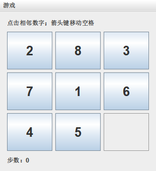

# Java零基础入门学习手册

# 前言

这本手册从“代码保存在哪里、谁来运行、结果为什么不同”开始，用可运行的小程序建立直觉，再把类型、对象、集合、文件、并发和网络连接成完整工具。你不需要先会Java、JavaScript或Python；其他语言对照放在Java规则解释之后，可以跳过。

学完主线，你应能独立配置JDK、编译运行程序、解释数据与引用关系、选择集合、维护对象约束、处理错误和资源，并完成一个能跨次保存数据、拒绝损坏文件且带行为测试的任务管理命令行工具。进阶章节帮助你看懂线程、网络、反射、JVM和版本差异，不要求第一遍就熟练实现所有算法。

**准备清单。** 一台适合所选发行版的电脑、JDK 21、UTF-8编辑器和终端即可开始。IDE是辅助工具，不替代实际JDK选择；Maven与第三方库到第32—33章再准备。Swing实际窗口需要图形桌面，模型测试可先单独运行。联网只在下载工具依赖和查阅资料时需要；本机网络例子自行创建回环服务。

**版本基线。** 主线以Java SE/JDK 21正式特性为准，默认不启用预览。第41章专门介绍8、11、17、21及中间版本的主要演进，区分首次正式版本与后续可用范围；21预览实验独立标识。代码在新JDK编译为旧目标，并不自动证明已经在旧运行时验证。

**阅读路线。** 第1—10章学运行和语法，第11—19章学对象与常用API，第20—26章学集合并完成内存项目，第27—33章学文件与开发工具，第34—40章学并发、网络和机制，第41章整理版本地图，第42章是桌面GUI选修，第43章完成持久化项目，第44—47章练习、对照、速查与复习。第23章扩展算法也可先了解后回读。

**源码与结果。** `C08E02` 是第8章内的稳定示例编号；编号用于识别，补充示例按知识依赖插入，不要求按编号大小阅读。每个例子保存到自己的目录，同名Demo.java之间互不替换、不要全部放进一个目录共同编译。java围栏是源码，powershell/bash是终端命令，text是输出或示意图；输出块不能当程序执行。多文件例子逐个列出文件；复用前节文件时会说明。路径、PID、时间、调度等可变结果已注明，固定输出可逐行核对，行末空格和平台换行不作为学习目标。

普通单文件示例可采用以下命令；入口类、包路径、断言开关、预览选项和命令行参数以相应示例说明为准：

```powershell
javac -encoding UTF-8 --release 21 -d classes Demo.java
java -cp classes Demo
```

正文包含完整教学源码、输入、参数和特殊运行方式。JavaScript/Python对照另有各自语言标识，不混入Java编译命令。

**练习方法。** 先预测，再运行，再只修改一个条件；错误记录写输入、预期、实际和位置。故意失败的代码会标明错误示范，不能把它直接当作正常实现。章末练习提供答案或明确检查方法；速查表用于定位，不代替理解求值、状态变化与失败边界。

图示只在帮助理解时使用，以可直接阅读的text图说明编译、引用、协作和数据流。版本事实以目标规范、API和官方指南为准；教学约定会与普遍规则区分。

# 目录

1. [第1章 从零认识程序、Java与学习方法](#第1章-从零认识程序java与学习方法):理解程序、工具与阅读路线。
2. [第2章 准备JDK 21与开发环境](#第2章-准备jdk-21与开发环境):确认JDK、终端与IDE。
3. [第3章 第一个Java程序与编译运行过程](#第3章-第一个java程序与编译运行过程):保存、编译、运行并定位错误。
4. [第4章 变量、基本类型与类型转换](#第4章-变量基本类型与类型转换):认识值、变量、类型与转换。
5. [第5章 运算符、精度与比较](#第5章-运算符精度与比较):分析计算、比较及边界。
6. [第6章 输入输出与条件判断](#第6章-输入输出与条件判断):读取输入并选择执行路径。
7. [第7章 循环、随机数与问题拆解](#第7章-循环随机数与问题拆解):控制重复、随机与终止。
8. [第8章 数组、二维数组与引用关系](#第8章-数组二维数组与引用关系):理解固定序列、嵌套与共享。
9. [第9章 方法、参数传递与递归](#第9章-方法参数传递与递归):组织输入输出并理解调用。
10. [第10章 字符串、字符编码与文本处理](#第10章-字符串字符编码与文本处理):处理文字、编码和内容比较。
11. [第11章 类、对象、封装与构造方法](#第11章-类对象封装与构造方法):建立对象并维护状态约束。
12. [第12章 static、包、访问权限与初始化](#第12章-static包访问权限与初始化):组织类级状态、名字和权限。
13. [第13章 继承、多态、抽象类与接口](#第13章-继承多态抽象类与接口):用类型契约表达不同实现。
14. [第14章 内部类、枚举与现代数据建模](#第14章-内部类枚举与现代数据建模):选择嵌套类、枚举与数据模型。
15. [第15章 Object、相等契约与对象复制](#第15章-object相等契约与对象复制):定义相等并控制共享关系。
16. [第16章 包装类、数值与常用工具API](#第16章-包装类数值与常用工具api):选择数值类型与计算规则。
17. [第17章 日期、时间、时区与格式化](#第17章-日期时间时区与格式化):区分日期、时间点与时区。
18. [第18章 正则表达式与文本校验](#第18章-正则表达式与文本校验):描述文字模式并验证格式。
19. [第19章 异常、断言与资源管理](#第19章-异常断言与资源管理):表达失败并可靠关闭资源。
20. [第20章 泛型、集合框架与迭代](#第20章-泛型集合框架与迭代):把元素类型和迭代规则写清。
21. [第21章 List、Queue、Deque与有序集合接口](#第21章-listqueuedeque与有序集合接口):选择位置序列、队列与首尾操作。
22. [第22章 Set、Map、排序与集合工具](#第22章-setmap排序与集合工具):去重、映射、排序与复制。
23. [第23章 数据结构、算法与复杂度](#第23章-数据结构算法与复杂度):解释结构、增长趋势和算法前提。
24. [第24章 Lambda、函数式接口与方法引用](#第24章-lambda函数式接口与方法引用):传递行为并辨认求值时机。
25. [第25章 Stream、Collector与Optional](#第25章-streamcollector与optional):组合数据管道与缺失结果。
26. [第26章 阶段项目：内存任务管理工具](#第26章-阶段项目内存任务管理工具):整合内存任务CRUD。
27. [第27章 Path、File与目录操作](#第27章-pathfile与目录操作):处理路径、目录与文件状态。
28. [第28章 字节流、字符流与缓冲](#第28章-字节流字符流与缓冲):区分字节、文字与缓冲。
29. [第29章 扩展IO、对象序列化与配置](#第29章-扩展io对象序列化与配置):明确数值、对象、配置和压缩格式。
30. [第30章 XML结构、解析与约束](#第30章-xml结构解析与约束):解析、生成和约束结构化文档。
31. [第31章 项目组织、资源、JAR与模块](#第31章-项目组织资源jar与模块):拆文件、加载资源、打包与模块。
32. [第32章 Maven与依赖管理](#第32章-maven与依赖管理):管理构建和第三方依赖。
33. [第33章 日志、调试与自动化测试](#第33章-日志调试与自动化测试):记录现场、调试与重复检查。
34. [第34章 线程、同步与内存可见性](#第34章-线程同步与内存可见性):维护线程协作和共享状态。
35. [第35章 线程池、Future与并发工具](#第35章-线程池future与并发工具):限制执行资源并组合任务结果。
36. [第36章 JDK 21虚拟线程](#第36章-jdk-21虚拟线程):使用等待型任务的轻量线程。
37. [第37章 网络基础、TCP、UDP与HTTP](#第37章-网络基础tcpudp与http):定义本机通信、协议和超时。
38. [第38章 网络实践：本机多人聊天室](#第38章-网络实践本机多人聊天室):完成注册、登录、广播与清理。
39. [第39章 反射、注解与动态代理](#第39章-反射注解与动态代理):检查类型、读取元数据与代理调用。
40. [第40章 类加载、JVM与运行问题排查](#第40章-类加载jvm与运行问题排查):用运行时证据定位问题。
41. [第41章 JDK 8、11、17、21：特性演进与版本选择](#第41章-jdk-8111721特性演进与版本选择):建立主要版本特性与迁移地图。
42. [第42章 Swing与事件驱动编程（选修）](#第42章-swing与事件驱动编程选修):通过拼图认识事件与EDT。
43. [第43章 综合项目：可持久化的任务管理工具](#第43章-综合项目可持久化的任务管理工具):整合持久化、命令与失败检查。
44. [第44章 分层练习与课程典型案例](#第44章-分层练习与课程典型案例):分层练习典型问题。
45. [第45章 Java与JavaScript、Python的系统对照](#第45章-java与javascriptpython的系统对照):辨认三种语言的迁移差异。
46. [第46章 语法、API与开发命令速查](#第46章-语法api与开发命令速查):快速定位常用操作与命令。
47. [第47章 知识回顾、阶段验收与参考资料](#第47章-知识回顾阶段验收与参考资料):回顾误区、验收能力并查官方资料。

---


# 第1章 从零认识程序、Java与学习方法

学习本书不需要先会另一门语言。你需要一台能运行JDK 21的电脑、一个编辑器，以及愿意先预测再运行的耐心。本章先认识程序的输入、处理与输出；安装和运行命令在第2—3章实际完成。

## 1.1 把一个任务变成明确规则

程序是按规则处理数据的一组指令。输入是交给程序的数据，处理是对数据执行的步骤，输出是交还给使用者的结果。例如记录学习任务：输入标题，去掉首尾空白，拒绝空标题，然后保存。人能补全含糊要求，程序需要明确规则。

下面先观察一个最小程序。暂时把外层声明看作程序的容器，把`main`看作入口；[第3章](#第3章-第一个java程序与编译运行过程)逐个解释。`println`把括号中的内容显示在终端并换行。

示例 **C01E01**，文件 `Demo.java`。

```java
public class Demo {
    public static void main(String[] args) {
        System.out.println("输入：学习Java");
        System.out.println("处理：记录一项任务");
        System.out.println("输出：已添加任务");
    }
}
```

预期输出：

```text
输入：学习Java
处理：记录一项任务
输出：已添加任务
```


先区别“打印了处理步骤”和“实际完成了处理”。C01E01只打印三行说明，没有读取标题、修改列表或保存文件。它帮助认识程序入口与输出；[第6章](#第6章-输入输出与条件判断)引入真实输入，[第26章](#第26章-阶段项目内存任务管理工具)才把一项任务真正加入集合。读代码时不能只看输出文字就推断业务已经发生。

## 1.2 语言、工具和运行环境

Java语言规定代码怎样写、怎样解释。编译器`javac`检查源代码并通常生成字节码文件；Java虚拟机（Java Virtual Machine，JVM）执行这种文件。Java开发工具包（Java Development Kit，JDK）包含编译、运行和诊断工具。运行时环境是执行程序所需的组件集合；现代JDK发行版通常不要求你再单独安装一个JRE。

标准库是JDK提供的常用代码，例如文字、集合和文件操作。第三方库需要额外引入。框架进一步约定应用如何组织与运行。不要把Java语言、JVM和某个Web框架混为一谈。

```text
Demo.java --javac编译--> Demo.class --java启动JVM--> 执行并输出
```

这张图说明常见开发流程，不表示JVM永远逐条解释字节码；实际运行还可能使用即时编译。


本书学习Java SE，即语言与标准平台的基础能力。企业应用、数据库和Web框架是建立在这些基础上的后续方向，不要求你先准备服务器。所谓跨平台，是在目标系统有合适Java运行时、且程序使用的文件/网络/本地能力满足条件时运行同类字节码；不是任何安装包都能在任意CPU和操作系统直接打开。[第2章](#第2章-准备jdk-21与开发环境)的架构选择与[第41章](#第41章-jdk-8111721特性演进与版本选择)的兼容验证正是这些条件的具体体现。

## 1.3 文件、终端和程序状态

编辑器负责保存文本，终端接收系统命令，Java程序负责执行自己的代码。把`javac Demo.java`写进Java文件不会完成编译，因为它是终端命令。扩展名`.java`帮助工具识别源码，不会让文件自动运行。

程序运行时的数据通常先在内存里。进程结束后，内存中的任务列表不会自动留到下一次运行。保存到文件是另一个需要明确编写的动作。第26章先做内存工具，[第43章](#第43章-综合项目可持久化的任务管理工具)再实现持久化，也就是跨次运行保存和恢复数据。

## 1.4 怎样使用这本书

第1—10章建立语法基础，第11—19章学习对象与常用API，第20—26章完成内存项目，第27—33章建立文件与开发工具能力，第34—40章学习并发、网络和机制，第41章整理版本地图，[第42章](#第42章-swing与事件驱动编程选修)为GUI选修，第43—47章综合实践与复习。

API是应用程序编程接口（Application Programming Interface），这里主要指别人提供的类和方法。第一次遇见API，先看它接收什么、返回什么、是否改变对象、可能怎样失败。

每个源码示例有唯一编号。先写预期，再运行，再只改一个条件；记录输入、预期、实际和错误位置。例子里的输出块、终端提示符和目录树不能复制到Java源码中。JavaScript/Python对照可以跳过，不影响主线。

## 1.5 动手练习与参考答案

1. 为“添加任务”写出三条规则。参考答案：去掉标题两端空白；空标题拒绝；成功时显示添加结果。是否跨次保存也应明确。
2. 把编译命令保存到Java文件，会执行编译吗？不会；应在终端执行。源码和终端命令由不同工具解析。

## 1.6 本章速查

| 场景或操作 | 写法与结果 | 边界 |
| :--- | :--- | :--- |
| 源码与命令 | 编辑区保存Java；终端执行命令 | 不要混贴 |
| 内存与文件 | 内存保存当前状态；文件用于跨次恢复 | 保存需要显式实现 |
| 学习顺序 | 预测→运行→单点修改→解释 | 不以背下输出为目标 |

# 第2章 准备JDK 21与开发环境

本章目标是确认编译器和运行器都是JDK 21。先完成终端中的最小运行，再配置IDE。发行版是不同组织构建、分发的JDK产品；先选择提供本机操作系统和CPU架构的21版本。

## 2.1 选择、安装与目录

从末章列出的官方发行渠道选择JDK 21。Windows可用安装包或解压版；macOS应区分Apple Silicon与Intel；Linux应选择发行版包或适合本机的归档。只安装来源明确、架构匹配的文件。解压版可以放在稳定目录，例如`C:\dev\jdk-21`，具体补丁号以实际下载为准。

JDK目录里的`bin`放可执行工具，`lib`放实现所需文件，`jmods`包含模块化分发文件；不要手工移动其中某个DLL来拼装环境。安装完成不等于终端已经选中这份JDK。


**第一次安装：以Windows解压版为完整操作路线。** 打开[Eclipse Temurin的JDK 21下载页](https://adoptium.net/temurin/releases/?version=21)，选择本机操作系统、CPU架构、JDK和21系列，下载ZIP归档。x64与ARM64不是文件大小的区别，应与电脑架构匹配。解压后找到真正含bin、lib等子目录的JDK根目录，将它放到稳定位置，例如C:\dev\jdk-21；如果归档多套了一层目录，应选择里面实际含bin的那层。

在文件管理器中检查bin下同时存在java.exe和javac.exe，再进行下一节的版本与路径验证。压缩包本身不能填写为JAVA_HOME，也不要只把bin里的一个exe复制出来。发行页提供摘要/签名时核对下载文件；不要用第三方“精简JDK”代替完整工具包。

Windows x64也可以使用官方MSI安装器：运行安装包，确认安装目录，按需要选择PATH和JAVA_HOME功能，安装后打开新终端检查。两项环境设置不是同一个功能；操作细节见[官方Windows安装说明](https://adoptium.net/installation/windows)。本书下面给出当前终端切换方法，已有旧项目的读者可以先用它确认，不必立刻改全局环境。

macOS选择匹配Apple Silicon或Intel的包，使用官方PKG或归档安装；Linux选择匹配架构的包/归档。下面的bash命令要求先把实际路径填好，不把Windows的C盘路径照搬过去。平台不同主要影响工具安装位置、shell和路径表示，Java源码仍按21基线编写。

**终端里先会四个动作。** PowerShell提示符通常以PS开头，cmd和bash不是同一套命令解释器。只输入代码块内命令，不输入提示符本身。以下命令创建并进入自己的练习目录，不删除内容：

```powershell
New-Item -ItemType Directory -Path 'C:\java-study' -Force | Out-Null
Set-Location -LiteralPath 'C:\java-study'
Get-Location
Get-ChildItem
```

应看到当前位置为C:\java-study；刚创建的空目录可能没有文件列表。`Set`-Location改变工作目录，Get-ChildItem查看当前目录，Clear-Host只清空终端显示而不删除文件。在cmd中类似操作是mkdir、cd /d、cd和dir；不要把cmd专用的cd /d粘到PowerShell。

```bash
mkdir -p "$HOME/java-study"
cd "$HOME/java-study"
pwd
ls
```

bash中pwd显示实际练习目录，ls查看文件。以后命令说“在项目根目录运行”，就是先用这些定位步骤确认当前位置。

## 2.2 在终端确认实际命令

Windows PowerShell中先检查版本和命令来源：
```powershell
java -version
javac -version
Get-Command java,javac | Select-Object Name,Source
```

两条版本命令都应显示21系列，路径应指向你选定的JDK。`java -version`可能把文字写入标准错误流，这是工具的输出约定，不代表执行失败。

`JAVA_HOME`约定指向JDK根目录；`PATH`是shell寻找可执行程序的目录列表。仅设置前者未必改变`java`的选择。下面只对当前PowerShell进程及其子进程选择JDK，不修改系统配置；路径先改成实际位置：
```powershell
$jdk21 = 'C:\dev\jdk-21'
$env:JAVA_HOME = $jdk21
$env:Path = "$jdk21in;$env:Path"
java -version
javac -version
```

macOS/Linux可在当前shell设置：
```bash
export JAVA_HOME="/实际的/jdk-21目录"
export PATH="$JAVA_HOME/bin:$PATH"
java -version
javac -version
command -v java
command -v javac
```

## 2.3 让程序报告运行环境

保存下面文件。[第3章](#第3章-第一个java程序与编译运行过程)给出编译运行步骤。`System.getProperty`根据属性名读取运行环境信息；这里的点号是属性名的一部分，不是文件路径。

示例 **C02E01**，文件 `Demo.java`。第一行应为21，后两行分别是运行JDK目录和当前工作目录，随环境变化。

```java
public class Demo {
    public static void main(String[] args) {
        System.out.println(System.getProperty("java.specification.version"));
        System.out.println(System.getProperty("java.home"));
        System.out.println(System.getProperty("user.dir"));
    }
}
```


不能通过看到路径里有“21”就断言运行版本正确；同时看第一行和工具版本。工作目录是相对路径的起点，并不一定是源码目录。

## 2.4 编辑器、IDE和多版本共存

IDE是集成开发环境（Integrated Development Environment）。IntelliJ IDEA把编辑、编译、调试等功能放到一起。创建普通Java项目时选JDK 21，语言级别使用21正式特性；本书主线不勾选预览。确认项目SDK、构建工具使用的JDK、运行配置使用的JDK一致。

多版本可以放在不同目录。旧项目继续使用旧JDK，新学习项目使用21；切换时重新检查终端与IDE。遇到“找不到javac”，优先确认装的是JDK、PATH和新终端；遇到“class file version”不兼容，检查编译目标与运行版本，见[第41章](#第41章-jdk-8111721特性演进与版本选择)。


**在IDE里完成同一个最小任务。** 从[官方Java项目入门说明](https://www.jetbrains.com/help/idea/creating-and-running-your-first-java-application.html)识别“新建项目、选择JDK、保存类、运行入口”的操作。新版说明可能默认演示更高版本的紧凑源文件；本书应选择JDK 21、普通Java `Class`，使用第3章给出的完整public class与`static` main，不切换到更高版本语法。

1. 新建Java项目，选择已安装的JDK 21目录；初次使用普通Java构建项目即可。
2. 在源码目录中新建名为Demo的Java类，复制第3章C03E01的完整源码；界面可能自动显示.java扩展名。
3. 点击main附近的运行入口。运行窗口应出现“你好，Java 21”和5；不要把IDE启动命令那一行当作程序输出。
4. 检查项目JDK、语言级别与运行配置都为21。若IDE正常而终端失败，分别核对两处工具选择，不能互相代替。

IDE的项目是一个工作单元；模块组织一组源码/依赖；包组织Java名字；类是具体类型。IDE模块不等于[第31章](#第31章-项目组织资源jar与模块)的Java平台模块。第一次可以采用“一个项目、一个IDE模块、一个src目录”。创建包/类后看目录树是否出现对应文件；重命名优先用重构功能，使引用一起更新。删除前检查是否还被其他例子使用，导入旧项目后重新确认JDK与构建配置。主手册每个Demo例子相互独立，不把所有同名类一起导入同一个源码目录。

## 2.5 动手练习与参考答案

1. `java`显示21而`javac`显示17，可以继续当作统一21环境吗？不可以；检查两个命令的实际路径。
2. 在目录A启动目录B中的程序，相对路径默认从哪里计算？通常从A，即工作目录；可用环境示例的第三行确认。

## 2.6 本章速查

| 场景或操作 | 写法与结果 | 边界 |
| :--- | :--- | :--- |
| 检查版本 | `java -version`、`javac -version` | 两者都确认 |
| 检查Windows路径 | `Get-Command java,javac` | IDE有独立配置 |
| 设置JAVA_HOME | 指向JDK根目录 | 不是bin目录 |
| 检查程序JDK | `java.specification.version` | 路径和补丁号会变化 |

# 第3章 第一个Java程序与编译运行过程

前置是[第2章](#第2章-准备jdk-21与开发环境)的JDK 21。学完后，你应能保存一个文件、编译、运行，并区分编译失败和运行失败。下面先逐个认识入口外壳，以后再深入类和方法。

## 3.1 逐个认识程序外壳

`class`声明类，即代码的一种组织单位。`public`表示公开；公共顶层类名应与文件名一致，含大小写。`main`是这里采用的启动入口。`static`让启动器无需先创建对象即可调用，`void`表示方法不返回值，`String[] args`接收命令行文字参数。它们的完整规则分别在方法、数组和对象章节展开。

花括号围出代码块，分号结束这里的语句。关键字大小写固定。英文引号用于字符串；中文引号不能代替语法符号。

示例 **C03E01**，文件 `Demo.java`。

```java
public class Demo {
    public static void main(String[] args) {
        // 注释向读者解释意图，不会成为输出。
        System.out.println("你好，Java 21");
        System.out.println(2 + 3);
    }
}
```

预期输出：

```text
你好，Java 21
5
```

## 3.2 从文件到运行结果

新建空目录，保存UTF-8编码的`Demo.java`。确认不是隐藏扩展名造成的`Demo.java.txt`。在该目录执行：
```powershell
javac -encoding UTF-8 --release 21 Demo.java
java -Dfile.encoding=UTF-8 -cp . Demo
```

第一步通常没有输出，成功后生成`Demo.class`；第二步输出示例文字。`-cp .`把当前目录放到类路径，`Demo`是类名，不带`.class`。`--release 21`选择21的语言和标准API基线。工具本身仍须支持这个目标。

也可直接启动源文件：
```powershell
java Demo.java
```

源文件启动会在运行过程中完成编译，适合小实验。学习编译产物和类路径时仍应练习前一种方式。

## 3.3 语句、表达式与参数

表达式计算一个值，例如`2 + 3`；语句完成一个动作，例如输出。Java按程序规定的控制流程执行，而不是所有文本从上到下无条件执行。下面的数组长度检查只为了让入口接受可选参数，[第6章](#第6章-输入输出与条件判断)解释判断，[第8章](#第8章-数组二维数组与引用关系)解释数组。

示例 **C03E02**，文件 `Demo.java`。

```java
public class Demo {
    public static void main(String[] args) {
        if (args.length == 0) {
            System.out.println("请传入一个名字");
        } else {
            System.out.println("你好，" + args[0]);
        }
    }
}
```

预期输出：

```text
你好，小林
```

```powershell
java -cp . Demo 小林
```

空格分隔参数，含空格的一个参数应按shell规则加引号。`//`是单行注释，`/* ... */`是块注释，`/** ... */`通常用于生成API文档；注释不会把不正确的程序自动修好。

## 3.4 按阶段定位错误

编译错误发生在生成可执行类文件之前，例如漏分号、拼错方法名或类型不匹配。运行时异常发生在程序已经启动之后，例如访问不存在的数组元素。逻辑错误则可能没有异常，只是答案不符合需求。

错误示范可以通过可控输入观察，而不需要破坏电脑环境：

示例 **C03E03**，文件 `Demo.java`。

```java
public class Demo {
    public static void main(String[] args) {
        int expected = 6;
        int actual = 2 + 3;
        System.out.println(actual == expected);
        try {
            Integer.parseInt("abc");
        } catch (NumberFormatException e) {
            System.out.println(e.getClass().getSimpleName());
        }
    }
}
```

预期输出：

```text
false
NumberFormatException
```


第一行展示结果不符合预期，第二行捕获文字转数字失败。`try/catch`会在[第19章](#第19章-异常断言与资源管理)系统解释；此处只观察“程序已启动、错误可定位”。排错时先看第一处有效编译错误，或异常类型、消息、栈中自己写的文件行号，再缩小输入。


**完整做一次编译排错。** 在C03E01中暂时删掉一个println行末的分号，保存并重新运行javac。编译应失败并指出源码位置；编译器的语言和具体提示可能随环境变化，先找第一处与你修改位置相关的错误。补回分号，再编译成功后运行，结果应恢复。

编译失败不会保证自动删除旧的Demo.class；如果此时直接java Demo，有可能看到上一次的程序结果。PowerShell可以按退出码只运行本次编译成功的产物：

```powershell
javac -encoding UTF-8 --release 21 Demo.java
if ($LASTEXITCODE -eq 0) {
    java -cp . Demo
}
```

$LASTEXITCODE是上一条本机程序的退出码，0表示本例编译成功。它是终端状态，不是Java变量。这一步把“保存→编译→确认成功→运行”的顺序变成可检查动作。

## 3.5 动手练习与参考答案

1. `public class Demo`保存为`demo.java`是否可靠？不可靠，应精确保存为`Demo.java`，避免平台大小写差异。
2. `java Demo.class`是前面类路径启动的正确命令吗？不是；使用`java -cp . Demo`。源文件启动则使用`java Demo.java`。
3. 把`2 + 3`的预期写成6属于什么问题？逻辑或需求预期问题；语法正确不代表业务正确。

## 3.6 本章速查

| 场景或操作 | 写法与结果 | 边界 |
| :--- | :--- | :--- |
| 编译 | `javac -encoding UTF-8 --release 21 Demo.java` | 先确认工作目录 |
| 运行类 | `java -cp . Demo` | 不带.class |
| 运行源文件 | `java Demo.java` | 适合小实验 |
| 传入参数 | `java -cp . Demo 小林` | 参数都是字符串 |

# 第4章 变量、基本类型与类型转换

变量是具有类型、名字和存储位置的程序元素。Java在编译时检查许多类型约束。本章从具体值开始认识类型；对象的内部结构留到[第11章](#第11章-类对象封装与构造方法)。

## 4.1 声明、初始化和八种基本类型

声明说明变量的类型和名字，初始化为它提供第一个值，赋值可以在规则允许时更新值。标识符区分大小写；建议类名用大驼峰，方法和变量用小驼峰，常量用大写下划线。关键字不能直接当普通变量名。

八种基本类型是`byte`、`short`、`int`、`long`、`float`、`double`、`char`、`boolean`。前四种是有符号整数，依次为8、16、32、64位；`char`是16位无符号UTF-16代码单元；浮点类型用二进制近似表示许多数值；`boolean`只有真和假，语言未规定它必须占某个固定存储字节数。

示例 **C04E01**，文件 `Demo.java`。

```java
public class Demo {
    public static void main(String[] args) {
        byte small = 100;
        short count = 2000;
        int total = 100_000;
        long distance = 3_000_000_000L;
        float ratio = 0.5F;
        double score = 95.25;
        char grade = 'A';
        boolean passed = true;
        System.out.println(small + "," + count + "," + total);
        System.out.println(distance);
        System.out.println(ratio + "," + score + "," + grade + "," + passed);
    }
}
```

预期输出：

```text
100,2000,100000
3000000000
0.5,95.25,A,true
```


整数默认通常按`int`解释，大整数后写`L`；浮点字面量默认`double`，写`float`时用`F`。下划线用于提高数字可读性，不能任意放在开头或小数点旁。单引号用于一个`char`，双引号用于字符串；一个可见符号可能需要两个`char`，[第10章](#第10章-字符串字符编码与文本处理)演示。


**先按用途选类型，再看边界。** 下面的默认值适用于对象字段/数组元素，不能用于声称局部变量未赋值也能读取。

| 类型 | 表示范围或用途 | 字段/数组元素默认值 |
| :--- | :--- | :--- |
| byte | -128到127的整数 | 0 |
| short | -32768到32767的整数 | 0 |
| int | -2147483648到2147483647的整数 | 0 |
| long | -2⁶³到2⁶³-1的整数 | 0L |
| float、double | 32/64位浮点表示，许多小数只有近似值 | 0.0 |
| char | 0到65535的UTF-16代码单元 | 数值为0的代码单元 |
| boolean | `true`或`false` | `false` |

普通计数先考虑int；计数可能超过其范围时考虑long，并同时检查运算的中间值。不是把所有变量改成double就能解决整数范围与精确性问题；第5、16章分别处理溢出与精确数值。

## 4.2 引用、null与局部变量

引用类型的变量保存引用值，可以指向对象，也可能是`null`，表示没有引用对象。`String`是引用类型。`null`不能赋给`int`等基本类型；访问空引用的实例方法会产生空指针异常。

示例 **C04E02**，文件 `Demo.java`。

```java
public class Demo {
    public static void main(String[] args) {
        String title = "学习Java";
        String missing = null;
        int done = 0;
        done = done + 1;
        System.out.println(title);
        System.out.println(missing == null);
        System.out.println(done);
    }
}
```

预期输出：

```text
学习Java
true
1
```


方法内的局部变量必须在使用前得到确定赋值；不能因为对象字段存在默认值，就推断局部变量也可直接读取。花括号中的局部声明通常不能在块外访问。JavaScript变量可重新绑定不同类型的值，Python名字也可绑定另一类型对象；Java的变量类型约束不会随赋值自动改变。

## 4.3 转换、提升与信息损失

把`int`赋给`long`通常可自动扩大；把较大范围整数缩小到`byte`需要显式转换。扩大并不保证完全精确：例如较大的`long`转`double`可能丢失整数精度。整数的小类型参加算术运算常提升为`int`。

示例 **C04E03**，文件 `Demo.java`。

```java
public class Demo {
    public static void main(String[] args) {
        int n = 130;
        long wide = n;
        byte narrow = (byte) n;
        byte a = 10;
        byte b = 20;
        int sum = a + b; // 结果类型提升为int。
        double quotient = (double) 5 / 2;
        System.out.println(wide);
        System.out.println(narrow);
        System.out.println(sum);
        System.out.println(quotient);
    }
}
```

预期输出：

```text
130
-126
30
2.5
```


强制转换表示要求按规则转换，不表示“保证数值合理”。`(double)(5 / 2)`先完成整数除法再转换，只会得到2.0。先决定在哪一步需要保留小数。

## 4.4 var与静态类型

`var`让编译器从初始化表达式推断局部变量类型，变量随后仍是静态类型。它不是JavaScript式的动态值容器，也不能替代字段类型或普通方法参数类型。

示例 **C04E04**，文件 `Demo.java`。

```java
public class Demo {
    public static void main(String[] args) {
        var title = "Java"; // 推断为String。
        var count = 2; // 推断为int。
        count += 3;
        System.out.println(title + ":" + count);
    }
}
```

预期输出：

```text
Java:5
```


错误示范：`var value = null;`没有足够的类型信息；`var count = 2; count = "two";`违反已经推断出的整数类型。二进制、八进制、十六进制字面量将在位运算示例中出现，不改变整数的本质。

## 4.5 动手练习与参考答案

1. `(double)(5 / 2)`与`(double)5 / 2`分别是多少？2.0和2.5；转换的位置不同。
2. `var name = "小林"`之后能赋值为数字1吗？不能，推断类型为`String`。
3. 解释130缩小到byte为何不是130。byte范围为-128到127，缩小转换保留低8位，结果为-126；需要限制范围时应先校验。

## 4.6 本章速查

| 场景或操作 | 写法与结果 | 边界 |
| :--- | :--- | :--- |
| 大整数 | `3_000_000_000L` | L大写便于识别 |
| 浮点转换 | 在除法之前转double | 不能恢复已经丢掉的小数 |
| 空引用 | `String s = null` | 基本类型不接受`null` |
| 类型推断 | `var n = 1` | 不是动态类型 |

# 第5章 运算符、精度与比较

前置是[第4章](#第4章-变量基本类型与类型转换)的类型。计算结果由运算符、操作数类型和求值顺序共同决定。先把复杂表达式拆开，确认中间值，再决定是否简写。

## 5.1 算术、连接与自增

`+ - * / %`分别用于常见算术；字符串参与`+`时会进行字符串连接。整数除法向零截断，余数的符号随被除数。赋值更新变量，复合赋值还包含隐式转换，因此不宜把它当作普通加法的任意替换。

示例 **C05E01**，文件 `Demo.java`。

```java
public class Demo {
    public static void main(String[] args) {
        System.out.println(5 / 2);
        System.out.println(-5 / 2);
        System.out.println(-5 % 2);
        System.out.println(1 + 2 + "项");
        System.out.println("项" + 1 + 2);
        int n = 3;
        int before = n++;
        int after = ++n;
        System.out.println(before + "," + after + "," + n);
        byte b = 1;
        b += 2; // 复合赋值包含向左侧类型的转换。
        System.out.println(b);
    }
}
```

预期输出：

```text
2
-2
-1
3项
项12
3,5,5
3
```


后置自增先提供旧值再更新，前置先更新再提供新值。业务代码中建议把更新独立成语句，避免把多个自增混在一个表达式里。Java对操作数求值顺序有规定，也不意味着难读的表达式值得采用。


**把自增的中间状态写出来。** 对本例的n，先给表达式提供值、再更新，和先更新、再提供值，会产生不同结果：

| 执行位置 | n当前值 | 接收变量得到什么 |
| :--- | :--- | :--- |
| 初始化n=3后 | 3 | before/after尚未赋值 |
| before=n++后 | 4 | before得到旧值3 |
| after=++n后 | 5 | after得到更新值5 |

所以那行输出为3,5,5。这个表不是说所有表达式都按“先扫一遍自增”执行，而是逐条遵循这两条语句本身的求值顺序。

## 5.2 溢出和浮点误差

普通整数加减乘溢出不会自动抛异常。`Math.addExact`在溢出时抛出算术异常，可用于需要拒绝溢出的计算。浮点近似会影响比较，不应把所有小数都当作精确十进制值。

示例 **C05E02**，文件 `Demo.java`。

```java
public class Demo {
    public static void main(String[] args) {
        int max = Integer.MAX_VALUE;
        System.out.println(max + 1);
        try {
            Math.addExact(max, 1);
        } catch (ArithmeticException e) {
            System.out.println("整数溢出");
        }
        System.out.println(0.1 + 0.2);
        System.out.println(0.1 + 0.2 == 0.3);
        double error = Math.abs((0.1 + 0.2) - 0.3);
        System.out.println(error < 1e-12);
    }
}
```

预期输出：

```text
-2147483648
整数溢出
0.30000000000000004
false
true
```


示例的容差只是本次量级下的教学约定，不是所有业务通用的精度规则。十进制金额与舍入在[第16章](#第16章-包装类数值与常用工具api)用`BigDecimal`讨论。Python普通整数可以增长到内存允许的规模，Java的int则有固定范围；不能直接迁移这种直觉。

## 5.3 比较、布尔条件和短路

比较运算产生`boolean`。Java的条件要求布尔值，不能用数字0或空字符串直接代替。`&&`与`||`短路：根据左侧结果决定是否求值右侧；`&`和`|`用于布尔值时会计算两侧。`!`取反，条件运算符`条件 ? 值1 : 值2`只求值被选中的分支。

示例 **C05E03**，文件 `Demo.java`。

```java
public class Demo {
    public static void main(String[] args) {
        String title = null;
        boolean valid = title != null && !title.isBlank();
        System.out.println(valid); // 右侧未求值，避免空引用访问。
        int count = 2;
        System.out.println(count > 0 ? "有任务" : "无任务");
        System.out.println(!(count == 0));
        System.out.println(3 < 5 && 5 < 10);
    }
}
```

预期输出：

```text
false
有任务
true
true
```


Java不能写数学式的`3 < x < 10`；应拆成两个比较再连接。JavaScript的truthy/falsy和Python的真值测试并不是Java条件的规则。引用相等和内容相等在第10、15章继续解释。

## 5.4 位运算与优先级

位运算按二进制位操作整数：`&`与、`|`或、`^`异或、`~`取反，`<<`左移、`>>`带符号右移、`>>>`无符号右移。二进制用`0b`前缀，十六进制用`0x`前缀；前导0的整数字面量可能表示八进制，日常十进制不要随意补前导0。

示例 **C05E04**，文件 `Demo.java`。

```java
public class Demo {
    public static void main(String[] args) {
        int read = 0b001;
        int write = 0b010;
        int permissions = read | write;
        System.out.println((permissions & write) != 0);
        System.out.println(permissions ^ write);
        System.out.println(1 << 3);
        System.out.println(-8 >> 1);
        System.out.println(-1 >>> 31);
        System.out.println(~0);
        System.out.println(1 << 32); // int移位距离只使用低5位。
        System.out.println(0x10 + 010);
    }
}
```

预期输出：

```text
true
1
8
-4
1
-1
1
24
```


这是教学用标志位，不等于完整权限系统。常见优先级是乘除高于加减、比较高于布尔连接；涉及位运算、条件运算或多个副作用时主动加括号。移位也可能溢出，不能把它当作无条件安全的乘除替代。

## 5.5 除零、非数值与移位边界

整数除零会抛算术异常；浮点除零按浮点规则产生无穷大或NaN（Not a Number，非数值）。NaN不等于自身，判断用Double.isNaN。int移位距离只看低5位，long看低6位，所以移32位不一定得到你直觉中的“全移出”。

示例 **C05E05**，文件 `Demo.java`。

```java
public class Demo {
    public static void main(String[] args) {
        int zero = 0;
        try {
            System.out.println(1 / zero);
        } catch (ArithmeticException e) {
            System.out.println("整数除零");
        }
        double nan = 0.0 / 0.0;
        System.out.println(1.0 / 0.0);
        System.out.println(nan == nan);
        System.out.println(Double.isNaN(nan));
        System.out.println(1 << 32);
        System.out.println(1L << 64);
        System.out.println(Math.abs(Integer.MIN_VALUE));
    }
}
```

预期输出：

```text
整数除零
Infinity
false
true
1
1
-2147483648
```

最后一行是另一个边界：最小int的正数绝对值超出int范围，因此不能把Math.abs(int)笼统理解为永远返回非负数。需要更大范围时先转long再处理。
## 5.6 动手练习与参考答案

1. `"结果" + 1 + 2`输出什么？结果12；若要得到结果3，应写`"结果" + (1 + 2)`。
2. `title != null & !title.isBlank()`能安全检查空引用吗？不能，单个`&`仍求值右边；应使用`&&`。
3. 预测`0x10 + 010`。十六进制16加八进制8，结果24。

## 5.7 本章速查

| 场景或操作 | 写法与结果 | 边界 |
| :--- | :--- | :--- |
| 整数除法 | `5 / 2`返回2 | 转换应发生在除法前 |
| 检查溢出 | `Math.addExact(a,b)` | 失败抛ArithmeticException |
| 短路 | `a && b`、`a \|\| b` | 右侧可能不执行 |
| 内容范围 | `x >= low && x <= high` | 不能链式比较 |

# 第6章 输入输出与条件判断

本章把固定数据改为用户输入。输入是一串文字，转成数字、验证范围、决定分支是不同步骤。示例接收标准输入；下面把输入文本和程序输出分开列出，终端可能回显你键入的文字。

## 6.1 整行读取和类型转换

`Scanner`可以从输入流读取内容。`System.in`是标准输入；`nextLine`读取一行文字但不包含行结束符，`Integer.parseInt`尝试把文字转为整数。`hasNextLine`可以判断是否还有一行。

示例 **C06E01**，文件 `Demo.java`。在独立练习目录保存、编译并运行；看到提示后输入数字3并回车。

本次标准输入：

```text
3
```

下面输出块只记录程序打印的文字，不包含终端回显的输入3。

```java
import java.util.Scanner;

public class Demo {
    public static void main(String[] args) {
        try (Scanner scanner = new Scanner(System.in)) {
            System.out.println("请输入任务数量：");
            if (!scanner.hasNextLine()) {
                System.out.println("没有输入");
                return;
            }
            String line = scanner.nextLine().strip();
            try {
                int count = Integer.parseInt(line);
                System.out.println("数量=" + count);
            } catch (NumberFormatException e) {
                System.out.println("请输入整数");
            }
        }
    }
}
```

预期输出：

```text
请输入任务数量：
数量=3
```


先读整行再转换，可以避免混用`nextInt`和`nextLine`时，后者立即读到前次数字后的换行。这里是独立小程序，关闭`Scanner`也会关闭它包装的标准输入；大型程序应统一管理输入所有权，不在多个方法中反复创建和关闭`Scanner`。

## 6.2 if分支与业务校验

格式正确不代表业务允许。数字能解析以后，仍要检查范围。`if/else if/else`从前往后选择第一条满足的分支；条件顺序会影响结果。大括号即使只有一条语句也建议保留。

示例 **C06E02**，文件 `Demo.java`。

```java
public class Demo {
    public static void main(String[] args) {
        int count = 3;
        if (count < 0) {
            System.out.println("数量不能为负");
        } else if (count == 0) {
            System.out.println("暂无任务");
        } else {
            System.out.println("待处理" + count + "项");
        }
        double rate = 0.75;
        System.out.printf(java.util.Locale.ROOT, "进度=%.1f%%%n", rate * 100);
    }
}
```

预期输出：

```text
待处理3项
进度=75.0%
```


`printf`使用格式串：`%.1f`保留一位小数用于显示，`%%`输出百分号，`%n`使用平台换行。指定`Locale.ROOT`固定本例小数点风格；它只影响显示，不把double变成精确小数。

## 6.3 switch语句与表达式

传统冒号分支可能向后贯穿，需要按需求写`break`；箭头分支不因省略break而贯穿。switch表达式产生一个值，所有可能路径应得到处理；块分支用`yield`交出值。JDK 21还支持模式匹配，见第14、41章。

示例 **C06E03**，文件 `Demo.java`。

```java
public class Demo {
    public static void main(String[] args) {
        int command = 2;
        switch (command) {
            case 1:
                System.out.println("添加");
                break;
            case 2:
                System.out.println("查询");
                break;
            default:
                System.out.println("未知命令");
        }
        String action =
                switch (command) {
                    case 1 -> "添加";
                    case 2, 3 -> "读取";
                    default -> {
                        String fallback = "帮助";
                        yield fallback;
                    }
                };
        System.out.println(action);
    }
}
```

预期输出：

```text
查询
读取
```


本例选择器是int。不要把新版switch概括为所有基本类型都可用：在21中long、float、double、boolean不能直接按普通基本类型选择器使用。字符串选择器遇到`null`也需要明确处理，不能假设default自动接住它。

## 6.4 观察nextInt与nextLine混用

nextInt读取数字令牌，通常把后面的换行留给后续读取。以下输入是第一行3、第二行Java；用isEmpty观察剩余换行形成的空行。主线推荐整行读取后明确解析，并非nextInt本身不能使用。

示例 **C06E04**，文件 `Demo.java`。

```java
import java.util.Scanner;

public class Demo {
    public static void main(String[] args) {
        try (Scanner scanner = new Scanner(System.in)) {
            System.out.println(scanner.nextInt());
            System.out.println(scanner.nextLine().isEmpty());
            System.out.println(scanner.nextLine());
        }
    }
}
```

预期输出：

```text
3
true
Java
```


## 6.5 动手练习与参考答案

1. 给C06E01输入`abc`，结果如何？提示请输入整数；输入结束而无行时提示没有输入。
2. 为什么格式合法的`-3`还需要校验？解析只解决文字能否表示整数，业务规则另外决定是否接受负数。
3. 把冒号switch的break删掉会怎样？匹配后可能继续执行后续分支；箭头分支则没有这种默认贯穿。

## 6.6 本章速查

| 场景或操作 | 写法与结果 | 边界 |
| :--- | :--- | :--- |
| 读整行 | `scanner.nextLine()` | 不会自动去掉所有空白 |
| 解析整数 | `Integer.parseInt(text)` | 可能抛NumberFormatException |
| 格式化 | `printf("%.1f%n", value)` | 格式和参数类型须匹配 |
| 块分支返回 | `yield value` | 不是方法的return |

# 第7章 循环、随机数与问题拆解

循环重复执行规则。本章重点是每次循环处理什么、状态如何变化以及何时结束。先用少量数据手算，再运行；不要一上来就把循环次数设得很大。

## 7.1 三种循环和终止条件

for适合明确计数，while在每次执行前检查条件，do-while先执行一次再检查。循环变量、累计变量和结束条件应分开考虑。`i < length`这样的半开区间通常比手动减一更清楚。

示例 **C07E01**，文件 `Demo.java`。

```java
public class Demo {
    public static void main(String[] args) {
        int sum = 0;
        for (int i = 1; i <= 5; i++) {
            sum += i;
        }
        int remaining = 2;
        while (remaining > 0) {
            remaining--;
        }
        int attempts = 0;
        do {
            attempts++;
        } while (attempts < 1);
        System.out.println(sum);
        System.out.println(remaining);
        System.out.println(attempts);
    }
}
```

预期输出：

```text
15
0
1
```


如果更新语句不能让条件最终变假，循环可能不结束。`while (true)`可以用于菜单循环，但必须有明确的退出路径。循环次数来自外部输入时还要限制工作量。


**手算一小段循环。** 若累计1到3，初始sum=0：i=1后sum=1，i=2后sum=3，i=3后sum=6；下一次检查i<=3为`false`才退出。条件、处理和更新缺一项，可能出现少算、多算或不结束。do-while在第一次判断前已经执行主体，所以即使初始条件不满足，也可能处理一次；不要只记三种循环的括号位置。

## 7.2 跳过、退出与嵌套

`continue`跳过本轮剩余步骤，`break`退出它所在的最近一层循环。嵌套循环中每个内层循环都可能执行多次，不能只看最外层的次数估算成本。

示例 **C07E02**，文件 `Demo.java`。

```java
public class Demo {
    public static void main(String[] args) {
        for (int i = 1; i <= 8; i++) {
            if (i % 2 == 0) {
                continue;
            }
            if (i > 5) {
                break;
            }
            System.out.print(i + " ");
        }
        System.out.println();
        for (int row = 1; row <= 2; row++) {
            for (int col = 1; col <= 3; col++) {
                System.out.print(row * col + " ");
            }
            System.out.println();
        }
    }
}
```

预期输出：

```text
1 3 5 
1 2 3 
2 4 6
```


输出行末的空格来自示例里的连接。带标签的break可以退出指定外层，但多数入门业务可通过提取方法和return表达清楚，避免堆叠标签。

## 7.3 随机数、范围与可复现性

伪随机数根据算法和内部状态产生。固定种子有利于复现实验；随机不意味着加密安全。`nextInt(bound)`返回从0到bound之前的整数，bound必须为正；要产生1到100，可在`nextInt(100)`之后加1。

示例 **C07E03**，文件 `Demo.java`。

```java
import java.util.Random;

public class Demo {
    public static void main(String[] args) {
        Random random = new Random(21);
        int target = random.nextInt(100) + 1;
        System.out.println(target >= 1 && target <= 100);
        int[] guesses = {0, 101, target};
        for (int guess : guesses) {
            if (guess < 1 || guess > 100) {
                System.out.println("超出范围");
                continue;
            }
            System.out.println(guess == target ? "猜中" : "继续");
            if (guess == target) {
                break;
            }
        }
    }
}
```

预期输出：

```text
true
超出范围
超出范围
猜中
```


这里的数组和增强for在下一章展开；你现在只需把guesses理解成按顺序提供的三次输入。固定种子用于学习，不用于密码或令牌。

## 7.4 从规则推导算法

判断正整数n是否为质数：n小于2直接否定；检查是否存在不超过平方根的因子：因子成对出现，如果两个因子都大于平方根，它们的积就会大于n，因此至少一个不超过平方根。为避免`d*d`的整数溢出，可以写`d <= n / d`。这里把可复用逻辑放进方法，[第9章](#第9章-方法参数传递与递归)系统讲方法声明。

示例 **C07E04**，文件 `Demo.java`。

```java
public class Demo {
    static boolean isPrime(int n) {
        if (n < 2) {
            return false;
        }
        for (int d = 2; d <= n / d; d++) {
            if (n % d == 0) {
                return false;
            }
        }
        return true;
    }

    public static void main(String[] args) {
        System.out.println(isPrime(1));
        System.out.println(isPrime(2));
        System.out.println(isPrime(49));
    }
}
```

预期输出：

```text
false
true
false
```


先列边界：负数、0、1、2、平方数，再检查普通输入。只验证一个质数无法证明判断过程覆盖了所有分支。

## 7.5 动手练习与参考答案

1. C07E01若把for条件改成`i < 5`，sum是多少？1+2+3+4=10。
2. `continue`会退出整个循环吗？不会，只跳过当前轮剩余步骤。
3. 用C07E04验证-1、0、2、9、17，结果应依次为`false`、`false`、`true`、`false`、`true`。

## 7.6 本章速查

| 场景或操作 | 写法与结果 | 边界 |
| :--- | :--- | :--- |
| 计数循环 | `for (int i=0; i<n; i++)` | n<=0时不执行 |
| 跳过本轮 | `continue` | while中别跳过必要更新 |
| 退出循环 | `break` | 默认只退出最近一层 |
| 随机范围 | `nextInt(100)+1` | 用于1到100 |

# 第8章 数组、二维数组与引用关系

数组是在固定长度的位置序列中保存同一种声明类型数据的对象。索引从0开始，最后一个有效索引是length-1。引用关系会影响复制、参数传递和集合，值得先画清楚。

## 8.1 创建、默认值与遍历

`new int[3]`创建长度3的数组，元素默认是0；布尔数组默认`false`，引用数组默认`null`。数组长度创建后不能改变，但元素通常可以修改。空数组长度为0；`null`则根本没有数组对象。

示例 **C08E01**，文件 `Demo.java`。

```java
import java.util.Arrays;

public class Demo {
    public static void main(String[] args) {
        int[] counts = new int[3];
        counts[1] = 5;
        System.out.println(Arrays.toString(counts));
        int sum = 0;
        for (int i = 0; i < counts.length; i++) {
            sum += counts[i];
        }
        for (int value : counts) {
            System.out.print(value + " ");
        }
        System.out.println();
        System.out.println(sum);
        System.out.println(new String[2].length);
    }
}
```

预期输出：

```text
[0, 5, 0]
0 5 0 
5
2
```


增强for将每次取得的元素值放到局部变量value；给value重新赋值不会替换原数组元素。需要按位置修改时用索引循环。`length`是数组字段，不写括号；字符串长度则调用`length()`。

## 8.2 共享、复制与内容比较

数组变量保存引用。`b = a`复制引用，两个名字指向同一个数组；`Arrays.copyOf`创建新数组并复制元素。基本类型元素的值被复制，引用元素的引用值被复制。

示例 **C08E02**，文件 `Demo.java`。

```java
import java.util.Arrays;

public class Demo {
    public static void main(String[] args) {
        int[] a = {1, 2, 3};
        int[] b = a;
        int[] c = Arrays.copyOf(a, a.length);
        b[0] = 9;
        System.out.println(Arrays.toString(a));
        System.out.println(Arrays.toString(c));
        System.out.println(a == b);
        System.out.println(a == c);
        System.out.println(Arrays.equals(c, new int[] {1, 2, 3}));
        int[] expanded = Arrays.copyOf(c, 5);
        System.out.println(Arrays.toString(expanded));
    }
}
```

预期输出：

```text
[9, 2, 3]
[1, 2, 3]
true
false
true
[1, 2, 3, 0, 0]
```


```text
a ──┐
    ├──> 数组对象 [9, 2, 3]
b ──┘
c ─────> 数组对象 [1, 2, 3]
```

图表达共享对象，不代表真实内存地址布局。JavaScript数组和Python列表通常可以变长；Java数组扩容实质上需要另建数组并处理引用。[第21章](#第21章-listqueuedeque与有序集合接口)介绍可变大小的`List`。

## 8.3 二维数组与嵌套复制

Java二维数组是“元素为数组引用的数组”，每行长度可以不同，也可能为`null`。外层复制不会自动复制每个内层数组。

示例 **C08E03**，文件 `Demo.java`。

```java
import java.util.Arrays;

public class Demo {
    public static void main(String[] args) {
        int[][] grid = {{1, 2}, {3}};
        int[][] shallow = grid.clone();
        shallow[0][0] = 8;
        System.out.println(Arrays.deepToString(grid));
        int[][] independent = new int[grid.length][];
        for (int i = 0; i < grid.length; i++) {
            independent[i] = grid[i].clone();
        }
        independent[0][0] = 7;
        System.out.println(Arrays.deepToString(grid));
        System.out.println(Arrays.deepToString(independent));
        int total = 0;
        for (int[] row : grid) {
            for (int value : row) {
                total += value;
            }
        }
        System.out.println(total);
    }
}
```

预期输出：

```text
[[8, 2], [3]]
[[8, 2], [3]]
[[7, 2], [3]]
13
```


本例每行已知非`null`；通用复制逻辑还要处理`null`行。`clone`在数组上创建同长度的新数组，但元素为引用时仍共享指向的对象。[第15章](#第15章-object相等契约与对象复制)继续讨论对象图中的深复制。


**按创建新对象的层数核对结果。** C08E03的执行顺序容易看漏：先让shallow与grid共享行数组，把第一项改为8；之后才复制当前每一行。因此independent的初始第一项也是8，再把它改成7。

| 时刻 | grid第一行 | shallow第一行 | independent第一行 |
| :--- | :--- | :--- | :--- |
| 刚clone外层 | [1, 2] | 与grid同一行 | 尚未创建 |
| shallow[0][0]=8后 | [8, 2] | [8, 2] | 尚未创建 |
| 每行单独clone后 | [8, 2] | [8, 2] | 独立的[8, 2] |
| independent[0][0]=7后 | [8, 2] | [8, 2] | [7, 2] |

最后累计grid得到8+2+3=13。二维数组“复制过一次”还不足以判断独立性，应画出每一层引用是否仍指向同一个对象。

## 8.4 常见工具和错误

`Arrays.sort`原地排序，`fill`原地填充，`copyOfRange`创建区间副本且右端不含在内。`System.arraycopy`在给定位置间复制，不会自动扩容。二分查找要求数组按相同顺序有序，[第23章](#第23章-数据结构算法与复杂度)展开。

示例 **C08E04**，文件 `Demo.java`。

```java
import java.util.Arrays;

public class Demo {
    public static void main(String[] args) {
        int[] data = {3, 1, 2};
        Arrays.sort(data);
        int[] middle = Arrays.copyOfRange(data, 1, 3);
        int[] target = new int[4];
        System.arraycopy(data, 0, target, 1, data.length);
        Arrays.fill(target, 0, 1, 9);
        System.out.println(Arrays.toString(data));
        System.out.println(Arrays.toString(middle));
        System.out.println(Arrays.toString(target));
        try {
            System.out.println(data[data.length]);
        } catch (ArrayIndexOutOfBoundsException e) {
            System.out.println("索引越界");
        }
    }
}
```

预期输出：

```text
[1, 2, 3]
[2, 3]
[9, 1, 2, 3]
索引越界
```

## 8.5 动手练习与参考答案

1. 对数组做`b=a`以后修改b，会影响a吗？如果修改的是同一个数组的元素，会影响；若只是让b指向新数组，不改变a。
2. 二维数组只clone外层是否得到完全独立内容？不是，行数组仍共享。
3. 长度为0的数组可以访问索引0吗？不能；它是有效对象，但没有元素。

## 8.6 本章速查

| 场景或操作 | 写法与结果 | 边界 |
| :--- | :--- | :--- |
| 数组长度 | `a.length` | 不是length() |
| 显示内容 | `Arrays.toString(a)` | 二维用deepToString |
| 比较内容 | `Arrays.equals(a,b)` | 二维可用deepEquals |
| 独立外层 | `Arrays.copyOf(a,n)` | 引用元素仍可能共享 |
| 区间副本 | `copyOfRange(a,from,to)` | 右端不包含 |

# 第9章 方法、参数传递与递归

方法把一组步骤命名，定义输入、输出和失败条件。前置是变量、分支、循环与数组。你应能解释一次调用怎样把实参交给形参，以及修改对象与重新赋值的区别。

## 9.1 输入、处理与返回

方法声明包含返回类型、方法名和形参列表。调用处提供的是实参；方法内接收的是形参。`return`结束当前方法，可按返回类型交出一个值；void方法不返回值。局部变量属于本次调用，方法不能在普通方法内部再声明另一个普通方法。

示例 **C09E01**，文件 `Demo.java`。

```java
public class Demo {
    static int countPositive(int[] values) {
        int count = 0;
        for (int value : values) {
            if (value > 0) {
                count++;
            }
        }
        return count;
    }

    public static void main(String[] args) {
        int result = countPositive(new int[] {-1, 0, 3, 4});
        System.out.println(result);
        System.out.println(countPositive(new int[0]));
    }
}
```

预期输出：

```text
2
0
```


这个方法约定数组非`null`。调用者若可能传`null`，应先决定是拒绝还是把它当空数组，不能一处当空、一处报错。方法名描述行为，比通过输出顺便返回结果更便于复用。

## 9.2 Java始终按值传递

调用时把实参值复制给形参。基本类型复制数值；引用类型复制引用值，所以两者仍可指向同一对象。方法给形参重新赋值只改变本地形参，不会替换调用者变量。

示例 **C09E02**，文件 `Demo.java`。

```java
import java.util.Arrays;

public class Demo {
    static void changeNumber(int n) {
        n = 99;
    }

    static void changeArray(int[] values) {
        values[0] = 9; // 通过复制的引用访问同一数组。
        values = new int[] {7, 7}; // 仅重绑定形参。
    }

    public static void main(String[] args) {
        int n = 1;
        int[] data = {1, 2};
        changeNumber(n);
        changeArray(data);
        System.out.println(n);
        System.out.println(Arrays.toString(data));
    }
}
```

预期输出：

```text
1
[9, 2]
```


“对象按引用传递”容易误导，因为它常让人误以为方法可以直接替换调用者的变量。准确说法是传递引用值的副本。JavaScript和Python也需要区分修改共享对象与重新绑定局部名字。


```text
调用前                    进入changeArray后
data ──> 数组A[1,2]       data   ──> 数组A[1,2]
                         values ──> 数组A[1,2]

values[0]=9               values重新指向新数组后
data   ──> 数组A[9,2]     data   ──> 数组A[9,2]
values ──> 数组A[9,2]     values ──> 数组B[7,7]
```

A、B只是图中的对象标记，不是实际内存地址。调用结束后局部形参values不再由该调用使用，调用者data仍引用A，所以打印[9, 2]。changeNumber中的n同样是本次调用的局部副本，改成99不改变main中的1。

## 9.3 重载、可变参数和选择

同名方法可用不同形参列表形成重载，不能只靠返回类型区分。重载选择主要根据编译时看到的参数类型和适用规则；这不同于[第13章](#第13章-继承多态抽象类与接口)的实例方法重写。可变参数在方法内部表现为数组，只能有一个且必须位于最后。

示例 **C09E03**，文件 `Demo.java`。

```java
public class Demo {
    static String label(int value) {
        return "int:" + value;
    }

    static String label(long value) {
        return "long:" + value;
    }

    static int sum(int... values) {
        int result = 0;
        for (int value : values) {
            result += value;
        }
        return result;
    }

    public static void main(String[] args) {
        System.out.println(label(2));
        System.out.println(label(2L));
        System.out.println(sum());
        System.out.println(sum(1, 2, 3));
        System.out.println(sum(new int[] {4, 5}));
    }
}
```

预期输出：

```text
int:2
long:2
0
6
9
```


重载过多可能使`null`等调用歧义。Java没有普通方法参数的默认值语法；可以用明确的重载或配置对象表达默认行为。给可变参数传`null`也不同于不传参数：前者可能让内部遍历失败。

## 9.4 递归、调用栈与边界

递归是方法直接或间接调用自身。每次调用有自己的局部状态，调用栈记录返回位置。必须有终止条件，且每次朝终止条件推进。Java不保证尾递归优化，深递归可能耗尽栈。

示例 **C09E04**，文件 `Demo.java`。

```java
public class Demo {
    static long factorial(int n) {
        if (n < 0 || n > 20) {
            throw new IllegalArgumentException("仅支持0到20");
        }
        if (n <= 1) {
            return 1;
        }
        return n * factorial(n - 1);
    }

    static long factorialLoop(int n) {
        if (n < 0 || n > 20) {
            throw new IllegalArgumentException("仅支持0到20");
        }
        long result = 1;
        for (int i = 2; i <= n; i++) {
            result *= i;
        }
        return result;
    }

    public static void main(String[] args) {
        System.out.println(factorial(0));
        System.out.println(factorial(5));
        System.out.println(factorialLoop(5));
    }
}
```

预期输出：

```text
1
120
120
```


上限20是为long的数值范围设定的教学边界。对大量线性步骤，循环通常更直接；对树等递归结构，递归可能更接近问题定义，但仍须考虑深度。


调用栈帮助记住“这次返回后继续哪里”。以阶乘3为例，第三层的终止条件先返回1，上一层才能算2×1，再回到第一层算3×2。每层的n与返回位置独立；若没有规模缩小，即使方法写了一个看起来正确的终止判断，也可能永远到不了那里。

## 9.5 动手练习与参考答案

1. C09E02中把`values[0]=9`删掉，结果如何？数组仍为[1, 2]；形参重新绑定不会替换调用者引用。
2. `sum()`的数组长度是多少？0；结果为0。
3. 为什么阶乘示例拒绝21？21!超出long可精确表示的整数范围，普通乘法可能溢出。

## 9.6 本章速查

| 场景或操作 | 写法与结果 | 边界 |
| :--- | :--- | :--- |
| 返回值 | `return result` | 类型必须兼容 |
| 方法重载 | 同名，不同参数列表 | 不能仅改返回类型 |
| 可变参数 | `int... values` | 最后一个参数 |
| 按值传递 | 复制数值或引用值 | 共享对象仍可被修改 |
| 递归 | 终止条件+规模缩小 | 考虑深度与数值范围 |

# 第10章 字符串、字符编码与文本处理

文字既有抽象字符，也有内存表示和文件字节。前置是数组与方法。本章先学常用文本操作，再解释为什么一个可见符号不一定等于一个char。

## 10.1 不可变性和内容比较

`String`对象一旦创建，其字符序列不因普通API调用而改变。变量可以重新指向另一个`String`。`==`比较引用值是否相同，`equals`比较`String`内容；字符串常量池可能让部分相同字面量共享对象，但不能依赖它判断内容。

示例 **C10E01**，文件 `Demo.java`。

```java
import java.util.Objects;

public class Demo {
    public static void main(String[] args) {
        String a = "Java";
        String b = new String("Java");
        String c = a.replace("J", "L");
        System.out.println(a == b);
        System.out.println(a.equals(b));
        System.out.println(a);
        System.out.println(c);
        String missing = null;
        System.out.println(Objects.equals(missing, "Java"));
        System.out.println("Java".equals(missing));
    }
}
```

预期输出：

```text
false
true
Java
Lava
false
false
```


`Objects.equals`可比较可能为空的两个引用。JavaScript字符串的`===`不能直接迁移为Java字符串的`==`。不要通过反射修改`String`内部字段来“证明可变”，那会破坏标准库契约和强封装边界。

## 10.2 索引、空白、分割与连接

`String`索引以UTF-16代码单元计数，区间通常左闭右开。`strip`按Unicode空白规则去两端空白，`trim`采用较早的字符范围规则；`isEmpty`判断长度为0，`isBlank`判断空串或全为空白。`split`参数是正则表达式，不是普通分隔字符串。

示例 **C10E02**，文件 `Demo.java`。

```java
import java.util.Arrays;
import java.util.Locale;

public class Demo {
    public static void main(String[] args) {
        String title = "  Learn Java  ".strip();
        System.out.println(title);
        System.out.println(title.length());
        System.out.println(title.charAt(0));
        System.out.println(title.substring(0, 5));
        System.out.println(title.contains("Java"));
        System.out.println(title.indexOf("Python"));
        System.out.println(title.toLowerCase(Locale.ROOT));
        System.out.println(Arrays.toString("a.b.".split("\\.", -1)));
        System.out.println(String.join("/", "Java", "基础"));
        System.out.println(" ".isEmpty() + "," + " ".isBlank());
    }
}
```

预期输出：

```text
Learn Java
10
L
Learn
true
-1
learn java
[a, b, ]
Java/基础
false,true
```


split的第二个参数-1保留末尾空字段；默认行为会去掉末尾空字段。Java源码和正则各有转义规则，所以字面点号写成`"\\."`。固定标识符大小写转换建议显式使用ROOT区域；自然语言文字处理可能需要目标地区规则。


**练习读API契约。** 对substring(from,to)，先看两个位置都按本字符串的索引解释，返回新的区间内容，右端不包含；再看越界时会失败。不要只凭方法名猜“截几个字符”。以Java为例，substring(1,3)得到av，不是从1开始取3个。

查[JDK 21的String文档](https://docs.oracle.com/en/java/javase/21/docs/api/java.base/java/lang/String.html)时，依次看方法签名、参数、返回值、异常与版本说明，再回到本节源码运行；重载方法要确认参数个数与类型。方法清单能帮助查找，但不能替代对这次调用的输入输出推理。

## 10.3 构建文本、格式化与文本块

反复连接很多片段时可用可变的`StringBuilder`，最后调用`toString`得到`String`。`StringBuilder`不提供通用线程安全保证；不要把共享构建器当作并发容器。文本块是多行字符串写法，仍是`String`。

示例 **C10E03**，文件 `Demo.java`。

```java
public class Demo {
    public static void main(String[] args) {
        StringBuilder builder = new StringBuilder();
        builder.append("Java").append('-').append(21);
        builder.insert(0, "学习:");
        System.out.println(builder.toString());
        System.out.println(new StringBuilder("abc").reverse());
        String block =
                """
                第一行
                第二行
                """;
        System.out.print(block);
        System.out.println("任务:%s/%d".formatted("Java", 2));
        System.out.println("哈".repeat(3));
    }
}
```

预期输出：

```text
学习:Java-21
cba
第一行
第二行
任务:Java/2
哈哈哈
```


文本块的开头分隔符后需要换行，缩进和结束分隔符会影响内容；本例结尾保留换行，因此用print。反转按代码单元实现的自定义算法容易拆开代理对，处理用户可见字符还可能涉及组合字符与字素簇，不应只凭length猜显示宽度。


**分隔符、前后缀交给`StringJoiner`。** `StringBuilder`适合逐片段构建；`StringJoiner`把“元素之间插什么、整体前后放什么”作为构造参数。add会处理元素之间的分隔符，不需要自己判断是不是第一个元素；length观察最终表示的代码单元长度。展示脱敏也仍是字符串处理，并不会让原值消失。下面手机号是已知的11位示例数据，只演示切片，真实外部输入需先校验格式。

示例 **C10E05**，文件 `Demo.java`。

```java
import java.util.StringJoiner;

public class Demo {
    public static void main(String[] args) {
        StringJoiner joined = new StringJoiner(", ", "[", "]");
        joined.add("Java").add("IO");
        System.out.println(joined);
        System.out.println("长度一致=" + (joined.length() == joined.toString().length()));
        StringJoiner empty = new StringJoiner(", ").setEmptyValue("暂无项目");
        System.out.println(empty);
        String phone = "13800138000";
        System.out.println(phone.substring(0, 3) + "****" + phone.substring(7));
        System.out.println("bad news".replace("bad", "***"));
        System.out.println("原手机号长度=" + phone.length());
    }
}
```

预期输出：

```text
[Java, IO]
长度一致=true
暂无项目
138****8000
*** news
原手机号长度=11
```

## 10.4 Unicode、码点与UTF-8

Unicode给字符分配码点；UTF-16和UTF-8是编码表示方式。Java的char为一个UTF-16代码单元，辅助平面字符需要一对代理代码单元。UTF-8把文本编码成字节序列，字节数与char数量不是同一个概念。

示例 **C10E04**，文件 `Demo.java`。

```java
import java.nio.charset.StandardCharsets;
import java.util.Arrays;

public class Demo {
    public static void main(String[] args) {
        String text = "A中😀";
        System.out.println(text.length());
        System.out.println(text.codePointCount(0, text.length()));
        byte[] bytes = text.getBytes(StandardCharsets.UTF_8);
        System.out.println(bytes.length);
        System.out.println(new String(bytes, StandardCharsets.UTF_8));
        int[] points = text.codePoints().toArray();
        System.out.println(Arrays.toString(points));
    }
}
```

预期输出：

```text
4
3
8
A中😀
[65, 20013, 128512]
```


最后一行使用流把码点收集成数组，[第25章](#第25章-streamcollector与optional)展开；此处观察每个码点的整数值。乱码常来自读写编码不一致，JDK 21默认字符集为UTF-8也不意味着旧文件已经是UTF-8。文件边界仍建议显式声明编码。


对本例A中😀，可以把三种计量并排核对：

| 内容 | UTF-16代码单元数 | Unicode码点数 | UTF-8字节数 |
| :--- | :--- | :--- | :--- |
| A | 1 | 1 | 1 |
| 中 | 1 | 1 | 3 |
| 😀 | 2 | 1 | 4 |
| 合起来 | 4 | 3 | 8 |

这里的三个码点恰好显示为三个可见符号；遇到组合标记或多个码点构成的表情时，码点数也不必等于用户眼中的字符数。文件大小按字节计算，字符串索引按代码单元解释，业务标题上限应另外声明口径。

## 10.5 动手练习与参考答案

1. `" ".isEmpty()`与`isBlank()`分别是什么？`false`和`true`。
2. 为什么`A中😀`的length是4？A和中各一个UTF-16代码单元，😀占两个；码点数是3。
3. 在C10E02删除split的-1，末尾空字段会怎样？默认会被丢弃，因此应按文件格式决定是否保留。

## 10.6 本章速查

| 场景或操作 | 写法与结果 | 边界 |
| :--- | :--- | :--- |
| 比较文字 | `a.equals(b)`、`Objects.equals(a,b)` | 后者可处理`null` |
| 截取 | `substring(from,to)` | 右端不包含，不能越界 |
| 空白 | `strip()`、`isBlank()` | 返回新值或判断值 |
| 分隔 | `split(regex,-1)` | 正则转义与末尾空字段 |
| 明确编码 | `getBytes(UTF_8)` | 字节数不等于字符数 |


**阶段验收。** 把 C10E04 的文本改为 `A`中，先预测 UTF-16 长度为 2、码点数为 2、UTF-8 字节数为 4，再运行核对。若不一致，分别检查字符串与编码。

# 第11章 类、对象、封装与构造方法

前面用几个变量描述一个任务，现在把相关数据与规则放到一起。类定义一种对象的结构和行为；对象是运行时创建的实例。先关注对象怎样保证自己的状态合理，再考虑继承。

## 11.1 从字段到对象行为

字段保存对象状态，实例方法通过某个对象调用。`new`创建对象并调用构造器。下面把Task和Demo放在同一个文件中，Task是非public顶层类，文件仍叫Demo.java。private字段只能由本类的相关代码直接访问，外部通过明确方法完成操作。

示例 **C11E01**，文件 `Demo.java`。

```java
class Task {
    private String title;
    private boolean completed;

    Task(String title) {
        setTitle(title);
    }

    String getTitle() {
        return title;
    }

    void setTitle(String title) {
        if (title == null || title.isBlank()) {
            throw new IllegalArgumentException("标题不能为空");
        }
        this.title = title.strip();
    }

    void complete() {
        completed = true;
    }

    String describe() {
        return title + ":" + completed;
    }
}

public class Demo {
    public static void main(String[] args) {
        Task first = new Task("  学习Java  ");
        Task second = new Task("练习数组");
        first.complete();
        System.out.println(first.describe());
        System.out.println(second.describe());
        System.out.println(first.getTitle());
    }
}
```

预期输出：

```text
学习Java:true
练习数组:false
学习Java
```


每个对象有独立的实例字段，first完成不会自动完成second。`this.title`表示当前对象的字段，右边title是参数。封装不是机械地给所有字段生成setter，而是把允许的状态变化集中到方法里。完成操作由complete表达，比外部随意改字段更清楚。


**先画出对象要保护的规则。** 一个Task不能把“标题已经空了，稍后再修好”作为正常状态。构造和setTitle都走标题检查，complete只改变完成状态；调用者因此不必记住“改完某个字段后还要补哪一步”。新增行为时先写状态变化，例如“完成前`false`、完成后`true`、再完成仍`true`”，再决定方法名和实现。

## 11.2 构造器与初始化约束

构造器与类同名，没有返回类型，负责建立初始状态。没有声明任何构造器时，编译器才会提供默认的无参构造器；声明了有参构造器后，不会顺便再送一个无参构造器。重载构造器可以用`this(...)`复用初始化，本书按21规则把这类调用放在构造器第一条语句。

示例 **C11E02**，文件 `Demo.java`。

```java
class Notebook {
    private final String name;
    private int pages;

    Notebook(String name) {
        this(name, 10);
    }

    Notebook(String name, int pages) {
        if (pages < 0) {
            throw new IllegalArgumentException("页数不能为负");
        }
        this.name = name;
        this.pages = pages;
    }

    String describe() {
        return name + ":" + pages;
    }
}

public class Demo {
    public static void main(String[] args) {
        System.out.println(new Notebook("Java").describe());
        System.out.println(new Notebook("练习", 20).describe());
        try {
            new Notebook("错误", -1);
        } catch (IllegalArgumentException e) {
            System.out.println(e.getMessage());
        }
    }
}
```

预期输出：

```text
Java:10
练习:20
页数不能为负
```


`final`字段在本例中只被赋值一次；更完整的`final`规则见[第12章](#第12章-static包访问权限与初始化)。把检查写在对象创建入口，可以避免生成一个已经不合理、还要外部补救的对象。

## 11.3 局部变量、字段与共享引用

字段可以得到默认值，局部变量使用前必须确定赋值。两个局部变量也可以引用同一个对象，修改行为会通过两条引用观察到；把一条引用设成`null`并不会直接删除另一条引用指向的对象。

示例 **C11E03**，文件 `Demo.java`。

```java
class Counter {
    int value;

    void increment() {
        value++;
    }
}

public class Demo {
    public static void main(String[] args) {
        Counter a = new Counter();
        Counter b = a;
        System.out.println(a.value);
        b.increment();
        b = null;
        System.out.println(a.value);
        System.out.println(b == null);
    }
}
```

预期输出：

```text
0
1
true
```


引用像联系对象的路径，只说明能否访问，不是业务上的“所有权证明”。垃圾回收关心对象能否从存活根到达；置`null`也不保证立即回收，[第40章](#第40章-类加载jvm与运行问题排查)展开。

## 11.4 动手练习与参考答案

1. C11E01中新增第三个Task，它的completed初始值是什么？`false`，因为布尔实例字段默认`false`。
2. Notebook只有当前两个有参构造器，能写`new Notebook()`吗？不能；没有匹配的无参构造器。
3. 把Task的setTitle改为直接赋值，会丢失什么约束？空值、空白标题的拒绝和两端空白规范化。

## 11.5 本章速查

| 场景或操作 | 写法与结果 | 边界 |
| :--- | :--- | :--- |
| 构造对象 | `new Task("学习")` | 构造器负责初始约束 |
| 当前实例 | `this.field` | 静态上下文没有当前实例 |
| 封装 | private字段+有意义的方法 | 不必每字段都有setter |
| 默认构造器 | 仅在未声明构造器时提供 | 不是永远自动存在 |

# 第12章 static、包、访问权限与初始化

本章区分属于类的内容和属于对象的内容。前置是类与构造器。包组织名字，访问权限限定可见范围，`final`限制修改或扩展；这些机制承担不同职责。

## 12.1 静态成员、实例成员与初始化顺序

`static`成员属于类，在同一类加载器定义的该类中共享。实例成员属于对象。静态方法没有隐式this，访问实例状态需要显式对象引用。初始化不是简单的“所有东西都按源码从上到下”：静态初始化与对象初始化属于不同阶段。

示例 **C12E01**，文件 `Demo.java`。

```java
class Ticket {
    static int issued;

    static {
        System.out.println("类初始化");
    }

    final int id;

    {
        System.out.println("实例初始化");
    }

    Ticket() {
        id = ++issued;
        System.out.println("构造:" + id);
    }
}

public class Demo {
    public static void main(String[] args) {
        Ticket first = new Ticket();
        Ticket second = new Ticket();
        System.out.println(first.id + "," + second.id + "," + Ticket.issued);
    }
}
```

预期输出：

```text
类初始化
实例初始化
构造:1
实例初始化
构造:2
1,2,2
```


本例单线程计数不是并发安全的标识生成器。类初始化只在相关初始化条件满足时发生，不等于程序一启动就初始化全部类。父子类构造顺序还要结合第13、40章理解。

## 12.2 包、导入和访问权限

package把类型放入命名空间；import让源码能用简短类型名，不是把代码复制进文件。public可公开访问，private限定在相应类的访问范围内，无修饰符通常是包级可见。protected还允许子类相关访问，但跨包子类通过引用访问有附加限制，不能概括为“子类能访问任意父类对象的protected成员”。

示例 **C12E02**，文件 `Demo.java`。

```java
import lesson.Tool;

public class Demo {
    public static void main(String[] args) {
        System.out.println(Tool.normalize("  Java  "));
        System.out.println(lesson.Tool.normalize("  API  "));
    }
}
```

配套文件 `lesson/Tool.java`：

```java
package lesson;

public final class Tool {
    private Tool() {}

    public static String normalize(String text) {
        return text.strip();
    }
}
```

预期输出：

```text
Java
API
```


编译时把Demo.java和lesson/Tool.java一起交给javac。包路径与编译输出目录组织一致，运行仍以输出根目录为类路径。`java.lang`常用类自动可见，例如`String`；通配导入不包含子包。若两个包有同名类，可用全限定名区分。


| 声明位置允许的访问 | public | protected | 包级可见 | private |
| :--- | :--- | :--- | :--- | :--- |
| 本类相关代码 | 是 | 是 | 是 | 是 |
| 同包其他顶层类 | 是 | 是 | 是 | 否 |
| 不同包子类中的相关访问 | 是 | 有附加限制 | 否 | 否 |
| 不同包普通调用者 | 是 | 否 | 否 | 否 |

表中的private范围包含Java规定的相关嵌套类型访问，不等于“同一源文件所有顶层类都能访问”。public跨平台模块使用还受导出/读取关系影响，[第31章](#第31章-项目组织资源jar与模块)再展开。protected最容易误用的跨包对象访问，由12.4的编译反例具体说明。

## 12.3 final不等于对象深度不可变

`final`变量只能按规定赋值一次；`final`引用不能改为指向另一个对象，但对象内部仍可能改变。`final`方法禁止子类重写，`final`类禁止继承。编译期常量有更具体的定义，不是所有`static` `final`字段都属于编译期常量。

示例 **C12E03**，文件 `Demo.java`。

```java
import java.util.Arrays;

public class Demo {
    static final int LIMIT = 3;

    public static void main(String[] args) {
        final int[] values = {1, 2};
        values[0] = LIMIT;
        System.out.println(Arrays.toString(values));
        final int answer;
        answer = 42;
        System.out.println(answer);
    }
}
```

预期输出：

```text
[3, 2]
42
```


错误示范：随后写`values = new int[2]`或`answer = 43`不能通过编译。对可变对象的线程安全或不可变性，不能仅看变量有没有`final`。工具类私有构造器用于表达不需要实例，前面的Tool同时用`final`禁止继承。

## 12.4 跨包protected访问的限制

子类在自身实例上可用继承来的protected成员；跨包时不能通过任意Parent引用访问该字段。下面是故意编译失败的反例，错误应定位到new Parent().value。删除这一行后，前一行在子类语境中可访问。

示例 **C12E04**，文件 `child/Child.java`。

```java
package child;

import base.Parent;

public class Child extends Parent {
    public static void main(String[] args) {
        Child child = new Child();
        System.out.println(child.value);
        System.out.println(new Parent().value); // 错误：跨包父类实例的protected访问。
    }
}
```

配套文件 `base/Parent.java`：

```java
package base;

public class Parent {
    protected int value = 21;
}
```


## 12.5 动手练习与参考答案

1. C12E01创建三个Ticket，静态初始化打印几次、实例初始化几次？前者一次，后者三次，前提是同一进程、同一定义类。
2. import是否让另一个包的private方法可调用？不会，导入只简化类型名，不改变权限。
3. `final`数组能修改元素吗？能；`final`限制引用重赋值。

## 12.6 本章速查

| 场景或操作 | 写法与结果 | 边界 |
| :--- | :--- | :--- |
| 类级成员 | `ClassName.member` | `static`共享状态需考虑并发 |
| 包级可见 | 省略访问修饰符 | 不是public |
| 限定名字 | `lesson.Tool` | 同名类型可用全限定名 |
| `final`引用 | 不能重绑定 | 对象内部未必不可变 |

# 第13章 继承、多态、抽象类与接口

继承建立类型关系，组合建立协作关系。前置是封装与访问权限。本章从“同一种操作由不同对象完成”认识多态，再解释何时需要抽象类或接口。

## 13.1 继承、super与重写

子类用`extends`扩展一个父类；构造时先建立父类部分。实例方法重写让父类型引用调用子对象的实现，称为动态分派。`@Override`让编译器检查重写关系；它不是运行时才决定是否重写的开关。

示例 **C13E01**，文件 `Demo.java`。

```java
abstract class Animal {
    protected final String name;

    Animal(String name) {
        this.name = name;
    }

    abstract String sound();

    String describe() {
        return name + ":" + sound();
    }
}

class Dog extends Animal {
    Dog(String name) {
        super(name);
    }

    @Override
    String sound() {
        return "汪";
    }
}

public class Demo {
    public static void main(String[] args) {
        Animal animal = new Dog("小白");
        System.out.println(animal.describe());
        if (animal instanceof Dog dog) {
            System.out.println(dog.sound());
        }
        System.out.println(null instanceof Dog);
    }
}
```

预期输出：

```text
小白:汪
汪
false
```


abstract类不能直接new，但可有字段、构造器和已实现方法。子类要么实现需要实现的抽象方法，要么继续保持抽象。`instanceof`模式变量dog在匹配成功的范围内可用；`null`不匹配。向下转型不能改变对象的真实类型，错误转型可能抛ClassCastException。

## 13.2 字段、静态方法与重载不是动态重写

多态主要看可重写的实例方法。字段访问按引用的编译时类型决定；静态方法属于类，建议通过类名调用。重载先根据编译时参数类型选方法签名，再谈该签名的实例方法实现。

示例 **C13E02**，文件 `Demo.java`。

```java
class Parent {
    String field = "父字段";

    static String kind() {
        return "父静态";
    }

    String speak() {
        return "父实例";
    }
}

class Child extends Parent {
    String field = "子字段";

    static String kind() {
        return "子静态";
    }

    @Override
    String speak() {
        return "子实例";
    }
}

public class Demo {
    static String choose(Parent value) {
        return "Parent参数";
    }

    static String choose(Child value) {
        return "Child参数";
    }

    public static void main(String[] args) {
        Parent value = new Child();
        System.out.println(value.field);
        System.out.println(value.speak());
        System.out.println(Parent.kind() + "," + Child.kind());
        System.out.println(choose(value));
    }
}
```

预期输出：

```text
父字段
子实例
父静态,子静态
Parent参数
```


把C13E02中的声明类型与真实类型分别写在纸上：value的声明类型是Parent，真实对象是Child。

| 表达式 | 决定因素 | 本例结果 |
| :--- | :--- | :--- |
| value.field | 引用的编译时类型 | 父字段 |
| value.speak() | 该签名可重写实例方法的真实对象实现 | 子实例 |
| Parent.kind()/Child.kind() | 显式指定的类 | 父静态/子静态 |
| choose(value) | 编译时实参类型选择重载 | Parent参数 |

最后一行不是“编译器不知道对象是Child”，而是重载选择遵守编译时类型规则。需要说明为什么调用不同实现时，先指出它属于字段、静态方法、重载还是重写，不把全部现象都叫多态。

## 13.3 接口与组合

接口描述一组能力，实现类用`implements`承诺实现。接口可以有抽象方法、默认方法、静态方法以及用于复用内部实现的private方法；字段是public `static` `final`常量。类可实现多个接口，但只能直接继承一个类。默认方法冲突需要明确解决。

示例 **C13E03**，文件 `Demo.java`。

```java
interface Sender {
    void send(String message);

    default void sendWelcome() {
        send(prefix() + "欢迎");
    }

    private String prefix() {
        return "通知:";
    }

    static boolean valid(String text) {
        return text != null && !text.isBlank();
    }
}

class ConsoleSender implements Sender {
    @Override
    public void send(String message) {
        System.out.println(message);
    }
}

class Reminder {
    private final Sender sender;

    Reminder(Sender sender) {
        this.sender = sender;
    }

    void remind(String title) {
        if (Sender.valid(title)) {
            sender.send("处理:" + title);
        }
    }
}

public class Demo {
    public static void main(String[] args) {
        Sender sender = new ConsoleSender();
        sender.sendWelcome();
        new Reminder(sender).remind("Java");
    }
}
```

预期输出：

```text
通知:欢迎
处理:Java
```


Reminder持有Sender，是组合：它把发送工作交给协作者，而不是继承发送器。把协作者作为构造参数传入，后续可换成测试实现。只有符合“子类型可以合理替代父类型”的关系时才采用继承，不为复用几行代码硬套继承。


**接口还可以继承接口。** 一个接口可以`extends`多个接口，把多组能力合成一个契约。若两条继承路径带来相同签名而冲突的默认实现，必须明确选择或重新实现；不是靠声明顺序选一个。以下Both在自己内部调用两个直接父接口的默认方法，Device再实现Both的抽象动作。

示例 **C13E04**，文件 `Demo.java`。

```java
interface Left {
    default String label() {
        return "左";
    }
}

interface Right {
    default String label() {
        return "右";
    }
}

interface Both extends Left, Right {
    @Override
    default String label() {
        return Left.super.label() + "+" + Right.super.label();
    }

    void execute();
}

class Device implements Both {
    @Override
    public void execute() {
        System.out.println(label());
    }
}

public class Demo {
    public static void main(String[] args) {
        Both task = new Device();
        task.execute();
    }
}
```

预期输出：

```text
左+右
```

删除Both中的label覆盖会产生默认方法冲突。类的单继承与接口的多继承是两种不同限制；接口也不会因此变成可直接new的普通类。

## 13.4 动手练习与参考答案

1. C13E01中Animal引用为什么能调用Dog的sound实现？真实对象为Dog，调用的是可重写实例方法。
2. C13E02中value.field为什么不是子字段？字段访问不参与实例方法的动态分派。
3. Reminder换一种发送实现需要改哪些位置？实现Sender并在创建Reminder时传入，业务方法不必依赖具体发送类。

## 13.5 本章速查

| 场景或操作 | 写法与结果 | 边界 |
| :--- | :--- | :--- |
| 继承 | `extends` | 单类继承 |
| 实现接口 | `implements` | 可多个接口 |
| 检查重写 | `@Override` | 由编译器检查 |
| 匹配类型 | `obj instanceof Type x` | `null`不匹配 |
| 组合 | 持有协作者并委托 | 减少不必要继承 |

# 第14章 内部类、枚举与现代数据建模

学完本章，应能为状态集合、简单数据和受限分支选择合适的类型。前置是类、接口与继承。`record`、`sealed`及模式匹配在主题章节先学用法，[第41章](#第41章-jdk-8111721特性演进与版本选择)再整理版本演进。

## 14.1 嵌套类和捕获外部状态

静态嵌套类不隐式持有外部类实例；非静态成员内部类关联一个外部对象。局部类定义在方法等局部范围内，匿名类在创建时给出实现。局部捕获变量必须`final`或事实上`final`，即初始化以后不再重新赋值。

示例 **C14E01**，文件 `Demo.java`。

```java
class Outer {
    private final String name = "外部";

    static class Helper {
        String work() {
            return "静态嵌套";
        }
    }

    class Member {
        String work() {
            return name;
        }
    }

    Runnable createJob() {
        String prefix = "局部";
        class Local {
            String work() {
                return prefix;
            }
        }
        return new Runnable() {
            @Override
            public void run() {
                System.out.println(new Local().work());
            }
        };
    }
}

public class Demo {
    public static void main(String[] args) {
        Outer outer = new Outer();
        System.out.println(new Outer.Helper().work());
        System.out.println(outer.new Member().work());
        outer.createJob().run();
    }
}
```

预期输出：

```text
静态嵌套
外部
局部
```


`Runnable`的run方法这里只当普通方法调用，没有启动线程。内部类关联外部实例可能延长对象可达时间；如果不需要外部对象，通常优先考虑静态嵌套类或独立类型。

## 14.2 枚举表达有限状态

枚举用命名常量表达有限、明确的一组值，比到处散落字符串更容易检查。枚举可有字段、构造器和方法；不要把ordinal当作稳定业务编码，因为调整声明顺序会改变它。

示例 **C14E02**，文件 `Demo.java`。

```java
enum Status {
    TODO("待办"),
    DONE("完成");
    private final String label;

    Status(String label) {
        this.label = label;
    }

    String label() {
        return label;
    }
}

public class Demo {
    public static void main(String[] args) {
        Status status = Status.valueOf("TODO");
        System.out.println(status == Status.TODO);
        System.out.println(status.label());
        for (Status value : Status.values()) {
            System.out.print(value.name() + " ");
        }
        System.out.println();
    }
}
```

预期输出：

```text
true
待办
TODO DONE
```


valueOf区分大小写，未知名字会失败；外部输入仍需要校验。enum的相同常量可用==比较，这不改变普通`String`应该按内容比较的规则。

## 14.3 record保存数据

`record`声明透明的数据载体，编译器提供组件访问器、相等、哈希和字符串表示等。组件字段是private `final`，但若组件引用可变对象，那个对象仍可能改变。紧凑构造器可检查并规范化参数；`record`不能再继承另一个普通类，可实现接口。

示例 **C14E03**，文件 `Demo.java`。

```java
record TaskView(long id, String title) {
    TaskView {
        if (id <= 0 || title == null || title.isBlank()) {
            throw new IllegalArgumentException("任务数据无效");
        }
        title = title.strip();
    }
}

public class Demo {
    public static void main(String[] args) {
        TaskView first = new TaskView(1, " Java ");
        TaskView second = new TaskView(1, "Java");
        System.out.println(first.title());
        System.out.println(first.equals(second));
        System.out.println(first);
    }
}
```

预期输出：

```text
Java
true
TaskView[id=1, title=Java]
```


访问器名是title()，不是自动生成getTitle()。如果业务需要不断修改对象状态，普通封装类可能更合适；也可用`record`创建一份新快照来表达更新。


“透明数据载体”可以具体理解为：你把组件名字与类型列在`record`头部，承诺这些组件就是它公开表达的数据；编译器据此生成访问和常用对象方法。普通封装类更适合持续维护可变业务状态，enum适合有限状态，`record`适合一份数据值/快照。它们是建模选择，不是新语法一定优于旧语法的排序。

## 14.4 sealed、record模式与switch模式

`sealed`限制哪些类型能直接扩展或实现它；许可子类型需按规则继续声明`final`、`sealed`或non-`sealed`，`record`本身隐式`final`。`record`模式在类型匹配后解构组件；switch模式根据匹配分支处理不同形状，when增加守卫条件。

示例 **C14E04**，文件 `Demo.java`。

```java
sealed interface Shape permits Circle, Rectangle {}

record Circle(double radius) implements Shape {}

record Rectangle(double width, double height) implements Shape {}

public class Demo {
    static String describe(Shape shape) {
        return switch (shape) {
            case null -> "缺失";
            case Circle(double radius) when radius > 0 -> "正半径圆";
            case Circle c -> "其他圆";
            case Rectangle(double width, double height) -> "矩形:" + width * height;
        };
    }

    public static void main(String[] args) {
        System.out.println(describe(new Circle(2)));
        System.out.println(describe(new Circle(0)));
        System.out.println(describe(new Rectangle(2, 3)));
        System.out.println(describe(null));
        Object value = new TaskPoint(3, 4);
        if (value instanceof TaskPoint(int x, int y)) {
            System.out.println(x + y);
        }
    }
}

record TaskPoint(int x, int y) {}
```

预期输出：

```text
正半径圆
其他圆
矩形:6.0
缺失
7
```


宽泛分支不能遮蔽后面的更具体分支。`sealed`层次使编译器能检查覆盖范围，但`null`仍需明确处理；`record`模式本身不匹配`null`。示例仅演示分派，真实几何模型还应校验维度。

## 14.5 动手练习与参考答案

1. `record`有`final`组件字段，是否意味着组件指向的数组也不会变？不是；需要防御性复制，见[第15章](#第15章-object相等契约与对象复制)。
2. 为什么不能把C14E04的无守卫Circle分支放在正半径分支前？前者已匹配所有Circle，会使后者被支配。
3. 枚举持久化用ordinal还是稳定编码？应采用明确约定的稳定编码或名称，并处理兼容变化。

## 14.6 本章速查

| 场景或操作 | 写法与结果 | 边界 |
| :--- | :--- | :--- |
| 有限状态 | enum | 未知外部文本仍需校验 |
| 数据快照 | `record` | 通常只有浅层不可变 |
| 限制子类型 | `sealed`+`permits` | 遵守包或模块相关约束 |
| 解构组件 | `record`模式 | `null`不匹配 |
| 模式守卫 | `case Type x when 条件` | 先具体再宽泛 |

# 第15章 Object、相等契约与对象复制

对象能否相等，取决于类型约定；复制能否独立，取决于要分离哪几层共享关系。前置是对象、数组和`record`。本章的集合示例只用于观察相等契约，集合框架在[第20章](#第20章-泛型集合框架与迭代)展开。

## 15.1 toString、equals与hashCode

`Object`是普通类体系的根。默认`equals`按身份比较；覆盖后可以定义内容或身份标识相等。`equals`应满足自反、对称、传递、一致以及与`null`不相等。相等对象必须有相同`hashCode`，哈希相同不代表对象相等。

示例 **C15E01**，文件 `Demo.java`。

```java
import java.util.HashSet;
import java.util.Objects;

final class TaskKey {
    private final long id;

    TaskKey(long id) {
        this.id = id;
    }

    @Override
    public boolean equals(Object other) {
        return other instanceof TaskKey key && id == key.id;
    }

    @Override
    public int hashCode() {
        return Objects.hash(id);
    }

    @Override
    public String toString() {
        return "TaskKey(" + id + ")";
    }
}

public class Demo {
    public static void main(String[] args) {
        TaskKey a = new TaskKey(1);
        TaskKey b = new TaskKey(1);
        var keys = new HashSet<TaskKey>();
        keys.add(a);
        keys.add(b);
        System.out.println(a.equals(b));
        System.out.println(a.hashCode() == b.hashCode());
        System.out.println(keys.size());
        System.out.println(a);
    }
}
```

预期输出：

```text
true
true
1
TaskKey(1)
```


`HashSet`按相等契约去重。若相等依赖的字段入集合后被修改，查找和删除可能失效。示例让id不可变，并用`final`类避免复杂的继承对称性问题。默认`toString`中的哈希样式文字不是可靠的物理地址。

## 15.2 clone与浅复制

Cloneable是允许`Object`克隆机制使用的标记接口，它本身不声明clone方法。`Object.clone`默认复制字段值，所以引用字段仍共享对象；一般不应把clone等同于深复制。复制构造器或工厂常更明确。

示例 **C15E02**，文件 `Demo.java`。

```java
import java.util.Arrays;

class Box implements Cloneable {
    int[] values;

    Box(int[] values) {
        this.values = values;
    }

    Box(Box other) {
        this.values = other.values.clone();
    }

    @Override
    public Box clone() {
        try {
            return (Box) super.clone();
        } catch (CloneNotSupportedException e) {
            throw new AssertionError(e);
        }
    }
}

public class Demo {
    public static void main(String[] args) {
        Box a = new Box(new int[] {1, 2});
        Box shallow = a.clone();
        Box deep = new Box(a);
        shallow.values[0] = 9;
        System.out.println(Arrays.toString(a.values));
        System.out.println(Arrays.toString(deep.values));
        System.out.println(a == shallow);
    }
}
```

预期输出：

```text
[9, 2]
[1, 2]
false
```


本例深复制只针对“Box→int数组”这一层对象图；任意图可能有环和共享节点，不能通过机械递归就声称正确。clone不调用普通构造器的语义，也使构造校验与资源所有权更难处理。

## 15.3 不可变对象与防御性复制

防御性复制在接收或返回可变数据时建立独立副本，避免调用者绕过对象约束。仅把字段设private `final`不足以保护一个可变数组。

示例 **C15E03**，文件 `Demo.java`。

```java
import java.util.Arrays;

record Scores(int[] values) {
    Scores {
        values = values.clone();
    }

    @Override
    public int[] values() {
        return values.clone();
    }
}

public class Demo {
    public static void main(String[] args) {
        int[] input = {1, 2};
        Scores scores = new Scores(input);
        input[0] = 8;
        int[] output = scores.values();
        output[0] = 9;
        System.out.println(Arrays.toString(scores.values()));
        System.out.println(scores.equals(new Scores(new int[] {1, 2})));
    }
}
```

预期输出：

```text
[1, 2]
false
```


最后一行尤其重要：`record`生成的`equals`对数组组件仍使用数组自己的相等语义，数组默认按引用相等。若需要数组内容相等，应明确覆盖`equals`/`hashCode`，或改用合适的数据表示。不要把`record`理解成任意嵌套内容都自动深比较。


```text
调用者input --构造器clone--> 内部数组 --访问器clone--> 调用者output
       可改                     不直接交出                   可改
```

C15E03把input改成8、把output改成9，都没有改到内部数组，所以再次读取仍为[1, 2]。最后的`equals`仍为`false`，是另一条独立规则：`record`默认比较数组组件时使用数组自己的身份相等语义。防住外部修改与定义内容相等，需要分别设计，不能由同一次clone同时推导出来。

## 15.4 动手练习与参考答案

1. `hashCode`相同能推出`equals`为`true`吗？不能，哈希冲突允许存在。
2. C15E02为什么深副本保留[1, 2]？复制构造器另外创建了int数组。
3. C15E03去掉访问器中的clone会怎样？调用者取得内部数组后能改变对象可观察状态。

## 15.5 本章速查

| 场景或操作 | 写法与结果 | 边界 |
| :--- | :--- | :--- |
| 相等契约 | 覆盖`equals`时配套`hashCode` | 可变键需谨慎 |
| 显示对象 | 覆盖`toString` | 不要把默认文字当地址 |
| 浅复制 | 复制字段值 | 引用字段继续共享 |
| 防御性复制 | 入口复制+出口复制 | 按对象图确定深度 |

# 第16章 包装类、数值与常用工具API

前置是基本类型与对象相等。本章把“数值是什么类型”和“业务需要怎样计算”分开。包装类用于需要对象的场景，大整数和十进制数用于不同的数值约束。

## 16.1 包装、拆箱与解析

每个基本类型都有对应包装类，如int对应`Integer`。装箱把基本值变成包装对象，拆箱取出基本值。`null`拆箱会失败；包装对象的==仍可能比较身份，不应靠缓存结果比较任意数值。

示例 **C16E01**，文件 `Demo.java`。

```java
public class Demo {
    public static void main(String[] args) {
        Integer boxed = 100;
        int unboxed = boxed;
        System.out.println(unboxed);
        System.out.println(Integer.parseInt("101", 2));
        System.out.println(Integer.toHexString(255));
        System.out.println(Integer.valueOf("21").equals(21));
        Integer missing = null;
        try {
            int n = missing;
            System.out.println(n);
        } catch (NullPointerException e) {
            System.out.println("null不能拆箱");
        }
    }
}
```

预期输出：

```text
100
5
ff
true
null不能拆箱
```


parseInt返回int，valueOf返回`Integer`。解析有范围限制，不能接受任意长度整数。缓存是实现和规范共同约束的细节；业务判断使用明确的数值或`equals`，不以某次==结果推断所有值。

## 16.2 BigInteger与BigDecimal

`BigInteger`表示任意精度整数，实际能力受内存等资源限制。`BigDecimal`用整数值和小数位数表达十进制数，适合需要明确十进制运算和舍入规则的场景。它们不可变，计算返回新对象。

示例 **C16E02**，文件 `Demo.java`。

```java
import java.math.BigDecimal;
import java.math.BigInteger;
import java.math.RoundingMode;

public class Demo {
    public static void main(String[] args) {
        BigInteger large = new BigInteger("99999999999999999999");
        System.out.println(large.add(BigInteger.ONE));
        BigDecimal a = new BigDecimal("0.1");
        BigDecimal b = new BigDecimal("0.2");
        System.out.println(a.add(b));
        System.out.println(
                new BigDecimal("1").divide(new BigDecimal("3"), 2, RoundingMode.HALF_UP));
        BigDecimal x = new BigDecimal("1.0");
        BigDecimal y = new BigDecimal("1.00");
        System.out.println(x.equals(y));
        System.out.println(x.compareTo(y) == 0);
        System.out.println(new BigDecimal(0.1).equals(a));
    }
}
```

预期输出：

```text
100000000000000000000
0.3
0.33
false
true
false
```


从字符串构造能保留指定十进制值；`new BigDecimal(0.1)`会精确接收那个已经近似的double值。`equals`还比较scale，`compareTo`按数值比较。除不尽且没有舍入规则的divide可能抛ArithmeticException。示例只演示数值规则；实际金额口径和舍入时点应由业务确定。


| 需求 | 先考虑什么 | 本章对应观察 |
| :--- | :--- | :--- |
| 普通固定范围计数 | int/long并检查运算边界 | 基本类型范围与Exact方法 |
| 超出long的整数运算 | `BigInteger` | 运算返回新对象 |
| 明确十进制及舍入规则 | `BigDecimal` | 字符串构造、scale、divide |
| 测量/科学近似计算 | double等浮点模型 | 明确误差和比较标准 |

类型选择先回答“允许什么误差、范围、舍入时点”，再选API。例如1.0与1.00可数值相同但scale不同；拿它们作键、判重或比较前，应先确定业务需要哪一种相等。

## 16.3 Math、Objects和系统信息

Math提供常用数学函数；Objects提供空值、相等与索引等辅助检查。System提供标准输入输出、属性、数组复制和计时；Runtime暴露部分运行环境能力。计耗时用nanoTime的差值，不把它当作日期时间戳。

示例 **C16E03**，文件 `Demo.java`。

```java
import java.util.Objects;

public class Demo {
    public static void main(String[] args) {
        System.out.println(Math.max(3, 5));
        System.out.println(Math.sqrt(9));
        System.out.println(Math.pow(2, 3));
        System.out.println(Math.floor(-1.2));
        System.out.println(Math.ceil(-1.2));
        System.out.println(Math.round(-1.5));
        System.out.println(Objects.requireNonNullElse(null, "默认标题"));
        System.out.println(Objects.checkIndex(1, 3));
        long start = System.nanoTime();
        long elapsed = System.nanoTime() - start;
        System.out.println(elapsed >= 0);
        System.out.println(Runtime.getRuntime().availableProcessors() >= 1);
    }
}
```

预期输出：

```text
5
3.0
8.0
-2.0
-1.0
-1
默认标题
1
true
true
```


round不是“对所有正负数统一远离零四舍五入”的口诀；应根据API规则和负值例子理解。nanoTime一次测得的差值不构成性能结论，基准测试还涉及预热、输入规模与测量噪声。不要在学习示例里调用关机或结束其他进程来演示Runtime。

## 16.4 动手练习与参考答案

1. `new BigDecimal("1.0")`和`new BigDecimal("1.00")`是否`equals`？不是；`compareTo`结果为0。
2. 为什么不能用`null`表示可直接计算的`Integer`？算术通常会拆箱，`null`拆箱失败；应先处理缺失值。
3. 需要当前日期时应直接用nanoTime吗？不应，它只适合计算同一运行环境中的时间差。

## 16.5 本章速查

| 场景或操作 | 写法与结果 | 边界 |
| :--- | :--- | :--- |
| 字符串转int | `Integer.parseInt(s)` | 范围和格式均受限 |
| 精确十进制 | `new BigDecimal("0.1")` | 避免先经double近似 |
| 数值比较 | `a.compareTo(b)` | `equals`可能考虑scale |
| 空值默认 | `Objects.requireNonNullElse` | 不是任意业务缺失值策略 |

# 第17章 日期、时间、时区与格式化

时间模型先决定“描述什么”。生日通常是日期，预约时间可能需要时区，日志事件适合记录时间点。本章使用固定日期便于复现；真实当前时间会随运行而变化。

## 17.1 本地日期与本地时间

`LocalDate`只保存年月日，LocalTime只保存时分秒，`LocalDateTime`组合两者但不带时区。它们不可变，plus等操作返回新值；不会因为调用而自动修改原变量。

示例 **C17E01**，文件 `Demo.java`。

```java
import java.time.LocalDate;
import java.time.LocalTime;
import java.time.LocalDateTime;
import java.time.format.DateTimeFormatter;

public class Demo {
    public static void main(String[] args) {
        LocalDate date = LocalDate.of(2024, 2, 28);
        LocalDate next = date.plusDays(1);
        System.out.println(date);
        System.out.println(next);
        System.out.println(LocalTime.of(23, 30).plusHours(2));
        LocalDateTime meeting = date.atTime(9, 0);
        System.out.println(meeting);
        DateTimeFormatter formatter = DateTimeFormatter.ofPattern("uuuu/MM/dd");
        System.out.println(next.format(formatter));
        System.out.println(LocalDate.parse("2024/02/29", formatter));
    }
}
```

预期输出：

```text
2024-02-28
2024-02-29
01:30
2024-02-28T09:00
2024/02/29
2024-02-29
```


of等构造方法会检查基本有效性。自定义格式器的解析风格也影响无效日期如何处理；严格业务日期可使用严格解析，下一节演示。年份常用uuuu，别把大写YYYY的周年份误用于普通日期。

## 17.2 严格解析、时间量与日期量

Duration描述以秒和纳秒为基础的时间量，Period描述年月日组成的日期量。它们不能总是互相替代；一个日历日遇到时区切换不一定等于固定24小时。ChronoUnit可按指定单位计算间隔。

示例 **C17E02**，文件 `Demo.java`。

```java
import java.time.*;
import java.time.format.*;
import java.time.temporal.ChronoUnit;

public class Demo {
    public static void main(String[] args) {
        DateTimeFormatter strict =
                DateTimeFormatter.ofPattern("uuuu-MM-dd").withResolverStyle(ResolverStyle.STRICT);
        try {
            LocalDate.parse("2023-02-29", strict);
        } catch (DateTimeParseException e) {
            System.out.println("无效日期");
        }
        System.out.println(Duration.between(LocalTime.of(9, 0), LocalTime.of(10, 30)).toMinutes());
        System.out.println(Period.between(LocalDate.of(2024, 1, 1), LocalDate.of(2024, 3, 2)));
        System.out.println(
                ChronoUnit.DAYS.between(LocalDate.of(2024, 1, 1), LocalDate.of(2024, 1, 3)));
    }
}
```

预期输出：

```text
无效日期
90
P2M1D
2
```


间隔方向由起点到终点决定，反向可能为负。Period的月份与天数是日历分量，不应直接把每个月固定乘30换算。

## 17.3 时间点、时区与时钟

`Instant`描述时间线上的时间点，ZoneId描述时区规则，`ZonedDateTime`把本地日期时间和时区关联。UTC是常用时间基准，偏移量和地理时区不是同一个概念；地理时区规则可能随历史和政策变化。

示例 **C17E03**，文件 `Demo.java`。

```java
import java.time.*;

public class Demo {
    public static void main(String[] args) {
        Instant instant = Instant.parse("2024-01-01T00:00:00Z");
        ZoneId shanghai = ZoneId.of("Asia/Shanghai");
        ZonedDateTime local = instant.atZone(shanghai);
        System.out.println(local.toLocalDateTime());
        System.out.println(local.toInstant().equals(instant));
        Clock fixed = Clock.fixed(instant, shanghai);
        System.out.println(LocalDate.now(fixed));
        ZonedDateTime before =
                ZonedDateTime.of(2024, 3, 9, 12, 0, 0, 0, ZoneId.of("America/New_York"));
        System.out.println(Duration.between(before, before.plusDays(1)).toHours());
    }
}
```

预期输出：

```text
2024-01-01T08:00
true
2024-01-01
23
```


最后一行在示例日期跨越当地夏令时变化，说明“当地明天同一时刻”与“经过24小时”不同。Clock把取当前时间的能力作为可替换协作者，测试可用固定时钟。


C17E03的四行输出回答四个不同问题：同一`Instant`在上海显示为2024-01-01T08:00；转回`Instant`仍与原时间点相等；固定Clock下取得的日期稳定；纽约从2024年3月9日中午到次日中午跨过夏令时切换，实际只有23小时。显示时间、事件时间点和经过时长不能只用一个“时间字符串”混在一起计算。

## 17.4 旧API识读与迁移

Date主要表示毫秒精度时间点，名字不意味着它只是日期；Calendar可按时区操作日期字段，SimpleDateFormat负责旧式格式化。后两者可变，不能把同一个实例未经协调地在多线程间共享。新代码通常优先java.time。

示例 **C17E04**，文件 `Demo.java`。

```java
import java.time.Instant;
import java.util.Date;
import java.util.Calendar;
import java.util.TimeZone;
import java.text.SimpleDateFormat;

public class Demo {
    public static void main(String[] args) {
        Date old = Date.from(Instant.parse("2024-01-01T00:00:00Z"));
        SimpleDateFormat formatter = new SimpleDateFormat("yyyy-MM-dd HH:mm");
        formatter.setTimeZone(TimeZone.getTimeZone("UTC"));
        System.out.println(formatter.format(old));
        Calendar calendar = Calendar.getInstance(TimeZone.getTimeZone("UTC"));
        calendar.setTime(old);
        calendar.add(Calendar.DAY_OF_MONTH, 1);
        System.out.println(calendar.getTime().toInstant());
    }
}
```

预期输出：

```text
2024-01-01 00:00
2024-01-02T00:00:00Z
```


Calendar某些月份字段以0为一月，直接迁移数字前先查字段语义。迁移不是简单替换类名，而是先选本地日期、时区时间或时间点模型，再明确格式和存储约定。

## 17.5 动手练习与参考答案

1. 生日通常用`LocalDate`还是`Instant`？通常是`LocalDate`，生日关注日历日期；具体业务仍应明确要求。
2. `date.plusDays(1)`后date会变吗？不会，应接收返回的新值。
3. C17E03为何使用固定Clock？让“现在”可被测试控制，避免日期变化导致结果不稳定。

## 17.6 本章速查

| 场景或操作 | 写法与结果 | 边界 |
| :--- | :--- | :--- |
| 日期 | `LocalDate` | 无时区 |
| 当地日期时间 | `LocalDateTime` | 不是唯一时间点 |
| 时间点 | `Instant` | 转当地显示要给时区 |
| 固定时间差 | Duration | 区别于Period |
| 严格解析 | ResolverStyle.STRICT | 格式中的年份语义要正确 |

# 第18章 正则表达式与文本校验

正则表达式是一种描述文字模式的语言。它适合查找与格式匹配，但不能自动确认号码真实存在或某人身份。前置是字符串转义、分支与方法。

## 18.1 字符、量词与整体匹配

字符类`[A-Z]`匹配范围内一个字符，`[^0-9]`表示排除数字，`+`表示至少一次，`*`允许零次，`?`表示零次或一次，`{m,n}`限定次数。括号用于分组，竖线表达选择，反斜杠引入预定义类别或转义。Java字符串和正则分别解析一次转义。

示例 **C18E01**，文件 `Demo.java`。

```java
public class Demo {
    public static void main(String[] args) {
        String username = "[A-Za-z][A-Za-z0-9_]{2,14}";
        System.out.println("user_21".matches(username));
        System.out.println("21user".matches(username));
        System.out.println("123".matches("\\d+"));
        System.out.println("a.b".matches("a\\.b"));
        System.out.println("ab".matches("(ab|cd)"));
        System.out.println("A7".matches("[A-Z]\\d?"));
    }
}
```

预期输出：

```text
true
false
true
true
true
true
```


`String.matches`检查整个字符串是否匹配，不是“只要里面有一段匹配”。默认正则点号不匹配所有换行场景，`\d`等类别也受标志影响；需要Unicode语义时应明确开启对应规则。不要用一个网上的长正则替代业务约束说明。

## 18.2 预编译、局部查找与捕获组

`Pattern`保存编译后的表达式；`Matcher`保存一次匹配过程的状态。反复匹配同一规则可复用`Pattern`，每次创建相应`Matcher`。find逐段找局部匹配，group读取匹配内容及捕获分组；索引仍是字符串索引。

示例 **C18E02**，文件 `Demo.java`。

```java
import java.util.regex.Pattern;
import java.util.regex.Matcher;

public class Demo {
    public static void main(String[] args) {
        Pattern pattern = Pattern.compile("(?<name>[A-Za-z]+)=(\\d+)");
        Matcher matcher = pattern.matcher("todo=3 done=2");
        while (matcher.find()) {
            System.out.println(matcher.group("name") + ":" + matcher.group(2));
        }
        System.out.println(
                Pattern.compile("java", Pattern.CASE_INSENSITIVE).matcher("JAVA").matches());
        System.out.println(Pattern.quote("a+b"));
    }
}
```

预期输出：

```text
todo:3
done:2
true
\Qa+b\E
```


命名分组name和编号分组都可使用；group(0)是整个匹配。没有成功匹配就读group会失败。`Pattern.quote`把任意文字按字面量模式处理，例如用户输入的加号不再表示量词。`Matcher`有状态，不应在不同线程间无协调共享。


读`Matcher`代码时按状态走：先创建本次匹配器，再调用find尝试推进；成功以后才读group。下一次find可能找到后面的片段，也可能返回`false`。`Pattern`是规则，`Matcher`是这次查找过程；把`Matcher`当作一个可在任意位置读取的结果字典，容易在尚未匹配成功时出错。

## 18.3 替换、引用和边界

替换字符串也有自己的特殊符号：美元符号可引用捕获组，反斜杠用于转义。需要原样插入外部文字时用`Matcher.quoteReplacement`。反向引用表示再次匹配前面捕获的相同内容。

示例 **C18E03**，文件 `Demo.java`。

```java
import java.util.Arrays;
import java.util.regex.Matcher;

public class Demo {
    public static void main(String[] args) {
        System.out.println("Java 21".replaceAll("(\\w+) (\\d+)", "$2:$1"));
        System.out.println("x".replaceAll("x", Matcher.quoteReplacement("$5")));
        System.out.println("go go".matches("(\\w+) \\1"));
        System.out.println(Arrays.toString("a, b; c".split("[,;]\\s*")));
        System.out.println("a\nb".matches("(?s)a.b"));
        System.out.println("中".matches("(?U)\\w+"));
    }
}
```

预期输出：

```text
21:Java
$5
true
[a, b, c]
true
true
```


`(?s)`让点号匹配换行，`(?U)`启用Unicode字符类。复杂嵌套量词在某些输入上可能产生很大的回溯成本；对于固定分隔格式、数值范围或结构化文档，普通字符串处理、解析器和分步校验可能更清楚。


**贪婪、勉强与不捕获分组。** 默认的`.*`会在允许时尽量多取，再回退以满足后续模式；`.*?`是勉强量词，先尽量少取，再按需要扩展。它们不是“永远最大/最小”的孤立规则，仍由整个模式决定是否成功。`(?:...)`只组织模式而不增加捕获组；CASE_INSENSITIVE开启大小写不敏感，Unicode文字还要按需要选择相应规则。

示例 **C18E04**，文件 `Demo.java`。

```java
import java.util.regex.Matcher;
import java.util.regex.Pattern;

public class Demo {
    public static void main(String[] args) {
        String text = "<tag>A</tag><tag>B</tag>";
        Matcher greedy = Pattern.compile("<tag>(.*)</tag>").matcher(text);
        Matcher reluctant = Pattern.compile("<tag>(.*?)</tag>").matcher(text);
        if (greedy.find()) System.out.println("贪婪=" + greedy.group(1));
        while (reluctant.find()) System.out.println("勉强=" + reluctant.group(1));
        Matcher noCapture = Pattern.compile("(?:ab|cd)+").matcher("abcd");
        System.out.println("匹配=" + noCapture.matches() + ",捕获组数=" + noCapture.groupCount());
        System.out.println(
                "忽略ASCII大小写="
                        + Pattern.compile("java", Pattern.CASE_INSENSITIVE)
                                .matcher("JAVA")
                                .matches());
    }
}
```

预期输出：

```text
贪婪=A</tag><tag>B
勉强=A
勉强=B
匹配=true,捕获组数=0
忽略ASCII大小写=true
```

这里的标签串用于观察量词，不是通用HTML/XML解析方案。对真实嵌套文档采用[第30章](#第30章-xml结构解析与约束)的结构化解析器；不要据此写一个正则去可靠解析任意网页。

## 18.4 动手练习与参考答案

1. 用matches检查`"xx todo=3 yy"`是否符合`todo=\d+`，会成功吗？不会，它要求整串匹配；用find可找到内部片段。
2. 外部字符串作为正则的字面内容应使用什么？`Pattern.quote`；作为替换文本应使用`Matcher.quoteReplacement`，两者用途不同。
3. 用户名规则通过能证明身份真实吗？不能，只能说明符合这个教学格式。

## 18.5 本章速查

| 场景或操作 | 写法与结果 | 边界 |
| :--- | :--- | :--- |
| 整串校验 | `matcher.matches()` | 与find不同 |
| 局部查找 | `matcher.find()` | 逐次改变匹配状态 |
| 字面模式 | `Pattern.quote(text)` | 用于模式一侧 |
| 字面替换 | `Matcher.quoteReplacement(text)` | 用于替换一侧 |
| 预编译 | 复用`Pattern` | 不要混用`Matcher`状态 |

# 第19章 异常、断言与资源管理

失败也有契约：谁发现错误、谁决定恢复、哪些资源必须关闭。前置是方法与对象。本章把前面为观察错误而使用的`try`/`catch`整理成完整模型。

## 19.1 异常体系与传播

Throwable下主要有Error和Exception。RuntimeException及其子类通常是非受检异常；其他很多Exception属于受检异常，调用者需要捕获或按规则声明。Error往往表示运行环境或严重问题，不应简单捕获全部后假装继续。

`throw`抛出一个异常对象，`throws`在方法声明上表达可能传播的异常类型。异常沿调用栈寻找匹配处理器；捕获类型应按具体到一般排列。包装异常时保留cause，才能追踪原始原因。

示例 **C19E01**，文件 `Demo.java`。

```java
class InvalidTaskException extends Exception {
    private static final long serialVersionUID = 1L;

    InvalidTaskException(String message) {
        super(message);
    }
}

public class Demo {
    static String validate(String title) throws InvalidTaskException {
        if (title == null || title.isBlank()) {
            throw new InvalidTaskException("标题不能为空");
        }
        return title.strip();
    }

    public static void main(String[] args) {
        try {
            validate(" ");
        } catch (InvalidTaskException e) {
            System.out.println(e.getMessage());
        }
        try {
            Integer.parseInt("bad");
        } catch (NumberFormatException e) {
            IllegalArgumentException wrapped = new IllegalArgumentException("数量无效", e);
            System.out.println(wrapped.getMessage());
            System.out.println(wrapped.getCause().getClass().getSimpleName());
        }
    }
}
```

预期输出：

```text
标题不能为空
数量无效
NumberFormatException
```

## 19.2 捕获、finally与恢复边界

`catch`执行恢复、转换错误或报告；`finally`适合必须完成的清理，但进程被强制终止等情况下不能保证执行。不要在`finally`返回值，它可能覆盖原本的返回或异常。多重捕获用竖线表达不同异常共享处理，但有继承关系的备选类型不能随意并列。

示例 **C19E02**，文件 `Demo.java`。

```java
public class Demo {
    static int parseNonNegative(String text) {
        int count = Integer.parseInt(text);
        if (count < 0) {
            throw new IllegalArgumentException("数量不能为负");
        }
        return count;
    }

    public static void main(String[] args) {
        String[] inputs = {"3", "-1", "x"};
        for (String input : inputs) {
            try {
                System.out.println("数量=" + parseNonNegative(input));
            } catch (IllegalArgumentException e) {
                System.out.println("输入错误");
            } finally {
                System.out.println("本轮结束");
            }
        }
    }
}
```

预期输出：

```text
数量=3
本轮结束
输入错误
本轮结束
输入错误
本轮结束
```


NumberFormatException属于IllegalArgumentException，因此这里捕获父类型能处理两种输入错误。异常不是正常菜单流程的唯一组织方式；能直接判断的条件也可用返回结果表达。不要吞异常、无休止重试或把损坏文件悄悄当空数据。

## 19.3 自动关闭资源与被抑制异常

AutoCloseable对象可用于`try`-with-resources。多个资源按声明的逆序关闭，前面构造成功的资源在后续构造失败时也会关闭。若主体和`close`都抛异常，通常保留主体异常，关闭异常作为被抑制异常附加。

示例 **C19E03**，文件 `Demo.java`。

```java
class Resource implements AutoCloseable {
    private final String name;

    Resource(String name) {
        this.name = name;
    }

    @Override
    public void close() {
        System.out.println("关闭:" + name);
        throw new IllegalStateException("close:" + name);
    }
}

public class Demo {
    public static void main(String[] args) {
        try (Resource first = new Resource("A");
                Resource second = new Resource("B")) {
            throw new IllegalArgumentException("body");
        } catch (RuntimeException e) {
            System.out.println(e.getMessage());
            for (Throwable suppressed : e.getSuppressed()) {
                System.out.println(suppressed.getMessage());
            }
        }
    }
}
```

预期输出：

```text
关闭:B
关闭:A
body
close:B
close:A
```


资源通常是文件、网络连接等需要释放的外部能力。垃圾回收主要管理对象内存，不代替及时关闭文件或连接。流的最外层包装器关闭时通常也关闭底层，实际仍按API契约检查。


| 执行阶段 | 正常时 | 同时失败时要保留什么 |
| :--- | :--- | :--- |
| 依次构造A、B | 都成功后进入主体 | B构造失败时也要关闭已成功的A |
| 执行主体 | 按业务产生结果 | 主体异常仍是主要失败原因 |
| 关闭B再关闭A | 逆序释放 | 关闭异常附加到相应主要异常上 |

用C19E03核对真实打印顺序，再从主异常和suppressed分别回答“业务哪里失败”“清理又哪里失败”。打印最后一个异常消息不够，它可能把原始失败原因藏起来。

## 19.4 断言与外部输入校验

`assert`用于表达程序内部应成立的条件，默认可能关闭；运行时加-ea启用。外部输入和业务规则应使用始终执行的校验，不把必要动作写进`assert`表达式。

示例 **C19E04**，文件 `Demo.java`。运行命令为java -ea -cp classes Demo；此示例特意启用断言。

```java
public class Demo {
    public static void main(String[] args) {
        int count = 2;
        assert count >= 0 : "内部计数不应为负";
        System.out.println("内部条件通过");
        try {
            assert count < 0 : "故意失败的教学断言";
        } catch (AssertionError e) {
            System.out.println(e.getMessage());
        }
    }
}
```

预期输出：

```text
内部条件通过
故意失败的教学断言
```


测试框架的断言通常会主动执行，不依赖Java的-ea开关；[第33章](#第33章-日志调试与自动化测试)介绍两者的区别。错误消息应帮助定位操作，不把敏感输入整段写入日志。

## 19.5 动手练习与参考答案

1. `throws`会实际抛出异常吗？它声明传播契约；真正抛出由`throw`或被调用代码触发。
2. C19E03中关闭顺序为何为B、A？按资源声明的逆序关闭。
3. 用`assert`校验用户标题有什么问题？默认关闭时可能完全不执行；应使用显式判断和错误处理。

## 19.6 本章速查

| 场景或操作 | 写法与结果 | 边界 |
| :--- | :--- | :--- |
| 抛出 | `throw new ...` | 对象与消息要表达原因 |
| 传播声明 | `throws Type` | 受检异常需遵守编译规则 |
| 保留原因 | `new Exception(message,cause)` | 避免丢失原始异常 |
| 关闭资源 | `try`-with-resources | 通常逆序关闭 |
| 启用断言 | `java -ea ...` | 不能代替外部输入校验 |


**阶段验收。** 分别制造一个非法构造参数和一次关闭资源异常，说明主异常与 suppressed 异常各来自哪里；再恢复合法输入，确认资源仍按逆序关闭。

# 第20章 泛型、集合框架与迭代

集合保存数量变化的数据；泛型把元素类型约束写给编译器。前置是对象、数组与异常。先看集合的公共操作，再分别学习有序位置、去重和键值关系。

## 20.1 泛型把类型关系写进声明

泛型参数是类型的占位符。`Box<String>`和`Box<Integer>`用同一套结构表达不同数据类型，基本类型不能直接作为类型实参，需用包装类。泛型方法在返回类型前声明自己的类型参数；上界可限定能力。

示例 **C20E01**，文件 `Demo.java`。

```java
class Box<T> {
    private final T value;

    Box(T value) {
        this.value = value;
    }

    T get() {
        return value;
    }
}

interface Source<T> {
    T read();
}

public class Demo {
    static <T> T first(T[] values) {
        if (values.length == 0) throw new IllegalArgumentException("空数组");
        return values[0];
    }

    static <T extends Number> double twice(T value) {
        return value.doubleValue() * 2;
    }

    public static void main(String[] args) {
        Box<String> text = new Box<>("Java");
        Source<String> source =
                new Source<>() {
                    @Override
                    public String read() {
                        return text.get();
                    }
                };
        System.out.println(source.read());
        System.out.println(first(new Integer[] {3, 4}));
        System.out.println(twice(3));
        System.out.println(new Box<>(1).getClass() == text.getClass());
    }
}
```

预期输出：

```text
Java
3
6.0
true
```


本例用[第14章](#第14章-内部类枚举与现代数据建模)的匿名类实现Source.read，方法体调用text.get；[第24章](#第24章-lambda函数式接口与方法引用)再学习表达同一行为的简写。最后一行展示泛型擦除后的运行类相同，不能据此认为`String`和`Integer`可在编译时任意互换。泛型主要在编译时约束，反射或原始类型可能绕过约束并把错误推迟到运行时。

## 20.2 不变性、通配符与类型擦除边界

即使`Integer`是Number子类型，`List<Integer>`也不是`List<Number>`子类型，否则就可能往整数表放入Double。下面是完整的故意编译错误示例，用来观察这种约束：

示例 **C20E02**，文件 `Demo.java`。错误示范：编译器应报告类型不兼容，不进入运行。

```java
import java.util.List;
import java.util.ArrayList;

public class Demo {
    public static void main(String[] args) {
        List<Number> values = new ArrayList<Integer>();
        System.out.println(values);
    }
}
```


`? extends Number`表示元素是某种未知Number子类型，适合按Number读取；不能安全添加任意具体数字。`? super Integer`允许添加`Integer`，读取时一般只能按`Object`处理。常用记忆是生产者`extends`、消费者super，但仍应从方法实际读写推导。

示例 **C20E03**，文件 `Demo.java`。

```java
import java.util.*;

public class Demo {
    static double total(List<? extends Number> values) {
        double sum = 0;
        for (Number n : values) sum += n.doubleValue();
        return sum;
    }

    static void append(List<? super Integer> target) {
        target.add(3);
    }

    public static void main(String[] args) {
        List<Integer> input = List.of(1, 2);
        List<Number> output = new ArrayList<>();
        append(output);
        System.out.println(total(input));
        System.out.println(output);
    }
}
```

预期输出：

```text
3.0
[3]
```


因类型擦除和数组运行时类型检查的差异，不能直接`new T[10]`或`new List<String>[10]`。也不能用`instanceof List<String>`检测具体元素参数；先按`List<?>`识别，再逐个校验元素。原始类型`List`会丢失类型约束，新代码应避免。


先不背通配符口号：如果拿到`List`<? `extends` Number>，实际可能是整数表或小数表，因此读取可以按共同父类型Number处理，写入一个具体`Integer`却未必合法。`List`<? super `Integer`>承诺能接收`Integer`，但其中原本可能还有其他`Object`，所以普通读取不能自动收窄到`Integer`。C20E03分别把“读取能力”和“写入能力”编译成可观察的结果。

## 20.3 框架、迭代器与修改

Collection是单元素集合常用根接口，`List`保留位置，`Set`按规则去重，`Queue`表达待处理次序；`Map`保存键值映射，不是Collection子接口。Iterable支持取得Iterator，增强for使用这种迭代协议或数组规则。

示例 **C20E04**，文件 `Demo.java`。

```java
import java.util.*;
import java.util.function.Predicate;

public class Demo {
    public static void main(String[] args) {
        Collection<String> values = new ArrayList<>();
        values.add("Java");
        values.add(" ");
        values.add("IO");
        Iterator<String> iterator = values.iterator();
        while (iterator.hasNext()) {
            if (iterator.next().isBlank()) iterator.remove();
        }
        System.out.println(values);
        values.removeIf(
                new Predicate<String>() {
                    @Override
                    public boolean test(String text) {
                        return text.length() < 3;
                    }
                });
        System.out.println(values);
        System.out.println(values.contains("Java"));
        System.out.println(values.size());
    }
}
```

预期输出：

```text
[Java, IO]
[Java]
true
1
```


removeIf接收一个判断规则，`Predicate`的test返回`true`时删除当前元素。本例使用已学的匿名类写清test方法，第24章再用Lambda简化。迭代期间直接结构性修改`ArrayList`等集合可能触发ConcurrentModificationException；这种fail-fast是尽力检测错误，不是线程安全保证，也不保证所有非法修改都必然抛出。通过当前迭代器remove或单独收集删除项更明确。

## 20.4 原始类型与泛型数组反例

原始类型绕过类型参数检查，后续按`String`取值时可能发生类型转换异常。示例故意局部抑制对应编译警告，以观察后果，不推荐这种写法。

示例 **C20E05**，文件 `Demo.java`。

```java
import java.util.*;

public class Demo {
    @SuppressWarnings({"rawtypes", "unchecked"})
    public static void main(String[] args) {
        List<String> words = new ArrayList<>();
        List raw = words;
        raw.add(21);
        try {
            String value = words.get(0);
            System.out.println(value);
        } catch (ClassCastException e) {
            System.out.println("运行时类型错误");
        }
    }
}
```

预期输出：

```text
运行时类型错误
```

数组创建需要可用于运行时检查的组件类型。下面故意创建带具体参数的泛型数组，编译器应报告generic array creation；可改为`List<List<String>>`表达相同的嵌套列表需求。

示例 **C20E06**，文件 `Demo.java`。

```java
import java.util.List;

public class Demo {
    public static void main(String[] args) {
        List<String>[] values = new List<String>[2];
        System.out.println(values.length);
    }
}
```


## 20.5 动手练习与参考答案

1. `List<Integer>`为什么不能赋给`List<Number>`？如果允许，接收者可放入Double而破坏整数表约束。
2. `extends`通配符为什么不能随意add整数？实际元素类型可能是另一种Number子类型。
3. 删除空白元素为何用iterator.remove？保持当前迭代过程和修改协同，不在增强for中直接改原集合结构。

## 20.6 本章速查

| 场景或操作 | 写法与结果 | 边界 |
| :--- | :--- | :--- |
| 泛型方法 | `<T> T method(T x)` | 方法声明自己的类型参数 |
| 读取数值 | `? extends Number` | 一般不添加具体值 |
| 写入整数 | `? super Integer` | 读取通常按`Object` |
| 安全遍历删除 | `iterator.remove()` | 迭代器还必须支持remove |
| 集合大小 | `size()` | 数组用length |

# 第21章 List、Queue、Deque与有序集合接口

本章根据操作需求选容器。需要按位置读写时考虑`List`，等待处理时考虑`Queue`，需要两端操作时考虑`Deque`。容器接口表达用途，具体实现决定部分性能与边界。

## 21.1 List、数组视图和切片视图

`ArrayList`以可调整的内部数组保存元素，按索引访问通常常数时间，中间插入删除会移动元素；`LinkedList`是双向链表，按索引访问通常需要遍历，不能因“链表插入快”就认定任意位置更新都快。

示例 **C21E01**，文件 `Demo.java`。

```java
import java.util.*;

public class Demo {
    public static void main(String[] args) {
        List<Integer> numbers = new ArrayList<>(List.of(1, 2, 3));
        numbers.add(1, 9);
        numbers.set(0, 7);
        numbers.remove(Integer.valueOf(2)); // 按值删除，不是删除索引2。
        System.out.println(numbers);
        List<Integer> view = numbers.subList(1, 3);
        view.set(0, 8);
        System.out.println(numbers);
        String[] array = {"A", "B"};
        List<String> fixed = Arrays.asList(array);
        fixed.set(0, "X");
        System.out.println(Arrays.toString(array));
        try {
            fixed.add("C");
        } catch (UnsupportedOperationException e) {
            System.out.println("固定大小");
        }
        System.out.println(Arrays.asList(new int[] {1, 2}).size());
        List<String> linked = new LinkedList<>();
        linked.add("A");
        linked.add("B");
        System.out.println(linked);
    }
}
```

预期输出：

```text
[7, 9, 3]
[7, 8, 3]
[X, B]
固定大小
1
[A, B]
```


subList是视图，不是独立副本；不通过视图修改原集合结构后继续用旧视图，行为可能不再有定义保证。`Arrays.asList`固定大小并共享数组，允许set但不支持add/remove。基本类型数组作为一个对象传给泛型可变参数，因此最后大小是1；不是两个`Integer`。


| 得到的对象 | 与原数据共享什么 | 典型检查 |
| :--- | :--- | :--- |
| `Arrays.asList`(array) | 原数组元素位置 | set可观察原数组变化，大小不变 |
| list.subList(from,to) | 原列表的区间视图 | 不把它当独立结构副本 |
| new `ArrayList`<>(source) | 新的列表结构，元素引用仍可能共享 | add/remove不改旧结构，改元素对象仍需另看 |

“支持修改”还要问修改哪一层：改位置、增删结构，和修改某个元素对象是三件事。先画共享关系，再判断操作是否被允许，避免把一个UnsupportedOperationException背成“整个对象永远不能变”。

## 21.2 队列、双端队列和优先队列

`Queue`的offer添加、poll移除并返回头部、peek查看头部；对应add/remove/element在某些失败条件下用异常表达。ArrayDeque适合队列和栈式使用，禁止`null`。PriorityQueue按比较规则确定优先取出的元素，遍历顺序不是完整排序顺序。

示例 **C21E02**，文件 `Demo.java`。

```java
import java.util.*;

public class Demo {
    public static void main(String[] args) {
        Deque<String> queue = new ArrayDeque<>();
        queue.offerLast("A");
        queue.offerLast("B");
        System.out.println(queue.pollFirst());
        queue.push("X");
        System.out.println(queue.pop());
        System.out.println(queue.peek());
        Queue<Integer> priority = new PriorityQueue<>();
        priority.offer(3);
        priority.offer(1);
        priority.offer(2);
        while (!priority.isEmpty()) System.out.print(priority.poll() + " ");
        System.out.println();
        System.out.println(priority.poll());
    }
}
```

预期输出：

```text
A
X
B
1 2 3 
null
```


push/pop是同一端进出的栈行为；offerLast/pollFirst是先进先出。`null`既可作为空队列返回标记，又可能与元素混淆，因此应理解实现的`null`策略。需要并发访问时使用[第35章](#第35章-线程池future与并发工具)的并发容器或显式协调。

## 21.3 JDK 21有序集合与反向视图

SequencedCollection表达有确定遭遇顺序、可访问首尾及反向查看的集合。`List`在21中接入这些能力。reversed返回反向视图，而非一般意义上的独立复制；修改支持情况取决于实现。

示例 **C21E03**，文件 `Demo.java`。

```java
import java.util.*;

public class Demo {
    public static void main(String[] args) {
        List<String> values = new ArrayList<>(List.of("A", "B"));
        values.addFirst("X");
        values.addLast("C");
        System.out.println(values.getFirst() + "," + values.getLast());
        List<String> reversed = values.reversed();
        System.out.println(reversed);
        reversed.set(0, "Z");
        System.out.println(values);
        List<String> independent = new ArrayList<>(reversed);
        values.removeFirst();
        System.out.println(independent);
    }
}
```

预期输出：

```text
X,C
[C, B, A, X]
[X, A, B, Z]
[Z, B, A, X]
```


空集合getFirst/getLast会失败。`TreeSet`等有自身排序规则的实现也实现有序集合相关接口，但不支持任意位置插入。接口有方法不等于所有实现都可执行所有可选修改操作。

## 21.4 动手练习与参考答案

1. `List<Integer>`的remove(1)删什么？索引1元素；按值删1可用remove(`Integer.valueOf`(1))。
2. `Arrays.asList`为什么不是完整可变`ArrayList`？它是固定大小、关联原数组的实现。
3. 如何让反向结果不再共享原表结构？创建new `ArrayList`<>(list.reversed())；元素对象本身仍可能共享。

## 21.5 本章速查

| 场景或操作 | 写法与结果 | 边界 |
| :--- | :--- | :--- |
| 按值删`Integer` | `remove(Integer.valueOf(n))` | 区别于remove(index) |
| 队列 | offer/poll/peek | 空队列返回`null`的操作要判断 |
| 栈 | `Deque.push`/pop | 空pop抛异常 |
| 反向查看 | `list.reversed()` | 视图与副本不同 |
| 首尾读取 | getFirst/getLast | 空集合会失败 |

# 第22章 Set、Map、排序与集合工具

去重先定义相等，排序先定义比较，映射先定义键。前置是相等契约、泛型和`List`。本章不承诺`HashMap`遍历顺序，也不把一次观察到的内部结构当作接口保证。

## 22.1 去重、遭遇顺序和排序

`HashSet`按`equals`/`hashCode`去重，不保证遍历顺序；`LinkedHashSet`保留遭遇顺序；`TreeSet`按比较结果判断排序位置和重复。自然排序由Comparable给出，外部排序规则由Comparator给出。比较器应满足一致、传递等要求，不用整数相减作为通用比较以免溢出。

示例 **C22E01**，文件 `Demo.java`。

```java
import java.util.*;

record Student(String name, int score) implements Comparable<Student> {
    @Override
    public int compareTo(Student other) {
        int scoreOrder = Integer.compare(score, other.score);
        return scoreOrder != 0 ? scoreOrder : name.compareTo(other.name);
    }
}

public class Demo {
    public static void main(String[] args) {
        Set<String> ordered = new LinkedHashSet<>(List.of("B", "A", "B"));
        System.out.println(ordered);
        Set<String> byLength = new TreeSet<>(Comparator.comparingInt(String::length));
        byLength.addAll(List.of("aa", "bb", "c"));
        System.out.println(byLength.size());
        var students = new TreeSet<Student>();
        students.add(new Student("小林", 90));
        students.add(new Student("小周", 80));
        System.out.println(students.first().score());
        List<String> words = new ArrayList<>(List.of("bb", "aa", "c"));
        words.sort(
                Comparator.comparingInt(String::length).thenComparing(Comparator.naturalOrder()));
        System.out.println(words);
    }
}
```

预期输出：

```text
[B, A]
2
80
[c, aa, bb]
```


只按长度比较时aa和bb被当作同一排序位置。若排序集合还需要不同名字共存，应增加次级键。`TreeSet`比较规则与`equals`不一致会产生与普通`Set`直觉不同的行为，应有明确约定。

## 22.2 Map操作与遍历

`Map`按键存值，一个键通常对应一个当前值。put返回旧值，get找不到通常返回`null`，但如果实现允许`null`值，`null`也可能表示已存入空值。需要区分时用containsKey。合并和计算方法让更新规则更集中。

示例 **C22E02**，文件 `Demo.java`。

```java
import java.util.*;

public class Demo {
    public static void main(String[] args) {
        Map<String, Integer> counts = new LinkedHashMap<>();
        System.out.println(counts.put("todo", 1));
        counts.merge("todo", 2, Integer::sum);
        counts.computeIfAbsent("done", key -> 0);
        counts.replaceAll((key, value) -> value + 1);
        for (Map.Entry<String, Integer> entry : counts.entrySet()) {
            System.out.println(entry.getKey() + "=" + entry.getValue());
        }
        System.out.println(counts.getOrDefault("missing", -1));
        counts.put("empty", null);
        System.out.println(counts.containsKey("empty"));
        System.out.println(counts.getOrDefault("empty", -1));
        Map<String, Integer> sorted = new TreeMap<>(counts);
        System.out.println(sorted.keySet());
    }
}
```

预期输出：

```text
null
todo=4
done=1
-1
true
null
[done, empty, todo]
```


keySet、values、entrySet通常是关联原`Map`的视图。`HashMap`允许某些`null`，`ConcurrentHashMap`不允许；不要把一种实现的规则推广给全部`Map`。普通`Map`的复合操作不因用了compute之类名字就自动适合并发。


以任务id查标题时，`Map`的键表达定位依据；以标题去重时，`Set`的相等规则表达合并依据；以完成时间排序时，比较器表达展示规则。先写需求中的“不变量”，再选择容器。C22E02中的put旧值、containsKey与get缺失值分别对应更新和查询，返回值不是“更新后的整个`Map`”。

## 22.3 不可修改视图、快照与工具

`List.of`/`Set.of`/`Map.of`创建不可修改集合，通常拒绝`null`；`Set.of`还拒绝重复元素，`Map.of`拒绝重复键。unmodifiableList包装原表为不可修改视图，原表变化仍可观察；copyOf用于建立不可修改快照，但不会深复制可变元素。

示例 **C22E03**，文件 `Demo.java`。

```java
import java.util.*;

public class Demo {
    public static void main(String[] args) {
        List<String> original = new ArrayList<>(List.of("B", "A"));
        List<String> view = Collections.unmodifiableList(original);
        List<String> snapshot = List.copyOf(original);
        original.set(0, "X");
        System.out.println(view);
        System.out.println(snapshot);
        Collections.reverse(original);
        System.out.println(original);
        System.out.println(Collections.frequency(original, "A"));
        Collections.swap(original, 0, 1);
        System.out.println(Collections.max(original));
        try {
            snapshot.add("Y");
        } catch (UnsupportedOperationException e) {
            System.out.println("不可修改");
        }
        try {
            Set.of("A", "A");
        } catch (IllegalArgumentException e) {
            System.out.println("重复元素");
        }
    }
}
```

预期输出：

```text
[X, A]
[B, A]
[A, X]
1
X
不可修改
重复元素
```


`Collections.shuffle`可打乱列表，可传固定种子的Random来复现；[第44章](#第44章-分层练习与课程典型案例)发牌示例使用它。集合工厂的迭代顺序须按具体契约看待，不根据某次输出背顺序。[第21章](#第21章-listqueuedeque与有序集合接口)的reversed是视图，`Collections.reverse`则原地改变列表。


**超过十个映射条目。** `Map.of`有按参数数量提供的重载，直接键值参数最多十对；`Map.ofEntries`接受`Map.entry`组成的条目序列，适合更多条目。它同样创建不可修改映射，仍拒绝重复键和`null`，不是可变`HashMap`的替代名称。

示例 **C22E04**，文件 `Demo.java`。

```java
import java.util.Map;

public class Demo {
    public static void main(String[] args) {
        Map<Integer, String> names =
                Map.ofEntries(
                        Map.entry(1, "A"),
                        Map.entry(2, "B"),
                        Map.entry(3, "C"),
                        Map.entry(4, "D"),
                        Map.entry(5, "E"),
                        Map.entry(6, "F"),
                        Map.entry(7, "G"),
                        Map.entry(8, "H"),
                        Map.entry(9, "I"),
                        Map.entry(10, "J"),
                        Map.entry(11, "K"));
        System.out.println("条目数=" + names.size());
        System.out.println("键11=" + names.get(11));
        try {
            names.put(12, "L");
        } catch (UnsupportedOperationException e) {
            System.out.println("不能新增");
        }
    }
}
```

预期输出：

```text
条目数=11
键11=K
不能新增
```

## 22.4 动手练习与参考答案

1. C22E01按长度构建`TreeSet`为何只有两个元素？aa与bb比较结果为0，排序集合把它们视为同一位置。
2. getOrDefault遇到已存在的`null`值会回退吗？不会，它返回该`null`；仅键缺失才用默认值。
3. unmodifiableList和copyOf的主要区别？前者关联原集合，后者表示取得时的不可修改快照；均不保证元素深度不可变。

## 22.5 本章速查

| 场景或操作 | 写法与结果 | 边界 |
| :--- | :--- | :--- |
| 去重 | `HashSet` | 依赖`equals`/`hashCode` |
| 稳定遭遇顺序 | `LinkedHashSet`/`LinkedHashMap` | 不是自动按键排序 |
| 排序映射 | `TreeMap` | 依赖比较规则 |
| 安全比较int | `Integer.compare(a,b)` | 避免相减溢出 |
| 不可修改快照 | `List.copyOf(source)` | 可变元素仍可能共享 |

# 第23章 数据结构、算法与复杂度

本章分为必修的复杂度、线性结构、查找和基础排序，以及可回读的树与扩展算法。不要把背下算法代码当作掌握；需要说清输入前提、循环保持的事实、输出和边界。

**本章导航：** [23.1 规模、复杂度与结构选择](#231-规模复杂度与结构选择) · [23.2 顺序查找与二分查找](#232-顺序查找与二分查找) · [23.3 插值查找与斐波那契查找〔选修〕](#233-插值查找与斐波那契查找选修) · [23.4 基础排序与快速排序](#234-基础排序与快速排序) · [23.5 二叉搜索树、旋转与平衡约束〔选修〕](#235-二叉搜索树旋转与平衡约束选修) · [23.6 动手练习与参考答案](#236-动手练习与参考答案) · [23.7 本章速查](#237-本章速查)

## 23.1 规模、复杂度与结构选择

时间复杂度描述输入规模增大时操作数量的增长趋势，空间复杂度描述额外存储增长。O(1)不是永远只执行一条指令，O(n)也不能单独断言实际耗时比另一个实现更慢。常见增长为O(1)、O(log n)、O(n)、O(n log n)、O(n²)。

数组支持快速定位但中间插入移动多；链表通过节点引用连接，定位节点可能要遍历；栈后进先出，队列先进先出；哈希结构通过哈希定位候选位置并处理冲突；树用父子关系组织数据。下面把链表和哈希冲突变成可观察代码。

示例 **C23E01**，文件 `Demo.java`。

```java
import java.util.*;

class Node {
    int value;
    Node next;

    Node(int value, Node next) {
        this.value = value;
        this.next = next;
    }
}

record Key(int value) {
    @Override
    public int hashCode() {
        return 1;
    } // 故意产生冲突，演示仍靠equals区分。
}

public class Demo {
    public static void main(String[] args) {
        Node head = new Node(1, new Node(2, null));
        head = new Node(0, head);
        int sum = 0;
        for (Node node = head; node != null; node = node.next) sum += node.value;
        System.out.println(sum);
        Map<Key, String> table = new HashMap<>();
        table.put(new Key(1), "A");
        table.put(new Key(2), "B");
        System.out.println(table.get(new Key(2)));
        Deque<Integer> stack = new ArrayDeque<>();
        stack.push(1);
        stack.push(2);
        System.out.println(stack.pop());
    }
}
```

预期输出：

```text
3
B
2
```


哈希冲突不意味着数据立即丢失；相等契约仍参与区分。`HashMap`树化阈值等属于特定实现细节，且可能有容量等前提；不要用“链长到某个数一定树化”概括整个集合契约。

## 23.2 顺序查找与二分查找

顺序查找逐个检查，最坏O(n)，可用于未排序数据。二分查找每次排除一半范围，要求数据按对应规则有序，数组随机访问下通常O(log n)。若先排序再查找，还须计入排序成本；排序后的索引也不是原始位置。

示例 **C23E02**，文件 `Demo.java`。

```java
import java.util.Arrays;

public class Demo {
    static int linear(int[] a, int target) {
        for (int i = 0; i < a.length; i++) if (a[i] == target) return i;
        return -1;
    }

    static int binary(int[] a, int target) {
        int low = 0, high = a.length - 1;
        while (low <= high) {
            int mid = low + (high - low) / 2;
            if (a[mid] == target) return mid;
            if (a[mid] < target) low = mid + 1;
            else high = mid - 1;
        }
        return -1;
    }

    public static void main(String[] args) {
        int[] a = {1, 3, 5, 7, 9};
        System.out.println(linear(a, 7));
        System.out.println(binary(a, 7));
        System.out.println(binary(a, 2));
        System.out.println(binary(new int[0], 1));
        System.out.println(Arrays.binarySearch(a, 2));
    }
}
```

预期输出：

```text
3
3
-1
-1
-2
```


自定义方法用-1表示缺失。`Arrays.binarySearch`未找到时返回`-(插入点)-1`，不能把所有负数只解释成同一个索引。重复值时，普通二分查找不保证返回最左或最右位置；有此需求要改变边界推进规则。


在C23E02的[1,3,5,7,9]里找7，可逐轮观察区间：

| 轮次 | low | high | mid及元素 | 下一步 |
| :--- | :--- | :--- | :--- | :--- |
| 1 | 0 | 4 | 2，对应5 | 7更大，low变3 |
| 2 | 3 | 4 | 3，对应7 | 找到，返回3 |

每次排除一半成立的原因是有序性，不是因为mid这个变量名。目标为2时，自定义查找返回-1；标准库插入点为1，返回-2，因此两种负值约定要分别解释。

## 23.3 插值查找与斐波那契查找〔选修〕

插值查找根据端点数值估计位置，对较均匀分布的数据可能有利，分布不均时不保证胜过二分。计算要处理端点相等和乘法溢出。斐波那契查找按斐波那契数分割区间，仍要求排序；下面用long保存分割长度，以覆盖int长度数组。

示例 **C23E03**，文件 `Demo.java`。

```java
public class Demo {
    static int interpolation(int[] a, int target) {
        int low = 0, high = a.length - 1;
        while (low <= high && target >= a[low] && target <= a[high]) {
            if (a[low] == a[high]) return a[low] == target ? low : -1;
            int mid =
                    low
                            + (int)
                                    (((long) target - a[low])
                                            * (high - low)
                                            / ((long) a[high] - a[low]));
            if (a[mid] == target) return mid;
            if (a[mid] < target) low = mid + 1;
            else high = mid - 1;
        }
        return -1;
    }

    static int fibonacci(int[] a, int target) {
        int n = a.length, offset = -1;
        long f2 = 0, f1 = 1, f = 1;
        while (f < n) {
            f2 = f1;
            f1 = f;
            f = f1 + f2;
        }
        while (f > 1) {
            int i = (int) Math.min((long) offset + f2, n - 1L);
            if (a[i] < target) {
                f = f1;
                f1 = f2;
                f2 = f - f1;
                offset = i;
            } else if (a[i] > target) {
                f = f2;
                f1 -= f2;
                f2 = f - f1;
            } else return i;
        }
        if (f1 != 0 && offset + 1 < n && a[offset + 1] == target) return offset + 1;
        return -1;
    }

    public static void main(String[] args) {
        int[] a = {10, 20, 30, 40, 50};
        System.out.println(interpolation(a, 40));
        System.out.println(fibonacci(a, 40));
        System.out.println(interpolation(new int[] {2, 2}, 3));
        System.out.println(fibonacci(new int[0], 3));
        for (int target = 0; target < 60; target++) {
            int expected = -1;
            for (int i = 0; i < a.length; i++) if (a[i] == target) expected = i;
            if (interpolation(a, target) != expected || fibonacci(a, target) != expected)
                throw new AssertionError("查找不一致:" + target);
        }
        System.out.println("边界检查通过");
    }
}
```

预期输出：

```text
3
3
-1
-1
边界检查通过
```


分割比例来自数列，不构成适用于所有数据的性能证明。工程代码优先使用已满足需求的标准库算法；手写版本用于解释过程并练习验证。

## 23.4 基础排序与快速排序

冒泡交换相邻逆序对，选择排序每轮挑剩余最小值，插入排序把当前元素插进已排好前缀；它们平均或最坏常为O(n²)。快速排序围绕基准分区，平均O(n log n)，不合理分区可退化为O(n²)且递归很深。稳定排序保持相等键的原相对次序；下面选择和快速排序不保证稳定。

示例 **C23E04**，文件 `Demo.java`。

```java
import java.util.Arrays;

public class Demo {
    static void swap(int[] a, int i, int j) {
        int t = a[i];
        a[i] = a[j];
        a[j] = t;
    }

    static void bubble(int[] a) {
        for (int end = a.length - 1; end > 0; end--) {
            boolean changed = false;
            for (int i = 0; i < end; i++)
                if (a[i] > a[i + 1]) {
                    swap(a, i, i + 1);
                    changed = true;
                }
            if (!changed) break;
        }
    }

    static void selection(int[] a) {
        for (int i = 0; i < a.length; i++) {
            int min = i;
            for (int j = i + 1; j < a.length; j++) if (a[j] < a[min]) min = j;
            swap(a, i, min);
        }
    }

    static void insertion(int[] a) {
        for (int i = 1; i < a.length; i++) {
            int value = a[i], j = i - 1;
            while (j >= 0 && a[j] > value) {
                a[j + 1] = a[j];
                j--;
            }
            a[j + 1] = value;
        }
    }

    static void quick(int[] a, int low, int high) {
        if (low >= high) return;
        int pivot = a[low + (high - low) / 2], i = low, j = high;
        while (i <= j) {
            while (a[i] < pivot) i++;
            while (a[j] > pivot) j--;
            if (i <= j) {
                swap(a, i, j);
                i++;
                j--;
            }
        }
        if (low < j) quick(a, low, j);
        if (i < high) quick(a, i, high);
    }

    public static void main(String[] args) {
        int[][] inputs = {{3, 1, 2, 1}, {}, {1}, {4, 3, 2, 1}, {2, 2, 2}};
        for (int[] input : inputs) {
            int[] expected = input.clone();
            Arrays.sort(expected);
            for (int method = 0; method < 4; method++) {
                int[] actual = input.clone();
                switch (method) {
                    case 0 -> bubble(actual);
                    case 1 -> selection(actual);
                    case 2 -> insertion(actual);
                    case 3 -> quick(actual, 0, actual.length - 1);
                }
                if (!Arrays.equals(expected, actual)) throw new AssertionError("排序失败");
            }
        }
        System.out.println("4种排序，5组输入通过");
    }
}
```

预期输出：

```text
4种排序，5组输入通过
```


比较正确性时复制同一输入，不能把前一个排序已改好的数组交给下一个再声称性能可比。空数组的high为-1，被递归终止条件处理。


再拿[3,1,2]手算一次冒泡：先比较3和1，交换为[1,3,2]；再比较3和2，得到[1,2,3]。该轮把较大项推到右边；下一轮只需处理剩余未确定区间。选择排序关注“本轮最小项在哪”，插入排序关注“已排好前缀中放在哪里”，不要只看最后输出一样就认为中间机制一样。

## 23.5 二叉搜索树、旋转与平衡约束〔选修〕

二叉树每个节点最多两个子节点；二叉搜索树按比较规则把小值放左、大值放右，中序遍历得到有序序列。单侧插入会退化成长链。AVL等平衡树通过旋转等操作限制高度；红黑树用颜色与黑高等约束维持对数级高度，并不要求每个节点两边完全等高。

下面用旋转保存搜索顺序，并检查一棵手工构造树的红黑约束。它是机制示例，不是完整的红黑插入删除实现。

示例 **C23E05**，文件 `Demo.java`。

```java
import java.util.*;

class TreeNode {
    int key;
    boolean red;
    TreeNode left, right;

    TreeNode(int key, boolean red) {
        this.key = key;
        this.red = red;
    }
}

public class Demo {
    static TreeNode rotateLeft(TreeNode root) {
        TreeNode next = root.right;
        root.right = next.left;
        next.left = root;
        return next;
    }

    static void inorder(TreeNode n, List<Integer> out) {
        if (n == null) return;
        inorder(n.left, out);
        out.add(n.key);
        inorder(n.right, out);
    }

    static int height(TreeNode n) {
        return n == null ? 0 : 1 + Math.max(height(n.left), height(n.right));
    }

    static boolean avlBalanced(TreeNode n) {
        return n == null
                || Math.abs(height(n.left) - height(n.right)) <= 1
                        && avlBalanced(n.left)
                        && avlBalanced(n.right);
    }

    static int blackHeight(TreeNode n) {
        if (n == null) return 1;
        if (n.red && ((n.left != null && n.left.red) || (n.right != null && n.right.red)))
            throw new IllegalStateException("连续红节点");
        int left = blackHeight(n.left), right = blackHeight(n.right);
        if (left != right) throw new IllegalStateException("黑高不等");
        return left + (n.red ? 0 : 1);
    }

    public static void main(String[] args) {
        TreeNode root = new TreeNode(1, false);
        root.right = new TreeNode(2, false);
        root.right.right = new TreeNode(3, false);
        System.out.println(avlBalanced(root));
        root = rotateLeft(root);
        List<Integer> sorted = new ArrayList<>();
        inorder(root, sorted);
        System.out.println(sorted);
        System.out.println(avlBalanced(root));
        root.left.red = true;
        root.right.red = true;
        if (root.red) throw new AssertionError("根需黑色");
        System.out.println(blackHeight(root));
    }
}
```

预期输出：

```text
false
[1, 2, 3]
true
2
```


红黑约束包括节点红或黑、根黑、空叶黑、红节点无红孩子、从节点到后代空叶的黑节点数一致；搜索次序还需另外保证。这里只验证给定小树的关键约束，不把颜色检查当作所有树操作的正确性证明。

## 23.6 动手练习与参考答案

1. 对未排序数组直接二分是否可靠？不可靠，区间排除的推理依赖排序。
2. 数组排序后查到的索引还能直接当原始位置吗？不能，除非另存了原始位置映射。
3. 扩展排序检查：把输入改为空、全相同、负数、最大最小int，继续与`Arrays.sort`结果比对。
4. 链表头插为什么常数时间，但找第n个节点不是？头插只更新有限引用，按位置查找需沿链遍历。

## 23.7 本章速查

| 场景或操作 | 写法与结果 | 边界 |
| :--- | :--- | :--- |
| 顺序查找 | 无需预排序，最坏O(n) | 匹配规则需明确 |
| 二分查找 | 有序数组，O(log n) | 重复值位置不唯一 |
| 排序比较 | 复制同一输入 | 区分稳定性与复杂度 |
| 链表操作 | 节点与next引用 | 防止断链和环 |
| 树平衡 | 高度约束与旋转 | 不是每层都完全填满 |

# 第24章 Lambda、函数式接口与方法引用

本章把“传入一段行为”变成可理解的类型约束。前置是接口、泛型和方法。Lambda不是独立于类型的万能函数，编译器需要知道它要适配哪个函数式接口。

## 24.1 从匿名类到Lambda

只有一个抽象方法的函数式接口可作为Lambda的目标类型；继承关系和`Object`公共方法等有细节规则，并非只数源码里几个方法名。@FunctionalInterface让编译器检查意图。参数列表、箭头和方法体构成Lambda；单表达式可省略return和花括号。

示例 **C24E01**，文件 `Demo.java`。

```java
@FunctionalInterface
interface Formatter {
    String format(String input);
}

public class Demo {
    public static void main(String[] args) {
        Formatter old =
                new Formatter() {
                    @Override
                    public String format(String input) {
                        return input.strip();
                    }
                };
        Formatter concise = input -> input.strip();
        System.out.println(old.format(" Java "));
        System.out.println(concise.format(" API "));
    }
}
```

预期输出：

```text
Java
API
```


不能只写`var f = x -> x + 1`而不给目标类型。匿名类有自己的this，Lambda中的this沿用词法外层；Lambda不等于把匿名类源码做纯文本替换。编译产物可能使用invokedynamic等机制，不把某个JDK观察到的隐藏类形态当成语言保证。

## 24.2 常用接口、组合与捕获

`Predicate`判断，`Function`转换，`Consumer`消费，`Supplier`提供值；名称表达接口用途。局部捕获变量必须`final`或事实上`final`，但捕获的引用若指向可变对象，该对象仍可能被修改，这也是副作用来源。

示例 **C24E02**，文件 `Demo.java`。

```java
import java.util.function.*;

public class Demo {
    public static void main(String[] args) {
        int min = 3;
        Predicate<String> valid = s -> s != null && s.length() >= min;
        Predicate<String> javaOnly = valid.and(s -> s.startsWith("Java"));
        Function<String, String> strip = String::strip;
        Function<String, Integer> length = String::length;
        Supplier<String> title = () -> " Java ";
        Consumer<Integer> print = System.out::println;
        System.out.println(javaOnly.test("Java21"));
        print.accept(strip.andThen(length).apply(title.get()));
        print.accept(length.compose(strip).apply(" A "));
        System.out.println(valid.negate().test("A"));
        System.out.println(javaOnly.or(s -> "IO".equals(s)).test("IO"));
        int[] shared = {0};
        Runnable change = () -> shared[0]++;
        change.run();
        System.out.println(shared[0]);
    }
}
```

预期输出：

```text
true
4
1
true
true
1
```


andThen先执行当前转换，再执行后续转换；compose的组合顺序相反。这里没有启动线程，`Runnable`仅作为可执行行为。共享数组自增在并发时不安全；“Lambda捕获成功”与“共享数据线程安全”是两回事。


把函数式接口理解成调用的形状，会比只背英文名更直接：

| 接口 | 调用形状 | 返回值要怎样使用 |
| :--- | :--- | :--- |
| `Predicate<T>` | 一个T变成boolean | 决定保留/拒绝等条件 |
| `Function<T,R>` | 一个T变成R | 接收转换后的值 |
| `Consumer<T>` | 接收一个T执行动作 | 没有业务返回值 |
| `Supplier<T>` | 无输入而取得T | 由调用时机决定何时产生值 |

C24E02中先根据目标接口看参数与返回类型，再把Lambda方法体代入对应的test/apply/accept/get。C24E03的方法引用只是复用现成方法，仍需匹配这个形状。

## 24.3 方法引用与构造器引用

方法引用引用已有行为，仍需满足目标接口参数和返回值。形式包括类的静态方法、某对象的实例方法、某类型的实例方法，以及构造器和数组构造器。类型实例方法引用的第一个调用参数通常提供接收对象。

示例 **C24E03**，文件 `Demo.java`。

```java
import java.util.function.*;

public class Demo {
    public static void main(String[] args) {
        Function<String, Integer> parse = Integer::parseInt;
        Predicate<String> starts = "Java21"::startsWith;
        Function<String, Integer> size = String::length;
        Supplier<StringBuilder> builder = StringBuilder::new;
        IntFunction<String[]> array = String[]::new;
        BiFunction<String, String, Boolean> contains = String::contains;
        System.out.println(parse.apply("21"));
        System.out.println(starts.test("Java"));
        System.out.println(size.apply("Java"));
        System.out.println(builder.get().append("A"));
        System.out.println(array.apply(3).length);
        System.out.println(contains.apply("Java21", "21"));
    }
}
```

预期输出：

```text
21
true
4
A
3
true
```


对象方法引用在创建引用时需要取得接收对象；若该对象表达式为`null`，会在建立绑定引用时失败。Lambda表达式则可能把接收对象访问推迟到调用。方法引用是否更清楚取决于读者能否看懂参数角色，不为简短而简短。

## 24.4 Lambda与匿名类的this

匿名类的this指向匿名对象，Lambda沿用外层this。用身份比较直接观察，`Runnable`仍只当普通行为调用，不创建线程。

示例 **C24E04**，文件 `Demo.java`。

```java
public class Demo {
    void observe() {
        Demo outer = this;
        Runnable anonymous =
                new Runnable() {
                    @Override
                    public void run() {
                        Object self = this;
                        System.out.println(self == outer);
                    }
                };
        Runnable lambda = () -> System.out.println(this == outer);
        anonymous.run();
        lambda.run();
    }

    public static void main(String[] args) {
        new Demo().observe();
    }
}
```

预期输出：

```text
false
true
```


## 24.5 动手练习与参考答案

1. Lambda赋给什么类型由谁决定？赋值、参数或转换等上下文中的目标函数式接口。
2. 捕获的int[]不能重新赋值，是否意味着数组元素不能改？不是，引用固定不禁止对象内部修改。
3. `String`::length如何接收字符串？目标`Function`的参数提供调用length的`String`对象。

## 24.6 本章速查

| 场景或操作 | 写法与结果 | 边界 |
| :--- | :--- | :--- |
| 判断 | `Predicate.test` | 可and/or/negate组合 |
| 转换 | `Function.apply` | andThen按先后组合 |
| 消费 | `Consumer.accept` | 无业务返回值 |
| 提供 | `Supplier.get` | 无调用参数 |
| 数组构造 | `String[]::new` | 长度由int参数提供 |

# 第25章 Stream、Collector与Optional

`Stream`是对数据处理步骤的描述，不是另一个保存全部元素的集合。前置是集合和Lambda。本章始终问：何时消费数据、是否有顺序、结果可否修改、失败如何处理。

## 25.1 管道、惰性与一次消费

流从集合、数组或生成规则取得数据；filter、map等中间操作返回处理管道，终结操作才触发消费。流通常只能终结一次，需要另一次处理时从数据源重新创建。

示例 **C25E01**，文件 `Demo.java`。

```java
import java.util.*;
import java.util.stream.*;

public class Demo {
    public static void main(String[] args) {
        List<String> source = List.of(" Java ", "", "IO", "Java");
        Stream<String> stream =
                source.stream().map(String::strip).filter(s -> !s.isEmpty()).distinct().sorted();
        System.out.println("管道已建立");
        System.out.println(stream.toList());
        try {
            stream.count();
        } catch (IllegalStateException e) {
            System.out.println("流已消费");
        }
        System.out.println(IntStream.range(1, 4).sum());
        System.out.println(Stream.of(List.of(1, 2), List.of(3)).flatMap(List::stream).toList());
        System.out.println(Stream.concat(Stream.of("A"), Stream.of("B")).toList());
        System.out.println(Stream.iterate(1, n -> n + 1).limit(3).toList());
    }
}
```

预期输出：

```text
管道已建立
[IO, Java]
流已消费
6
[1, 2, 3]
[A, B]
[1, 2, 3]
```


range右端不包含，rangeClosed包含右端。无限生成流需要limit等边界，否则终结操作可能不结束。不要用peek中的副作用承担业务必须发生的动作，某些流水线优化可能省略不影响结果的步骤。


把C25E01的管道按数据阶段展开，才能解释最后的顺序：

| 阶段 | 本例可理解的内容 |
| :--- | :--- |
| 原列表 | 带两端空白的Java、空串、IO、Java |
| map(strip) | Java、空串、IO、Java |
| filter非空 | Java、IO、Java |
| distinct | Java、IO |
| sorted并终结 | [IO, Java] |

表是帮助理解结果的逻辑阶段，不承诺JDK一定为每个阶段创建一份真实中间列表。终结前只是描述处理，toList后当前stream已消费；后续需要重新从source创建新流。

## 25.2 筛选、排序、收集与聚合

limit、skip控制保留范围，anyMatch等可短路，findFirst取遭遇顺序中的首个结果。`Collector`描述怎样把元素汇总为列表、映射或统计。toMap遇到重复键需要明确合并规则；groupingBy按键分组。

示例 **C25E02**，文件 `Demo.java`。

```java
import java.util.*;
import java.util.stream.*;

record Task(String title, boolean done, int minutes) {}

public class Demo {
    public static void main(String[] args) {
        List<Task> tasks =
                List.of(
                        new Task("Java", false, 20),
                        new Task("IO", true, 10),
                        new Task("Java", false, 5));
        System.out.println(tasks.stream().map(Task::title).skip(1).limit(1).toList());
        System.out.println(tasks.stream().anyMatch(Task::done));
        System.out.println(tasks.stream().mapToInt(Task::minutes).sum());
        System.out.println(tasks.stream().map(Task::minutes).reduce(0, Integer::sum));
        Map<Boolean, Long> groups =
                tasks.stream()
                        .collect(
                                Collectors.groupingBy(
                                        Task::done, TreeMap::new, Collectors.counting()));
        System.out.println(groups);
        Map<String, Integer> totals =
                tasks.stream()
                        .collect(
                                Collectors.toMap(
                                        Task::title, Task::minutes, Integer::sum, TreeMap::new));
        System.out.println(totals);
        System.out.println(tasks.stream().map(Task::title).collect(Collectors.joining(",")));
        List<String> mutable =
                tasks.stream().map(Task::title).collect(Collectors.toCollection(ArrayList::new));
        mutable.add("测试");
        System.out.println(mutable.size());
    }
}
```

预期输出：

```text
[IO]
true
35
35
{false=2, true=1}
{IO=10, Java=25}
Java,IO,Java
4
```


`Stream.toList`返回不可修改列表；Collectors.toList不承诺具体实现及可修改性，若要修改应明确toCollection(`ArrayList`::new)。并行归约需要符合结合等规则，不能给任意减法随便加parallel就认为结果不变。

## 25.3 Optional与默认值时机

`Optional`表示返回结果可能缺失，是显式的容器约定，不是所有字段和参数的统一替代品。of要求非`null`，ofNullable接受可能`null`；map转换存在值，flatMap用于转换函数已经返回`Optional`的情况。

示例 **C25E03**，文件 `Demo.java`。

```java
import java.util.*;

public class Demo {
    static String fallback() {
        System.out.println("计算默认值");
        return "默认";
    }

    public static void main(String[] args) {
        Optional<String> present = Optional.of("Java");
        System.out.println(present.orElse(fallback()));
        System.out.println(present.orElseGet(Demo::fallback));
        System.out.println(Optional.ofNullable(null).isEmpty());
        System.out.println(present.filter(s -> s.length() > 2).map(String::length).orElse(0));
        System.out.println(
                present.flatMap(s -> Optional.of(s.toUpperCase(Locale.ROOT))).orElseThrow());
        System.out.println(List.of(1, 2, 3).parallelStream().mapToInt(Integer::intValue).sum());
    }
}
```

预期输出：

```text
计算默认值
Java
Java
true
4
JAVA
6
```


orElse的实参会在方法调用前求值，即使`Optional`已有值；orElseGet只在缺失时调用提供器。避免先isPresent再到处get而丢掉组合优势，也不要返回`null`来表示一个`Optional`自身缺失。并行流适合与否需测量，阻塞I/O和共享修改往往需要另行设计。

## 25.4 动手练习与参考答案

1. 一个stream做完toList还能count吗？不能，应重新从数据源建流。
2. toMap遇到重复标题为什么传`Integer`::sum？明确把重复键的值相加，而不是让默认重复键异常决定业务。
3. 默认值构造成本很高时优先考虑什么？orElseGet；仍要确认默认值生成器只在需要时执行。

## 25.5 本章速查

| 场景或操作 | 写法与结果 | 边界 |
| :--- | :--- | :--- |
| 惰性处理 | 中间操作构建，终结操作消费 | 不要依赖peek副作用 |
| 展开嵌套 | flatMap | 与map保留嵌套不同 |
| 可修改结果 | toCollection(`ArrayList`::new) | toList不可修改 |
| 重复键 | toMap提供merge函数 | 合并口径要明确 |
| 懒默认值 | orElseGet | orElse会先求值实参 |

# 第26章 阶段项目：内存任务管理工具

现在把对象、集合、输入和异常组合成一个完整程序。教学范围是单进程内存管理：退出后数据消失；[第43章](#第43章-综合项目可持久化的任务管理工具)会增加文件、测试与打包。先明确行为，再读源码。

**本章导航：** [26.1 定义可检查的需求](#261-定义可检查的需求) · [26.2 完整实现](#262-完整实现) · [26.3 观察职责与失败路径](#263-观察职责与失败路径) · [26.4 动手练习与参考答案](#264-动手练习与参考答案) · [26.5 本章速查](#265-本章速查)

## 26.1 定义可检查的需求

每项任务有正整数id、非空标题和完成状态。添加时自动分配id，同一标题允许重复；标题去两端空白，最多100个UTF-16代码单元。支持add、list、done、rename、remove、stats、help、quit。id不存在、输入非法时显示错误并继续接收命令。

命令与参数用第一个空格分隔；add后剩余文字全部作为标题，rename后还需解析id。这里选择命令行文本作为交互协议，不要求GUI。菜单只是调用业务方法的一种入口。

## 26.2 完整实现

**从空目录复现本次交互。** 把完整源码保存为Demo.java，在该目录编译、运行：

```powershell
javac -encoding UTF-8 --release 21 -d classes Demo.java
java -cp classes Demo
```

程序等待输入时不会自动打印整段预期结果；在终端逐行输入下面文本，最后quit结束。本节采用直接键入的交互方式，避免shell重定向编码差异；无需额外输入文件。

```text
list
add 学习Java
add 练习IO
done 1
rename 2 练习集合
list
stats
done 99
add
remove 2
quit
```

这11条命令与本节预期输出逐步对应：先查看空表；添加两项得到id1、2；完成1、重命名2；列表显示两项，统计为总数2、完成1；不存在id和空标题都报错且不结束循环；最后删除2、退出。终端的输入回显不是程序额外输出。

| 操作后 | 已有任务 | 下一个id | 要观察的约束 |
| :--- | :--- | :--- | :--- |
| 两次add | 1未完成、2未完成 | 3 | 标题和id各自管理 |
| done 1、rename 2 | 1已完成、2标题更新 | 3 | 只修改目标项 |
| done 99、空标题add | 保持两项 | 3 | 失败不创建半成品、不消耗id |
| remove 2 | 只剩1 | 3 | 删除不回收旧id |

**分三层走读源码。** 先读Task的字段：它只描述一项任务。再读Tasks的checked、require、add：先把标题/id变成合法值，才进入data的修改。最后读main：它拆命令，把参数交给业务方法，并在入口报告异常。若把`Scanner`读入放进add，测试业务就必须模拟键盘，因此这里分开。

第一次练习可以只跟踪add与list的路径，确认新对象何时放进`Map`；接着跟踪done和rename怎样取得同一个对象；最后跟踪错误分支为什么回到循环。完整源码保持一份，按方法分段理解即可，不必先背下整个switch。

Task保存一个对象的状态，Tasks集中处理规则，入口负责文字命令和输出。异常在入口转成可读提示，业务方法不读取键盘。代码使用同一文件中的嵌套类型组织教学项目；[第31章](#第31章-项目组织资源jar与模块)再拆多文件。

示例 **C26E01**，文件 `Demo.java`。

```java
import java.util.*;

public class Demo {
    static final class Task {
        final int id;
        String title;
        boolean done;

        Task(int id, String title) {
            this.id = id;
            this.title = title;
        }

        @Override
        public String toString() {
            return id + " [" + (done ? "x" : " ") + "] " + title;
        }
    }

    static final class Tasks {
        private final Map<Integer, Task> data = new LinkedHashMap<>();
        private int nextId = 1;

        private String checked(String title) {
            if (title == null || title.isBlank()) throw new IllegalArgumentException("标题不能为空");
            String result = title.strip();
            if (result.length() > 100) throw new IllegalArgumentException("标题过长");
            return result;
        }

        Task require(int id) {
            Task task = data.get(id);
            if (task == null) throw new IllegalArgumentException("任务不存在:" + id);
            return task;
        }

        Task add(String title) {
            String value = checked(title);
            int id = nextId;
            nextId = Math.incrementExact(nextId);
            Task task = new Task(id, value);
            data.put(id, task);
            return task;
        }

        void done(int id) {
            require(id).done = true;
        }

        void rename(int id, String title) {
            require(id).title = checked(title);
        }

        void remove(int id) {
            require(id);
            data.remove(id);
        }

        List<Task> all() {
            return new ArrayList<>(data.values());
        }

        String stats() {
            long done = data.values().stream().filter(task -> task.done).count();
            return "总数=" + data.size() + ",完成=" + done;
        }
    }

    static int id(String text) {
        try {
            int value = Integer.parseInt(text.strip());
            if (value <= 0) throw new NumberFormatException();
            return value;
        } catch (NumberFormatException e) {
            throw new IllegalArgumentException("id必须为正整数", e);
        }
    }

    public static void main(String[] args) {
        Tasks tasks = new Tasks();
        try (Scanner scanner = new Scanner(System.in)) {
            while (scanner.hasNextLine()) {
                String line = scanner.nextLine().strip();
                if (line.isEmpty()) continue;
                String[] parts = line.split("\s+", 2);
                String command = parts[0], rest = parts.length == 2 ? parts[1] : "";
                try {
                    switch (command) {
                        case "add" -> System.out.println("已添加:" + tasks.add(rest).id);
                        case "list" -> {
                            if (tasks.all().isEmpty()) System.out.println("暂无任务");
                            else tasks.all().forEach(System.out::println);
                        }
                        case "done" -> {
                            tasks.done(id(rest));
                            System.out.println("已完成");
                        }
                        case "rename" -> {
                            String[] edit = rest.split("\s+", 2);
                            if (edit.length != 2)
                                throw new IllegalArgumentException("用法:rename id 标题");
                            tasks.rename(id(edit[0]), edit[1]);
                            System.out.println("已改名");
                        }
                        case "remove" -> {
                            tasks.remove(id(rest));
                            System.out.println("已删除");
                        }
                        case "stats" -> System.out.println(tasks.stats());
                        case "help" -> System.out.println("add/list/done/rename/remove/stats/quit");
                        case "quit" -> {
                            System.out.println("再见");
                            return;
                        }
                        default -> throw new IllegalArgumentException("未知命令");
                    }
                } catch (IllegalArgumentException | ArithmeticException e) {
                    System.out.println("错误:" + e.getMessage());
                }
            }
        }
    }
}
```

预期输出：

```text
暂无任务
已添加:1
已添加:2
已完成
已改名
1 [x] 学习Java
2 [ ] 练习集合
总数=2,完成=1
错误:任务不存在:99
错误:标题不能为空
已删除
再见
```

## 26.3 观察职责与失败路径

业务方法先检查条件再修改状态，避免错误输入消耗正常id或留下半成品。这里all复制集合结构，却仍包含可变Task引用；方法放在内部教学实现中使用，不宣称它是对外不可变API。若将来把数据交给任意调用者，应返回`record`快照或复制对象。

id递增溢出会报告错误。这个项目尚不支持多线程共享、多进程访问或文件恢复，这些都是明确的后续需求，不应因使用了`Map`就假设自动具备。

## 26.4 动手练习与参考答案

1. 连续执行done 1两次会怎样？都成功，当前规则把完成操作设计为幂等，即重复执行不改变最终状态。
2. 输入`rename 1`时应怎样？显示用法错误并继续；不能把任务改成空标题。
3. 自行运行`add A`、`remove 1`、`add B`、`list`，应看到任务2，而不是复用1。再次启动则从空内存重新开始。

## 26.5 本章速查

| 场景或操作 | 写法与结果 | 边界 |
| :--- | :--- | :--- |
| 创建 | add 标题 | 标题校验后分配id |
| 完成 | done id | 当前规则允许重复完成 |
| 更新 | rename id 标题 | 检查存在性与标题 |
| 删除 | remove id | 不存在时报错 |
| 统计 | stats | 明确总数和完成数口径 |


**阶段验收。** 用本章交互命令新建两条任务、删除第一条、再新建一条。新编号应为 3，列表不应出现已删除项；输入不存在的编号后，工具仍能接收下一条命令。

# 第27章 Path、File与目录操作

路径描述位置，文件系统决定那里是否存在内容。前置是异常和资源管理。本章示例只在自行创建的临时目录里操作，不要求你准备真实业务文件。

## 27.1 相对路径、绝对路径与存在性

`Path`是路径表示，创建`Path`不会自动创建文件。相对路径通常从当前工作目录解析；normalize做语法级消除多余片段，不等于解析符号链接后的真实路径。toRealPath需要文件存在并访问文件系统。

示例 **C27E01**，文件 `Demo.java`。

```java
import java.nio.file.*;
import java.io.File;

public class Demo {
    public static void main(String[] args) throws Exception {
        Path root = Files.createTempDirectory("java21-path-");
        Path file = root.resolve("task.txt");
        try {
            System.out.println(Files.exists(file));
            Files.writeString(file, "Java");
            System.out.println(Files.isRegularFile(file));
            System.out.println(file.getFileName());
            System.out.println(root.resolve("sub/../task.txt").normalize().equals(file));
            System.out.println(file.toRealPath().isAbsolute());
            File legacy = file.toFile();
            System.out.println(legacy.exists());
            System.out.println(legacy.toPath().equals(file));
        } finally {
            Files.deleteIfExists(file);
            Files.deleteIfExists(root);
        }
    }
}
```

预期输出：

```text
false
true
task.txt
true
true
true
true
```


`File`是旧式路径API，并不意味着对象一创建就对应已存在文件。exists返回`false`也可能与无法确定状态等因素有关；真正操作仍可能失败。路径里的斜杠由平台处理，避免把字符串拼接当作通用路径解析。

## 27.2 复制、移动、属性与目录流

Files提供创建目录、复制、移动、大小和属性等操作。默认复制或移动到已存在目标时通常失败；覆盖应显式选择。Files.list/walk返回持有资源的流，需要关闭；walk默认不跟随符号链接。

示例 **C27E02**，文件 `Demo.java`。

```java
import java.nio.file.*;
import java.nio.file.attribute.BasicFileAttributes;
import java.util.stream.Stream;

public class Demo {
    public static void main(String[] args) throws Exception {
        Path root = Files.createTempDirectory("java21-files-");
        Path dir = root.resolve("sub"),
                a = dir.resolve("a.txt"),
                b = dir.resolve("b.txt"),
                c = root.resolve("c.txt");
        try {
            Files.createDirectories(dir);
            Files.writeString(a, "abc");
            Files.copy(a, b);
            Files.move(b, c);
            BasicFileAttributes attrs = Files.readAttributes(c, BasicFileAttributes.class);
            System.out.println(attrs.size());
            try (Stream<Path> paths = Files.list(root)) {
                System.out.println(paths.map(p -> p.getFileName().toString()).sorted().toList());
            }
            try (Stream<Path> paths = Files.walk(root)) {
                System.out.println(paths.filter(Files::isRegularFile).count());
            }
            System.out.println(Files.isSymbolicLink(c));
        } finally {
            Files.deleteIfExists(a);
            Files.deleteIfExists(b);
            Files.deleteIfExists(c);
            Files.deleteIfExists(dir);
            Files.deleteIfExists(root);
        }
    }
}
```

预期输出：

```text
3
[c.txt, sub]
2
false
```


先检查exists再操作不能消除并发变化：检查与操作之间文件状态可能改变。处理IOException应基于实际失败。lastModifiedTime等时间、绝对路径、目录天然遍历顺序会随环境变化，示例排序后才核对文件名。

## 27.3 遍历、删除与路径边界

递归删除必须先处理子项再删除父目录。下面只删除本例创建的临时树；不应直接套在用户指定但未确认的目录上。限制路径到某个根目录时，先规范化再按路径元素比较，不能只做字符串前缀判断。

示例 **C27E03**，文件 `Demo.java`。

```java
import java.nio.file.*;
import java.util.Comparator;
import java.util.List;
import java.util.stream.Stream;

public class Demo {
    static Path resolveInside(Path root, String relative) {
        Path target = root.resolve(relative).normalize();
        if (!target.startsWith(root)) throw new IllegalArgumentException("超出目录");
        return target;
    }

    public static void main(String[] args) throws Exception {
        Path root = Files.createTempDirectory("java21-tree-").toAbsolutePath().normalize();
        try {
            Path child = resolveInside(root, "sub/a.txt");
            Files.createDirectories(child.getParent());
            Files.writeString(child, "A");
            try {
                resolveInside(root, "../outside.txt");
            } catch (IllegalArgumentException e) {
                System.out.println(e.getMessage());
            }
            try (Stream<Path> paths = Files.walk(root)) {
                List<Path> order = paths.sorted(Comparator.reverseOrder()).toList();
                for (Path path : order) Files.delete(path);
            }
            System.out.println(Files.notExists(root));
        } finally {
            // 正常路径已删除所有本例文件。
            if (Files.exists(root)) {
                try (Stream<Path> paths = Files.walk(root)) {
                    for (Path path : paths.sorted(Comparator.reverseOrder()).toList())
                        Files.deleteIfExists(path);
                }
            }
        }
    }
}
```

预期输出：

```text
超出目录
true
```


这段resolveInside演示词法边界，不能独自防住符号链接、挂载变化和并发替换。面对不可信文件树，需要结合真实路径、链接策略、权限和更严格的文件操作设计。递归遍历还应考虑深度和项目数量；目录很大时不要全部收集到内存。


路径安全检查与实际文件操作是两层：先按本例规则拒绝词法越界，再执行操作并处理真实失败。即使刚检查过存在，下一步也可能因权限或并发变化失败。对本章的受控临时目录，先预测输出，再打开目录确认文件创建/移动；最后看`finally`是否把本例创建的资源清理完。不要用一次exists结果替代整个操作的错误处理。

## 27.4 动手练习与参考答案

1. `Path.of`("missing.txt")是否创建文件？没有，它只表示路径。
2. 为什么Files.walk需要`try`-with-resources？它可能持有目录访问资源。
3. normalize与toRealPath有什么区别？前者主要处理路径语法，后者访问文件系统并要求目标可解析。

## 27.5 本章速查

| 场景或操作 | 写法与结果 | 边界 |
| :--- | :--- | :--- |
| 拼路径 | `root.resolve(name)` | 不要手工拼分隔符 |
| 读写文字 | Files.readString/writeString | 默认整文件，注意规模 |
| 目录遍历 | Files.list/walk | 关闭流、明确链接策略 |
| 删除 | Files.delete/deleteIfExists | 非空目录不能直接删除 |
| 旧API桥接 | `Path.toFile`/`File.toPath` | 创建路径对象不创建文件 |

# 第28章 字节流、字符流与缓冲

IO是输入输出（Input/Output）。流的方向以程序为参照：读入程序是输入，写出程序是输出。字节流处理原始字节，字符流借助编码处理文字。图片、压缩包不能当作普通字符流复制。

## 28.1 字节、缓冲区与有效长度

`InputStream`读取字节，`OutputStream`写字节。read()用int返回0到255或-1；批量read(buffer)返回本次有效字节数，不保证填满缓冲区。复制时只能写有效片段，不能每次把整块缓冲区全写出去。

示例 **C28E01**，文件 `Demo.java`。

```java
import java.io.*;
import java.nio.charset.StandardCharsets;

public class Demo {
    public static void main(String[] args) throws Exception {
        byte[] source = "ABCDE".getBytes(StandardCharsets.UTF_8);
        try (InputStream in = new ByteArrayInputStream(source);
                ByteArrayOutputStream out = new ByteArrayOutputStream()) {
            byte[] buffer = new byte[3];
            int length;
            while ((length = in.read(buffer)) != -1) {
                out.write(buffer, 0, length);
            }
            System.out.println(out.toString(StandardCharsets.UTF_8));
        }
        try (InputStream in = new ByteArrayInputStream(new byte[] {(byte) 255})) {
            System.out.println(in.read());
            System.out.println(in.read());
        }
    }
}
```

预期输出：

```text
ABCDE
255
-1
```


ByteArrayInputStream/`OutputStream`把内存数组当作流，适合小型协议和测试。write(int)只使用低8位，不是把整个int的4字节二进制格式写出去；需要结构化数值格式时见[第29章](#第29章-扩展io对象序列化与配置)。


对C28E01的ABCDE，缓冲区容量为3，可以逐轮核对为什么write必须带length：

| 轮次 | read返回 | 缓冲区中可以写出的部分 | 不能推断什么 |
| :--- | :--- | :--- | :--- |
| 第一轮 | 3 | ABC | 不代表文件总长只有3 |
| 第二轮 | 2 | DE | 第三个位置不是本轮新读入内容 |
| 之后 | -1 | 没有新字节 | 不能把-1也当作数据写入 |

所以输出仍是ABCDE。后两行255与-1进一步区分合法字节值和结束标记：Java的byte有符号，但read()用int把完整0到255和EOF区分开。

## 28.2 文件流、缓冲与复制

FileInputStream/FileOutputStream是传统文件字节流。缓冲包装器减少某些底层调用次数，实际性能仍受缓冲、系统缓存和数据规模影响。Files.newInputStream/newOutputStream可从`Path`创建流，transferTo可完成流间复制。

示例 **C28E02**，文件 `Demo.java`。

```java
import java.io.*;
import java.nio.file.*;
import java.util.Arrays;

public class Demo {
    public static void main(String[] args) throws Exception {
        Path source = Files.createTempFile("java21-source-", ".bin");
        Path target = Files.createTempFile("java21-target-", ".bin");
        try {
            try (OutputStream out =
                    new BufferedOutputStream(new FileOutputStream(source.toFile()))) {
                out.write(new byte[] {1, 2, 3, 4, 5});
            }
            try (InputStream in = new BufferedInputStream(Files.newInputStream(source));
                    OutputStream out = new BufferedOutputStream(Files.newOutputStream(target))) {
                System.out.println(in.transferTo(out));
            }
            System.out.println(
                    Arrays.equals(Files.readAllBytes(source), Files.readAllBytes(target)));
        } finally {
            Files.deleteIfExists(source);
            Files.deleteIfExists(target);
        }
    }
}
```

预期输出：

```text
5
true
```


默认输出流可能截断现有文件；追加必须显式选择APPEND等选项。flush把包装器已缓冲数据向下推进，不等于所有场景都已物理落盘。`close`一般也负责刷新和关闭下层流，不应依赖垃圾回收来完成。

## 28.3 字符流、逐行读取与编码转换

`Reader`/`Writer`处理char序列，InputStreamReader/OutputStreamWriter在字节和字符间转换。BufferedReader.readLine移除行结束符；BufferedWriter.newLine写平台换行。因此逐行重写可能改变原文件换行风格，不能声称字节不变。

示例 **C28E03**，文件 `Demo.java`。

```java
import java.io.*;
import java.nio.charset.*;

public class Demo {
    public static void main(String[] args) throws Exception {
        byte[] source = "第一行\n第二行".getBytes(StandardCharsets.UTF_8);
        StringWriter text = new StringWriter();
        try (BufferedReader reader =
                        new BufferedReader(
                                new InputStreamReader(
                                        new ByteArrayInputStream(source), StandardCharsets.UTF_8));
                BufferedWriter writer = new BufferedWriter(text)) {
            String line;
            while ((line = reader.readLine()) != null) {
                writer.write(line);
                writer.write('|');
            }
        }
        System.out.println(text);
        Charset gbk = Charset.forName("GBK");
        byte[] old = "中文".getBytes(gbk);
        String decoded = new String(old, gbk);
        byte[] utf8 = decoded.getBytes(StandardCharsets.UTF_8);
        System.out.println(new String(utf8, StandardCharsets.UTF_8));
        System.out.println(utf8.length);
    }
}
```

预期输出：

```text
第一行|第二行|
中文
6
```


转换编码要先用正确的旧编码解码，再用新编码编码；猜错源编码无法可靠恢复文字。FileReader/FileWriter也有显式字符集构造方式。若要求遇到非法字节必须拒绝，应使用设置REPORT策略的CharsetDecoder，而不是默认替换后继续。

示例 **C28E04**，文件 `Demo.java`。

```java
import java.nio.*;
import java.nio.charset.*;

public class Demo {
    public static void main(String[] args) {
        CharsetDecoder decoder =
                StandardCharsets.UTF_8
                        .newDecoder()
                        .onMalformedInput(CodingErrorAction.REPORT)
                        .onUnmappableCharacter(CodingErrorAction.REPORT);
        try {
            decoder.decode(ByteBuffer.wrap(new byte[] {(byte) 0xC3}));
        } catch (CharacterCodingException e) {
            System.out.println("非法UTF-8");
        }
    }
}
```

预期输出：

```text
非法UTF-8
```

## 28.4 FileReader与FileWriter的显式字符集

旧式文件字符流仍可使用，但应明确字符集。下面独立写入再读回，关闭写入器后才打开读取器。换成二进制内容就不应采用这种字符解释。

示例 **C28E05**，文件 `Demo.java`。

```java
import java.io.*;
import java.nio.file.*;
import java.nio.charset.StandardCharsets;

public class Demo {
    public static void main(String[] args) throws Exception {
        Path file = Files.createTempFile("java21-chars-", ".txt");
        try {
            try (Writer out = new FileWriter(file.toFile(), StandardCharsets.UTF_8)) {
                out.write("中文Java");
            }
            StringBuilder text = new StringBuilder();
            try (Reader in = new FileReader(file.toFile(), StandardCharsets.UTF_8)) {
                char[] buffer = new char[3];
                int count;
                while ((count = in.read(buffer)) != -1) text.append(buffer, 0, count);
            }
            System.out.println(text);
        } finally {
            Files.deleteIfExists(file);
        }
    }
}
```

预期输出：

```text
中文Java
```


## 28.5 动手练习与参考答案

1. 为什么复制5字节、缓冲区长度3时第二轮只能写2字节？read返回2，缓冲区剩余位置可能仍有旧内容。
2. 图片复制应该用字符流吗？不应该，用字节流或Files.copy，避免编码解释改变数据。
3. readLine后再newLine是否保证与原文件逐字节相同？不保证，原有行结束符信息已被移除。

## 28.6 本章速查

| 场景或操作 | 写法与结果 | 边界 |
| :--- | :--- | :--- |
| 批量读取 | `read(buffer)`返回有效长度 | 不是总文件长度 |
| 写有效片段 | `write(buffer,0,len)` | 别把旧缓冲数据写出 |
| 文字转换 | InputStreamReader/OutputStreamWriter | 显式编码 |
| 严格解码 | CharsetDecoder+REPORT | 拒绝非法字节 |
| 流复制 | `in.transferTo(out)` | 调用者仍负责关闭 |

# 第29章 扩展IO、对象序列化与配置

基础流之上可以增加数值格式、对象图、配置和压缩。前置是IO与对象模型。先明确数据格式，再选择流；写入和读取顺序、编码与版本都属于格式的一部分。

## 29.1 数据流与打印流

DataOutputStream按规定格式写基本数值，DataInputStream按相同顺序读取。PrintStream/PrintWriter面向文本显示，部分写入错误通过内部状态表达，需按API调用checkError；不能把“没抛IOException”当作写成功。

示例 **C29E01**，文件 `Demo.java`。

```java
import java.io.*;
import java.nio.charset.StandardCharsets;

public class Demo {
    public static void main(String[] args) throws Exception {
        ByteArrayOutputStream bytes = new ByteArrayOutputStream();
        try (DataOutputStream out = new DataOutputStream(bytes)) {
            out.writeInt(21);
            out.writeBoolean(true);
            out.writeUTF("Java");
        }
        try (DataInputStream in =
                new DataInputStream(new ByteArrayInputStream(bytes.toByteArray()))) {
            System.out.println(in.readInt());
            System.out.println(in.readBoolean());
            System.out.println(in.readUTF());
        }
        StringWriter text = new StringWriter();
        try (PrintWriter writer = new PrintWriter(text)) {
            writer.printf("%s:%d", "数量", 2);
            if (writer.checkError()) throw new IOException("打印失败");
        }
        System.out.println(text);
    }
}
```

预期输出：

```text
21
true
Java
数量:2
```


writeUTF/readUTF使用修改版UTF-8和长度约定，不是任意外部UTF-8文件的通用读写器，且有长度限制。跨语言交换必须明确格式，不能让接收者猜读int还是字符串。


先确定文件由谁读取：给人看的日志采用文本显示；双方约定写int、boolean的数据流，则按相同类型与顺序读；对象序列化、`Properties`和ZIP又各有格式。相同数字“65”可以是两个文本字节，也可以是某种二进制数值表示，不能仅看文件扩展名猜测读取方式。各节示例都先写再读，目的正是把格式选择变成能核对的往返过程。

## 29.2 对象序列化与过滤

Java对象序列化可以保存符合规则的对象图，相关对象需满足可序列化要求。serialVersionUID参与版本兼容检查；transient实例字段不按默认字段序列化保存，`static`字段也不是每个对象的序列化状态。

示例 **C29E02**，文件 `Demo.java`。

```java
import java.io.*;

class Session implements Serializable {
    private static final long serialVersionUID = 1L;
    String user;
    transient String temporary;

    Session(String user, String temporary) {
        this.user = user;
        this.temporary = temporary;
    }
}

public class Demo {
    public static void main(String[] args) throws Exception {
        ByteArrayOutputStream bytes = new ByteArrayOutputStream();
        try (ObjectOutputStream out = new ObjectOutputStream(bytes)) {
            out.writeObject(new Session("learner", "scratch"));
        }
        try (ObjectInputStream in =
                new ObjectInputStream(new ByteArrayInputStream(bytes.toByteArray()))) {
            in.setObjectInputFilter(
                    ObjectInputFilter.Config.createFilter(
                            "maxdepth=5;maxrefs=20;maxbytes=4096;Session;java.base/*;!*"));
            Session restored = (Session) in.readObject();
            System.out.println(restored.user);
            System.out.println(restored.temporary);
        }
    }
}
```

预期输出：

```text
learner
null
```


示例只读取自己刚写出的内存数据。反序列化可能触发对象相关行为，不把不可信字节直接交给ObjectInputStream；过滤器是约束层，不是完整信任机制。对象序列化也不自动加密，不适合作为任意跨版本、跨语言交换格式。transient只是序列化规则，不是秘密保护方案。

## 29.3 Properties与显式编码

`Properties`保存字符串键值配置。load(`InputStream`)使用历史编码约定，load(`Reader`)则由`Reader`决定解码；需要UTF-8时显式使用`Reader`。store会加入注释或时间等内容，不能依赖逐字节稳定性。

示例 **C29E03**，文件 `Demo.java`。

```java
import java.io.*;
import java.util.Properties;

public class Demo {
    public static void main(String[] args) throws Exception {
        Properties config = new Properties();
        config.load(new StringReader("title=学习Java\nlimit=20\n"));
        System.out.println(config.getProperty("title"));
        int limit = Integer.parseInt(config.getProperty("limit", "10"));
        if (limit < 1 || limit > 100) throw new IllegalArgumentException("limit范围错误");
        System.out.println(limit);
        StringWriter writer = new StringWriter();
        config.store(writer, "settings");
        Properties restored = new Properties();
        restored.load(new StringReader(writer.toString()));
        System.out.println(restored.getProperty("title").equals(config.getProperty("title")));
    }
}
```

预期输出：

```text
学习Java
20
true
```


默认值只在缺失时使用，不会自动修复非法数字。配置文件也需要校验类型和范围。[第31章](#第31章-项目组织资源jar与模块)演示从类路径加载配置，[第43章](#第43章-综合项目可持久化的任务管理工具)区分损坏数据与首次不存在的数据文件。

## 29.4 ZIP与解压边界

ZipOutputStream按条目打包，ZipInputStream逐条读取。解压时条目名不能直接当可信目标路径；应限制到指定根目录，还要限制条目数、单项及总解压大小，避免路径越界和资源耗尽。

示例 **C29E04**，文件 `Demo.java`。

```java
import java.io.*;
import java.nio.file.*;
import java.nio.charset.StandardCharsets;
import java.util.zip.*;

public class Demo {
    static void unpack(byte[] archive, Path root) throws IOException {
        long total = 0;
        int entries = 0;
        try (ZipInputStream in =
                new ZipInputStream(new ByteArrayInputStream(archive), StandardCharsets.UTF_8)) {
            ZipEntry entry;
            byte[] buffer = new byte[128];
            while ((entry = in.getNextEntry()) != null) {
                if (++entries > 10) throw new IOException("条目过多");
                Path target = root.resolve(entry.getName()).normalize();
                if (!target.startsWith(root)) throw new IOException("越界条目");
                if (entry.isDirectory()) {
                    Files.createDirectories(target);
                    continue;
                }
                Files.createDirectories(target.getParent());
                try (OutputStream out =
                        Files.newOutputStream(target, StandardOpenOption.CREATE_NEW)) {
                    int count;
                    while ((count = in.read(buffer)) != -1) {
                        total += count;
                        if (total > 1024) throw new IOException("内容过大");
                        out.write(buffer, 0, count);
                    }
                }
            }
        }
    }

    public static void main(String[] args) throws Exception {
        ByteArrayOutputStream archive = new ByteArrayOutputStream();
        try (ZipOutputStream out = new ZipOutputStream(archive, StandardCharsets.UTF_8)) {
            out.putNextEntry(new ZipEntry("task.txt"));
            out.write("Java".getBytes(StandardCharsets.UTF_8));
            out.closeEntry();
        }
        Path root = Files.createTempDirectory("java21-zip-").toAbsolutePath().normalize();
        try {
            unpack(archive.toByteArray(), root);
            System.out.println(Files.readString(root.resolve("task.txt")));
        } finally {
            Files.deleteIfExists(root.resolve("task.txt"));
            Files.deleteIfExists(root);
        }
    }
}
```

预期输出：

```text
Java
```


本例根目录是新建、受本程序控制且不包含链接的临时目录，限额只是小实验约定。通用解压服务还需处理链接与并发替换、权限、失败清理等；不把这个小例子称为生产级解压库。第三方IO工具的依赖引入与替代见[第32章](#第32章-maven与依赖管理)。

## 29.5 动手练习与参考答案

1. 按writeInt、writeBoolean写出后，可以先readBoolean再readInt吗？不能假设可行，读取顺序必须与格式对应。
2. transient能保证字段不会出现在任何日志或文件中吗？不能，它只影响特定序列化机制的默认字段保存。
3. ZIP条目名为../outside时该如何处理？拒绝越出受控根目录的路径，不直接拼接写入。

## 29.6 本章速查

| 场景或操作 | 写法与结果 | 边界 |
| :--- | :--- | :--- |
| 数值格式 | DataInput/`OutputStream` | 读写顺序和类型一致 |
| 对象序列化 | ObjectInput/`OutputStream` | 输入信任、过滤和版本要明确 |
| 配置文字 | `Properties`+`Reader` | 明确字符集和范围 |
| 压缩条目 | ZipEntry | 限制路径与解压资源 |
| 打印错误 | checkError | 不能仅凭未抛异常判断成功 |

# 第30章 XML结构、解析与约束

XML用嵌套标记表达结构化数据。前置是字符串、文件和异常。示例使用JDK自带XML API，不要求先安装旧版dom4j；遇到课程代码时先识别结构与解析职责，再看具体库名。

## 30.1 结构、命名空间与DOM解析

XML有一个文档根元素，元素可含属性、文本与子元素；标签区分大小写，保留字符需转义，如文本中的`&`写为`&amp;`。命名空间通过URI区分同名元素，它的URI不表示解析器必须联网下载内容。DOM把文档构造成内存中的树。

示例 **C30E01**，文件 `Demo.java`。

```java
import javax.xml.parsers.*;
import javax.xml.XMLConstants;
import org.w3c.dom.*;
import org.xml.sax.InputSource;
import java.io.StringReader;

public class Demo {
    public static void main(String[] args) throws Exception {
        String xml = "<tasks xmlns='urn:study'><task id='1'>Java &amp; IO</task></tasks>";
        DocumentBuilderFactory factory = DocumentBuilderFactory.newInstance();
        factory.setNamespaceAware(true);
        factory.setFeature(XMLConstants.FEATURE_SECURE_PROCESSING, true);
        factory.setFeature("http://apache.org/xml/features/disallow-doctype-decl", true);
        factory.setAttribute(XMLConstants.ACCESS_EXTERNAL_DTD, "");
        factory.setAttribute(XMLConstants.ACCESS_EXTERNAL_SCHEMA, "");
        Document doc = factory.newDocumentBuilder().parse(new InputSource(new StringReader(xml)));
        Element task = (Element) doc.getElementsByTagNameNS("urn:study", "task").item(0);
        System.out.println(task.getAttribute("id"));
        System.out.println(task.getTextContent());
        System.out.println(task.getNamespaceURI());
    }
}
```

预期输出：

```text
1
Java & IO
urn:study
```


JDK默认解析器支持这里使用的DOCTYPE禁用特性；换解析器时须核对设置支持情况，不应吞掉设置失败继续解析。禁止外部访问是为了让文档处理范围明确，不能只因输入扩展名为xml就信任其内容。

## 30.2 流式解析与生成

DOM便于随机访问但需要保留文档树；StAX流式解析逐个读取事件，适合顺序处理较大数据。写XML时使用写入API负责转义，不手工连接带不可信内容的标签。

示例 **C30E02**，文件 `Demo.java`。

```java
import javax.xml.stream.*;
import java.io.*;

public class Demo {
    public static void main(String[] args) throws Exception {
        StringWriter text = new StringWriter();
        XMLStreamWriter writer = XMLOutputFactory.newFactory().createXMLStreamWriter(text);
        try {
            writer.writeStartElement("task");
            writer.writeAttribute("id", "1");
            writer.writeCharacters("Java & IO");
            writer.writeEndElement();
            writer.flush();
        } finally {
            writer.close();
        }
        System.out.println(text);
        XMLInputFactory factory = XMLInputFactory.newFactory();
        factory.setProperty(XMLInputFactory.SUPPORT_DTD, false);
        factory.setProperty("javax.xml.stream.isSupportingExternalEntities", false);
        XMLStreamReader reader = factory.createXMLStreamReader(new StringReader(text.toString()));
        try {
            while (reader.hasNext()) {
                if (reader.next() == XMLStreamConstants.START_ELEMENT
                        && reader.getLocalName().equals("task"))
                    System.out.println(reader.getElementText());
            }
        } finally {
            reader.close();
        }
    }
}
```

预期输出：

```text
<task id="1">Java &amp; IO</task>
Java & IO
```


流式解析仍需限制输入规模和业务元素数量，并不因“不建整棵树”就自动没有资源风险。getElementText适合这里的简单文本元素；复杂嵌套结构要逐事件处理。


可以把两种解析方式按访问过程区分：DOM先建立节点树，再按需要访问节点；StAX让程序推进到下一个事件，并在合适事件读取内容。对简单task文本，本例getElementText可以帮忙读到该元素结束；如果内部还有子元素，就要重新设计事件处理，不能把任意嵌套内容都当作一个字符串字段。生成器负责转义，业务负责解释字段含义和规模限制。

## 30.3 DTD、XSD与业务规则

DTD可约束元素结构和顺序，XSD还提供更丰富的数据类型和命名空间机制。结构校验不能替代业务语义，例如任务标题不重复、id对应真实记录仍需程序判断。下面给出内联XSD并验证正整数id。

示例 **C30E03**，文件 `Demo.java`。

```java
import javax.xml.XMLConstants;
import javax.xml.validation.*;
import javax.xml.transform.stream.StreamSource;
import java.io.StringReader;
import org.xml.sax.SAXException;

public class Demo {
    public static void main(String[] args) throws Exception {
        String xsd =
                """
                <xs:schema xmlns:xs="http://www.w3.org/2001/XMLSchema">
                  <xs:element name="task">
                    <xs:complexType><xs:simpleContent><xs:extension base="xs:string">
                      <xs:attribute name="id" type="xs:positiveInteger" use="required"/>
                    </xs:extension></xs:simpleContent></xs:complexType>
                  </xs:element>
                </xs:schema>
                """;
        SchemaFactory factory = SchemaFactory.newInstance(XMLConstants.W3C_XML_SCHEMA_NS_URI);
        factory.setProperty(XMLConstants.ACCESS_EXTERNAL_DTD, "");
        factory.setProperty(XMLConstants.ACCESS_EXTERNAL_SCHEMA, "");
        Schema schema = factory.newSchema(new StreamSource(new StringReader(xsd)));
        Validator validator = schema.newValidator();
        validator.setProperty(XMLConstants.ACCESS_EXTERNAL_DTD, "");
        validator.setProperty(XMLConstants.ACCESS_EXTERNAL_SCHEMA, "");
        validator.validate(new StreamSource(new StringReader("<task id='1'>Java</task>")));
        System.out.println("结构有效");
        try {
            validator.validate(new StreamSource(new StringReader("<task id='0'>Java</task>")));
        } catch (SAXException e) {
            System.out.println("id不满足约束");
        }
    }
}
```

预期输出：

```text
结构有效
id不满足约束
```


DTD的最小结构写法如下，ELEMENT声明tasks包含零到多个task，ATTLIST声明id为必填属性。它用于识读文档约束；正常应用解析策略仍可选择禁用DOCTYPE和外部DTD。
```xml
<!ELEMENT tasks (task*)>
<!ELEMENT task (#PCDATA)>
<!ATTLIST task id CDATA #REQUIRED>
```

这个DTD不能像XSD中的positiveInteger那样表达同等丰富的数值约束。若确需DTD校验，使用受控内存实体解析器，见下一示例，避免依赖外部地址。

示例 **C30E04**，文件 `Demo.java`。

```java
import javax.xml.parsers.*;
import javax.xml.XMLConstants;
import org.xml.sax.*;
import java.io.StringReader;

public class Demo {
    public static void main(String[] args) throws Exception {
        String dtd =
                "<!ELEMENT tasks (task*)><!ELEMENT task (#PCDATA)><!ATTLIST task id CDATA #REQUIRED>";
        String xml =
                "<!DOCTYPE tasks SYSTEM 'urn:controlled-dtd'><tasks><task id='1'>Java</task></tasks>";
        DocumentBuilderFactory factory = DocumentBuilderFactory.newInstance();
        factory.setValidating(true);
        factory.setFeature(XMLConstants.FEATURE_SECURE_PROCESSING, true);
        factory.setAttribute(XMLConstants.ACCESS_EXTERNAL_DTD, "");
        DocumentBuilder builder = factory.newDocumentBuilder();
        builder.setEntityResolver(
                (publicId, systemId) -> {
                    if (!"urn:controlled-dtd".equals(systemId)) throw new SAXException("未知DTD");
                    return new InputSource(new StringReader(dtd));
                });
        builder.setErrorHandler(
                new org.xml.sax.helpers.DefaultHandler() {
                    @Override
                    public void error(SAXParseException e) throws SAXException {
                        throw e;
                    }

                    @Override
                    public void fatalError(SAXParseException e) throws SAXException {
                        throw e;
                    }
                });
        System.out.println(
                builder.parse(new InputSource(new StringReader(xml)))
                        .getDocumentElement()
                        .getTagName());
    }
}
```

预期输出：

```text
tasks
```

## 30.4 动手练习与参考答案

1. 文本Java & IO直接写进XML文本节点是否合规？&需要转义，生成器会处理。
2. 命名空间URI一定需要联网吗？不需要，它主要用作名字标识。
3. XSD校验id为正，能证明id对应真实任务吗？不能，仍需业务查询与校验。

## 30.5 本章速查

| 场景或操作 | 写法与结果 | 边界 |
| :--- | :--- | :--- |
| 小文档树处理 | DOM | 内存含文档树 |
| 顺序事件处理 | StAX | 控制输入与状态 |
| 结构和类型约束 | XSD | 不替代业务规则 |
| 生成XML | XMLStreamWriter | 交由API转义 |
| 外部资源 | 明确禁用或受控解析 | 不要吞配置失败 |

# 第31章 项目组织、资源、JAR与模块

前置是包与文件。源码位置、编译输出、运行工作目录、类路径资源是四件事。项目拆分后，要让读者知道每个文件放哪里、如何一起编译、从哪里启动。

## 31.1 多文件项目与资源加载

源文件按包组织，javac的-d选项指定输出根目录。类路径资源是运行时可从类路径查到的内容，不一定是磁盘普通文件；JAR内部资源应以流读取。

示例 **C31E01**，文件 `app/Main.java`。

```java
package app;

import java.io.*;
import java.nio.charset.StandardCharsets;
import java.util.Properties;

public class Main {
    public static void main(String[] args) throws Exception {
        try (InputStream in = Main.class.getResourceAsStream("/settings.properties")) {
            if (in == null) throw new FileNotFoundException("缺少settings.properties");
            Properties config = new Properties();
            config.load(new InputStreamReader(in, StandardCharsets.UTF_8));
            System.out.println(config.getProperty("title"));
            System.out.println(app.model.Task.label(1));
        }
    }
}
```

配套文件 `app/model/Task.java`：

```java
package app.model;

public final class Task {
    private Task() {}

    public static String label(int id) {
        return "任务" + id;
    }
}
```

配套文件 `settings.properties`：

```ini
title=学习Java
```

预期输出：

```text
学习Java
任务1
```


`Class.getResourceAsStream`以/开头从类路径根查找，不带/时相对当前类所在包；`ClassLoader.getResourceAsStream`通常用不带前导/的根相对名字。找不到返回`null`，使用前检查。
```powershell
javac -encoding UTF-8 --release 21 -d out app/Main.java app/model/Task.java
Copy-Item -LiteralPath settings.properties -Destination out/settings.properties
java -cp out app.Main
```


保存完本节文件后，工程根目录应如下；settings.properties在根目录，源码路径与包名相对应：

```text
resource-demo/
  settings.properties
  app/
    Main.java
    model/Task.java
```

编译产生out/app等包目录，配置也要复制到out根下，才能按本例的根相对资源名字读取。macOS/Linux在同一根目录的完整操作为：

```bash
javac -encoding UTF-8 --release 21 -d out app/Main.java app/model/Task.java
cp settings.properties out/
java -cp out app.Main
```

随后再按31.2打包。不要把源文件根、编译输出根、终端工作目录和JAR内部路径当成同一个位置。

## 31.2 创建和运行JAR

JAR把类文件和资源打成归档，可在清单里声明入口。它不是把整个JDK自动打进去。先创建out并按上一节编译、复制资源，再执行：
```powershell
jar --create --file task-app.jar --main-class app.Main -C out .
jar --list --file task-app.jar
java -jar task-app.jar
```

预期运行结果仍是“学习Java”和“任务1”，列表内容包含入口类、模型类与配置。`java -jar`使用JAR入口；不要以为同时写任意-cp就一定覆盖其启动语义。外部库如何随应用运行，需要单独的类路径、清单或打包方案，[第32章](#第32章-maven与依赖管理)介绍依赖职责。

JAR运行后应与普通类路径启动得到相同业务输出。若归档能启动但找不到资源，先用jar --list检查资源是否位于预期位置，再检查读取路径；不要只在IDE源码目录里补文件。

## 31.3 模块声明、导出与开放

Java模块把一组包和资源作为具名组件，声明读取哪些模块、导出哪些包。exports允许普通访问公开类型，opens面向深反射访问；两者不同。普通类路径工程可先保持非模块化，不必为第一个程序引入全部模块配置。

示例 **C31E02**，文件 `app/Main.java`。

```java
package app;

public class Main {
    public static void main(String[] args) {
        System.out.println(Main.class.getModule().getName());
    }
}
```

配套文件 `module-info.java`：

```java
module study.app {
    requires java.xml;

    exports app;

    opens app;
}
```

预期输出：

```text
study.app
```

```powershell
javac -encoding UTF-8 --release 21 -d mods/study.app module-info.java app/Main.java
java --module-path mods --module study.app/app.Main
```

若代码使用java.xml等模块，在模块声明中按需requires；java.base隐式可读。导出包不等于允许反射改private字段；不要通过无差别开放全部模块来掩盖旧依赖问题。


本例module-info把requires、exports和opens都写明：requires java.xml声明读取XML模块；exports app允许正常使用该包的公开类型；opens app允许反射按模块规则进行深访问。主程序没有实际解析XML，只展示这份声明能与入口一起编译、作为具名模块启动；引入XML代码后还应实际验证解析路径。

在模块编译输出目录已生成后，可运行`java --module-path mods --describe-module study.app`查看描述，其中应能看到本例的读取、导出及开放声明。这里与上面的编译命令保持一致，使用mods作为模块路径。只开放需要反射访问的包，不把整个应用无差别改成open module。

## 31.4 动手练习与参考答案

1. 工作目录有settings.properties，就保证getResourceAsStream能找到吗？不保证；它按类路径资源规则查找，需要放入输出根或归档。
2. JAR包含了class文件就能在没有Java运行环境的电脑上直接执行吗？通常不能，仍需合适运行时或另做应用分发。
3. exports与opens作用相同吗？不同，普通访问和深反射开放是不同边界。

## 31.5 本章速查

| 场景或操作 | 写法与结果 | 边界 |
| :--- | :--- | :--- |
| 输出根 | `javac -d out ...` | 包目录在输出根下面 |
| 类路径资源 | `Class.getResourceAsStream` | 检查`null`，及时关闭 |
| JAR入口 | `jar --main-class ...` | 资源一起打包 |
| 模块运行 | `--module-path`与`--module` | 不是普通-cp |
| 模块声明 | requires/exports/opens | 按职责最小声明 |

# 第32章 Maven与依赖管理

Maven自动执行约定好的构建步骤和依赖解析。前置是多文件项目与JAR。先通过一个固定版本的小工程认识配置，不把“IDE里能展开jar”当作完整、可复现的依赖管理。

## 32.1 坐标、目录与生命周期

**准备Maven。** 本章使用Maven 3.x命令。先完成[第2章](#第2章-准备jdk-21与开发环境)JDK 21验证，再从[Apache Maven官方安装页](https://maven.apache.org/install.html)进入下载页，取得Binary分发包，而非源码包。Windows可下载ZIP，解压到例如C:\dev\apache-maven；实际含bin的目录才是Maven根目录。

打开PowerShell，将下面路径替换为真实位置。配置只影响当前终端及其子进程；重新打开终端后如需继续，可重复这段或在确认无冲突后自行持久化环境。

```powershell
$env:JAVA_HOME = 'C:\dev\jdk-21'
$mavenRoot = 'C:\dev\apache-maven'
if (-not (Test-Path (Join-Path $env:JAVA_HOME 'bin\javac.exe'))) { throw 'JDK路径不正确' }
if (-not (Test-Path (Join-Path $mavenRoot 'bin\mvn.cmd'))) { throw 'Maven路径不正确' }
$env:Path = "$mavenRoot\bin;$env:JAVA_HOME\bin;$env:Path"
Get-Command mvn,java,javac
mvn -version
```

验收看两部分：Maven能报告3.x版本和安装目录；其中Java version为21、Java home为所选JDK。只有java -version正确而mvn显示另一个JDK时，先检查JAVA_HOME和命令来源。

macOS/Linux也可按官方说明用包管理器或归档安装；使用bash时按实际路径设置：

```bash
export JAVA_HOME="/实际/JDK21/根目录"
export MAVEN_HOME="/实际/Maven/根目录"
export PATH="$MAVEN_HOME/bin:$JAVA_HOME/bin:$PATH"
command -v mvn
mvn -version
```

这些路径需根据安装结果填写。MAVEN_HOME在这里用于拼接PATH，不是必须额外设置的神奇开关。

| 当前现象 | 先查什么 | 修正后检查 |
| :--- | :--- | :--- |
| 找不到mvn | 解压目录、bin是否在PATH、当前终端 | mvn -version能运行 |
| Maven用了旧Java | JAVA_HOME和实际mvn来源 | Java version与Java home都指向21 |
| 提示没有POM | 是否已保存下一节工程并进入根目录 | 该目录能看到pom.xml |
| 依赖下载失败 | 错误中的仓库地址、网络/代理和缓存 | 保留TLS校验，按实际网络配置重试 |
| 编译失败或测试失败 | 对应文件行号、测试报告 | 不用跳过测试掩盖业务问题 |

当前先执行版本命令；test、package等构建命令应在下一节文件保存完整后执行。


Maven坐标通常由groupId、artifactId和version组成。pom.xml描述项目、依赖和插件。源码通常放src/main/java，资源放src/main/resources，测试放src/test/java，构建产物放target。

生命周期阶段是有顺序的构建节点，例如compile、test、package、verify、install；执行较后阶段通常会包含前面的相关阶段。插件提供具体目标，例如编译器插件的编译、依赖插件的依赖列表。依赖是程序使用的代码，插件是构建过程中执行的工具，两者不要混淆。
```powershell
mvn -version
```

mvn -version显示Maven实际采用的Java。与终端java或IDE项目JDK可能不同，所以本书先确认它显示21。首次构建可能下载插件和依赖；离线环境要预先准备完整缓存。

## 32.2 完整依赖示例：Commons IO与Hutool

下面固定依赖版本以便复现。Commons IO和Hutool是第三方工具库，不属于Java语言或JDK。只为一个简单操作不一定值得新增依赖；这里用它们对照前面的标准库流操作，同时说明如何声明依赖。

示例 **C32E01**，文件 `src/main/java/app/Main.java`。

```java
package app;

import java.io.ByteArrayInputStream;
import java.nio.charset.StandardCharsets;
import org.apache.commons.io.IOUtils;
import cn.hutool.core.io.IoUtil;

public class Main {
    public static void main(String[] args) throws Exception {
        byte[] bytes = "学习Java".getBytes(StandardCharsets.UTF_8);
        try (ByteArrayInputStream in = new ByteArrayInputStream(bytes)) {
            System.out.println(IOUtils.toString(in, StandardCharsets.UTF_8));
        }
        try (ByteArrayInputStream in = new ByteArrayInputStream(bytes)) {
            System.out.println(IoUtil.readUtf8(in));
        }
        System.out.println(new String(bytes, StandardCharsets.UTF_8));
    }
}
```

配套文件 `pom.xml`：

```xml
<project xmlns="http://maven.apache.org/POM/4.0.0"
         xmlns:xsi="http://www.w3.org/2001/XMLSchema-instance"
         xsi:schemaLocation="http://maven.apache.org/POM/4.0.0 https://maven.apache.org/xsd/maven-4.0.0.xsd">
  <modelVersion>4.0.0</modelVersion>
  <groupId>study</groupId><artifactId>io-tools</artifactId><version>1.0.0</version>
  <properties>
    <maven.compiler.release>21</maven.compiler.release>
    <project.build.sourceEncoding>UTF-8</project.build.sourceEncoding>
  </properties>

  <dependencies>
    <dependency><groupId>commons-io</groupId><artifactId>commons-io</artifactId><version>2.22.0</version></dependency>
    <dependency><groupId>cn.hutool</groupId><artifactId>hutool-all</artifactId><version>5.8.48</version></dependency>
  </dependencies>
  <build><plugins>
    <plugin><groupId>org.apache.maven.plugins</groupId><artifactId>maven-compiler-plugin</artifactId><version>3.13.0</version></plugin>
    <plugin><groupId>org.apache.maven.plugins</groupId><artifactId>maven-surefire-plugin</artifactId><version>3.5.2</version></plugin>
    <plugin><groupId>org.apache.maven.plugins</groupId><artifactId>maven-dependency-plugin</artifactId><version>3.8.1</version></plugin>
  </plugins></build>
</project>
```

预期输出：

```text
学习Java
学习Java
学习Java
```


三行完成相同的小任务，不证明这些库的全部能力可互换。若只是把已在内存中的字节解码，最后一行标准库已经足够。读外部流时仍要关注资源所有权、大小限制和编码。

在pom.xml所在目录执行以下命令。Windows使用分号连接类路径；macOS/Linux改为冒号。
```powershell
mvn test package
mvn dependency:build-classpath -Dmdep.outputFile=classpath.txt
$dependencies = (Get-Content -LiteralPath classpath.txt -Raw).Trim()
java -cp "target/classes;$dependencies" app.Main
```


**第一次构建的目录和结果。** 新建独立目录，例如C:\java-study\maven-demo。保存本节的两个文件，目录应为：

```text
maven-demo/
  pom.xml
  src/main/java/app/Main.java
```

先进入maven-demo再运行本节构建命令。第一次可能先下载插件和依赖；构建成功后target/classes/app/Main.class存在，dependency:build-classpath生成classpath.txt。最后的java命令输出三行“学习Java”，表明主程序确实已运行。BUILD SUCCESS只说明该次构建阶段成功，不能代替运行输出。

PowerShell的$dependencies是终端变量，用来读取依赖路径文本，不是Java变量。macOS/Linux的bash可在相同工程根目录运行完整对应命令，而非只替换分号：

```bash
mvn test package
mvn dependency:build-classpath -Dmdep.outputFile=classpath.txt
dependencies=$(cat classpath.txt)
java -cp "target/classes:$dependencies" app.Main
```

两套命令都依赖当前目录中的pom.xml。练习中每种库完成同一解码任务；在实际业务新增依赖前，仍先判断标准库是否足够。

## 32.3 范围、冲突与可复现性

compile依赖用于主代码与常见运行路径；test依赖用于测试；provided表示由目标环境提供，运行时未必随应用带上；runtime主要用于运行。传递依赖是依赖继续依赖的其他库，版本冲突可能由依赖树和管理规则共同解决。

先看dependency:tree中谁引入了某个版本，再用显式依赖、dependencyManagement或exclusions表达决定。不要随意复制一堆jar直到编译通过，也不要把所有依赖都设test后期待主程序能使用。[第33章](#第33章-日志调试与自动化测试)的JUnit依赖会使用test范围。

固定编译目标、插件与依赖版本能减少环境漂移；仍需保留仓库可达性与构建记录。maven.compiler.release=21同时约束语言和标准API目标，比只设置字节码target更完整。


在上一个工程根目录执行`mvn dependency:tree`，观察主工程到Commons IO、Hutool等依赖的关系。直接依赖写在本工程POM中，传递依赖由它继续引入；只看到某个类能导入，不能解释版本为何被选中。第33章的完整POM同时展示dependencyManagement、runtime、test和exclusions，把配置名称和实际例子对应起来。

## 32.4 动手练习与参考答案

1. Maven的test阶段通常会先编译主代码吗？会按生命周期执行相关前置阶段。
2. 只运行javac编译含IOUtils的文件为何找不到类型？第三方jar没有进入编译类路径；可由Maven管理。
3. 新增一个工具库前先判断什么？标准库是否已经够用、依赖版本和许可是否适合、额外维护成本是否值得。

## 32.5 本章速查

| 场景或操作 | 写法与结果 | 边界 |
| :--- | :--- | :--- |
| 看实际JDK | `mvn -version` | 与IDE可能不同 |
| 构建入口 | pom.xml所在目录 | 不是任意源码子目录 |
| 查依赖来源 | `mvn dependency:tree` | 关注传递与版本 |
| 编译目标 | maven.compiler.release | 同时约束语言和标准API |
| 测试依赖 | scope=test | 不进入主代码编译契约 |

# 第33章 日志、调试与自动化测试

日志描述运行现场，调试器帮助观察一次执行，测试把预期行为变成可重复检查。前置是异常、项目组织和Maven。三者互相补充，不能用“控制台看着正常”代替边界验证。

## 33.1 JDK日志与输出上下文

日志应说明做了什么、与哪个对象有关、失败在哪一步。级别用来区分记录的重要性；JDK日志和SLF4J等生态的级别名称并非完全一样。下面用受控格式写到标准输出，避免日期和线程名干扰观察。

示例 **C33E01**，文件 `Demo.java`。

```java
import java.util.logging.*;

public class Demo {
    public static void main(String[] args) {
        Logger logger = Logger.getLogger("study.tasks");
        logger.setUseParentHandlers(false);
        logger.setLevel(Level.ALL);
        StreamHandler handler =
                new StreamHandler(
                        System.out,
                        new Formatter() {
                            @Override
                            public String format(LogRecord record) {
                                return record.getLevel() + ":" + formatMessage(record) + "\n";
                            }
                        });
        handler.setLevel(Level.ALL);
        logger.addHandler(handler);
        logger.log(Level.INFO, "已添加任务 id={0}", 1);
        logger.warning("输入格式错误");
        handler.flush();
        logger.removeHandler(handler);
    }
}
```

预期输出：

```text
INFO:已添加任务 id=1
WARNING:输入格式错误
```


实际日志可以加入时间、关联标识和异常堆栈，但不要把口令或整份私密输入写入。错误在有责任处理或报告的边界记录，避免每层重复打印同一异常。[第43章](#第43章-综合项目可持久化的任务管理工具)使用错误上下文区分读取、解析和写入失败。

## 33.2 断点、单步与最小复现

断点让调试器暂停在某个位置；单步进入可进入调用的方法，单步跳过执行当前行，单步返回执行到调用者。观察局部变量和调用栈，才能知道值在哪一层变错。表达式求值也可能调用有副作用的方法，观察时不要悄悄改业务状态。

示例 **C33E02**，文件 `Demo.java`。

```java
public class Demo {
    static int average(int total, int count) {
        if (count <= 0) throw new IllegalArgumentException("count必须为正");
        int result = total / count; // 可在这一行打断点。
        return result;
    }

    public static void main(String[] args) {
        System.out.println(average(5, 2));
        int[] a = {1, 2, 3};
        int sum = 0;
        for (int i = 0; i < a.length; i++) sum += a[i];
        if (sum != 6) throw new AssertionError("sum=" + sum);
        System.out.println(sum);
    }
}
```

预期输出：

```text
2
6
```


average名字可能让人预期小数，但返回int就按整数除法处理；调试器能展示发生的事，不能替你决定需求。命令行调试可用`javac -g Demo.java`保留调试信息，再用`jdb -classpath . Demo`启动，在jdb中输入`stop in Demo.average`、`run`、`locals`、`where`、`cont`、`quit`观察。IDE用相同概念提供按钮界面。

## 33.3 完整Maven测试工程与日志实现

JUnit Jupiter的@Test标记测试方法，@BeforeEach在每次测试前准备独立数据，@AfterEach做相应收尾，参数化测试用多组输入运行同一规则。断言通常把预期放前、实际放后；assertThrows检查异常路径。这些断言不依赖Java的-ea开关。

SLF4J是日志门面，Logback提供具体实现；避免同时加入多个互相竞争的提供者。下面给出主类、测试、依赖和日志配置，运行mvn test可直接验证。

示例 **C33E03**，文件 `src/main/java/app/Main.java`。

```java
package app;

import org.slf4j.Logger;
import org.slf4j.LoggerFactory;

public class Main {
    private static final Logger LOG = LoggerFactory.getLogger(Main.class);

    public static String normalize(String title) {
        if (title == null || title.isBlank()) throw new IllegalArgumentException("标题不能为空");
        return title.strip();
    }

    public static void main(String[] args) {
        String title = normalize(" Java ");
        LOG.info("处理任务 title={}", title);
        System.out.println(title);
    }
}
```

配套文件 `pom.xml`：

```xml
<project xmlns="http://maven.apache.org/POM/4.0.0"
         xmlns:xsi="http://www.w3.org/2001/XMLSchema-instance"
         xsi:schemaLocation="http://maven.apache.org/POM/4.0.0 https://maven.apache.org/xsd/maven-4.0.0.xsd">
  <modelVersion>4.0.0</modelVersion>
  <groupId>study</groupId><artifactId>tests-and-logs</artifactId><version>1.0.0</version>
  <properties>
    <maven.compiler.release>21</maven.compiler.release>
    <project.build.sourceEncoding>UTF-8</project.build.sourceEncoding>
  </properties>
  <dependencyManagement><dependencies>
    <dependency><groupId>org.slf4j</groupId><artifactId>slf4j-api</artifactId><version>2.0.20</version></dependency>
  </dependencies></dependencyManagement>
  <dependencies>
    <dependency><groupId>org.slf4j</groupId><artifactId>slf4j-api</artifactId></dependency>
    <dependency><groupId>ch.qos.logback</groupId><artifactId>logback-classic</artifactId><version>1.5.38</version><scope>runtime</scope>
      <exclusions><exclusion><groupId>org.slf4j</groupId><artifactId>slf4j-api</artifactId></exclusion></exclusions>
    </dependency>
    <dependency><groupId>org.junit.jupiter</groupId><artifactId>junit-jupiter</artifactId><version>5.11.4</version><scope>test</scope></dependency>
  </dependencies>
  <build><plugins>
    <plugin><groupId>org.apache.maven.plugins</groupId><artifactId>maven-compiler-plugin</artifactId><version>3.13.0</version></plugin>
    <plugin><groupId>org.apache.maven.plugins</groupId><artifactId>maven-surefire-plugin</artifactId><version>3.5.2</version></plugin>
    <plugin><groupId>org.apache.maven.plugins</groupId><artifactId>maven-dependency-plugin</artifactId><version>3.8.1</version></plugin>
  </plugins></build>
</project>
```

配套文件 `src/main/resources/logback.xml`：

```xml
<configuration>
  <appender name="CONSOLE" class="ch.qos.logback.core.ConsoleAppender">
    <encoder><pattern>%level %msg%n</pattern></encoder>
  </appender>
  <appender name="FILE" class="ch.qos.logback.core.rolling.RollingFileAppender">
    <file>target/study.log</file>
    <encoder><charset>UTF-8</charset><pattern>%level %msg%n</pattern></encoder>
    <rollingPolicy class="ch.qos.logback.core.rolling.SizeAndTimeBasedRollingPolicy">
      <fileNamePattern>target/study.%d{yyyy-MM-dd}.%i.log.gz</fileNamePattern>
      <maxFileSize>1MB</maxFileSize><maxHistory>7</maxHistory><totalSizeCap>10MB</totalSizeCap>
    </rollingPolicy>
  </appender>
  <root level="INFO"><appender-ref ref="CONSOLE"/><appender-ref ref="FILE"/></root>
</configuration>
```

配套文件 `src/test/java/app/MainTest.java`：

```java
package app;

import org.junit.jupiter.api.*;
import org.junit.jupiter.params.ParameterizedTest;
import org.junit.jupiter.params.provider.ValueSource;
import java.util.ArrayList;
import static org.junit.jupiter.api.Assertions.*;

class MainTest {
    private ArrayList<String> values;

    @BeforeEach
    void prepare() {
        values = new ArrayList<>();
    }

    @AfterEach
    void clean() {
        values.clear();
    }

    @Test
    void stripsOuterWhitespace() {
        assertEquals("Java", Main.normalize(" Java "));
    }

    @ParameterizedTest
    @ValueSource(strings = {"", " ", "\t"})
    void rejectsBlank(String value) {
        assertThrows(IllegalArgumentException.class, () -> Main.normalize(value));
    }

    @Test
    void rejectsNull() {
        assertThrows(IllegalArgumentException.class, () -> Main.normalize(null));
    }

    @Test
    void hasFreshState() {
        assertTrue(values.isEmpty());
        values.add("A");
        assertEquals(1, values.size());
    }
}
```

预期输出：

```text
INFO 处理任务 title=Java
Java
```


本例在dependencyManagement中统一门面版本，直接slf4j-api依赖使用该版本；Logback设为runtime，排除其传递门面后由直接依赖明确提供。JUnit设为test，避免主代码依赖测试API。

本工程共6次测试调用：三个普通正常/空值/独立状态测试，加三组空白参数。测试应验证可观察行为，不依赖测试执行顺序。可把预期Java故意改成Python，观察失败报告中的expected、actual和源码位置，再恢复。配置把日志写入控制台和target文件，大小、保留天数是本例约定。

旧课程JUnit 4的@Before/@After与Jupiter的@BeforeEach/@AfterEach并非同一包同一注解；迁移时同时检查引擎、依赖和测试发现。不要混用导包后因“没有测试失败”就认为测试已执行。


**做一轮成功→失败→恢复。** 在本工程POM所在目录运行mvn test，确认6次测试调用被发现，Failures/Errors/Skipped均为0。参数化的rejectsBlank有3组输入，所以不等于“源码里@Test出现几次”。随后只把stripsOuterWhitespace中的预期Java改成Python，再运行：应出现断言失败，报告expected与actual及MainTest的行号。把预期恢复Java后再次运行，才完成这一轮练习。

若只定位该方法，在同一目录运行`mvn "-Dtest=MainTest#stripsOuterWhitespace" test`。这次只运行该方法，不再期待总数6；再次运行完整mvn test时才检查全部调用数。不要把局部测试次数和全量验收数字混用。

## 33.4 动手练习与参考答案

1. JUnit运行0个测试且构建成功，能算本例通过吗？不能，应确认发现了6次测试调用及失败/错误数为0。
2. 日志门面与实现分别负责什么？门面提供调用API，实现决定输出、格式和路由。
3. 调试时发现average(5,2)=2，应改成double吗？先确认需求；如果确需小数，应同时改返回类型和除法前的类型转换。

## 33.5 本章速查

| 场景或操作 | 写法与结果 | 边界 |
| :--- | :--- | :--- |
| JDK日志 | Logger+Handler+Formatter | 级别名称与其他生态有差异 |
| 异常测试 | assertThrows | 检查真正的失败路径 |
| 参数化 | @ParameterizedTest+@ValueSource | 一次声明可对应多次调用 |
| 生命周期 | @BeforeEach/@AfterEach | 避免测试间共享状态 |
| 测试证据 | 次数、失败数、错误数 | 0测试不等于验证通过 |


**阶段验收。** 从干净的输出目录重新编译项目，再执行本章 Maven 测试。人为改错一个断言应失败，恢复后应通过；解释失败属于业务行为还是构建环境。

# 第34章 线程、同步与内存可见性

进程是程序的一次运行，线程是进程中的执行路径。并发表示多个任务的执行过程重叠，并行表示某时刻实际同时执行；并发并不限定只能发生在单核。本章先建立正确性，再谈性能。

## 34.1 启动、等待与生命周期

`Runnable`描述任务，`Thread`代表线程。直接调用run只是普通方法调用，start才启动新的执行路径；同一个`Thread`对象不能反复start。join等待某线程结束。NEW、RUNNABLE、BLOCKED、WAITING、TIMED_WAITING、TERMINATED是Java线程状态，不等同于操作系统所有调度状态。

示例 **C34E01**，文件 `Demo.java`。

```java
public class Demo {
    public static void main(String[] args) throws InterruptedException {
        Thread caller = Thread.currentThread();
        Runnable work = () -> System.out.println(Thread.currentThread() == caller);
        Thread thread = new Thread(work, "worker");
        System.out.println(thread.getState());
        thread.run();
        thread.start();
        thread.join();
        System.out.println(thread.getState());
        System.out.println(java.util.Arrays.toString(Thread.State.values()));
    }
}
```

预期输出：

```text
NEW
true
false
TERMINATED
[NEW, RUNNABLE, BLOCKED, WAITING, TIMED_WAITING, TERMINATED]
```


RUNNABLE包含可运行或正在运行等情况；BLOCKED特指等待进入监视器锁的状态，不是所有阻塞操作的统一名字。线程状态是瞬时观察，不能靠轮询某个状态构造可靠协作协议。


**另外两种任务表达。** 继承`Thread`并覆盖run，可以把执行逻辑放入线程子类；实现`Runnable`通常更方便把“做什么”与“由谁执行”分开。`Callable`的call可以返回值并声明异常；`FutureTask`把它包装为`Thread`可执行的任务，并保存结果，get等待取得结果。这是本节所需的最小理解，[第35章](#第35章-线程池future与并发工具)继续解释`Future`的超时、取消和执行器。

下面先start/join一个`Thread`子类，再用`Callable`取得整数结果。设置线程名字有助定位；平台线程优先级只是调度提示，不能代替同步协议，也不保证某个线程先运行。虚拟线程有自己的优先级规则，[第36章](#第36章-jdk-21虚拟线程)讨论。

示例 **C34E06**，文件 `Demo.java`。

```java
import java.util.concurrent.Callable;
import java.util.concurrent.FutureTask;
import java.util.concurrent.TimeUnit;

public class Demo {
    static final class Worker extends Thread {
        int value;

        @Override
        public void run() {
            value = 5;
        }
    }

    public static void main(String[] args) throws Exception {
        Worker worker = new Worker();
        worker.setName("inherit-worker");
        worker.setPriority(Thread.NORM_PRIORITY);
        worker.start();
        worker.join();
        System.out.println("子类结果=" + worker.value);
        System.out.println("线程名字=" + worker.getName());
        Callable<Integer> calculation = () -> 2 * 3;
        FutureTask<Integer> result = new FutureTask<>(calculation);
        Thread thread = new Thread(result, "callable-worker");
        thread.start();
        try {
            System.out.println("Callable结果=" + result.get(5, TimeUnit.SECONDS));
        } finally {
            result.cancel(true);
            thread.join();
        }
    }
}
```

预期输出：

```text
子类结果=5
线程名字=inherit-worker
Callable结果=6
```

## 34.2 共享状态、锁与原子性

竞态条件指结果依赖未受约束的交错过程。`count++`包含读取、计算和写回，不是一个不可分割的整体。`synchronized`让使用同一监视器的临界区互斥，并建立相关可见性关系；锁住不同对象不能保护同一个共享规则。

示例 **C34E02**，文件 `Demo.java`。

```java
public class Demo {
    private int count;

    synchronized void increment() {
        count++;
    }

    synchronized int value() {
        return count;
    }

    public static void main(String[] args) throws InterruptedException {
        Demo counter = new Demo();
        Runnable work =
                () -> {
                    for (int i = 0; i < 1000; i++) counter.increment();
                };
        Thread a = new Thread(work), b = new Thread(work);
        a.start();
        b.start();
        a.join();
        b.join();
        System.out.println(counter.value());
    }
}
```

预期输出：

```text
2000
```


Java内存模型规定线程间哪些写入必须对读取可见，可用happens-before关系理解。它不是“每个变量永远有一份真实物理线程副本”的内存布局图。线程start之前的相关动作、成功join观察到的线程完成以及锁的释放/取得都有相应关系。


```text
主线程写入准备数据 ──start──> 工作线程可以观察这些准备动作
工作线程完成相关写入 ──成功join返回──> 主线程观察完成后的结果
同一锁内写入 ──释放锁/后续取得同一锁──> 后续临界区观察对应写入
```

这些箭头表达happens-before保证的顺序关系，不是CPU必须只按一条时间线运行。不同锁之间不能仅凭“都写了`synchronized`”建立同一保护协议；多个字段共同构成的规则也不能靠各自加`volatile`自动保持。

## 34.3 volatile的可见性不等于复合原子性

`volatile`对特定变量读写提供可见性和顺序约束，不能把读-改-写自动变成一个整体。下面用两个闸门让两个线程先读到同一个旧值再写回，稳定展示丢失更新。`CountDownLatch`是一次性倒计数闸门，countDown递减，await等待归零，第35章继续应用。

示例 **C34E03**，文件 `Demo.java`。

```java
import java.util.concurrent.CountDownLatch;

public class Demo {
    static volatile int count;

    public static void main(String[] args) throws InterruptedException {
        CountDownLatch readDone = new CountDownLatch(2), allowWrite = new CountDownLatch(1);
        Runnable work =
                () -> {
                    int old = count;
                    readDone.countDown();
                    try {
                        allowWrite.await();
                    } catch (InterruptedException e) {
                        Thread.currentThread().interrupt();
                        return;
                    }
                    count = old + 1;
                };
        Thread a = new Thread(work), b = new Thread(work);
        a.start();
        b.start();
        readDone.await();
        allowWrite.countDown();
        a.join();
        b.join();
        System.out.println(count);
    }
}
```

预期输出：

```text
1
```


两个线程都读0、都写1，所以最终不是2。`volatile`适合某些独立状态标记；多个字段之间的不变量或复合更新需要锁、原子操作或其他设计。

## 34.4 中断、显式锁与协作退出

中断是协作请求，不是安全强杀线程。sleep、wait、join等可能抛InterruptedException；捕获后若不能继续传播，通常恢复中断标记并结束当前任务。`ReentrantLock`允许显式加解锁，务必在`finally`释放。sleep不释放持有的监视器锁。

示例 **C34E04**，文件 `Demo.java`。

```java
import java.util.concurrent.CountDownLatch;
import java.util.concurrent.locks.ReentrantLock;

public class Demo {
    public static void main(String[] args) throws Exception {
        ReentrantLock lock = new ReentrantLock();
        lock.lock();
        try {
            System.out.println(lock.isHeldByCurrentThread());
        } finally {
            lock.unlock();
        }
        CountDownLatch ready = new CountDownLatch(1);
        Thread worker =
                new Thread(
                        () -> {
                            ready.countDown();
                            try {
                                Thread.sleep(60_000);
                            } catch (InterruptedException e) {
                                Thread.currentThread().interrupt();
                                System.out.println(
                                        "收到中断:" + Thread.currentThread().isInterrupted());
                            }
                        });
        worker.start();
        ready.await();
        worker.interrupt();
        worker.join();
        System.out.println(worker.isAlive());
    }
}
```

预期输出：

```text
true
收到中断:true
false
```


守护线程不阻止JVM在只剩守护线程时退出，不能把重要保存任务交给守护线程后立即结束主线程。不要使用已弃用的强制停止方法来处理取消。

## 34.5 等待通知与死锁条件

wait必须在持有相应对象监视器时调用，等待时释放该监视器；被唤醒后重新竞争锁并再次检查条件，所以用while而不是if。notifyAll唤醒等待者不等于它们立即获得锁。死锁可由互相持锁等待形成，保持统一加锁顺序是一种常见预防方式。

示例 **C34E05**，文件 `Demo.java`。

```java
class Slot {
    private String value;

    synchronized void put(String text) throws InterruptedException {
        while (value != null) wait();
        value = text;
        notifyAll();
    }

    synchronized String take() throws InterruptedException {
        while (value == null) wait();
        String result = value;
        value = null;
        notifyAll();
        return result;
    }
}

public class Demo {
    public static void main(String[] args) throws Exception {
        Slot slot = new Slot();
        Thread producer =
                new Thread(
                        () -> {
                            try {
                                slot.put("Java");
                            } catch (InterruptedException e) {
                                Thread.currentThread().interrupt();
                            }
                        });
        producer.start();
        System.out.println(slot.take());
        producer.join();
        Object first = new Object(), second = new Object();
        Runnable ordered =
                () -> {
                    synchronized (first) {
                        synchronized (second) {
                        }
                    }
                };
        Thread a = new Thread(ordered), b = new Thread(ordered);
        a.start();
        b.start();
        a.join();
        b.join();
        System.out.println("统一锁顺序完成");
    }
}
```

预期输出：

```text
Java
统一锁顺序完成
```


```text
危险交错：线程A持有锁1 → 等锁2
          线程B持有锁2 → 等锁1
改进约定：所有相关路径都先锁1，再锁2
```

工程代码通常优先第35章的BlockingQueue等成熟协作工具。手写等待通知用于理解协议，仍需考虑取消、异常和关闭。

## 34.6 动手练习与参考答案

1. run和start的区别？前者直接在当前线程调用，后者启动新线程执行任务。
2. `volatile` count++是否原子？不是，C34E03稳定展示两个更新只留下1。
3. 为什么wait前用while？唤醒不保证条件仍满足，还可能有虚假唤醒，需持锁重新检查。

## 34.7 本章速查

| 场景或操作 | 写法与结果 | 边界 |
| :--- | :--- | :--- |
| 启动 | `Thread.start` | 一个`Thread`只启动一次 |
| 等待结束 | join | 会阻塞调用线程 |
| 互斥 | 相同监视器或相同锁 | 不是任意`synchronized`都互斥 |
| 可见性 | `volatile`及happens-before规则 | 不自动保障复合更新 |
| 响应取消 | 传播中断或恢复标记后退出 | 不要静默吞中断 |

# 第35章 线程池、Future与并发工具

任务和执行资源分开管理，可以集中限制并发、等待结果和处理失败。前置是线程、中断与锁。本章使用有限任务与可关闭执行器，不建立无法终止的后台服务。

## 35.1 有界线程池、拒绝与关闭

`ThreadPoolExecutor`用核心线程数、最大线程数、空闲保持时间、工作队列、线程工厂和拒绝策略管理任务。很多便捷工厂隐藏了无界队列或较大资源上限；选用前先理解这些限制。`Future`表示尚未或已经完成的计算，可取得结果或取消。

示例 **C35E01**，文件 `Demo.java`。

```java
import java.util.*;
import java.util.concurrent.*;

public class Demo {
    public static void main(String[] args) throws Exception {
        ThreadPoolExecutor pool =
                new ThreadPoolExecutor(
                        2,
                        2,
                        0,
                        TimeUnit.MILLISECONDS,
                        new ArrayBlockingQueue<>(4),
                        Executors.defaultThreadFactory(),
                        new ThreadPoolExecutor.AbortPolicy());
        try {
            List<Future<Integer>> results = new ArrayList<>();
            for (int i = 1; i <= 4; i++) {
                int value = i;
                results.add(pool.submit(() -> value * value));
            }
            for (Future<Integer> result : results) System.out.print(result.get() + " ");
            System.out.println();
            Future<Integer> failed =
                    pool.submit(
                            () -> {
                                throw new IllegalArgumentException("bad");
                            });
            try {
                failed.get();
            } catch (ExecutionException e) {
                System.out.println(e.getCause().getMessage());
            }
        } finally {
            pool.shutdown();
            if (!pool.awaitTermination(5, TimeUnit.SECONDS)) pool.shutdownNow();
        }
        System.out.println(pool.isTerminated());
    }
}
```

预期输出：

```text
1 4 9 16 
bad
true
```


结果按`Future`列表读取顺序打印，不代表任务完成顺序。`shutdown`发起有序关闭并停止接收新任务，但该调用不等待已提交任务完成；`awaitTermination`在限定时间内等待结束。`shutdownNow`尝试中断且返回未开始任务，也不等待所有任务停止，不保证无条件强制停止。JDK 21执行器可用`try`-with-resources关闭，但仍须避免永不结束的任务。


**分清三个动作。** `shutdown`像停止售卖新票：已有任务仍可继续；`awaitTermination`才是站在出口等它们结束；`shutdownNow`尝试发出中断并取回尚未开始的队列项。这个类比只描述生命周期职责，不代表任务能像纸票一样随意撤销。JDK 21的`close`会发起关闭并等待执行器终止，因此适用于任务确实能够结束的作用域。

下面让工作任务明确等候闸门，所以可以稳定看到：`shutdown`已返回，任务却还没有完成。不要用“睡一会儿大概结束了”代替等待协议。

示例 **C35E08**，文件 `Demo.java`。

```java
import java.util.concurrent.CountDownLatch;
import java.util.concurrent.ExecutorService;
import java.util.concurrent.Executors;
import java.util.concurrent.Future;
import java.util.concurrent.TimeUnit;

public class Demo {
    public static void main(String[] args) throws Exception {
        CountDownLatch started = new CountDownLatch(1);
        CountDownLatch release = new CountDownLatch(1);
        ExecutorService pool = Executors.newSingleThreadExecutor();
        try {
            Future<?> result =
                    pool.submit(
                            () -> {
                                started.countDown();
                                try {
                                    release.await();
                                } catch (InterruptedException e) {
                                    Thread.currentThread().interrupt();
                                }
                            });
            if (!started.await(5, TimeUnit.SECONDS)) throw new IllegalStateException("启动超时");
            pool.shutdown();
            System.out.println("已请求关闭=" + pool.isShutdown());
            System.out.println("任务已完成=" + result.isDone());
            System.out.println("执行器已终止=" + pool.isTerminated());
            release.countDown();
            result.get(5, TimeUnit.SECONDS);
            System.out.println("等待结束=" + pool.awaitTermination(5, TimeUnit.SECONDS));
        } finally {
            release.countDown();
            pool.close();
        }
    }
}
```

预期输出：

```text
已请求关闭=true
任务已完成=false
执行器已终止=false
等待结束=true
```


**先识别便捷工厂的资源约定。** newFixedThreadPool固定工作线程数量，但默认排队能力可能使待处理任务长期积压；newSingleThreadExecutor以单个工作线程顺序处理任务，也要关注队列；newCachedThreadPool会按需要扩展并复用线程，负载失控时可能创建很多线程。下面每种只提交一个有限任务认识调用方式，实际业务仍需结合本节有界`ThreadPoolExecutor`设计容量和拒绝。

示例 **C35E09**，文件 `Demo.java`。

```java
import java.util.concurrent.ExecutorService;
import java.util.concurrent.Executors;
import java.util.concurrent.TimeUnit;

public class Demo {
    public static void main(String[] args) throws Exception {
        try (ExecutorService fixed = Executors.newFixedThreadPool(2);
                ExecutorService cached = Executors.newCachedThreadPool();
                ExecutorService single = Executors.newSingleThreadExecutor()) {
            System.out.println("fixed=" + fixed.submit(() -> 1).get(5, TimeUnit.SECONDS));
            System.out.println("cached=" + cached.submit(() -> 2).get(5, TimeUnit.SECONDS));
            System.out.println("single=" + single.submit(() -> 3).get(5, TimeUnit.SECONDS));
        }
    }
}
```

预期输出：

```text
fixed=1
cached=2
single=3
```

## 35.2 超时与取消状态

get(timeout,unit)限制调用者等候，不自动取消任务。cancel(`true`)请求中断运行中的任务，实际任务需配合；取消成功不等于所有外部操作已经撤销。下面用尚未启动的`FutureTask`，稳定观察超时和取消状态。

示例 **C35E02**，文件 `Demo.java`。

```java
import java.util.concurrent.*;

public class Demo {
    public static void main(String[] args) throws Exception {
        FutureTask<Integer> task = new FutureTask<>(() -> 21);
        try {
            task.get(1, TimeUnit.MILLISECONDS);
        } catch (TimeoutException e) {
            System.out.println("等待超时");
        }
        System.out.println(task.cancel(true));
        try {
            task.get();
        } catch (CancellationException e) {
            System.out.println("已取消");
        }
    }
}
```

预期输出：

```text
等待超时
true
已取消
```


真实任务中还需设置网络、数据库等下游操作自己的超时，单独给`Future`等候设超时不能让所有下游调用自动结束。

## 35.3 CompletableFuture组合与异常

`CompletableFuture`允许声明后续转换和多个异步结果的关系。thenApply转换结果，thenCompose把返回的异步阶段展平，thenCombine合并独立结果；exceptionally提供异常回退，join通常用非受检CompletionException表达失败。

示例 **C35E03**，文件 `Demo.java`。

```java
import java.util.concurrent.*;

public class Demo {
    public static void main(String[] args) {
        try (ExecutorService pool = Executors.newFixedThreadPool(2)) {
            CompletableFuture<Integer> first = CompletableFuture.supplyAsync(() -> 2, pool);
            CompletableFuture<Integer> second = CompletableFuture.supplyAsync(() -> 3, pool);
            System.out.println(first.thenCombine(second, Integer::sum).join());
            System.out.println(first.thenApply(n -> n * 2).join());
            System.out.println(
                    first.thenCompose(n -> CompletableFuture.supplyAsync(() -> n + 10, pool))
                            .join());
            CompletableFuture<Integer> failed =
                    CompletableFuture.supplyAsync(
                            () -> {
                                throw new IllegalStateException("bad");
                            },
                            pool);
            System.out.println(failed.exceptionally(error -> -1).join());
            CompletableFuture.allOf(first, second).join();
            System.out.println("全部完成");
        }
    }
}
```

预期输出：

```text
5
4
12
-1
全部完成
```


非Async后续阶段可能在完成线程或调用线程上执行，不能从方法链外观推断线程。省略执行器的Async方法可能使用公共池，阻塞工作和资源边界需特别设计；示例显式持有自己的执行器。

## 35.4 原子类、并发容器和协作器

`AtomicInteger`提供原子更新，内部可用比较并交换（CAS）等机制重试；不是“没有任何成本的无锁万能替代”。`ConcurrentHashMap`提供并发映射，复合规则仍要选择原子方法；`CountDownLatch`等待计数归零，`Semaphore`限制同时持有许可的数量，BlockingQueue表达生产消费等待。

示例 **C35E04**，文件 `Demo.java`。

```java
import java.util.*;
import java.util.concurrent.*;
import java.util.concurrent.atomic.AtomicInteger;

public class Demo {
    public static void main(String[] args) throws Exception {
        AtomicInteger total = new AtomicInteger();
        ConcurrentHashMap<String, Integer> counts = new ConcurrentHashMap<>();
        CountDownLatch done = new CountDownLatch(2);
        Semaphore permits = new Semaphore(1);
        BlockingQueue<String> queue = new ArrayBlockingQueue<>(2);
        try (ExecutorService pool = Executors.newFixedThreadPool(2)) {
            for (int i = 0; i < 2; i++)
                pool.submit(
                        () -> {
                            try {
                                permits.acquire();
                                try {
                                    total.incrementAndGet();
                                    counts.merge("Java", 1, Integer::sum);
                                } finally {
                                    permits.release();
                                }
                            } catch (InterruptedException e) {
                                Thread.currentThread().interrupt();
                            } finally {
                                done.countDown();
                            }
                        });
            if (!done.await(5, TimeUnit.SECONDS)) throw new IllegalStateException("等待超时");
            queue.put("任务");
            System.out.println(queue.take());
            System.out.println(total.get());
            System.out.println(counts.get("Java"));
            System.out.println(permits.availablePermits());
        }
    }
}
```

预期输出：

```text
任务
2
2
1
```


许可只在取得成功后释放；闸门在`finally`倒计数。`ConcurrentHashMap`不允许`null`键值，其迭代不是对所有键值冻结的一张快照。旧式Hashtable整体同步也不使任意跨多次方法调用的业务步骤自动原子。


**把乐观验证与先互斥分开理解。** 本章用CAS观察“值仍等于我读到的旧值时才更新”；竞争使检查失败时，调用者可按规则重试或放弃。`synchronized`/锁则先约束谁能进入相关临界区。它们不是“一个永远快、另一个永远慢”的结论；竞争程度、临界区长度和业务不变量都会影响选择。

示例 **C35E10**，文件 `Demo.java`。

```java
import java.util.concurrent.atomic.AtomicInteger;

public class Demo {
    public static void main(String[] args) {
        AtomicInteger value = new AtomicInteger(0);
        int expected = value.get();
        System.out.println("第一次CAS=" + value.compareAndSet(expected, expected + 1));
        System.out.println("沿用旧值CAS=" + value.compareAndSet(expected, 99));
        System.out.println("当前值=" + value.get());
        int updated = value.updateAndGet(old -> old + 1);
        System.out.println("重新计算更新=" + updated);
    }
}
```

预期输出：

```text
第一次CAS=true
沿用旧值CAS=false
当前值=1
重新计算更新=2
```


CAS检查的是相应值，并不自动记录期间所有业务历史。多个字段或“先查询再修改”的业务步骤仍需完整设计。旧资料中的`ConcurrentHashMap` 1.7分段设计、1.8桶级协作等属于实现演进识读；不能把其中某张内部结构图当作JDK 21公开契约。这里用merge/compute等公开操作表达需要的原子更新，不依赖反射查看JDK内部桶结构。

## 35.5 ThreadLocal与线程复用

`ThreadLocal`为线程关联独立值，不是给对象自动加锁。线程池复用线程时，旧值可能留给后续任务；使用结束后在`finally`移除。不要把线程局部数据误当成可靠的跨异步阶段自动传递上下文。

示例 **C35E05**，文件 `Demo.java`。

```java
import java.util.concurrent.*;

public class Demo {
    public static void main(String[] args) throws Exception {
        ThreadLocal<String> context = new ThreadLocal<>();
        try (ExecutorService pool = Executors.newSingleThreadExecutor()) {
            String first =
                    pool.submit(
                                    () -> {
                                        context.set("request-1");
                                        try {
                                            return context.get();
                                        } finally {
                                            context.remove();
                                        }
                                    })
                            .get();
            Boolean cleared = pool.submit(() -> context.get() == null).get();
            System.out.println(first);
            System.out.println(cleared);
        }
    }
}
```

预期输出：

```text
request-1
true
```

## 35.6 稳定观察拒绝策略

一个工作线程正在等待闸门、一个任务占满长度1的队列时，第三个任务触发`AbortPolicy`。先用闸门确定状态，避免靠睡眠猜线程是否已经启动；`finally`释放闸门，使关闭执行器能够完成。

示例 **C35E06**，文件 `Demo.java`。

```java
import java.util.concurrent.*;

public class Demo {
    public static void main(String[] args) throws Exception {
        CountDownLatch started = new CountDownLatch(1), release = new CountDownLatch(1);
        ThreadPoolExecutor pool =
                new ThreadPoolExecutor(
                        1,
                        1,
                        0,
                        TimeUnit.MILLISECONDS,
                        new ArrayBlockingQueue<>(1),
                        new ThreadPoolExecutor.AbortPolicy());
        try {
            pool.submit(
                    () -> {
                        started.countDown();
                        try {
                            release.await();
                        } catch (InterruptedException e) {
                            Thread.currentThread().interrupt();
                        }
                    });
            if (!started.await(5, TimeUnit.SECONDS)) throw new IllegalStateException("启动超时");
            pool.submit(() -> {});
            try {
                pool.submit(() -> {});
            } catch (RejectedExecutionException e) {
                System.out.println("任务被拒绝");
            }
        } finally {
            release.countDown();
            pool.close();
        }
        System.out.println(pool.getCompletedTaskCount());
    }
}
```

预期输出：

```text
任务被拒绝
2
```


**把四种拒绝策略放进同一个可观察场景。** 先让唯一工作线程停在闸门上，再放一个任务占满队列；第三次提交此时一定经过拒绝处理。这里使用execute，避免把被静默丢弃的任务包装成一个无人完成、get却一直等待的`Future`。

| 策略 | 饱和时的动作 | 本例应观察到 |
| :--- | :--- | :--- |
| `AbortPolicy` | 抛`RejectedExecutionException` | 队列任务执行，第三项被拒绝 |
| `CallerRunsPolicy` | 提交线程直接运行新任务 | 第三项在main线程完成，原队列项仍执行 |
| `DiscardPolicy` | 静默丢弃新任务 | 第三项不执行，也没有拒绝异常 |
| `DiscardOldestPolicy` | 丢弃队首待执行项，再尝试执行新任务 | 原队列项不执行，第三项进入队列后执行 |

DiscardOldest丢的是等待队列头部，不是抢停正在执行的任务。后两种丢弃策略通常不能用于必须完成的业务；选策略时应明确如何告知调用者、记录失败和处理返回的`Future`。执行器已关闭时，CallerRuns和两个丢弃策略也不会替你完成新任务；默认Abort仍抛拒绝异常。下面同时检查饱和与关闭两种状态。

示例 **C35E07**，文件 `Demo.java`。

```java
import java.util.concurrent.ArrayBlockingQueue;
import java.util.concurrent.CountDownLatch;
import java.util.concurrent.Executors;
import java.util.concurrent.RejectedExecutionException;
import java.util.concurrent.RejectedExecutionHandler;
import java.util.concurrent.ThreadPoolExecutor;
import java.util.concurrent.TimeUnit;
import java.util.concurrent.atomic.AtomicBoolean;

public class Demo {
    static void observe(String name, RejectedExecutionHandler handler) throws Exception {
        CountDownLatch started = new CountDownLatch(1);
        CountDownLatch release = new CountDownLatch(1);
        AtomicBoolean queued = new AtomicBoolean();
        AtomicBoolean third = new AtomicBoolean();
        AtomicBoolean caller = new AtomicBoolean();
        Thread submitting = Thread.currentThread();
        ThreadPoolExecutor pool =
                new ThreadPoolExecutor(
                        1,
                        1,
                        0,
                        TimeUnit.SECONDS,
                        new ArrayBlockingQueue<>(1),
                        Executors.defaultThreadFactory(),
                        handler);
        boolean rejected = false;
        try {
            pool.execute(
                    () -> {
                        started.countDown();
                        try {
                            release.await();
                        } catch (InterruptedException e) {
                            Thread.currentThread().interrupt();
                        }
                    });
            if (!started.await(5, TimeUnit.SECONDS)) throw new IllegalStateException("工作线程未启动");
            pool.execute(() -> queued.set(true));
            try {
                pool.execute(
                        () -> {
                            third.set(true);
                            caller.set(Thread.currentThread() == submitting);
                        });
            } catch (RejectedExecutionException e) {
                rejected = true;
            }
        } finally {
            release.countDown();
            pool.shutdown();
            if (!pool.awaitTermination(5, TimeUnit.SECONDS)) {
                pool.shutdownNow();
                if (!pool.awaitTermination(5, TimeUnit.SECONDS))
                    throw new IllegalStateException("任务未结束");
            }
        }
        System.out.println(
                name
                        + ":queued="
                        + queued.get()
                        + ",third="
                        + third.get()
                        + ",rejected="
                        + rejected
                        + ",caller="
                        + caller.get());
        AtomicBoolean afterClose = new AtomicBoolean();
        boolean closedRejected = false;
        try {
            pool.execute(() -> afterClose.set(true));
        } catch (RejectedExecutionException e) {
            closedRejected = true;
        }
        System.out.println(
                "closed:" + name + ",ran=" + afterClose.get() + ",rejected=" + closedRejected);
    }

    public static void main(String[] args) throws Exception {
        observe("Abort", new ThreadPoolExecutor.AbortPolicy());
        observe("CallerRuns", new ThreadPoolExecutor.CallerRunsPolicy());
        observe("Discard", new ThreadPoolExecutor.DiscardPolicy());
        observe("DiscardOldest", new ThreadPoolExecutor.DiscardOldestPolicy());
    }
}
```

预期输出：

```text
Abort:queued=true,third=false,rejected=true,caller=false
closed:Abort,ran=false,rejected=true
CallerRuns:queued=true,third=true,rejected=false,caller=true
closed:CallerRuns,ran=false,rejected=false
Discard:queued=true,third=false,rejected=false,caller=false
closed:Discard,ran=false,rejected=false
DiscardOldest:queued=false,third=true,rejected=false,caller=false
closed:DiscardOldest,ran=false,rejected=false
```

## 35.7 动手练习与参考答案

1. `Future.get`超时后任务一定停止吗？不一定；需要明确取消和下游超时。
2. 为什么`Semaphore.release`放内层`finally`？只有acquire成功才拥有要释放的许可。
3. 线程池中`ThreadLocal`为何需要remove？线程会复用，旧值可能跨任务残留并占用资源。

## 35.8 本章速查

| 场景或操作 | 写法与结果 | 边界 |
| :--- | :--- | :--- |
| 任务结果 | `Future.get` | 检查ExecutionException的cause |
| 等候超时 | get(timeout,unit) | 不自动撤销工作 |
| 有界排队 | ArrayBlockingQueue | 配置拒绝和容量 |
| 原子映射更新 | `ConcurrentHashMap.merge`/compute | 业务多步骤需另行设计 |
| 线程局部清理 | `finally`中remove | 线程复用时尤其重要 |

# 第36章 JDK 21虚拟线程

虚拟线程仍然是`Thread`，由JDK调度到承载它的平台线程上。它主要降低大量等待型任务的线程成本，不会让单个计算凭空更快。前置是线程、阻塞、执行器和资源限制。

## 36.1 创建与等待

`Thread.ofVirtual`创建构建器，start启动虚拟线程；isVirtual可检查线程种类。虚拟线程是守护线程，主线程退出前需要等待重要工作完成。newVirtualThreadPerTaskExecutor按任务创建虚拟线程，不是把任务排给固定数量虚拟工作线程。

示例 **C36E01**，文件 `Demo.java`。

```java
import java.util.concurrent.*;

public class Demo {
    public static void main(String[] args) throws Exception {
        Thread thread =
                Thread.ofVirtual()
                        .name("learner")
                        .start(
                                () -> {
                                    System.out.println(Thread.currentThread().isVirtual());
                                });
        thread.join();
        try (ExecutorService executor = Executors.newVirtualThreadPerTaskExecutor()) {
            Future<Integer> result = executor.submit(() -> 21);
            System.out.println(result.get());
        }
        System.out.println("已等待完成");
    }
}
```

预期输出：

```text
true
21
已等待完成
```


大量虚拟线程仍会消耗内存、连接和下游配额。线程便宜不意味着数据库或远程服务无限承受并发。CPU密集工作仍受可用CPU等约束。

## 36.2 用许可限制外部资源

把任务数量与资源数量分开。下面提交4个任务，但只允许2个同时进入模拟资源区；许可释放与异常路径配套，不以创建多少虚拟线程作为资源上限。

示例 **C36E02**，文件 `Demo.java`。

```java
import java.util.*;
import java.util.concurrent.*;
import java.util.concurrent.atomic.AtomicInteger;

public class Demo {
    public static void main(String[] args) throws Exception {
        Semaphore connections = new Semaphore(2);
        AtomicInteger active = new AtomicInteger(), max = new AtomicInteger();
        List<Future<Integer>> results = new ArrayList<>();
        try (ExecutorService executor = Executors.newVirtualThreadPerTaskExecutor()) {
            for (int i = 0; i < 4; i++) {
                int id = i;
                results.add(
                        executor.submit(
                                () -> {
                                    connections.acquire();
                                    try {
                                        int n = active.incrementAndGet();
                                        max.accumulateAndGet(n, Math::max);
                                        try {
                                            Thread.sleep(5);
                                            return id;
                                        } finally {
                                            active.decrementAndGet();
                                        }
                                    } finally {
                                        connections.release();
                                    }
                                }));
            }
            for (Future<Integer> result : results) System.out.print(result.get() + " ");
            System.out.println();
        }
        System.out.println(max.get() <= 2);
        System.out.println(connections.availablePermits());
    }
}
```

预期输出：

```text
0 1 2 3 
true
2
```


此处sleep仅模拟等待，不是性能基准。只断言最高并发不超过2，没有假定每次都恰好同时达到2。对于无限输入，还需要背压或排队上限，不能无限提交任务。


```text
4个提交任务 → 各自的虚拟线程 → 等待2个资源许可 → 有限资源区 → finally归还
```

任务个数、线程表达和外部资源容量是三件事。本例即使已经为4个任务创建虚拟线程，同时进入资源区仍不能超过2个；调度也可能使最高并发只有1。读性能示例时先问测量对象是等待成本、CPU工作还是下游资源，再决定线程方案。

## 36.3 JDK 21的固定问题与选择

在JDK 21，虚拟线程在`synchronized`区段内执行某些阻塞操作时可能固定到承载线程，影响可扩展性。后续JDK对此有演进，本书按21说明。不要由此推断所有`synchronized`都错误；关注频繁且长时间的阻塞区段。

示例 **C36E03**，文件 `Demo.java`。

```java
import java.util.concurrent.locks.ReentrantLock;

public class Demo {
    public static void main(String[] args) throws Exception {
        ReentrantLock lock = new ReentrantLock();
        Thread worker =
                Thread.ofVirtual()
                        .start(
                                () -> {
                                    lock.lock();
                                    try {
                                        try {
                                            Thread.sleep(5);
                                        } catch (InterruptedException e) {
                                            Thread.currentThread().interrupt();
                                        }
                                    } finally {
                                        lock.unlock();
                                    }
                                });
        worker.join();
        System.out.println("锁已释放:" + !lock.isLocked());
    }
}
```

预期输出：

```text
锁已释放:true
```


替换锁前先确认互斥范围和可中断性，不是看到`synchronized`就批量替换。通常可把长I/O移出锁、用合适显式锁或重组共享状态。[第40章](#第40章-类加载jvm与运行问题排查)介绍诊断命令；[第41章](#第41章-jdk-8111721特性演进与版本选择)区别虚拟线程正式功能与结构化并发等预览功能。

## 36.4 动手练习与参考答案

1. 虚拟线程为什么不能保证CPU计算更快？仍在有限CPU上执行相同工作，主要优势在等待型任务规模。
2. 每任务一个虚拟线程是否自动限制连接数？不会，可用`Semaphore`或资源池限制。
3. C36E02为什么断言<=2而不是==2？调度不保证恰好达到最高许可数，但必须遵守上限。

## 36.5 本章速查

| 场景或操作 | 写法与结果 | 边界 |
| :--- | :--- | :--- |
| 新虚拟线程 | `Thread.ofVirtual()`.start | 记得等待重要工作 |
| 每任务执行器 | newVirtualThreadPerTaskExecutor | 不是固定虚拟线程池 |
| 识别类型 | `Thread.isVirtual` | `Thread` API仍适用 |
| 资源上限 | `Semaphore`/资源池 | 线程数量不是下游容量 |
| 21边界 | 关注长阻塞固定 | 不要套用后续版本结论 |

# 第37章 网络基础、TCP、UDP与HTTP

网络程序跨越进程和机器，输入可能延迟、截断或失败。IP表示网络地址，端口帮助定位主机上的通信端点，域名由名称解析系统映射地址。示例全部在本机回环地址上运行，自动分配临时端口。

## 37.1 TCP字节流与消息边界

TCP提供有序字节流，但不保留应用写入次数的消息边界。应用需要长度前缀、分隔符等协议。本例采用UTF-8加换行，一行一条消息，写完flush；读取还要设置超时并处理EOF。TCP本身不自动提供身份认证和内容加密。

示例 **C37E01**，文件 `Demo.java`。

```java
import java.net.*;
import java.io.*;
import java.nio.charset.StandardCharsets;
import java.util.concurrent.*;

public class Demo {
    public static void main(String[] args) throws Exception {
        InetAddress loop = InetAddress.getLoopbackAddress();
        try (ServerSocket server = new ServerSocket(0, 1, loop);
                ExecutorService executor = Executors.newVirtualThreadPerTaskExecutor()) {
            server.setSoTimeout(3000);
            Future<String> handled =
                    executor.submit(
                            () -> {
                                try (Socket socket = server.accept()) {
                                    socket.setSoTimeout(3000);
                                    BufferedReader in =
                                            new BufferedReader(
                                                    new InputStreamReader(
                                                            socket.getInputStream(),
                                                            StandardCharsets.UTF_8));
                                    BufferedWriter out =
                                            new BufferedWriter(
                                                    new OutputStreamWriter(
                                                            socket.getOutputStream(),
                                                            StandardCharsets.UTF_8));
                                    String line = in.readLine();
                                    if (line == null) throw new EOFException("缺少消息");
                                    out.write("收到:" + line);
                                    out.newLine();
                                    out.flush();
                                    return line;
                                }
                            });
            try (Socket client = new Socket()) {
                client.connect(new InetSocketAddress(loop, server.getLocalPort()), 3000);
                client.setSoTimeout(3000);
                BufferedWriter out =
                        new BufferedWriter(
                                new OutputStreamWriter(
                                        client.getOutputStream(), StandardCharsets.UTF_8));
                BufferedReader in =
                        new BufferedReader(
                                new InputStreamReader(
                                        client.getInputStream(), StandardCharsets.UTF_8));
                out.write("Java");
                out.newLine();
                out.flush();
                System.out.println(in.readLine());
            }
            System.out.println(handled.get(5, TimeUnit.SECONDS));
        }
    }
}
```

预期输出：

```text
收到:Java
Java
```


readLine本身没有业务行长度上限；本例输入由程序控制，面向外部服务时需要有限帧读取器，[第38章](#第38章-网络实践本机多人聊天室)实现。连接超时与读取超时是不同设置。双方都等对方先写也会僵持，协议必须规定发送接收顺序。


```text
客户端connect → 写一行请求并flush → 等待一行响应 → 关闭
服务端accept  → 读取一行请求      → 写响应并flush → 关闭本次连接
```

connect只建立通信通道，不证明业务已完成；flush只推进应用缓冲，不证明接收方已处理。先约定哪一方先写、帧在哪里结束、EOF和超时怎样处理，再看Socket API，能避免双方都先等待读取而僵持。

## 37.2 UDP数据报与超时

UDP保留数据报边界，但不承诺可靠交付、顺序和去重。应用仍可以定义服务端、客户端等角色，不能说UDP“没有客户端服务端概念”；只是传输层不要求TCP式连接。接收缓冲太小可能截断数据报。

示例 **C37E02**，文件 `Demo.java`。

```java
import java.net.*;
import java.nio.charset.StandardCharsets;

public class Demo {
    public static void main(String[] args) throws Exception {
        InetAddress loop = InetAddress.getLoopbackAddress();
        try (DatagramSocket receiver = new DatagramSocket(0, loop);
                DatagramSocket sender = new DatagramSocket(0, loop)) {
            receiver.setSoTimeout(3000);
            byte[] message = "Java".getBytes(StandardCharsets.UTF_8);
            sender.send(new DatagramPacket(message, message.length, loop, receiver.getLocalPort()));
            byte[] buffer = new byte[64];
            DatagramPacket packet = new DatagramPacket(buffer, buffer.length);
            receiver.receive(packet);
            System.out.println(
                    new String(
                            packet.getData(),
                            packet.getOffset(),
                            packet.getLength(),
                            StandardCharsets.UTF_8));
            System.out.println(packet.getPort() == sender.getLocalPort());
        }
    }
}
```

预期输出：

```text
Java
true
```


本机测试成功不表示所有网络环境都保证交付。重传、序号、确认和重复处理需要应用协议自行设计或采用成熟协议。端口范围、权限和防火墙也会影响跨机通信。


**单播、组播和广播〔局域网实验选修〕。** 单播面向一个地址/端口；组播面向加入某个组的接收端，IP组地址不是某一台机器的普通地址；IPv4广播面向相应广播范围。广播是否被网卡、路由和策略允许，不由setBroadcast(`true`)独自决定，IPv6也不是照搬IPv4广播。

MulticastSocket加入组时要明确本地NetworkInterface；同组、同端口、可用接口和网络策略共同决定能否收到。组播组地址239.255.0.1在这里只作为实验约定。下面默认分支只检查地址和Socket选项，不发送报文，输出可直接复现。显式局域网分支需要你有权限使用的网卡IPv4和空闲端口；本书不把默认分支通过称为真实组播/广播已验证。

示例 **C37E05**，文件 `Demo.java`。环境依赖：默认无参数分支可运行；显式局域网分支需另行确认接口、权限与连通条件。

```java
import java.net.DatagramPacket;
import java.net.DatagramSocket;
import java.net.InetAddress;
import java.net.InetSocketAddress;
import java.net.MulticastSocket;
import java.net.NetworkInterface;
import java.nio.charset.StandardCharsets;

public class Demo {
    public static void main(String[] args) throws Exception {
        InetAddress group = InetAddress.getByName("239.255.0.1");
        if (args.length == 0) {
            System.out.println("单播=" + InetAddress.getByName("127.0.0.1").getHostAddress());
            System.out.println("组地址=" + group.isMulticastAddress());
            try (DatagramSocket socket = new DatagramSocket(null)) {
                socket.setBroadcast(true);
                System.out.println("广播选项=" + socket.getBroadcast());
            }
            System.out.println("默认分支未发送报文");
            return;
        }
        if (args.length != 3)
            throw new IllegalArgumentException("用法:--multicast/--broadcast 本地IPv4 端口");
        InetAddress local = InetAddress.getByName(args[1]);
        NetworkInterface nic = NetworkInterface.getByInetAddress(local);
        int port = Integer.parseInt(args[2]);
        if (nic == null || !nic.isUp() || nic.isLoopback() || port < 1 || port > 65535)
            throw new IllegalArgumentException("请选择可用局域网接口和端口");
        byte[] bytes = "hello".getBytes(StandardCharsets.UTF_8);
        if (args[0].equals("--multicast")) {
            if (!nic.supportsMulticast()) throw new IllegalArgumentException("接口不支持组播");
            InetSocketAddress address = new InetSocketAddress(group, port);
            try (MulticastSocket socket = new MulticastSocket(null)) {
                socket.setReuseAddress(true);
                socket.bind(new InetSocketAddress(port));
                socket.setNetworkInterface(nic);
                socket.setTimeToLive(1);
                socket.setSoTimeout(2000);
                socket.joinGroup(address, nic);
                try {
                    socket.send(new DatagramPacket(bytes, bytes.length, group, port));
                    DatagramPacket received = new DatagramPacket(new byte[64], 64);
                    socket.receive(received);
                    System.out.println(
                            new String(
                                    received.getData(),
                                    received.getOffset(),
                                    received.getLength(),
                                    StandardCharsets.UTF_8));
                } finally {
                    socket.leaveGroup(address, nic);
                }
            }
        } else if (args[0].equals("--broadcast")) {
            try (DatagramSocket socket = new DatagramSocket(new InetSocketAddress(local, 0))) {
                socket.setBroadcast(true);
                socket.send(
                        new DatagramPacket(
                                bytes,
                                bytes.length,
                                InetAddress.getByName("255.255.255.255"),
                                port));
                System.out.println("已请求发送广播，是否收到需由接收端验证");
            }
        } else throw new IllegalArgumentException("未知实验模式");
    }
}
```

预期输出：

```text
单播=127.0.0.1
组地址=true
广播选项=true
默认分支未发送报文
```


先按普通示例命令编译、无参数运行。若在你有权限的局域网中实验，可用ipconfig（macOS用ifconfig，Linux可用ip addr）查本机接口地址，再运行`java -cp classes Demo --multicast 本机IPv4 9001`。把“本机IPv4”替换成真实接口地址，不把组地址当本地地址。--broadcast模式只发送，需另用已学的DatagramSocket接收程序在对应端口观察。组播接收超时可以是接口、过滤或网络策略问题；不要据一台机器的结果断言所有网络都可靠交付。

## 37.3 HTTP请求、响应与异步调用

HTTP在请求和响应中定义方法、目标、首部、状态码与内容。URI标识资源，URL是常见定位形式。200表示此响应的HTTP成功状态，不自动证明返回内容符合业务契约。HttpClient处理HTTP协议，不能把Socket手写发送的任意文字自动当作HTTP。

示例 **C37E03**，文件 `Demo.java`。

```java
import com.sun.net.httpserver.HttpServer;
import java.net.*;
import java.net.http.*;
import java.nio.charset.StandardCharsets;
import java.time.Duration;
import java.util.concurrent.*;

public class Demo {
    public static void main(String[] args) throws Exception {
        HttpServer server =
                HttpServer.create(new InetSocketAddress(InetAddress.getLoopbackAddress(), 0), 0);
        try (ExecutorService workers = Executors.newVirtualThreadPerTaskExecutor()) {
            server.setExecutor(workers);
            server.createContext(
                    "/tasks",
                    exchange -> {
                        byte[] body = "任务=2".getBytes(StandardCharsets.UTF_8);
                        exchange.getResponseHeaders()
                                .set("Content-Type", "text/plain; charset=UTF-8");
                        exchange.sendResponseHeaders(200, body.length);
                        try (var out = exchange.getResponseBody()) {
                            out.write(body);
                        } finally {
                            exchange.close();
                        }
                    });
            server.start();
            try (HttpClient client =
                    HttpClient.newBuilder()
                            .connectTimeout(Duration.ofSeconds(3))
                            .followRedirects(HttpClient.Redirect.NEVER)
                            .build()) {
                URI uri =
                        new URI(
                                "http",
                                null,
                                server.getAddress().getAddress().getHostAddress(),
                                server.getAddress().getPort(),
                                "/tasks",
                                null,
                                null);
                HttpRequest request =
                        HttpRequest.newBuilder(uri).timeout(Duration.ofSeconds(3)).GET().build();
                HttpResponse<String> response =
                        client.send(
                                request,
                                HttpResponse.BodyHandlers.ofString(StandardCharsets.UTF_8));
                System.out.println(response.statusCode());
                System.out.println(response.body());
                System.out.println(
                        client.sendAsync(
                                        request,
                                        HttpResponse.BodyHandlers.ofString(StandardCharsets.UTF_8))
                                .thenApply(HttpResponse::body)
                                .get(5, TimeUnit.SECONDS));
            } finally {
                server.stop(0);
            }
        }
    }
}
```

预期输出：

```text
200
任务=2
任务=2
```


HttpServer是JDK提供的简易HTTP服务模块，用于本机实验；它不是本书要求采用的生产框架。HTTPS在HTTP连接上结合TLS提供传输保护与服务端身份校验等能力；客户端默认应保留证书校验，不通过“信任所有证书”解决连接问题。

下面检查HTTPS地址结构并使用默认TLS上下文，不发起外网请求，因此不把它当作真实握手验证。

示例 **C37E04**，文件 `Demo.java`。

```java
import java.net.URI;
import javax.net.ssl.SSLContext;

public class Demo {
    public static void main(String[] args) throws Exception {
        URI uri = URI.create("https://example.org/tasks?q=java");
        System.out.println(uri.getScheme());
        System.out.println(uri.getHost());
        System.out.println(uri.getPath());
        System.out.println(SSLContext.getDefault().getProtocol());
    }
}
```

预期输出：

```text
https
example.org
/tasks
Default
```

## 37.4 动手练习与参考答案

1. TCP一次write对应对方一次read吗？不保证，必须定义应用帧格式。
2. UDP收到数据后为什么只解码packet.getLength的片段？缓冲区容量不是实际报文长度。
3. HTTP得到200后还需检查什么？内容类型、响应结构、必要字段、业务错误以及大小等约定。

## 37.5 本章速查

| 场景或操作 | 写法与结果 | 边界 |
| :--- | :--- | :--- |
| 连接超时 | Socket.connect/HttpClient.connectTimeout | 与读取超时分开 |
| 行协议 | 分隔符+flush+EOF处理 | 外部输入应限制帧长 |
| UDP有效长度 | DatagramPacket.getLength | 防止解码无效缓冲区 |
| HTTP同步 | client.send | 调用者等待 |
| HTTP异步 | client.sendAsync | 仍需错误、取消和资源边界 |

# 第38章 网络实践：本机多人聊天室

这个项目把输入校验、配置、文件、线程和TCP连接起来。它在同一进程启动本机服务与两个模拟客户端，便于稳定复现注册、登录、广播与退出；不依赖人工同时操作两个终端。代码可拆成服务端和客户端入口继续扩展。

**本章导航：** [38.1 协议和状态先于代码](#381-协议和状态先于代码) · [38.2 账号文件与口令派生](#382-账号文件与口令派生) · [38.3 服务端、客户端与自动演示](#383-服务端客户端与自动演示) · [38.4 验证和扩展边界](#384-验证和扩展边界) · [38.5 动手练习与参考答案](#385-动手练习与参考答案) · [38.6 本章速查](#386-本章速查)

## 38.1 协议和状态先于代码

每帧UTF-8文字，以LF结束，最多512个UTF-16代码单元。REGISTER 用户 口令申请注册，LOGIN 用户 口令登录，SAY后跟文字群发，QUIT退出。未登录不能发送；同一账号同时只允许一条已登录连接。服务最多接收8条连接，读取空闲超时5秒。这些数字是教学约定。发送和接收共用MAX_FRAME_UNITS常量，长度不含结尾LF。广播会增加MSG:、用户名和冒号，因此用户名长n个代码单元时，正文最多为512-(4+n+1)个代码单元；超过广播上限返回ERROR，不转发、不关闭正常连接。

```text
连接 → 未登录 ──REGISTER──> 未登录（账号已保存）
            └─LOGIN成功──> 已登录 ──SAY──> 向在线用户转发
任意状态 ──QUIT/EOF/超时──> 关闭连接、移除在线记录、归还许可
```

TCP不会自动按应用消息分帧，也不自动加密。这里限定回环教学，不用真实账号或真实口令；若部署到网络，还需TLS、访问控制、限流与完整凭据策略。

## 38.2 账号文件与口令派生

**先把一次注册走完。** register依次检查用户名/口令格式、检查是否已存在、创建盐、派生结果、构造候选`Properties`、写临时文件、替换正式文件，最后发布data。login读取盐与已保存结果，用相同算法重新派生并比较。它不需要把原口令从文件中“解密回来”，文件也没有保存可供解密的原口令。

先只运行Accounts.java，观察正确口令、错误口令和重新创建Accounts后的结果；再看输出中“是否包含明文”为`false`。这个检查只能说明本例的存储文本没有直接包含那段口令，不是整个系统没有任何泄密可能的证明。

盐是为每个账号生成的随机字节，使相同口令不直接产生同一存储值。口令派生函数通过重复计算产生验证用结果；本例用JDK的PBKDF2WithHmacSHA256，并把盐与结果用Base64编码存储。Base64只是字节编码，不是加密。迭代次数是本地演示固定值，不作为生产配置建议。

写文件先生成候选快照，再写同目录临时文件，替换成功才更新内存状态。示例优先原子移动，平台不支持时退回普通替换；后者不承诺突然断电时的原子性。

示例 **C38E01**，文件 `Accounts.java`。

```java
import java.io.*;
import java.nio.file.*;
import java.nio.charset.StandardCharsets;
import java.security.*;
import java.util.*;
import javax.crypto.SecretKeyFactory;
import javax.crypto.spec.PBEKeySpec;

public final class Accounts {
    private static final int ITERATIONS = 120_000;
    private final Path file;
    private Properties data = new Properties();

    public Accounts(Path file) throws IOException {
        this.file = file.toAbsolutePath().normalize();
        if (Files.exists(this.file)) {
            try (Reader reader = Files.newBufferedReader(this.file, StandardCharsets.UTF_8)) {
                data.load(reader);
            }
            for (String user : data.stringPropertyNames()) {
                try {
                    String[] parts = data.getProperty(user).split(":", -1);
                    if (parts.length != 2
                            || Base64.getDecoder().decode(parts[0]).length != 16
                            || Base64.getDecoder().decode(parts[1]).length != 32)
                        throw new IllegalArgumentException("记录格式错误");
                } catch (IllegalArgumentException e) {
                    throw new IOException("账号文件格式错误", e);
                }
            }
        }
    }

    private static byte[] derive(String password, byte[] salt) throws GeneralSecurityException {
        char[] chars = password.toCharArray();
        PBEKeySpec spec = new PBEKeySpec(chars, salt, ITERATIONS, 256);
        Arrays.fill(chars, '\0');
        try {
            return SecretKeyFactory.getInstance("PBKDF2WithHmacSHA256")
                    .generateSecret(spec)
                    .getEncoded();
        } finally {
            spec.clearPassword();
        }
    }

    public synchronized void register(String user, String password)
            throws IOException, GeneralSecurityException {
        if (!user.matches("[A-Za-z][A-Za-z0-9_]{2,14}")
                || password.length() < 8
                || password.length() > 64
                || password.chars().anyMatch(Character::isWhitespace))
            throw new IllegalArgumentException("账号或口令格式错误");
        if (data.containsKey(user)) throw new IllegalArgumentException("账号已存在");
        byte[] salt = new byte[16];
        new SecureRandom().nextBytes(salt);
        String encoded =
                Base64.getEncoder().encodeToString(salt)
                        + ":"
                        + Base64.getEncoder().encodeToString(derive(password, salt));
        Properties next = new Properties();
        next.putAll(data);
        next.setProperty(user, encoded);
        Path temp = Files.createTempFile(file.getParent(), "accounts-", ".tmp");
        try {
            try (Writer writer = Files.newBufferedWriter(temp, StandardCharsets.UTF_8)) {
                next.store(writer, "learning accounts");
            }
            try {
                Files.move(
                        temp,
                        file,
                        StandardCopyOption.REPLACE_EXISTING,
                        StandardCopyOption.ATOMIC_MOVE);
            } catch (AtomicMoveNotSupportedException e) {
                Files.move(temp, file, StandardCopyOption.REPLACE_EXISTING);
            }
            data = next;
        } finally {
            Files.deleteIfExists(temp);
        }
    }

    public synchronized boolean login(String user, String password)
            throws GeneralSecurityException {
        String encoded = data.getProperty(user);
        if (encoded == null) return false;
        String[] parts = encoded.split(":", -1);
        byte[] salt = Base64.getDecoder().decode(parts[0]);
        byte[] expected = Base64.getDecoder().decode(parts[1]);
        return MessageDigest.isEqual(expected, derive(password, salt));
    }

    public static void main(String[] args) throws Exception {
        Path root = Files.createTempDirectory("java21-accounts-");
        Path file = root.resolve("accounts.properties");
        try {
            Accounts accounts = new Accounts(file);
            accounts.register("alice", "learn123");
            System.out.println(accounts.login("alice", "learn123"));
            System.out.println(accounts.login("alice", "wrong123"));
            System.out.println(new Accounts(file).login("alice", "learn123"));
            System.out.println(Files.readString(file).contains("learn123"));
            try {
                accounts.register("alice", "learn123");
            } catch (IllegalArgumentException e) {
                System.out.println(e.getMessage());
            }
        } finally {
            Files.deleteIfExists(file);
            Files.deleteIfExists(root);
        }
    }
}
```

预期输出：

```text
true
false
true
false
账号已存在
```


文件应由应用权限保护；从文件恢复时检查记录基本结构，损坏时拒绝。示例没有实现多进程共享、口令重置、算法版本迁移和长期账号运营，不把它当作生产认证系统。

## 38.3 服务端、客户端与自动演示

**先按一条连接理解，再加入并发。** 读Frame/Peer时只问：一帧在哪里结束，谁负责输出LF，为什么要检查完整帧长度。读handle时只跟踪一个用户从未登录到已登录。最后才读Server中的在线映射、接入许可与关闭流程。

```text
客户端                         服务端
REGISTER alice learn123  --->   校验并保存账号
                         <---   REGISTERED（尚未在线）
LOGIN alice learn123     --->   持该连接写锁、占用名字
                         <---   OK，然后释放写锁
SAY 你好Java             --->   检查MSG:alice:正文的完整长度
                         <---   MSG:alice:你好Java
QUIT                     --->   回复BYE，进入连接清理
```

此图只说明协议先后，不表示所有用户必须串行执行。广播可以与其他连接同时发生，但同一个接收连接的帧必须完整，且登录OK要先于其首条聊天广播。

| 资源或状态 | 取得/登记位置 | 释放/移除位置 |
| :--- | :--- | :--- |
| 连接许可 | 接入任务成功tryAcquire后 | 提交失败由接入任务归还；成功提交后由handle的`finally`归还 |
| Socket集合项 | 生命周期锁内登记 | 提交失败或handle结束时移除 |
| 在线用户名 | 口令成功后putIfAbsent | 对应连接结束时按名字与Peer一起移除 |
| 写锁 | 发帧；登录发布与OK应答 | `finally`解锁 |

用这张表检查失败路径：没有取得许可就不能release；同名登录失败的连接不能移除别人的在线身份；锁外等待执行器结束，才能让等待生命周期锁的接入任务继续退出。只验证屏幕出现BYE不够，还要检查资源是否归还。

本例依赖上一节完整的Accounts.java，放在同一目录一起编译。Peer把一条连接的读写集中起来，写锁保证多条广播不把同一条连接上的消息帧交错；`ConcurrentHashMap`管理在线连接，`Semaphore`管理接入数量。

示例 **C38E02**，文件 `Demo.java`。

```java
import java.io.*;
import java.net.*;
import java.nio.file.*;
import java.nio.charset.StandardCharsets;
import java.util.*;
import java.util.concurrent.*;
import java.util.concurrent.locks.ReentrantLock;

public class Demo {
    static final int MAX_FRAME_UNITS = 512;

    static String readFrame(Reader reader) throws IOException {
        StringBuilder text = new StringBuilder();
        int c;
        while ((c = reader.read()) != -1) {
            if (c == '\n') return text.toString();
            if (c == '\r' || text.length() >= MAX_FRAME_UNITS) throw new IOException("非法消息帧");
            text.append((char) c);
        }
        if (!text.isEmpty()) throw new EOFException("消息未结束");
        return null;
    }

    static final class Peer {
        final Socket socket;
        final BufferedReader in;
        final BufferedWriter out;
        final ReentrantLock writeLock = new ReentrantLock();
        String name;

        Peer(Socket socket) throws IOException {
            this.socket = socket;
            socket.setSoTimeout(5000);
            in =
                    new BufferedReader(
                            new InputStreamReader(socket.getInputStream(), StandardCharsets.UTF_8));
            out =
                    new BufferedWriter(
                            new OutputStreamWriter(
                                    socket.getOutputStream(), StandardCharsets.UTF_8));
        }

        void send(String line) throws IOException {
            if (line.length() > MAX_FRAME_UNITS
                    || line.indexOf('\n') >= 0
                    || line.indexOf('\r') >= 0) throw new IOException("非法消息帧");
            writeLock.lock();
            try {
                out.write(line);
                out.write('\n');
                out.flush();
            } finally {
                writeLock.unlock();
            }
        }
    }

    static final class Server implements AutoCloseable {
        final Accounts accounts;
        final ServerSocket listener;
        final ExecutorService workers = Executors.newVirtualThreadPerTaskExecutor();
        final Set<Socket> sockets = ConcurrentHashMap.newKeySet();
        final ConcurrentHashMap<String, Peer> online = new ConcurrentHashMap<>();
        final Semaphore capacity = new Semaphore(8);
        final Object lifecycle = new Object();
        volatile boolean closed;

        Server(Accounts accounts) throws IOException {
            this.accounts = accounts;
            listener = new ServerSocket(0, 8, InetAddress.getLoopbackAddress());
            workers.submit(
                    () -> {
                        while (!closed) {
                            try {
                                Socket socket = listener.accept();
                                synchronized (lifecycle) {
                                    if (closed || !capacity.tryAcquire()) {
                                        socket.close();
                                        continue;
                                    }
                                    sockets.add(socket);
                                    try {
                                        workers.submit(() -> handle(socket));
                                    } catch (RejectedExecutionException e) {
                                        sockets.remove(socket);
                                        capacity.release();
                                        socket.close();
                                        throw e;
                                    }
                                }
                            } catch (IOException | RejectedExecutionException e) {
                                if (!closed) System.err.println("接受连接失败:" + e.getMessage());
                                break;
                            }
                        }
                    });
        }

        int port() {
            return listener.getLocalPort();
        }

        void handle(Socket socket) {
            Peer peer = null;
            try (socket) {
                peer = new Peer(socket);
                String line;
                while ((line = readFrame(peer.in)) != null) {
                    String[] parts = line.split(" ", 3);
                    String command = parts[0];
                    if (command.equals("QUIT")) {
                        peer.send("BYE");
                        return;
                    }
                    if (command.equals("REGISTER") || command.equals("LOGIN")) {
                        if (peer.name != null || parts.length != 3) {
                            peer.send("ERROR");
                            continue;
                        }
                        if (command.equals("REGISTER")) {
                            try {
                                accounts.register(parts[1], parts[2]);
                                peer.send("REGISTERED");
                            } catch (IllegalArgumentException e) {
                                peer.send("ERROR");
                            }
                        } else {
                            if (!accounts.login(parts[1], parts[2])) {
                                peer.send("ERROR");
                                continue;
                            }
                            peer.writeLock.lock();
                            try {
                                if (online.putIfAbsent(parts[1], peer) != null) {
                                    peer.send("ERROR");
                                    continue;
                                }
                                peer.name = parts[1];
                                peer.send("OK");
                            } finally {
                                peer.writeLock.unlock();
                            }
                        }
                    } else if (command.equals("SAY") && peer.name != null && line.length() > 4) {
                        String message = "MSG:" + peer.name + ":" + line.substring(4);
                        if (message.length() > MAX_FRAME_UNITS) {
                            peer.send("ERROR");
                            continue;
                        }
                        for (Peer receiver : online.values()) {
                            try {
                                receiver.send(message);
                            } catch (IOException e) {
                                receiver.socket.close();
                            }
                        }
                    } else peer.send("ERROR");
                }
            } catch (Exception e) {
                if (!closed && !(e instanceof SocketException))
                    System.err.println("连接处理结束:" + e.getClass().getSimpleName());
            } finally {
                if (peer != null && peer.name != null) online.remove(peer.name, peer);
                sockets.remove(socket);
                capacity.release();
            }
        }

        @Override
        public void close() throws IOException {
            IOException failure = null;
            try {
                synchronized (lifecycle) {
                    closed = true;
                    try {
                        listener.close();
                    } catch (IOException e) {
                        failure = e;
                    }
                    for (Socket socket : sockets) {
                        try {
                            socket.close();
                        } catch (IOException e) {
                            if (failure == null) failure = e;
                            else failure.addSuppressed(e);
                        }
                    }
                }
            } finally {
                workers.close();
            }
            if (failure != null) throw failure;
        }
    }

    static final class Client implements AutoCloseable {
        final Socket socket = new Socket();
        final Peer peer;

        Client(int port) throws IOException {
            socket.connect(new InetSocketAddress(InetAddress.getLoopbackAddress(), port), 3000);
            peer = new Peer(socket);
        }

        String exchange(String command) throws IOException {
            peer.send(command);
            return readFrame(peer.in);
        }

        String receive() throws IOException {
            return readFrame(peer.in);
        }

        @Override
        public void close() throws IOException {
            socket.close();
        }
    }

    public static void main(String[] args) throws Exception {
        Path root = Files.createTempDirectory("java21-chat-");
        Path file = root.resolve("accounts.properties");
        try (Server server = new Server(new Accounts(file));
                Client alice = new Client(server.port());
                Client bob = new Client(server.port())) {
            System.out.println(alice.exchange("SAY 未登录"));
            System.out.println(alice.exchange("REGISTER alice learn123"));
            System.out.println(alice.exchange("LOGIN alice wrong123"));
            System.out.println(alice.exchange("LOGIN alice learn123"));
            System.out.println(bob.exchange("REGISTER bob learn456"));
            System.out.println(bob.exchange("LOGIN bob learn456"));
            alice.peer.send("SAY 你好Java");
            System.out.println(alice.receive());
            System.out.println(bob.receive());
            System.out.println(alice.exchange("QUIT"));
            System.out.println(bob.exchange("QUIT"));
        } finally {
            Files.deleteIfExists(file);
            Files.deleteIfExists(root);
        }
    }
}
```

预期输出：

```text
ERROR
REGISTERED
ERROR
OK
REGISTERED
OK
MSG:alice:你好Java
MSG:alice:你好Java
BYE
BYE
```


输出表明未登录发送被拒、错误口令被拒、两个客户端都收到广播。广播遍历是并发视图，不承诺任意瞬间严格冻结全体在线用户，也不承诺不同发送者之间的全局消息顺序。

登录先持有该Peer的写锁，再占用用户名并发送OK，最后释放锁。即使广播看到了刚加入的连接，也会等待同一把写锁，所以不能抢在登录成功应答前写入；重复用户名仍返回ERROR。send内部再次加锁是同一线程的重入，不会把自己永久阻塞。

接入登记、取得许可和提交处理任务与`close`共用lifecycle锁，关闭后到达登记步骤的连接会直接关闭。提交被拒绝时，当前接入任务负责移除Socket、归还许可并关闭连接；提交成功后由handle的`finally`负责清理，避免两边重复归还。`close`在锁内关闭监听和已登记连接，记录关闭异常，并在锁外等待workers.`close`结束；若持锁等待执行器，正在等待登记锁的接入任务可能无法结束。

编译运行：
```powershell
javac -encoding UTF-8 --release 21 -d out Accounts.java Demo.java
java -cp out Demo
```

## 38.4 验证和扩展边界

可以把main中的命令改为重复注册、重复登录、未知命令、空消息，先预测返回再运行。连接处理中要释放许可、关闭Socket、移除在线映射；仅从`Map`删掉对象并不会关闭底层连接。测试还应覆盖广播包装后的恰好上限与超限、登录与广播同时发生、接入与关闭交错，以及提交处理任务失败的清理。

本例客户端按演示脚本顺序读写。若扩展为持续接收异步广播的交互客户端，需要统一读取连接并按帧类型分派，不能假定登录后的每个下一帧都对应刚发出的命令。

本例输入帧限制按代码单元计量，线上协议还可按字节限制并采用严格解码。账号文件是单进程管理，没有文件锁或数据库事务。空闲超时会让长时间不发消息的连接关闭；增加心跳要先定义协议和状态，不把超时直接删除。

## 38.5 动手练习与参考答案

1. 为什么REGISTER成功后仍需LOGIN？协议把账号持久化和取得在线身份区分成两步。
2. 为什么每个Peer单独有写锁？多个服务任务可能同时向同一个接收者写入，必须保持每帧完整。
3. 删除在线记录是否足够释放连接？不够，要关闭Socket并释放接入许可。
4. 在main中再次发送REGISTER alice，预期ERROR；修改错误口令为正确值，登录应成功，仍需考虑是否已有同名在线连接。

## 38.6 本章速查

| 场景或操作 | 写法与结果 | 边界 |
| :--- | :--- | :--- |
| 帧格式 | UTF-8+LF+长度限制 | TCP不保留write边界 |
| 连接状态 | 未登录/已登录/关闭 | 校验命令允许状态 |
| 广播写入 | 每连接写锁 | 防止帧交错 |
| 账号保存 | 盐+派生结果 | Base64不是加密 |
| 退出清理 | 关闭连接+移除映射+归还许可 | 异常路径也要执行 |


**阶段验收。** 在本机依次验证重复注册、错误口令、重复在线登录、合法广播与退出。每次失败都应有明确应答；关闭服务端后，连接与工作线程都能结束。

# 第39章 反射、注解与动态代理

反射让程序在运行时检查类型并调用成员，注解提供可被工具或运行逻辑读取的元数据，代理在接口调用处插入统一行为。前置是类型、接口、异常与模块边界。它们常见于框架，但不会自动替代清晰的普通调用。

## 39.1 Class、成员查找与受控访问

类型字面量、对象getClass和`Class.forName`都能取得`Class`对象，但初始化时机等语义不同。getMethods主要取得公开方法及继承方法，getDeclaredMethods检查本类声明的方法；返回顺序不应依赖。反射调用包装的目标异常可从InvocationTargetException的cause取得。

示例 **C39E01**，文件 `Demo.java`。

```java
import java.lang.reflect.*;

class Person {
    private int score;

    private Person(int score) {
        this.score = score;
    }

    private String describe(String prefix) {
        return prefix + score;
    }
}

public class Demo {
    public static void main(String[] args) throws Exception {
        Class<Person> type = Person.class;
        System.out.println(type == Class.forName("Person"));
        Constructor<Person> constructor = type.getDeclaredConstructor(int.class);
        if (!constructor.trySetAccessible()) throw new IllegalAccessException("构造器不可访问");
        Person person = constructor.newInstance(80);
        Field field = type.getDeclaredField("score");
        if (!field.trySetAccessible()) throw new IllegalAccessException("字段不可访问");
        field.setInt(person, 90);
        Method method = type.getDeclaredMethod("describe", String.class);
        if (!method.trySetAccessible()) throw new IllegalAccessException("方法不可访问");
        System.out.println(method.invoke(person, "分数="));
        System.out.println(person.getClass() == type);
        System.out.println(String.class.getDeclaredField("value").trySetAccessible());
    }
}
```

预期输出：

```text
true
分数=90
true
false
```


最后一行在没有额外开放java.lang的JDK 21中为`false`；它用于观察强封装，不修改`String`内部数据。trySetAccessible仍受模块与访问策略约束，不能把反射称作“无条件访问任何字段”。构造对象用getDeclaredConstructor().newInstance，避免旧式`Class.newInstance`。


**反射与配置、对象信息保存。** 配置可以选择一类实现，但不应允许不可信文字任意指定待加载类。本例把type=task映射到白名单内的Task，反射创建对象，再按字段名把本例数据保存为`Properties`并读回。它演示框架的基本动作，不是通用ORM；真实对象的访问权限、类型转换和约束仍需设计。

示例 **C39E05**，文件 `Demo.java`。

```java
import java.io.StringReader;
import java.io.StringWriter;
import java.lang.reflect.Constructor;
import java.lang.reflect.Field;
import java.lang.reflect.Modifier;
import java.util.Map;
import java.util.Properties;

public class Demo {
    static final class Task {
        private final int id = 1;
        private final String title;

        Task(String title) {
            this.title = title;
        }
    }

    public static void main(String[] args) throws Exception {
        Properties config = new Properties();
        config.load(new StringReader("type=task\n"));
        Map<String, Class<?>> allowed = Map.of("task", Task.class);
        Class<?> type = allowed.get(config.getProperty("type"));
        if (type == null) throw new IllegalArgumentException("类型不在白名单");
        Constructor<?> constructor = type.getDeclaredConstructor(String.class);
        if (!constructor.trySetAccessible()) throw new IllegalAccessException("构造器不可访问");
        Object task = constructor.newInstance("学习Java");
        Properties saved = new Properties();
        for (Field field : type.getDeclaredFields()) {
            if (Modifier.isStatic(field.getModifiers())) continue;
            if (!field.trySetAccessible()) throw new IllegalAccessException(field.getName());
            saved.setProperty(field.getName(), String.valueOf(field.get(task)));
        }
        StringWriter writer = new StringWriter();
        saved.store(writer, "demo");
        Properties restored = new Properties();
        restored.load(new StringReader(writer.toString()));
        for (String key : restored.stringPropertyNames().stream().sorted().toList())
            System.out.println(key + "=" + restored.getProperty(key));
    }
}
```

预期输出：

```text
id=1
title=学习Java
```

`Properties.store`会产生时间注释，所以没有把序列化文本当固定输出；读回后按键排序才得到上面的两行。本例只保存简单字段，复杂对象图、嵌套类型和反向恢复需要额外格式与校验。

## 39.2 运行时注解与最小执行器

注解是否保留到运行时由@Retention决定：SOURCE主要保留在源码处理阶段，CLASS保留到类文件但不要求运行时反射可见，RUNTIME可由反射读取。@Target限定使用位置。注解自身不会主动执行业务，必须由编译器、工具或运行逻辑解释。

示例 **C39E02**，文件 `Demo.java`。

```java
import java.lang.annotation.*;
import java.lang.reflect.*;
import java.util.*;

@Retention(RetentionPolicy.RUNTIME)
@Target(ElementType.METHOD)
@interface Check {
    String value() default "";
}

class Cases {
    @Check("加法")
    public void add() {
        if (1 + 1 != 2) throw new AssertionError("加法失败");
    }

    @Check("标题")
    public void title() {
        if (!" Java ".strip().equals("Java")) throw new AssertionError("标题失败");
    }
}

public class Demo {
    public static void main(String[] args) throws Exception {
        Object instance = Cases.class.getDeclaredConstructor().newInstance();
        Method[] methods = Cases.class.getDeclaredMethods();
        Arrays.sort(methods, Comparator.comparing(Method::getName));
        for (Method method : methods) {
            Check check = method.getAnnotation(Check.class);
            if (check == null) continue;
            if (method.getParameterCount() != 0 || method.getReturnType() != void.class)
                throw new IllegalArgumentException("检查方法必须无参且返回void");
            try {
                method.invoke(instance);
                System.out.println("通过:" + check.value());
            } catch (InvocationTargetException e) {
                throw new AssertionError("检查失败:" + method.getName(), e.getCause());
            }
        }
    }
}
```

预期输出：

```text
通过:加法
通过:标题
```


Check的value有默认值，只有value时可省略属性名。@Override由编译器检查，不能说成JVM运行时看见它才检查重写。@Deprecated表达弃用，@SuppressWarnings控制指定编译警告；不应一律使用all隐藏有价值问题。

下面补充可重复、可继承和文档化注解，观察类继承上的读取：

示例 **C39E03**，文件 `Demo.java`。

```java
import java.lang.annotation.*;

@Documented
@Inherited
@Retention(RetentionPolicy.RUNTIME)
@Target(ElementType.TYPE)
@Repeatable(Tags.class)
@interface Tag {
    String value();
}

@Documented
@Inherited
@Retention(RetentionPolicy.RUNTIME)
@Target(ElementType.TYPE)
@interface Tags {
    Tag[] value();
}

@Tag("core")
@Tag("java")
class Base {}

class Child extends Base {}

public class Demo {
    public static void main(String[] args) {
        for (Tag tag : Child.class.getAnnotationsByType(Tag.class)) System.out.println(tag.value());
        System.out.println(Child.class.getDeclaredAnnotationsByType(Tag.class).length);
    }
}
```

预期输出：

```text
core
java
0
```


@Inherited作用于类继承查找，不代表接口、方法、字段的注解都自动继承。@Documented表达生成文档时包含此注解的意图，不会增加业务执行动作。

## 39.3 接口动态代理和异常解包

JDK动态代理创建实现指定接口的代理对象。InvocationHandler接收代理、`Method`和参数数组，可以计时、校验并委托；如果目标方法抛异常，应按需求解包，避免把反射包装误当业务异常。代理也可能收到`equals`/`hashCode`/`toString`调用，需要明确处理。

示例 **C39E04**，文件 `Demo.java`。

```java
import java.lang.reflect.*;

public class Demo {
    public interface Sender {
        String send(String text);
    }

    public static class ConsoleSender implements Sender {
        @Override
        public String send(String text) {
            if (text.isBlank()) throw new IllegalArgumentException("空消息");
            return "发送:" + text;
        }
    }

    public static void main(String[] args) {
        Sender target = new ConsoleSender();
        Sender proxy =
                (Sender)
                        Proxy.newProxyInstance(
                                Sender.class.getClassLoader(),
                                new Class<?>[] {Sender.class},
                                (object, method, arguments) -> {
                                    if (method.getDeclaringClass() == Object.class) {
                                        return switch (method.getName()) {
                                            case "toString" -> "Sender代理";
                                            case "hashCode" -> System.identityHashCode(object);
                                            case "equals" -> object == arguments[0];
                                            default ->
                                                    throw new UnsupportedOperationException(
                                                            method.getName());
                                        };
                                    }
                                    try {
                                        return method.invoke(target, arguments);
                                    } catch (InvocationTargetException e) {
                                        throw e.getCause();
                                    }
                                });
        System.out.println(proxy.send("Java"));
        System.out.println(proxy);
        System.out.println(proxy.equals(proxy));
        try {
            proxy.send(" ");
        } catch (IllegalArgumentException e) {
            System.out.println(e.getMessage());
        }
    }
}
```

预期输出：

```text
发送:Java
Sender代理
true
空消息
```


这类代理围绕接口调用工作，不能据此假设所有类、`final`方法、对象内部自调用都被自动拦截。框架可能采用其他代理技术，需读其具体契约。反射适合框架和配置驱动等场景，普通业务能直接调用时通常更清楚。


把间接层画清楚：普通调用是调用者→目标方法；反射多了`Method`查找与invoke；接口代理则是调用者→代理→InvocationHandler→目标。每多一层，都要决定异常怎样返回。C39E04在反射调用目标后解包InvocationTargetException，目的就是让调用者看到目标的真实异常，而非把代理包装当成业务规则。

## 39.4 动手练习与参考答案

1. 把Check保留策略改成SOURCE，运行执行器还能读到吗？不能按运行时反射取得。
2. 为什么排序反射取得的方法？API不承诺原源码声明顺序，演示输出需显式确定。
3. 代理解包InvocationTargetException有什么作用？把目标方法真正抛出的异常传给调用者，保留原有业务语义。

## 39.5 本章速查

| 场景或操作 | 写法与结果 | 边界 |
| :--- | :--- | :--- |
| 取得类型 | Type.class/getClass/`Class.forName` | 留意初始化差异 |
| 声明成员 | getDeclaredMethod等 | 不等于自动可访问 |
| 受控开放 | trySetAccessible | 受模块边界约束 |
| 运行时注解 | RetentionPolicy.RUNTIME | 注解需解释者执行 |
| 动态代理 | Proxy+InvocationHandler | 处理`Object`方法与目标异常 |

# 第40章 类加载、JVM与运行问题排查

本章建立解释运行故障需要的最小模型。JVM规范的抽象区域与某个HotSpot版本的实际实现不完全等同，图用于理解职责，不当作物理内存地址地图。前置是对象、线程、反射与打包。

## 40.1 加载、链接与初始化

加载取得类型定义，链接包含验证、准备和解析等职责，初始化执行相应静态初始化逻辑。解析可以按规则延迟，不是所有类一开始就一次性完成所有阶段。读取编译期常量与主动使用普通静态字段，初始化效果可能不同。

示例 **C40E01**，文件 `Demo.java`。

```java
class Target {
    static final int CONSTANT = 7;
    public static int value;

    static {
        value = 8;
        System.out.println("Target初始化");
    }
}

public class Demo {
    public static void main(String[] args) throws Exception {
        System.out.println(Target.CONSTANT);
        Class<?> type = Class.forName("Target", false, Demo.class.getClassLoader());
        System.out.println("已取得类型");
        System.out.println(type.getDeclaredField("value").get(null));
    }
}
```

预期输出：

```text
7
已取得类型
Target初始化
8
```


`false`参数要求本次`Class.forName`不触发初始化；随后读取普通静态字段触发。准备阶段的默认值与程序写的静态初始化赋值不是同一动作；常量字段还有具体规则，不能把所有`static` `final`都当作普通运行时字段。

## 40.2 类加载器、委派与身份

启动类加载器在很多API中用`null`表示，平台加载器和应用加载器承担其他职责。常见委派模型优先尝试父加载器，但自定义加载器可有不同策略，不是不可改变的语言语法。类身份还与定义它的加载器有关，不能只看类名。

示例 **C40E02**，文件 `Demo.java`。

```java
public class Demo {
    public static void main(String[] args) {
        ClassLoader app = ClassLoader.getSystemClassLoader();
        ClassLoader platform = ClassLoader.getPlatformClassLoader();
        System.out.println(app.getParent() == platform);
        System.out.println(platform.getParent() == null);
        System.out.println(String.class.getClassLoader() == null);
        System.out.println(Demo.class.getClassLoader() == app);
        try {
            Class.forName("study.DoesNotExist");
        } catch (ClassNotFoundException e) {
            System.out.println("类型未找到");
        }
    }
}
```

预期输出：

```text
true
true
true
true
类型未找到
```


本例按常见JDK 21类路径启动方式观察；特殊容器或自定义启动器可能不同。ClassNotFoundException常在显式动态加载失败出现，NoClassDefFoundError还可能与链接或先前初始化失败等有关；排查时看完整cause，不直接归结为“缺一个jar”。

## 40.3 内存区域、可达性与GC

线程调用栈保存帧与局部状态，堆承载对象等数据，类元数据属于运行时的另一类职责；HotSpot使用元空间等实现。JIT和逃逸分析可能改变具体分配优化，不把“每个对象物理上必定怎样放”写成简单口诀。

垃圾回收根据可达性等规则回收不再需要的内存，不是引用计数清零的统一机制。一个对象即使参与循环引用，只要整体不可达，仍可能回收；关闭外部资源仍需显式管理。

示例 **C40E03**，文件 `Demo.java`。

```java
import java.lang.ref.WeakReference;
import java.lang.management.ManagementFactory;

public class Demo {
    public static void main(String[] args) {
        Object strong = new Object();
        WeakReference<Object> weak = new WeakReference<>(strong);
        System.out.println(weak.get() == strong);
        weak.clear(); // 显式清除，不把它当作GC已经发生的证据。
        System.out.println(weak.get() == null);
        System.out.println(ManagementFactory.getMemoryMXBean().getHeapMemoryUsage().getUsed() >= 0);
        System.gc(); // 请求，不保证何时回收哪个对象。
        System.out.println("已发出回收请求");
    }
}
```

预期输出：

```text
true
true
true
已发出回收请求
```


StackOverflowError常与过深调用有关，OutOfMemoryError有多种资源原因，不能看到名字就只加堆。先看错误细节、线程、堆与本地资源证据。性能诊断先定义负载和指标，再观察CPU、等待、分配与GC。

## 40.4 字节码、运行参数和诊断工具

用[第3章](#第3章-第一个java程序与编译运行过程)小程序生成类文件，然后反汇编：
```powershell
javac -g -encoding UTF-8 --release 21 Demo.java
javap -c -p -classpath . Demo
java -Xms64m -Xmx256m -Xlog:gc -cp . Demo
```

javap展示字节码与成员，-p也显示非公开成员；它不等同于还原原始源码。-Xms/-Xmx设置初始和最大Java堆，不能覆盖全部进程内存；-Xlog:gc启用相应日志。

以下程序可立即输出进程信息，或传30让它保留30秒，供另一终端诊断。PID和日志内容随环境变化。

示例 **C40E04**，文件 `Demo.java`。PID可变；无参数时立即结束，传30时保留观察窗口。

```java
public class Demo {
    public static void main(String[] args) throws InterruptedException {
        System.out.println("PID=" + ProcessHandle.current().pid());
        System.out.println("JDK=" + System.getProperty("java.specification.version"));
        int seconds = args.length == 0 ? 0 : Integer.parseInt(args[0]);
        if (seconds < 0 || seconds > 60) throw new IllegalArgumentException("等待0到60秒");
        Thread.sleep(seconds * 1000L);
    }
}
```

```powershell
java -cp . Demo 30
# 在另一终端把12345替换成上面实际PID：
jcmd 12345 VM.version
jcmd 12345 Thread.print
jcmd 12345 GC.heap_info
jcmd 12345 JFR.start name=study duration=10s filename=study.jfr
```

JFR是Java Flight Recorder，记录运行事件帮助分析。下面用API生成一份短录制，验证文件生命周期；它不把空闲小程序录制当作业务性能证据。

示例 **C40E05**，文件 `Demo.java`。

```java
import jdk.jfr.Recording;
import java.nio.file.*;

public class Demo {
    public static void main(String[] args) throws Exception {
        Path file = Files.createTempFile("java21-jfr-", ".jfr");
        try (Recording recording = new Recording()) {
            recording.start();
            recording.stop();
            recording.dump(file);
            System.out.println(Files.size(file) > 0);
        } finally {
            Files.deleteIfExists(file);
        }
    }
}
```

预期输出：

```text
true
```


诊断命令通常需要同用户权限与目标进程支持。堆转储和事件文件可能包含业务数据，按实际使用范围保管。不要为演示故意耗尽整台电脑内存。


**按一个具体症状排查。** 若运行提示class file version不支持：先java -version确认实际运行器，再javap -verbose查看该class的major version，接着回查编译时--release。21目标通常为65，17运行器不能因此自动识别21目标。修正运行器或选择真实需要且API兼容的编译目标后，从干净输出目录重新编译运行。

若症状是程序一直不退出，则先核对是否还有未结束线程、未关闭执行器或阻塞等待；用`Thread.print`观察等待位置，再回到业务的结束协议。堆大小与线程等待是不同问题，不要先随机更改一组JVM参数。

## 40.5 动手练习与参考答案

1. 取得`Class`对象一定初始化类型吗？不一定，`Class.forName`的`false`示例说明可控制本次初始化。
2. System.gc后能断言某对象马上消失吗？不能。
3. 出现类加载错误先检查什么？实际运行JDK、启动命令、类路径/模块路径、打包内容和完整cause链。

## 40.6 本章速查

| 场景或操作 | 写法与结果 | 边界 |
| :--- | :--- | :--- |
| 看字节码 | javap -c -p | 不是源码还原保证 |
| 看线程 | jcmd PID `Thread.print` | 结合业务和锁关系 |
| 看堆 | jcmd PID GC.heap_info | 进程内存不只Java堆 |
| 录制事件 | JFR | 负载和记录范围决定证据意义 |
| 初始化控制 | `Class.forName`(name,`false`,loader) | 后续主动使用仍可能初始化 |

# 第41章 JDK 8、11、17、21：特性演进与版本选择

前面各章按主题学习，这一章建立版本地图。读者要分清“在某版本可以使用”和“首次在该版本正式发布”。本书以21正式功能为基线，旧版本示例用于识读与迁移，不要求同时安装所有版本才能阅读。

**本章导航：** [41.1 版本、发行版与兼容性](#411-版本发行版与兼容性) · [41.2 JDK 8：函数式处理与现代时间API](#412-jdk-8函数式处理与现代时间api) · [41.3 JDK 9、10、11：模块、推断和标准HTTP](#413-jdk-91011模块推断和标准http) · [41.4 JDK 12—17：表达式与数据建模](#414-jdk-1217表达式与数据建模) · [41.5 JDK 18—21：编码、模式和虚拟线程](#415-jdk-1821编码模式和虚拟线程) · [41.6 正式、预览与孵化：隔离实验](#416-正式预览与孵化隔离实验) · [41.7 迁移检查与版本速查](#417-迁移检查与版本速查) · [41.8 动手练习与参考答案](#418-动手练习与参考答案) · [41.9 本章速查](#419-本章速查)

## 41.1 版本、发行版与兼容性

Java SE版本描述平台规范，JDK发行版是具体构建与交付，长期支持安排取决于发行商和产品。补丁版也会修复运行时与标准库问题；不要仅根据主版本认定所有实现细节相同。

源码兼容、二进制兼容、运行行为兼容是不同层面。较新JDK通常能运行很多旧字节码，但移除组件、强封装、默认编码和依赖变化可能影响程序。反过来，旧JDK通常不能运行较新目标字节码。`--release 8`生成8目标，不代表使用JDK 21测试一次就已在真实8运行时验证。

```text
源码语法 ──编译器版本与--release──> 字节码/API目标
                                        │
                              实际JDK + 依赖 + 配置
                                        ↓
                                  可观察运行行为
```


| 版本阶段 | 阅读时重点识别 | 迁移时先检查 |
| :--- | :--- | :--- |
| 8 | Lambda、`Stream`、java.time等基础能力 | 旧依赖、日期模型、构建目标 |
| 11 | 标准HTTP Client、字符串/文件增强；可使用9的模块能力 | 不再随JDK捆绑的组件、启动/依赖路径 |
| 17 | 已正式可用的`record`/`sealed`等建模方式、内部实现更强封装 | 反射访问内部API、依赖是否适配 |
| 21 | 模式匹配、有序集合和虚拟线程 | 线程与资源边界、预览开关、实际运行行为 |

这张表按学习阶段归纳可用能力；首次正式版本仍以41.7的逐项时间线为准。补丁号、发行商支持和主版本承担不同职责，不用“都是LTS”替代实际兼容验证。

## 41.2 JDK 8：函数式处理与现代时间API

8的重要学习主题包括Lambda、方法引用、函数式接口、接口默认/静态方法、`Stream`、`Optional`、java.time和`CompletableFuture`。第13、17、24、25、35章已逐项解释，下面把它们放在一个可编译到8的样例中。

示例 **C41E01**，文件 `Demo.java`。

```java
import java.util.*;
import java.util.concurrent.*;
import java.time.LocalDate;

interface Named {
    default String label() {
        return "Java8";
    }

    static boolean valid(String s) {
        return s != null && !s.isEmpty();
    }
}

public class Demo implements Named {
    public static void main(String[] args) throws Exception {
        List<String> values = Arrays.asList("Java", "", "IO");
        System.out.println(values.stream().filter(Named::valid).mapToInt(String::length).sum());
        System.out.println(Optional.of("Java").orElse("默认"));
        System.out.println(LocalDate.of(2024, 1, 1).plusDays(1));
        System.out.println(CompletableFuture.completedFuture(2).thenApply(n -> n + 1).get());
        System.out.println(new Demo().label());
    }
}
```

预期输出：

```text
6
Java
2024-01-02
3
Java8
```


这里用`Arrays.asList`而非`List.of`，也用普通collect或基本流而不使用`Stream.toList`，因为后两项分别来自更晚版本。字节码主要版本8对应52，可用javap -verbose观察。

## 41.3 JDK 9、10、11：模块、推断和标准HTTP

9引入模块系统、JShell和集合工厂方法等，10引入局部变量`var`，11把`var`扩展到Lambda参数声明，并把标准HTTP Client带入java.net.http。`String.strip`/isBlank/lines/repeat和Files.readString/writeString也是11阶段常用API。

示例 **C41E02**，文件 `Demo.java`。

```java
import java.nio.file.*;
import java.nio.charset.StandardCharsets;
import java.net.http.HttpClient;
import java.util.*;
import java.util.function.Function;

public class Demo {
    public static void main(String[] args) throws Exception {
        var values = List.of("Java", "IO");
        Function<String, String> normalize = (var text) -> text.strip();
        System.out.println(normalize.apply(" Java "));
        System.out.println(" ".isBlank());
        System.out.println("a\nb".lines().count());
        System.out.println("A".repeat(2));
        Path file = Files.createTempFile("java11-", ".txt");
        try {
            Files.writeString(file, "Java", StandardCharsets.UTF_8);
            System.out.println(Files.readString(file, StandardCharsets.UTF_8));
        } finally {
            Files.deleteIfExists(file);
        }
        HttpClient client = HttpClient.newBuilder().version(HttpClient.Version.HTTP_1_1).build();
        System.out.println(client.version());
        System.out.println(values.size());
    }
}
```

预期输出：

```text
Java
true
2
AA
Java
HTTP_1_1
2
```


JShell可交互试表达式，输入下列内容，观察5，再用/exit退出：
```text
jshell
int total = 2 + 3;
System.out.println(total);
/exit
```

模块完整源码见[第31章](#第31章-项目组织资源jar与模块)。11支持直接`java Demo.java`启动源文件；这不等于支持后续预览的无名类和实例main。迁移旧工程时，还要检查已不再随JDK捆绑的组件和原有构建插件。

## 41.4 JDK 12—17：表达式与数据建模

以下是正式版本：switch表达式在14、文本块在15、`record`与`instanceof`模式匹配在16、`sealed`类型在17。它们都可以在17使用，但不是全部首次出现在17。17中的switch模式匹配仍是预览，不能与21正式语法混用。

示例 **C41E03**，文件 `Demo.java`。

```java
sealed interface Result permits Ok, Failed {}

record Ok(int value) implements Result {}

record Failed(String reason) implements Result {}

public class Demo {
    public static void main(String[] args) {
        String text =
                """
                Java
                17
                """;
        System.out.println(text.strip().replace("\n", "/"));
        Object result = new Ok(21);
        if (result instanceof Ok ok) System.out.println(ok.value());
        int command = 1;
        String action =
                switch (command) {
                    case 1 -> "添加";
                    default -> "帮助";
                };
        System.out.println(action);
    }
}
```

预期输出：

```text
Java/17
21
添加
```


17强化了JDK内部实现的封装。依赖通过反射访问JDK内部字段的旧写法可能失败，应先升级依赖或改用公开API，而不是默认加一批无边界开放参数。常量、API和运行时变化都应由官方迁移指南逐项确认。

## 41.5 JDK 18—21：编码、模式和虚拟线程

18把许多标准API使用的默认字符集统一为UTF-8，但控制台、显式指定编码或既有文件仍有各自规则。21正式提供`record`模式、switch模式匹配、SequencedCollection等有序集合接口和虚拟线程。

示例 **C41E04**，文件 `Demo.java`。

```java
import java.util.*;

record Point(int x, int y) {}

public class Demo {
    public static void main(String[] args) throws Exception {
        Object value = new Point(3, 4);
        String label =
                switch (value) {
                    case Point(int x, int y) when x >= 0 && y >= 0 -> "第一象限或边界:" + (x + y);
                    case Point p -> "其他点";
                    case null -> "缺失";
                    default -> "其他类型";
                };
        System.out.println(label);
        SequencedMap<String, Integer> map = new LinkedHashMap<>();
        map.putLast("B", 2);
        map.putFirst("A", 1);
        System.out.println(map.firstEntry());
        System.out.println(map.reversed().keySet());
        Thread thread =
                Thread.ofVirtual()
                        .start(() -> System.out.println(Thread.currentThread().isVirtual()));
        thread.join();
        System.out.println(java.nio.charset.Charset.defaultCharset().name());
    }
}
```

预期输出：

```text
第一象限或边界:7
A=1
[B, A]
true
UTF-8
```


21还包含运行时和工具变化，按问题查阅比背全部提案编号更有价值。例如分代ZGC可以用明确参数试验；下面检查所选收集器，不宣称它在所有负载上更快。

示例 **C41E05**，文件 `Demo.java`。运行时添加-XX:+UseZGC -XX:+ZGenerational -Xmx64m；该示例要求发行版与平台支持这些参数。

```java
import java.lang.management.ManagementFactory;

public class Demo {
    public static void main(String[] args) {
        boolean z =
                ManagementFactory.getGarbageCollectorMXBeans().stream()
                        .anyMatch(gc -> gc.getName().startsWith("ZGC"));
        System.out.println(z);
    }
}
```

预期输出：

```text
true
```

## 41.6 正式、预览与孵化：隔离实验

本节属于隔离实验，第一遍可在读懂“正式/预览/孵化”区别后暂时后读；主线综合项目不依赖这些实验。准备运行时，单独目录保存各个Demo，确认实际java和javac都是21，再同时启用编译与运行的预览开关。默认关闭预览的其他章节不需要因这三段代码改变配置。


正式功能默认可用，预览功能必须按对应版本显式启用，语法或API未来可能变化甚至撤回；孵化API通常通过jdk.incubator等模块提供试用能力。不要把它们混入普通21主线源码。

下面三个例子专用于JDK 21预览实验。编译与运行都要启用预览，且不能假设可把21预览字节码拿到后续主版本继续运行。
```powershell
javac --enable-preview --release 21 -encoding UTF-8 Demo.java
java --enable-preview -cp . Demo
```

示例 **C41E06**，文件 `Demo.java`。

```java
import static java.lang.StringTemplate.STR;

public class Demo {
    public static void main(String[] args) {
        String name = "Java";
        System.out.println(STR."你好，\{name}");
    }
}
```

预期输出：

```text
你好，Java
```


字符串模板在21是预览，不是本书推荐的长期稳定格式化替代。下面的ScopedValue提供按作用域绑定值的实验API，StructuredTaskScope把子任务生命周期组织到词法范围内；这两项在21也都是预览。

示例 **C41E07**，文件 `Demo.java`。

```java
import java.util.concurrent.StructuredTaskScope;

public class Demo {
    private static final ScopedValue<String> USER = ScopedValue.newInstance();

    public static void main(String[] args) throws Exception {
        String result =
                ScopedValue.where(USER, "learner")
                        .call(
                                () -> {
                                    try (var scope = new StructuredTaskScope.ShutdownOnFailure()) {
                                        var task = scope.fork(() -> USER.get() + ":Java");
                                        scope.join().throwIfFailed();
                                        return task.get();
                                    }
                                });
        System.out.println(result);
    }
}
```

预期输出：

```text
learner:Java
```


最后一个样例同时展示21预览的无名类、实例main和未命名模式。它特意没有public class外壳，与[第3章](#第3章-第一个java程序与编译运行过程)的正式入口写法分开保存。

示例 **C41E08**，文件 `Demo.java`。

```java
record Point(int x, int y) {}

void main() {
    Object value = new Point(3, 4);
    if (value instanceof Point(int x, _)) {
        System.out.println(x);
    }
}
```

预期输出：

```text
3
```


孵化能力的识别可以用`java --list-modules`观察jdk.incubator前缀，实际使用前查相应版本模块文档。本书不展开向量和外部内存等独立专题，避免把全部实验API当作零基础必修。

## 41.7 迁移检查与版本速查

迁移先保留旧行为测试，再调整JDK、构建目标和依赖。按顺序检查：实际编译/运行JDK、移除组件、内部API访问、默认编码、日期和区域设置、并发资源、打包与启动命令。遇到问题先做最小复现，不把所有业务逻辑同时重写。

| 能力 | 正式引入版本 | 本书位置 |
| :--- | :--- | :--- |
| Lambda、`Stream`、java.time | 8 | 第17、24、25章 |
| 模块、JShell、集合工厂 | 9 | 第22、31、41章 |
| 局部变量`var` | 10 | [第4章](#第4章-变量基本类型与类型转换) |
| 标准HTTP Client、字符串与文件增强 | 11 | 第10、27、37章 |
| switch表达式 | 14 | [第6章](#第6章-输入输出与条件判断) |
| 文本块 | 15 | [第10章](#第10章-字符串字符编码与文本处理) |
| `record`、`instanceof`模式 | 16 | 第13、14章 |
| `sealed`类型 | 17 | [第14章](#第14章-内部类枚举与现代数据建模) |
| 默认UTF-8变化 | 18 | 第10、28章 |
| `record`模式、switch模式、有序集合、虚拟线程 | 21 | 第14、21、36章 |

常见字节码主要版本是8→52、11→55、17→61、21→65，可用javap -verbose查major version。字节码版本只是兼容性的一部分，不能证明外部依赖和所有运行行为兼容。

## 41.8 动手练习与参考答案

1. `record`属于“17能使用”还是“17首次正式引入”？前者；正式版本是16。
2. 用JDK 21的--release 8编译并在21运行，能说已真实运行于8吗？不能，只能证明这个目标编译和21运行路径。
3. 结构化并发在21默认正式可用吗？不是，需按21预览实验处理。
4. 迁移前为什么保存测试？用同一输入验证升级前后行为，区分环境兼容问题和业务修改。

## 41.9 本章速查

| 场景或操作 | 写法与结果 | 边界 |
| :--- | :--- | :--- |
| 编译基线 | --release 8/11/17/21 | 编译器需支持目标 |
| 预览实验 | 编译和运行都--enable-preview | 严格对应主版本 |
| 版本归属 | 分别写首次正式版本和可用范围 | 不要全部归到LTS版本 |
| 迁移验证 | 编译+真实目标运行+行为测试 | 其中一项不能代替全部 |
| 选JDK | 项目约束、发行商支持与依赖 | 不以主版本号替代全部判断 |

# 第42章 Swing与事件驱动编程（选修）

本章用图形界面理解事件驱动，而不是把桌面开发作为Java入门主线。前置是对象、监听器、数组与线程。数字拼图不需要下载图片；模型测试可在没有桌面的环境运行，实际窗口需要可用图形桌面。

## 42.1 窗口、布局与事件

Swing组件包括JFrame窗口、JPanel容器、JButton按钮、JLabel标签等。布局管理器负责组件位置，避免把所有坐标写死。事件监听器在用户操作后调用逻辑，程序不再只有一条从上到下立即完成的交互流程。

Swing的事件分派线程（Event Dispatch `Thread`，EDT）处理大多数界面事件与更新。用SwingUtilities.invokeLater安排创建界面；不要在EDT上执行长网络或文件工作，否则界面会停住。

## 42.2 数字拼图完整源码

先从testModel的已完成盘面理解Board：空格起点为索引8，move(7)与空格距离1，因此交换并加一步；再move(8)回到完成状态，累计两步；move(0)不相邻，拒绝且步数不变。然后才看Window如何把点击位置传进同一规则，刷新九个按钮和状态文字。规则放在模型里，才能同时保护鼠标、键盘和测试入口。


Board保存棋盘并验证移动，Window显示状态。初始棋盘从完成状态做合法移动来打乱，因此保留可解性；任意洗牌全部数字可能产生无解局面。测试入口验证模型，不弹窗口。

示例 **C42E01**，文件 `Demo.java`。模型检查入口为java -cp classes Demo --test；去掉--test运行实际窗口。

```java
import javax.swing.*;
import javax.swing.border.EmptyBorder;
import java.awt.*;
import java.awt.event.ActionEvent;
import java.util.*;

public class Demo {
    static final class Board {
        final int[] cells = {1, 2, 3, 4, 5, 6, 7, 8, 0};
        int empty = 8, moves;

        boolean move(int index) {
            if (index < 0 || index >= 9) return false;
            int distance = Math.abs(index / 3 - empty / 3) + Math.abs(index % 3 - empty % 3);
            if (distance != 1) return false;
            cells[empty] = cells[index];
            cells[index] = 0;
            empty = index;
            moves++;
            return true;
        }

        boolean solved() {
            for (int i = 0; i < 8; i++) if (cells[i] != i + 1) return false;
            return cells[8] == 0;
        }

        void scramble(Random random) {
            for (int i = 0; i < 8; i++) cells[i] = i + 1;
            cells[8] = 0;
            empty = 8;
            for (int i = 0; i < 60; i++) {
                java.util.List<Integer> candidates = new ArrayList<>();
                for (int j = 0; j < 9; j++)
                    if (Math.abs(j / 3 - empty / 3) + Math.abs(j % 3 - empty % 3) == 1)
                        candidates.add(j);
                move(candidates.get(random.nextInt(candidates.size())));
            }
            if (solved()) move(empty == 8 ? 7 : 8);
            moves = 0;
        }
    }

    static final class Window extends JFrame {
        private static final long serialVersionUID = 1L;
        final Board board;
        final JButton[] buttons = new JButton[9];
        final JLabel status = new JLabel();
        final Random random = new Random(21);

        Window(Board board) {
            super("Java 21 数字拼图");
            this.board = board;
            setDefaultCloseOperation(JFrame.DISPOSE_ON_CLOSE);
            JPanel content = new JPanel(new BorderLayout(0, 10));
            content.setBorder(new EmptyBorder(14, 14, 14, 14));
            content.add(new JLabel("点击相邻数字；箭头键移动空格"), BorderLayout.NORTH);
            JPanel grid = new JPanel(new GridLayout(3, 3, 6, 6));
            for (int i = 0; i < 9; i++) {
                final int index = i;
                buttons[i] = new JButton();
                buttons[i].setFont(new Font(Font.SANS_SERIF, Font.BOLD, 26));
                buttons[i].setPreferredSize(new Dimension(90, 75));
                buttons[i].addActionListener(
                        event -> {
                            board.move(index);
                            refresh();
                        });
                grid.add(buttons[i]);
            }
            content.add(grid, BorderLayout.CENTER);
            content.add(status, BorderLayout.SOUTH);
            String[] names = {"UP", "DOWN", "LEFT", "RIGHT"};
            int[] changes = {-3, 3, -1, 1};
            for (int i = 0; i < names.length; i++) {
                final int change = changes[i];
                String name = names[i];
                grid.getInputMap(JComponent.WHEN_IN_FOCUSED_WINDOW)
                        .put(KeyStroke.getKeyStroke(name), name);
                grid.getActionMap()
                        .put(
                                name,
                                new AbstractAction() {
                                    @Override
                                    public void actionPerformed(ActionEvent event) {
                                        board.move(board.empty + change);
                                        refresh();
                                    }
                                });
            }
            JMenuBar menuBar = new JMenuBar();
            JMenu game = new JMenu("游戏");
            JMenuItem restart = new JMenuItem("重新打乱");
            restart.addActionListener(
                    event -> {
                        board.scramble(random);
                        refresh();
                    });
            game.add(restart);
            menuBar.add(game);
            setJMenuBar(menuBar);
            setContentPane(content);
            refresh();
            pack();
            setLocationRelativeTo(null);
        }

        void refresh() {
            if (!SwingUtilities.isEventDispatchThread())
                throw new IllegalStateException("界面更新应在EDT");
            for (int i = 0; i < 9; i++) {
                buttons[i].setText(board.cells[i] == 0 ? "" : Integer.toString(board.cells[i]));
                buttons[i].setEnabled(board.cells[i] != 0);
            }
            status.setText(board.solved() ? "已完成，步数：" + board.moves : "步数：" + board.moves);
        }
    }

    static void check(boolean condition) {
        if (!condition) throw new AssertionError("模型检查失败");
    }

    static void testModel() {
        Board board = new Board();
        check(board.solved());
        check(board.move(7));
        check(!board.solved());
        check(board.move(8));
        check(board.solved());
        check(!board.move(0));
        check(board.moves == 2);
        board.scramble(new Random(21));
        check(!board.solved());
        check(board.moves == 0);
        int[] sorted = board.cells.clone();
        Arrays.sort(sorted);
        check(Arrays.equals(sorted, new int[] {0, 1, 2, 3, 4, 5, 6, 7, 8}));
        System.out.println("模型检查通过");
    }

    public static void main(String[] args) {
        if (args.length > 0 && args[0].equals("--test")) {
            testModel();
            return;
        }
        if (GraphicsEnvironment.isHeadless()) {
            System.out.println("需要桌面环境；可先运行--test");
            return;
        }
        SwingUtilities.invokeLater(
                () -> {
                    Board board = new Board();
                    board.scramble(new Random(21));
                    new Window(board).setVisible(true);
                });
    }
}
```

预期输出：

```text
模型检查通过
```




上图直接渲染本例Swing组件，省略操作系统标题栏；主题、边框和字体会随平台变化。

窗口用GridLayout排列九格、BorderLayout安排标题与状态，事件监听器捕获固定index。键盘操作定义为移动空格，Board再次检查曼哈顿距离，避免左右键越行移动。菜单重新打乱，完成时更新状态文字。模型不操作Swing，因此容易独立测试。

窗口关闭使用DISPOSE_ON_CLOSE释放窗口，不在组件内部无条件结束整个进程；多个窗口或后台资源需要由应用统一协调。

## 42.3 图片和后台任务

课程拼图也可把数字换成图片。JAR资源宜用URL或流读取，找不到应明确回退；这里直接生成内存图片，演示ImageIcon而不依赖外部路径。Graphics2D使用结束后dispose释放绘图上下文。

示例 **C42E02**，文件 `Demo.java`。

```java
import java.awt.*;
import java.awt.image.BufferedImage;
import javax.swing.ImageIcon;

public class Demo {
    public static void main(String[] args) {
        BufferedImage image = new BufferedImage(48, 48, BufferedImage.TYPE_INT_ARGB);
        Graphics2D graphics = image.createGraphics();
        try {
            graphics.setColor(Color.WHITE);
            graphics.fillRect(0, 0, 48, 48);
            graphics.setColor(Color.BLACK);
            graphics.drawString("1", 20, 28);
        } finally {
            graphics.dispose();
        }
        ImageIcon icon = new ImageIcon(image);
        System.out.println(icon.getIconWidth() + "," + icon.getIconHeight());
        System.out.println(Demo.class.getResource("/tile.png") == null);
    }
}
```

预期输出：

```text
48,48
true
```


最后一行本例没有tile.png，因此为`true`；实际资源存在时按资源读取结果处理。后台加载可用SwingWorker：doInBackground执行耗时工作，done回到EDT更新界面，get取得结果并处理失败。下面验证回调线程，使用闸门让输出顺序可检查。

示例 **C42E03**，文件 `Demo.java`。

```java
import javax.swing.*;
import java.util.concurrent.*;

public class Demo {
    public static void main(String[] args) throws Exception {
        CountDownLatch done = new CountDownLatch(1);
        SwingWorker<String, Void> worker =
                new SwingWorker<>() {
                    @Override
                    protected String doInBackground() throws Exception {
                        Thread.sleep(10);
                        return "加载完成";
                    }

                    @Override
                    protected void done() {
                        System.out.println(SwingUtilities.isEventDispatchThread());
                        done.countDown();
                    }
                };
        worker.execute();
        if (!done.await(5, TimeUnit.SECONDS)) throw new IllegalStateException("回调超时");
        System.out.println(worker.get());
    }
}
```

预期输出：

```text
true
加载完成
```


GUI上的取消也需要连接到任务取消和资源关闭；不能只把按钮变灰就声称后台停止。显示图片时像素尺寸、缩放与屏幕密度会影响效果，不能拿源码中的尺寸断言所有平台看起来完全一样。

## 42.4 动手练习与参考答案

1. 为什么打乱采用合法移动？保证从已知可解状态可逆到达，任意置换未必可解。
2. 点击按钮后应由谁检查是否相邻？Board；界面只是输入入口，不应成为唯一规则保护。
3. doInBackground能直接随意更新Swing组件吗？应把更新安排到EDT，例如done或publish/process等合适机制；本例用done。
4. 运行窗口，移动空格、点击相邻与不相邻数字、重新打乱，检查步数只在合法移动后增加。

## 42.5 本章速查

| 场景或操作 | 写法与结果 | 边界 |
| :--- | :--- | :--- |
| 创建界面 | SwingUtilities.invokeLater | 大多数界面操作放EDT |
| 布局 | GridLayout/BorderLayout | 避免依赖固定屏幕坐标 |
| 键盘动作 | InputMap+ActionMap | 逻辑仍由模型校验 |
| 后台加载 | SwingWorker | 不要阻塞EDT |
| 资源图片 | getResource/ImageIcon | 检查缺失，正确打包 |

# 第43章 综合项目：可持久化的任务管理工具

本章把前面知识整合为单进程命令行工具。每次启动读取文件，修改成功后保存，下一次启动恢复。前置是集合、异常、IO、不可变快照与测试。核心只依赖JDK，不要求Maven、数据库或框架。

**本章导航：** [43.1 先明确功能、格式与失败语义](#431-先明确功能格式与失败语义) · [43.2 完整主程序](#432-完整主程序) · [43.3 完整测试：正常、损坏与写入失败](#433-完整测试正常损坏与写入失败) · [43.4 逐步运行、日志与打包](#434-逐步运行日志与打包) · [43.5 动手练习与参考答案](#435-动手练习与参考答案) · [43.6 本章速查](#436-本章速查)

## 43.1 先明确功能、格式与失败语义

支持add、list、find、done、rename、remove、stats和help。每项任务有递增正整数id、规范化标题、TODO/DONE状态。删除后不复用id；完成可重复执行；列表按id升序。标题最多100个Unicode码点，拒绝控制字符与非法代理代码单元，允许中文和表情。

文件格式第一行是版本标记，第二行记录下一个id，其后每行三个制表符分隔字段：id、状态、标题的UTF-8字节经Base64编码后的文字。Base64让标题无需直接参与制表符分割，不是保密。数据文件上限8MiB、任务上限10000，是此工具的明确规模约定。

文件不存在视为首次空数据，已存在但损坏必须报错，不能静默清空。修改先产生候选快照，保存成功后再更新当前内存，失败时不报告“添加成功”。

```text
参数 → 解析命令 → 加载并验证文件 → 业务检查
                                     │
                           构造候选不可变快照
                                     ↓
                         同目录临时文件 → 替换目标
                                     ↓ 成功
                            发布快照、输出成功
```


**先看一份可以手工核对的数据。** 下列示意中的`\t`代表制表符，第二行NEXT保存下一次可分配id；任务1标题的UTF-8字节经Base64后得到最后一列。

```text
JAVA_TASKS\t1
NEXT\t2
1\tTODO\t5a2m5LmgIEphdmEgMjE=
```

实际文件使用真正的制表符，不是反斜杠加字母t。可以先按43.4添加一项，再用编辑器查看生成文件。预期它有版本行、NEXT行和任务行；标题先编码只是为了使字段边界明确，仍可还原，不提供保密性。

## 43.2 完整主程序

**按五个小目标读完完整实现。** 不先从第一行一路猜到最后一行，先找到这些方法及其相互关系：

| 小目标 | 入口或类型 | 先验证什么 |
| :--- | :--- | :--- |
| 合法数据 | Task、checkedTitle、Snapshot | 正id、标题口径、状态和NEXT约束 |
| 文件往返 | encode、读取/解码逻辑 | 同一任务保存后能恢复；坏版本和坏字段不当空表 |
| 候选变更 | Store.add/done/rename/remove | 在副本上得到下一份状态，不先修改current |
| 保存与发布 | commit、SnapshotWriter | writer成功后才替换current；失败时旧快照仍可读 |
| 命令边界 | run、main | 参数如何变成业务操作，错误怎样对应退出码 |

以空数据添加“学习 Java 21”为例：当前NEXT=1；校验标题后构造id1任务与NEXT=2的候选快照；编码并保存；保存成功后current才指向候选值。若writer在保存阶段抛IOException，当前任务表仍为空，写入故障排除后再次添加仍可分配1。局部计算过新id并不代表旧快照已被修改。

```text
旧快照 current
    |
    +--校验失败--------------------------> 保持旧快照
    |
    +--构造候选--编码--写临时文件--替换目标
                                    |
                         成功-------+----> 发布新current
                         失败------------> 报存储错误，内存不先发布
```

这张图关注应用内的发布顺序；磁盘写失败或系统崩溃的保证仍按源码中的原子替换能力及本章边界解释，不把“内存未发布”扩张成任意文件系统都绝对不损坏。

Task表达单项数据，Snapshot表达一份完整状态，Store管理规则与持久化，run负责命令和退出码。SnapshotWriter仅把写入能力作为协作者传入，测试可据此模拟IO失败，不需要修改操作系统权限。

示例 **C43E01**，文件 `TaskCli.java`。

```java
import java.io.*;
import java.nio.*;
import java.nio.channels.FileChannel;
import java.nio.charset.*;
import java.nio.file.*;
import java.util.*;
import java.util.function.Predicate;
import java.util.logging.Logger;

public final class TaskCli {
    static final int MAX_TASKS = 10_000, MAX_BYTES = 8 * 1024 * 1024;
    static final Logger LOG = Logger.getLogger(TaskCli.class.getName());

    enum Status {
        TODO,
        DONE
    }

    record Task(int id, String title, Status status) {
        Task {
            if (id <= 0) throw new IllegalArgumentException("id必须为正");
            title = checkedTitle(title);
            Objects.requireNonNull(status, "状态不能为空");
        }
    }

    record Snapshot(int nextId, Map<Integer, Task> tasks) {
        Snapshot {
            if (nextId <= 0 || tasks.size() > MAX_TASKS)
                throw new IllegalArgumentException("数据规模无效");
            for (var entry : tasks.entrySet()) {
                if (entry.getKey() != entry.getValue().id() || entry.getKey() >= nextId)
                    throw new IllegalArgumentException("id与nextId不一致");
            }
            // 复制并封住映射，外部容器的修改不会影响已经发布的快照。
            tasks = Collections.unmodifiableMap(new TreeMap<>(tasks));
        }
    }

    @FunctionalInterface
    interface SnapshotWriter {
        void write(Path file, String text) throws IOException;
    }

    static String checkedTitle(String title) {
        if (title == null || title.isBlank()) throw new IllegalArgumentException("标题不能为空");
        String result = title.strip();
        if (result.codePointCount(0, result.length()) > 100
                || result.codePoints()
                        .anyMatch(cp -> Character.isISOControl(cp) || cp >= 0xD800 && cp <= 0xDFFF))
            throw new IllegalArgumentException("标题过长或含控制/非法字符");
        return result;
    }

    static int positive(String text) {
        try {
            int value = Integer.parseInt(text);
            if (value <= 0) throw new NumberFormatException();
            return value;
        } catch (NumberFormatException e) {
            throw new IllegalArgumentException("id必须为正整数", e);
        }
    }

    static String utf8(byte[] bytes) throws CharacterCodingException {
        return StandardCharsets.UTF_8
                .newDecoder()
                .onMalformedInput(CodingErrorAction.REPORT)
                .onUnmappableCharacter(CodingErrorAction.REPORT)
                .decode(ByteBuffer.wrap(bytes))
                .toString();
    }

    static Snapshot read(Path file) throws IOException {
        byte[] bytes;
        try (InputStream input = Files.newInputStream(file)) {
            bytes = input.readNBytes(MAX_BYTES + 1);
        } catch (NoSuchFileException e) {
            return new Snapshot(1, Map.of());
        }
        if (bytes.length > MAX_BYTES) throw new IOException("数据文件超过8MiB");
        try (BufferedReader reader = new BufferedReader(new StringReader(utf8(bytes)))) {
            if (!"JAVA_TASKS\t1".equals(reader.readLine())) throw new IOException("数据头或版本无效");
            String metadata = reader.readLine();
            if (metadata == null) throw new IOException("缺少NEXT");
            String[] next = metadata.split("\t", -1);
            if (next.length != 2 || !next[0].equals("NEXT")) throw new IOException("NEXT格式无效");
            int nextId = positive(next[1]);
            Map<Integer, Task> tasks = new LinkedHashMap<>();
            String line;
            while ((line = reader.readLine()) != null) {
                String[] fields = line.split("\t", -1);
                if (fields.length != 3) throw new IOException("任务记录列数无效");
                int id = positive(fields[0]);
                Status status = Status.valueOf(fields[1]);
                String title = utf8(Base64.getDecoder().decode(fields[2]));
                Task task = new Task(id, title, status);
                if (!task.title().equals(title)) throw new IOException("标题未规范化");
                if (tasks.putIfAbsent(id, task) != null) throw new IOException("重复任务id");
                if (tasks.size() > MAX_TASKS) throw new IOException("任务数量过多");
            }
            return new Snapshot(nextId, tasks);
        } catch (IllegalArgumentException e) {
            throw new IOException("数据格式错误", e);
        }
    }

    static String encode(Snapshot snapshot) {
        StringBuilder text =
                new StringBuilder("JAVA_TASKS\t1\nNEXT\t").append(snapshot.nextId()).append('\n');
        for (Task task : snapshot.tasks().values()) {
            String title =
                    Base64.getEncoder()
                            .encodeToString(task.title().getBytes(StandardCharsets.UTF_8));
            text.append(task.id())
                    .append('\t')
                    .append(task.status())
                    .append('\t')
                    .append(title)
                    .append('\n');
        }
        return text.toString();
    }

    static void writeAtomic(Path file, String text) throws IOException {
        Path target = file.toAbsolutePath().normalize(), parent = target.getParent();
        Files.createDirectories(parent);
        // 先检查编码后的实际字节数，再创建待替换文件。
        byte[] bytes = text.getBytes(StandardCharsets.UTF_8);
        if (bytes.length > MAX_BYTES) throw new IOException("数据文件超过8MiB");
        // 临时文件与目标放在同一目录，提高同文件系统原子移动的可用性。
        Path temp = Files.createTempFile(parent, "task-save-", ".tmp");
        try {
            try (FileChannel channel =
                    FileChannel.open(
                            temp, StandardOpenOption.WRITE, StandardOpenOption.TRUNCATE_EXISTING)) {
                ByteBuffer buffer = ByteBuffer.wrap(bytes);
                while (buffer.hasRemaining()) channel.write(buffer);
                channel.force(true);
            }
            try {
                Files.move(
                        temp,
                        target,
                        StandardCopyOption.ATOMIC_MOVE,
                        StandardCopyOption.REPLACE_EXISTING);
            } catch (AtomicMoveNotSupportedException e) {
                Files.move(temp, target, StandardCopyOption.REPLACE_EXISTING);
            }
        } finally {
            Files.deleteIfExists(temp);
        }
    }

    static final class Store {
        private final Path file;
        private final SnapshotWriter writer;
        private Snapshot current;

        Store(Path file) throws IOException {
            this(file, TaskCli::writeAtomic);
        }

        Store(Path file, SnapshotWriter writer) throws IOException {
            this.file = file;
            this.writer = writer;
            current = read(file);
        }

        List<Task> list() {
            return List.copyOf(current.tasks().values());
        }

        private Task require(int id) {
            Task task = current.tasks().get(id);
            if (task == null) throw new IllegalArgumentException("任务不存在:" + id);
            return task;
        }

        private void commit(Snapshot next) throws IOException {
            writer.write(file, encode(next)); // 持久化成功后才发布新内存快照。
            current = next;
            LOG.fine("已提交快照 count=" + next.tasks().size());
        }

        Task add(String title) throws IOException {
            if (current.tasks().size() >= MAX_TASKS) throw new IllegalArgumentException("任务达到上限");
            int next = Math.incrementExact(current.nextId());
            Task task = new Task(current.nextId(), title, Status.TODO);
            // 只改变候选映射；commit 成功前 current 仍指向旧快照。
            Map<Integer, Task> data = new LinkedHashMap<>(current.tasks());
            data.put(task.id(), task);
            commit(new Snapshot(next, data));
            return task;
        }

        void done(int id) throws IOException {
            Task old = require(id);
            replace(new Task(id, old.title(), Status.DONE));
        }

        void rename(int id, String title) throws IOException {
            Task old = require(id);
            replace(new Task(id, title, old.status()));
        }

        private void replace(Task task) throws IOException {
            // 只改变候选映射；commit 成功前 current 仍指向旧快照。
            Map<Integer, Task> data = new LinkedHashMap<>(current.tasks());
            data.put(task.id(), task);
            commit(new Snapshot(current.nextId(), data));
        }

        void remove(int id) throws IOException {
            require(id);
            Map<Integer, Task> data = new LinkedHashMap<>(current.tasks());
            data.remove(id);
            commit(new Snapshot(current.nextId(), data));
        }
    }

    static void countArgs(String[] args, int expected) {
        if (args.length != expected) throw new IllegalArgumentException("参数数量错误，使用help查看用法");
    }

    static void printTasks(List<Task> tasks, Predicate<Task> filter, PrintStream out) {
        List<Task> selected = tasks.stream().filter(filter).toList();
        if (selected.isEmpty()) out.println("暂无任务");
        else
            for (Task task : selected)
                out.println(task.id() + "\t" + task.status() + "\t" + task.title());
    }

    public static int run(String[] original, PrintStream out, PrintStream err) {
        try {
            int offset = 0;
            Path file = Path.of("tasks-data.tsv");
            if (original.length > 0 && original[0].equals("--file")) {
                if (original.length < 3) throw new IllegalArgumentException("--file后需要路径和命令");
                file = Path.of(original[1]);
                offset = 2;
            }
            String[] args = Arrays.copyOfRange(original, offset, original.length);
            if (args.length == 0 || args[0].equals("help")) {
                out.println("用法:TaskCli [--file 路径] 命令 参数");
                out.println(
                        "add 标题 | list [TODO|DONE] | find 关键词 | done id | rename id 标题 | remove id | stats");
                return 0;
            }
            Store store = new Store(file);
            switch (args[0]) {
                case "add" -> {
                    countArgs(args, 2);
                    out.println("已添加:" + store.add(args[1]).id());
                }
                case "list" -> {
                    if (args.length < 1 || args.length > 2)
                        throw new IllegalArgumentException("list参数错误");
                    Status status = args.length == 2 ? Status.valueOf(args[1]) : null;
                    printTasks(
                            store.list(), task -> status == null || task.status() == status, out);
                }
                case "find" -> {
                    countArgs(args, 2);
                    printTasks(store.list(), task -> task.title().contains(args[1]), out);
                }
                case "done" -> {
                    countArgs(args, 2);
                    store.done(positive(args[1]));
                    out.println("已完成");
                }
                case "rename" -> {
                    countArgs(args, 3);
                    store.rename(positive(args[1]), args[2]);
                    out.println("已改名");
                }
                case "remove" -> {
                    countArgs(args, 2);
                    store.remove(positive(args[1]));
                    out.println("已删除");
                }
                case "stats" -> {
                    countArgs(args, 1);
                    long done =
                            store.list().stream()
                                    .filter(task -> task.status() == Status.DONE)
                                    .count();
                    out.println(
                            "总数="
                                    + store.list().size()
                                    + ",待办="
                                    + (store.list().size() - done)
                                    + ",完成="
                                    + done);
                }
                default -> throw new IllegalArgumentException("未知命令:" + args[0]);
            }
            return 0;
        } catch (IllegalArgumentException | ArithmeticException e) {
            err.println("输入错误:" + e.getMessage());
            return 2;
        } catch (IOException e) {
            err.println("存储错误:" + e.getMessage());
            return 3;
        }
    }

    public static void main(String[] args) {
        int exit = run(args, System.out, System.err);
        if (exit != 0) System.exit(exit);
    }
}
```

预期输出：

```text
用法:TaskCli [--file 路径] 命令 参数
add 标题 | list [TODO|DONE] | find 关键词 | done id | rename id 标题 | remove id | stats
```


持久化写入使用`FileChannel`和force推进文件内容，再优先尝试同目录原子替换。回退普通替换时不提供相同的崩溃原子性保证；即使force，也不能概括为所有文件系统和断电情形都绝对持久。源码明确支持单进程单次操作，不支持两个进程同时读改写同一文件，否则可能相互覆盖更新。

## 43.3 完整测试：正常、损坏与写入失败

**先运行，再解释一次失败。** 先按43.4编译两个文件并运行TaskCliTest，确认输出“项目检查通过:27”。找到测试注入的SnapshotWriter：它在写入位置主动抛IOException，因此不依赖修改电脑目录权限。再看测试如何同时比较旧内存快照和原文件；只看到异常，并不能说明失败没有留下副作用。

把“预期成功”故意改成一个错误断言时，应看到AssertionError并定位到该检查；恢复后再运行。增字段前，先补一个保存→退出→重新加载的测试，以及旧格式遇到新字段的明确迁移规则。

本测试不依赖JUnit，用显式抛AssertionError保证即使没有-ea也执行。它依赖上一节TaskCli.java，一起编译。每次检查都针对行为或文件内容，失败会指出规则名。

示例 **C43E02**，文件 `TaskCliTest.java`。

```java
import java.io.*;
import java.nio.file.*;
import java.nio.charset.StandardCharsets;
import java.util.*;
import java.util.stream.Stream;

public class TaskCliTest {
    static int checks;

    record Call(int code, String out, String err) {}

    static void check(String name, boolean result) {
        if (!result) throw new AssertionError(name);
        checks++;
    }

    static Call call(Path file, String... command) throws Exception {
        String[] args = new String[command.length + 2];
        args[0] = "--file";
        args[1] = file.toString();
        System.arraycopy(command, 0, args, 2, command.length);
        ByteArrayOutputStream out = new ByteArrayOutputStream(), err = new ByteArrayOutputStream();
        int code;
        try (PrintStream stdout = new PrintStream(out, true, StandardCharsets.UTF_8);
                PrintStream stderr = new PrintStream(err, true, StandardCharsets.UTF_8)) {
            code = TaskCli.run(args, stdout, stderr);
        }
        return new Call(
                code,
                out.toString(StandardCharsets.UTF_8).strip(),
                err.toString(StandardCharsets.UTF_8).strip());
    }

    static void rejects(Path file, String text, String name) throws Exception {
        Files.writeString(file, text, StandardCharsets.UTF_8);
        try {
            new TaskCli.Store(file);
            throw new AssertionError(name);
        } catch (IOException e) {
            checks++;
        }
    }

    public static void main(String[] args) throws Exception {
        Path root = Files.createTempDirectory("java21-project-tests-");
        Path file = root.resolve("tasks.tsv"), bad = root.resolve("bad.tsv");
        try {
            check("首次无文件", new TaskCli.Store(file).list().isEmpty());
            check("空列表", call(file, "list").out().equals("暂无任务"));
            check("添加A", call(file, "add", " Java ").out().equals("已添加:1"));
            byte[] before = Files.readAllBytes(file);
            check(
                    "非法标题不写文件",
                    call(file, "add", " ").code() == 2
                            && Arrays.equals(before, Files.readAllBytes(file)));
            check("添加B", call(file, "add", "练习IO").out().equals("已添加:2"));
            check("跨实例恢复", new TaskCli.Store(file).list().size() == 2);
            check("完成", call(file, "done", "1").code() == 0);
            check("改名", call(file, "rename", "2", "集合😀").code() == 0);
            check("状态筛选", call(file, "list", "DONE").out().equals("1\tDONE\tJava"));
            check("标题查找", call(file, "find", "😀").out().equals("2\tTODO\t集合😀"));
            before = Files.readAllBytes(file);
            check(
                    "不存在id",
                    call(file, "done", "99").code() == 2
                            && Arrays.equals(before, Files.readAllBytes(file)));
            check("删除", call(file, "remove", "2").code() == 0);
            check("统计", call(file, "stats").out().equals("总数=1,待办=0,完成=1"));
            Path help = root.resolve("help.tsv");
            check("帮助不写文件", call(help, "help").code() == 0 && Files.notExists(help));
            String goodTitle =
                    Base64.getEncoder().encodeToString("A".getBytes(StandardCharsets.UTF_8));
            rejects(
                    bad,
                    "JAVA_TASKS\t1\nNEXT\t3\n1\tTODO\t"
                            + goodTitle
                            + "\n1\tDONE\t"
                            + goodTitle
                            + "\n",
                    "重复id");
            rejects(bad, "JAVA_TASKS\t1\nNEXT\t1\n1\tTODO\t" + goodTitle + "\n", "nextId过小");
            rejects(bad, "JAVA_TASKS\t1\nNEXT\t2\n1\tTODO\t%%%\n", "非法Base64");
            rejects(bad, "JAVA_TASKS\t1\nNEXT\t2\n1\tTODO\t/w==\n", "标题非法UTF8");
            Files.write(bad, new byte[] {(byte) 0xFF});
            try {
                new TaskCli.Store(bad);
                throw new AssertionError("文件非法UTF8");
            } catch (IOException e) {
                checks++;
            }
            rejects(bad, "", "空文件");
            before = Files.readAllBytes(file);
            TaskCli.Store failing =
                    new TaskCli.Store(
                            file,
                            (path, text) -> {
                                throw new IOException("模拟写入失败");
                            });
            int count = failing.list().size();
            try {
                failing.add("不会提交");
                throw new AssertionError("写入未失败");
            } catch (IOException e) {
                check(
                        "写入失败不发布",
                        failing.list().size() == count
                                && Arrays.equals(before, Files.readAllBytes(file)));
            }
            check("参数不足", call(file, "rename", "1").code() == 2);
            check("拒绝控制字符", call(file, "add", "a\nb").code() == 2);
            check(
                    "Unicode往返",
                    call(file, "add", "你好😀").code() == 0
                            && new TaskCli.Store(file).list().get(1).title().equals("你好😀"));
            rejects(bad, "JAVA_TASKS\t2\nNEXT\t1\n", "未知版本");
            byte[] broken = Files.readAllBytes(bad);
            check(
                    "损坏文件不清空",
                    call(bad, "add", "A").code() == 3
                            && Arrays.equals(broken, Files.readAllBytes(bad)));
            check("删除后不复用id", call(file, "add", "继续").out().equals("已添加:4"));
            System.out.println("项目检查通过:" + checks);
        } finally {
            try (Stream<Path> paths = Files.list(root)) {
                for (Path path : paths.toList()) Files.deleteIfExists(path);
            }
            Files.deleteIfExists(root);
        }
    }
}
```

预期输出：

```text
项目检查通过:27
```


检查覆盖首次无文件、非法输入不改原文件、跨实例恢复、中文表情、完成和删除、重复id、非法nextId、非法Base64/UTF-8、空文件、未知版本以及模拟写入失败。写入失败测试同时检查内存快照和原文件，不把“异常抛出”当作全部正确性证据。

这不等于验证任意系统崩溃、多进程并发和所有文件系统。业务若需要这些能力，应重新选择带事务/锁的存储与交互设计。

## 43.4 逐步运行、日志与打包

在新建练习目录保存两个源码文件，指定独立数据文件避免与其他练习混用。每条java命令都是新进程，因此能观察跨次保存。
```powershell
javac -encoding UTF-8 --release 21 -d out TaskCli.java TaskCliTest.java
java -cp out TaskCliTest
java -cp out TaskCli --file practice.tsv list
java -cp out TaskCli --file practice.tsv add "学习 Java 21"
java -cp out TaskCli --file practice.tsv add "练习集合"
java -cp out TaskCli --file practice.tsv done 1
java -cp out TaskCli --file practice.tsv list DONE
java -cp out TaskCli --file practice.tsv stats
jar --create --file task-cli.jar --main-class TaskCli -C out .
java -jar task-cli.jar --file practice.tsv list
```

独立练习文件从空开始时，添加得到id1、2，筛选显示1 DONE 学习 Java 21，统计得到总数2、待办1、完成1。原始输出各字段以制表符分隔，终端对齐宽度随字体变化。

退出码0表示本次命令成功，2表示输入错误，3表示存储错误。PowerShell可查看`$LASTEXITCODE`；不能只看到进程结束就认为操作成功。help不读取文件，普通命令会加载并校验存储。

需要观察提交日志时，另存logging.properties：
```ini
handlers=java.util.logging.ConsoleHandler
.level=FINE
java.util.logging.ConsoleHandler.level=FINE
java.util.logging.ConsoleHandler.formatter=java.util.logging.SimpleFormatter
```
```powershell
java -Djava.util.logging.config.file=logging.properties -cp out TaskCli --file practice.tsv add "检查日志"
```

日志中的时间和进程上下文可变；任务输出仍是成功命令的业务结果。后续扩展可增加截止日期、导出或另一种界面，但每项都先补数据格式、迁移规则和相应测试。

## 43.5 动手练习与参考答案

1. 把文件头版本改成2再执行add，应怎样？退出码3，原文件保留，不自动当作空文件重写。
2. 把SnapshotWriter替换成抛IOException的实现，add后内存应怎样？保持旧快照，测试也检查原文件不变。
3. 两个进程同时添加是否已经安全？没有；本项目明确单进程操作边界，需要额外跨进程协调或事务存储。
4. 添加截止日期前需设计哪些内容？日期模型、输入格式、旧文件迁移、列表显示和边界测试。

## 43.6 本章速查

| 场景或操作 | 写法与结果 | 边界 |
| :--- | :--- | :--- |
| 首次使用 | 不存在的数据文件 | 与损坏文件区别处理 |
| 写入顺序 | 候选→临时文件→替换→发布 | 失败不先更新内存 |
| 退出码 | 0/2/3 | 成功/输入错误/存储错误 |
| 格式版本 | JAVA_TASKS+版本号 | 未知版本拒绝 |
| 测试失败 | 显式AssertionError | 无需-ea也运行 |


**阶段验收。** 从新数据文件添加任务并退出，再启动读取；另用测试制造保存失败，确认旧内存状态和下一编号保留。最后用损坏副本启动，必须报错且不覆盖原文件。

# 第44章 分层练习与课程典型案例

先独立写输入、规则、预期输出，再看参考实现。练习按语法、数组方法、对象集合、文件工程分层。原课程里名字不同但训练同一能力的案例合并到代表题中，避免靠更换人物或商品名字重复代码。

## 44.1 基础预测、定位与修复

先回答四题，再用对应章节源码验证：①int计算5/2为什么不是2.5；②数组a赋给b后改b[0]，a是否变化；③字符串==为什么不能替代`equals`；④增强for里给整数局部变量赋值为什么不改原数组。答案依次是整数除法、共享数组、身份与内容不同、循环变量接收元素值副本，见第4、8、10章。

操作题：从[第26章](#第26章-阶段项目内存任务管理工具)内存项目提取一个“只接收标题并返回规范化标题”的方法，至少检查`null`、空白、两端空格和过长输入。[第43章](#第43章-综合项目可持久化的任务管理工具)checkedTitle给出更完整规则；比较两个版本的长度口径，前者用代码单元，后者用码点，不能悄悄混用。


**提取标题规则的参考实现。** 本题沿用第26章的100个UTF-16代码单元，不提前改成第43章的100个码点。方法只接收值并返回规范化值，不读取键盘、不分配id，也不修改集合；因此可以直接覆盖正常、空白、`null`与上限。

示例 **C44E08**，文件 `Demo.java`。

```java
public class Demo {
    static String normalizeTitle(String title) {
        if (title == null) throw new IllegalArgumentException("标题不能为null");
        String value = title.strip();
        if (value.isEmpty() || value.length() > 100) throw new IllegalArgumentException("标题长度不合法");
        return value;
    }

    public static void main(String[] args) {
        System.out.println(normalizeTitle("  学习Java  "));
        System.out.println("上限长度=" + normalizeTitle("x".repeat(100)).length());
        for (String bad : new String[] {null, " \t", "x".repeat(101)}) {
            try {
                normalizeTitle(bad);
                throw new AssertionError("非法标题未拒绝");
            } catch (IllegalArgumentException e) {
                System.out.println("非法标题已拒绝");
            }
        }
        System.out.println("50个表情的代码单元=" + normalizeTitle("😀".repeat(50)).length());
    }
}
```

预期输出：

```text
学习Java
上限长度=100
非法标题已拒绝
非法标题已拒绝
非法标题已拒绝
50个表情的代码单元=100
```

## 44.2 票价、评委打分与数字变换

教学规则：原价1000，旺季乘0.8，其余乘0.6，最终保留两位；这不是航空公司真实计价规则。评委打分从至少3个分数中去掉一个最高、一个最低再求平均；多个最高值不全部删除。数字变换把每位加5模10，再反转，反向可还原，属于可逆练习而非安全加密。

示例 **C44E01**，文件 `Demo.java`。

```java
import java.math.*;
import java.util.Arrays;

public class Demo {
    static BigDecimal fare(BigDecimal price, boolean peak) {
        if (price.signum() < 0) throw new IllegalArgumentException("价格不能为负");
        return price.multiply(new BigDecimal(peak ? "0.8" : "0.6"))
                .setScale(2, RoundingMode.HALF_UP);
    }

    static double average(int[] scores) {
        if (scores.length < 3) throw new IllegalArgumentException("至少3位评委");
        int min = Integer.MAX_VALUE, max = Integer.MIN_VALUE;
        long sum = 0;
        for (int score : scores) {
            if (score < 0 || score > 100) throw new IllegalArgumentException("分数范围错误");
            min = Math.min(min, score);
            max = Math.max(max, score);
            sum += score;
        }
        return (double) (sum - min - max) / (scores.length - 2);
    }

    static String encode(String digits) {
        if (!digits.matches("[0-9]+")) throw new IllegalArgumentException("需要十进制数字串");
        StringBuilder out = new StringBuilder();
        for (int i = digits.length() - 1; i >= 0; i--)
            out.append((digits.charAt(i) - '0' + 5) % 10);
        return out.toString();
    }

    static String decode(String digits) {
        if (!digits.matches("[0-9]+")) throw new IllegalArgumentException("需要十进制数字串");
        StringBuilder out = new StringBuilder();
        for (int i = digits.length() - 1; i >= 0; i--)
            out.append((digits.charAt(i) - '0' + 5) % 10);
        return out.toString();
    }

    public static void main(String[] args) {
        System.out.println(fare(new BigDecimal("1000"), true));
        System.out.println(average(new int[] {80, 90, 100, 70, 85}));
        System.out.println(encode("1983"));
        System.out.println(decode("8346"));
        System.out.println(decode(encode("0001")).equals("0001"));
    }
}
```

预期输出：

```text
800.00
85.0
8346
1983
true
```


选字符串保留前导零。这个特定变换中加5模10本身是其逆，所以encode/decode主体恰好相同；不能由此概括所有变换的逆算法。练习数据与数学计算仅用于学习，不构成专业建议。

## 44.3 验证码、随机点名和不重复抽取

验证码练习生成4个英文字母加1个数字，再打乱位置；不把Random用于真实认证安全。带权抽样用区间长度表达权重，不要求有限次试验比例精确等于权重。若要求一轮不重复，先洗牌再依次取出，不是每次独立抽样。

示例 **C44E02**，文件 `Demo.java`。

```java
import java.util.*;

public class Demo {
    static String code(Random random) {
        String letters = "ABCDEFGHIJKLMNOPQRSTUVWXYZabcdefghijklmnopqrstuvwxyz";
        List<Character> chars = new ArrayList<>();
        for (int i = 0; i < 4; i++) chars.add(letters.charAt(random.nextInt(letters.length())));
        chars.add((char) ('0' + random.nextInt(10)));
        Collections.shuffle(chars, random);
        StringBuilder out = new StringBuilder();
        for (char c : chars) out.append(c);
        return out.toString();
    }

    public static void main(String[] args) {
        Random random = new Random(21);
        String value = code(random);
        System.out.println(value.length() == 5);
        System.out.println(value.chars().filter(Character::isDigit).count() == 1);
        List<String> names = new ArrayList<>(List.of("小林", "小周", "小王"));
        Collections.shuffle(names, random);
        System.out.println(new HashSet<>(names).size() == 3);
        int first = 0, second = 0;
        for (int i = 0; i < 1000; i++) {
            if (random.nextInt(10) < 7) first++;
            else second++;
        }
        System.out.println(first + second);
        Set<Integer> red = new TreeSet<>();
        while (red.size() < 6) red.add(random.nextInt(33) + 1);
        int blue = random.nextInt(16) + 1;
        System.out.println(red.size() == 6 && blue >= 1 && blue <= 16);
    }
}
```

预期输出：

```text
true
true
true
1000
true
```


最后是“6个不重复1—33数字加一个1—16数字”的抽样题，只练习范围与去重，不讨论投注或收益。若要从大范围抽取很大比例样本，反复碰撞重试可能低效，应考虑洗牌或其他抽样算法。

## 44.4 发牌、对象数组与统计

54张牌包含四种花色的13种牌面和两个王，洗牌后给三位各17张、保留3张。只验证总数、唯一性和分配规则，不把某次牌序当成唯一正确输出。对象数组题则关注按字段过滤和聚合，而不是把商品、车辆、手机各复制一套循环。

示例 **C44E03**，文件 `Demo.java`。

```java
import java.util.*;

record Product(String name, int price) {}

public class Demo {
    public static void main(String[] args) {
        List<String> deck = new ArrayList<>();
        String[] suits = {"黑桃", "红桃", "梅花", "方片"};
        String[] ranks = {"3", "4", "5", "6", "7", "8", "9", "10", "J", "Q", "K", "A", "2"};
        for (String suit : suits) for (String rank : ranks) deck.add(suit + rank);
        deck.add("小王");
        deck.add("大王");
        Collections.shuffle(deck, new Random(21));
        List<List<String>> players =
                List.of(new ArrayList<>(), new ArrayList<>(), new ArrayList<>());
        for (int i = 0; i < 51; i++) players.get(i % 3).add(deck.get(i));
        List<String> reserved = new ArrayList<>(deck.subList(51, 54));
        System.out.println(
                players.get(0).size()
                        + ","
                        + players.get(1).size()
                        + ","
                        + players.get(2).size()
                        + ","
                        + reserved.size());
        System.out.println(new HashSet<>(deck).size());
        Product[] products = {new Product("A", 100), new Product("B", 200), new Product("C", 150)};
        System.out.println(
                Arrays.stream(products).filter(p -> p.price() >= 150).map(Product::name).toList());
        System.out.println(Arrays.stream(products).mapToInt(Product::price).average().orElse(0));
        System.out.println(Arrays.deepEquals(new int[][] {{1, 2}}, new int[][] {{1, 2}}));
    }
}
```

预期输出：

```text
17,17,17,3
54
[B, C]
150.0
true
```

## 44.5 对象行为与学生管理变体

角色对战练习关注状态和封装：伤害不能为负，生命不低于0，胜负由当前状态判断。学生管理变体关注唯一id、修改和删除，不依赖真实个人资料。账号与登录状态的完整案例已在[第38章](#第38章-网络实践本机多人聊天室)给出，任务CRUD完整案例在第26、43章，不再复制相同菜单。

示例 **C44E04**，文件 `Demo.java`。

```java
import java.util.*;

class Fighter {
    private int health = 100;

    void receive(int damage) {
        if (damage < 0) throw new IllegalArgumentException("伤害不能为负");
        health = Math.max(0, health - damage);
    }

    int health() {
        return health;
    }
}

record Student(int id, String name, int age) {}

public class Demo {
    public static void main(String[] args) {
        Fighter fighter = new Fighter();
        fighter.receive(30);
        fighter.receive(90);
        System.out.println(fighter.health());
        Map<Integer, Student> students = new LinkedHashMap<>();
        Student first = new Student(1, "小林", 18);
        students.put(first.id(), first);
        System.out.println(students.putIfAbsent(1, new Student(1, "重复", 19)) != null);
        students.computeIfPresent(1, (id, old) -> new Student(id, old.name(), 20));
        System.out.println(students.get(1));
        students.remove(1);
        System.out.println(students.isEmpty());
    }
}
```

预期输出：

```text
0
true
Student[id=1, name=小林, age=20]
true
```


进一步练习：把学生列表改为不可变`record`快照，增加年龄范围校验；用[第11章](#第11章-类对象封装与构造方法)构造校验方式实现，再验证0、18、边界年龄与非法负数。边界应由你明确选择，不能把某个课程示例上限说成普遍业务规则。


**学生管理变体的参考决策。** 本题选择年龄0到150（包含端点），这是练习约定；id为正且唯一，名字规范化后非空。更新时创建新的Student快照，返回`List.copyOf`结果。Student的组件只有整数和`String`，所以本题没有额外嵌套可变元素。旧列表是取得时的快照，不会随之后的修改变化。

示例 **C44E06**，文件 `Demo.java`。

```java
import java.util.LinkedHashMap;
import java.util.List;
import java.util.Map;

public class Demo {
    record Student(int id, String name, int age) {
        Student {
            if (id <= 0 || name == null || name.isBlank() || age < 0 || age > 150)
                throw new IllegalArgumentException("学生信息不合法");
            name = name.strip();
        }
    }

    static final class Students {
        private final Map<Integer, Student> data = new LinkedHashMap<>();

        void add(Student student) {
            if (data.putIfAbsent(student.id(), student) != null)
                throw new IllegalArgumentException("id重复");
        }

        void update(Student student) {
            if (!data.containsKey(student.id())) throw new IllegalArgumentException("id不存在");
            data.put(student.id(), student);
        }

        List<Student> snapshot() {
            return List.copyOf(data.values());
        }
    }

    public static void main(String[] args) {
        Students students = new Students();
        students.add(new Student(1, " 小林 ", 18));
        List<Student> before = students.snapshot();
        students.update(new Student(1, "小林", 19));
        System.out.println("旧快照年龄=" + before.getFirst().age());
        System.out.println("新快照年龄=" + students.snapshot().getFirst().age());
        System.out.println(
                "边界年龄=" + new Student(2, "甲", 0).age() + "," + new Student(3, "乙", 150).age());
        for (int bad : new int[] {-1, 151}) {
            try {
                new Student(4, "丙", bad);
                throw new AssertionError("年龄未拒绝");
            } catch (IllegalArgumentException e) {
                System.out.println("拒绝年龄=" + bad);
            }
        }
        try {
            students.add(new Student(1, "同名id", 20));
            throw new AssertionError("重复未拒绝");
        } catch (IllegalArgumentException e) {
            System.out.println("重复id已拒绝");
        }
        try {
            before.clear();
            throw new AssertionError("快照可修改");
        } catch (UnsupportedOperationException e) {
            System.out.println("快照不可修改");
        }
    }
}
```

预期输出：

```text
旧快照年龄=18
新快照年龄=19
边界年龄=0,150
拒绝年龄=-1
拒绝年龄=151
重复id已拒绝
快照不可修改
```

## 44.6 文件与并发综合验收

文件题：读带序号文本，按数值序号排序，写到另一文件；切勿按完整字符串字典序把10排在2前。可用[第28章](#第28章-字节流字符流与缓冲)逐行读取、[第22章](#第22章-setmap排序与集合工具)比较器、[第27章](#第27章-pathfile与目录操作)路径操作组合实现。先保留原文件，测试空文件、重复序号和非法行。

并发题：两个工作任务各增加1000次，最终必须2000；然后解释去掉同步为什么不再保证结果。线程题同时检查中断和结束，不把主线程打印完成当作子任务已结束。网络题运行第38章，新增重复登录、超长帧和提前断开用例，检查许可与在线映射恢复。


**文件题的明确契约与参考实现。** 输入每行是“正整数序号、一个制表符、非空文字”。按序号升序，序号必须唯一；空文件输出空文件，空行、非法序号和重复序号都拒绝。先完整读入并检查本题的小文件，再写另一个文件，因此校验失败时已有输出不变；本例不承诺写入途中IO失败的崩溃原子性。输入和输出不能是同一路径。

参考输入为三行：`10\t整理文件`、`2\t练习集合`、`1\t学习Java`，其中`\t`表示一个真正的制表符。下面程序自行在临时目录创建该输入并清理，不需要修改真实业务文件。先看序号1、2、10的结果，再观察重复、非法和空输入的检查。

示例 **C44E05**，文件 `Demo.java`。

```java
import java.io.IOException;
import java.nio.charset.StandardCharsets;
import java.nio.file.Files;
import java.nio.file.Path;
import java.util.ArrayList;
import java.util.Comparator;
import java.util.HashSet;
import java.util.List;
import java.util.Set;

public class Demo {
    record Row(int number, String text) {}

    static void sortFile(Path input, Path output) throws IOException {
        if (input.toAbsolutePath().normalize().equals(output.toAbsolutePath().normalize()))
            throw new IllegalArgumentException("输入输出不能相同");
        List<Row> rows = new ArrayList<>();
        Set<Integer> seen = new HashSet<>();
        for (String line : Files.readAllLines(input, StandardCharsets.UTF_8)) {
            String[] parts = line.split("\t", 2);
            if (parts.length != 2 || parts[1].isBlank()) throw new IllegalArgumentException("非法行");
            int number;
            try {
                number = Integer.parseInt(parts[0]);
            } catch (NumberFormatException e) {
                throw new IllegalArgumentException("非法序号", e);
            }
            if (number <= 0) throw new IllegalArgumentException("序号必须为正数");
            if (!seen.add(number)) throw new IllegalArgumentException("重复序号");
            rows.add(new Row(number, parts[1]));
        }
        rows.sort(Comparator.comparingInt(Row::number));
        List<String> result = rows.stream().map(row -> row.number() + "\t" + row.text()).toList();
        Files.write(output, result, StandardCharsets.UTF_8);
    }

    public static void main(String[] args) throws Exception {
        Path root = Files.createTempDirectory("java21-sort-exercise-");
        Path input = root.resolve("input.txt"), output = root.resolve("output.txt");
        try {
            Files.writeString(input, "10\t整理文件\n2\t练习集合\n1\t学习Java\n", StandardCharsets.UTF_8);
            sortFile(input, output);
            for (String line : Files.readAllLines(output, StandardCharsets.UTF_8))
                System.out.println(line);
            String before = Files.readString(output, StandardCharsets.UTF_8);
            Files.writeString(input, "1\tA\n1\tB\n", StandardCharsets.UTF_8);
            try {
                sortFile(input, output);
                throw new AssertionError("重复未拒绝");
            } catch (IllegalArgumentException e) {
                System.out.println("重复序号已拒绝");
            }
            System.out.println(
                    "原输出保留:" + before.equals(Files.readString(output, StandardCharsets.UTF_8)));
            Files.writeString(input, "bad\n", StandardCharsets.UTF_8);
            try {
                sortFile(input, output);
                throw new AssertionError("非法行未拒绝");
            } catch (IllegalArgumentException e) {
                System.out.println("非法行已拒绝");
            }
            Files.writeString(input, "", StandardCharsets.UTF_8);
            sortFile(input, output);
            System.out.println(
                    "空输入行数:" + Files.readAllLines(output, StandardCharsets.UTF_8).size());
        } finally {
            try (var paths = Files.walk(root)) {
                for (Path path : paths.sorted(Comparator.reverseOrder()).toList())
                    Files.deleteIfExists(path);
            }
        }
    }
}
```

预期输出：

```text
1	学习Java
2	练习集合
10	整理文件
重复序号已拒绝
原输出保留:true
非法行已拒绝
空输入行数:0
```


**并发题参考实现。** 两个任务各执行1000次计数，用同一`AtomicInteger`保存状态，再用join等待两个线程结束。每个线程响应中断；正常运行后验收2000。如果改成普通共享int的读改写，就不再保证2000；需要观察稳定丢失更新时运行C34E03，不用一次偶然输出当作结论。

示例 **C44E07**，文件 `Demo.java`。

```java
import java.util.concurrent.atomic.AtomicInteger;

public class Demo {
    public static void main(String[] args) throws InterruptedException {
        AtomicInteger count = new AtomicInteger();
        Runnable work =
                () -> {
                    for (int i = 0; i < 1000; i++) {
                        if (Thread.currentThread().isInterrupted()) return;
                        count.incrementAndGet();
                    }
                };
        Thread first = new Thread(work, "counter-1");
        Thread second = new Thread(work, "counter-2");
        first.start();
        second.start();
        try {
            first.join();
            second.join();
        } catch (InterruptedException e) {
            first.interrupt();
            second.interrupt();
            throw e;
        }
        if (count.get() != 2000) throw new AssertionError("计数不符合约定");
        System.out.println("最终计数=" + count.get());
        System.out.println("两个线程已结束=" + (!first.isAlive() && !second.isAlive()));
    }
}
```

预期输出：

```text
最终计数=2000
两个线程已结束=true
```

## 44.7 动手练习与参考答案

1. 评委最高分有两个，应删几个？按本题约定只删一个最高和一个最低；修改口径应同步修改实现和测试。
2. 每次Random独立点名能保证一轮不重复吗？不能；一轮不重复需要记录或先洗牌。
3. 商品数组三个类型变体应怎样避免机械重复？抽出字段和统计规则，采用清晰模型和复用方法，不仅仅复制不同类名。
4. 完成上面任一综合题后，写出最小正常输入、空输入和失败输入，分别保存预期。


综合题可以使用不同实现，但验收契约应相同：文件题检查数值顺序与校验失败不提前改输出；学生题检查id唯一、年龄约定和快照独立；计数题检查2000及线程结束；标题题检查100代码单元边界。先运行本章参考实现获得基线，再改输入做正常、边界和失败三类检查，并写出每类为何命中规则。

## 44.8 本章速查

| 场景或操作 | 写法与结果 | 边界 |
| :--- | :--- | :--- |
| 预测题 | 先写中间值 | 再核对类型和求值顺序 |
| 随机题 | 范围、去重、分配不变量 | 不是固定某次输出 |
| CRUD题 | 唯一id与状态规则 | 菜单不是唯一业务入口 |
| 文件题 | 新文件保存结果 | 先检查格式、排序口径 |
| 并发题 | 结果+结束+资源释放 | 避免只检查主线程输出 |

# 第45章 Java与JavaScript、Python的系统对照

本章为有其他语言经验的读者减少错误迁移。先按Java规则解释，再看相同目标的写法。JavaScript示例在Node.js运行，Python示例使用Python 3；不要求先学它们才能完成Java主线。

**本章导航：** [45.1 类型、数值、空值与条件](#451-类型数值空值与条件) · [45.2 集合、相等、函数与对象](#452-集合相等函数与对象) · [45.3 异步启动时机与调度模型](#453-异步启动时机与调度模型) · [45.4 动手练习与参考答案](#454-动手练习与参考答案) · [45.5 本章速查](#455-本章速查)

## 45.1 类型、数值、空值与条件

Java在编译期检查变量类型，`var`只是局部类型推断；JavaScript与Python的变量可以绑定不同类型的值。Java基本整数有固定范围，JavaScript常用Number是浮点数，Python普通int可增长。Java条件必须boolean，JavaScript和Python可对多种对象做真值测试，二者对空容器的规则也不同。

示例 **C45E01**，文件 `Demo.java`。

```java
import java.math.BigInteger;
import java.util.*;

public class Demo {
    static void change(List<Integer> values) {
        values.add(2);
        values = new ArrayList<>(List.of(9));
    }

    public static void main(String[] args) {
        System.out.println(5 / 2);
        System.out.println(-5 / 2);
        System.out.println(9007199254740992L == 9007199254740993L);
        System.out.println(new BigInteger("9007199254740993").add(BigInteger.ONE));
        List<Integer> a = new ArrayList<>(List.of(1));
        List<Integer> copy = new ArrayList<>(a);
        change(a);
        System.out.println(a);
        System.out.println(copy);
        System.out.println(new String("Java").equals("Java"));
        System.out.println(new HashMap<String, Integer>().get("missing") == null);
    }
}
```

预期输出：

```text
2
-2
false
9007199254740994
[1, 2]
[1]
true
true
```


文件`compare.js`：

```javascript
function change(values) {
  values.push(2);
  values = [9];
}
console.log(5 / 2);
console.log(Math.trunc(-5 / 2));
console.log(9007199254740992 === 9007199254740993);
console.log((9007199254740993n + 1n).toString());
const a = [1];
const copy = [...a];
change(a);
console.log(JSON.stringify(a));
console.log(JSON.stringify(copy));
console.log("Java" === "Java");
console.log(new Map().get("missing") === undefined);
console.log(Boolean([]));
```

预期输出：

```text
2.5
-2
true
9007199254740994
[1,2]
[1]
true
true
true
```

文件`compare.py`：

```python
def change(values):
    values.append(2)
    values = [9]

print(5 / 2)
print(-5 // 2)
print(9007199254740992 == 9007199254740993)
print(9007199254740993 + 1)
a = [1]
copy = a.copy()
change(a)
print(a)
print(copy)
print("Java" == "Java")
print({}.get("missing") is None)
print(bool([]))
```

预期输出：

```text
2.5
-3
False
9007199254740994
[1, 2]
[1]
True
True
False
```

JavaScript的两个大Number字面量可能已舍入到同一值，BigInt才保留本例整数。Python的//向负无穷取整，所以-5//2是-3；Java整数除法向零截断。三段change都展示修改共享对象与重绑定局部变量的区别。

## 45.2 集合、相等、函数与对象

| 主题 | Java | JavaScript | Python |
| :--- | :--- | :--- | :--- |
| 字符串内容 | `equals`或Objects.`equals` | 原始字符串常用=== | == |
| 对象身份 | 引用== | 对象=== | is |
| 序列内容相等 | `List`.`equals`或`Arrays`.`equals` | 数组===比较身份，需显式比较内容 | list的==按元素比较 |
| 可变序列 | `List`；数组固定长度 | Array | list |
| 缺失键 | `Map.get`常用`null`，配合containsKey | `Map.get返回undefined`，配合has | dict.get常用None，索引缺失会KeyError |
| 参数 | 按值传递，包括引用值副本 | 值传递，可共享对象 | 实参对象绑定到形参名 |
| 默认参数 | 常用重载或配置对象 | 支持默认参数 | 支持默认参数，注意默认值求值时机 |
| 类与契约 | 类、接口、泛型、显式访问权限 | 原型和class语法等机制 | 类、协议约定与动态属性 |
| 异常与资源 | `try`/`catch`、`try`-with-resources | `try`/`catch`/`finally`等 | `try`/except、with |

以下源码补足身份与内容比较。Python的is不用于一般数值或字符串内容比较；JavaScript数组深比较也不能简单替换为JSON.stringify后比较所有对象，因为顺序、特殊值和循环引用等语义不同。

示例 **C45E02**，文件 `Demo.java`。

```java
import java.util.*;

public class Demo {
    public static void main(String[] args) {
        List<Integer> a = new ArrayList<>(List.of(1));
        List<Integer> b = new ArrayList<>(List.of(1));
        System.out.println(a == b);
        System.out.println(a.equals(b));
        Object missing = null;
        System.out.println(missing == null);
        System.out.println(Arrays.equals(new int[] {1}, new int[] {1}));
    }
}
```

预期输出：

```text
false
true
true
true
```


文件`identity.js`：

```javascript
const a = [1];
const b = [1];
console.log(a === b);
console.log(a.length === b.length && a.every((x, i) => x === b[i]));
function title(value = "Java") { return value; }
console.log(title());
try { throw new Error("bad"); } catch (error) { console.log(error.message); }
function appendDefault(items = []) { items.push("A"); return items; }
console.log(JSON.stringify(appendDefault()));
console.log(JSON.stringify(appendDefault()));
```

预期输出：

```text
false
true
Java
bad
["A"]
["A"]
```

文件`identity.py`：

```python
a = [1]
b = [1]
print(a is b)
print(a == b)
def title(value="Java"):
    return value
print(title())
try:
    raise ValueError("bad")
except ValueError as error:
    print(str(error))
# 错误示范：默认列表在定义函数时创建，跨调用共享。
def shared_default(items=[]):
    items.append("A")
    return items
print(shared_default())
print(shared_default())
def fresh_default(items=None):
    if items is None:
        items = []
    items.append("A")
    return items
print(fresh_default())
print(fresh_default())
```

预期输出：

```text
False
True
Java
bad
['A']
['A', 'A']
['A']
['A']
```

JavaScript的默认表达式在需要采用默认参数的调用时求值；Python普通默认值在定义函数时求值一次，所以可变默认列表会跨调用共享。shared_default是错误示范，fresh_default使用None标记后在调用内新建列表。Java用重载等明确表达默认行为，见[第9章](#第9章-方法参数传递与递归)；资源规则回读[第19章](#第19章-异常断言与资源管理)。不要因为几段代码输出相同，就认定三种语言的对象模型和异常体系相同。


阅读对照表时一次只比较一个目标。例如“内容是否相同”先在Java确定`equals`/`Arrays`.`equals`的契约，再看另外两种语言如何表达；不要把同一个符号在三列中的位置当作语义相同。下方可运行程序对身份、列表内容和默认参数分别给结果，表格用于定位这些实验，不代替它们。

## 45.3 异步启动时机与调度模型

Java的`CompletableFuture`不是语言级async函数；任务是否异步取决于具体创建和组合方法，线程由执行器等机制决定。JavaScript async函数调用时执行到首个实际挂起点；Python调用async def通常先得到协程对象，await或调度后才执行函数体。下面对照可观察的启动顺序。

示例 **C45E03**，文件 `Demo.java`。

```java
import java.util.concurrent.CompletableFuture;

public class Demo {
    public static void main(String[] args) {
        System.out.println("构建前");
        var result =
                CompletableFuture.completedFuture("Java")
                        .thenApply(
                                value -> {
                                    System.out.println("同步后续回调");
                                    return value;
                                });
        System.out.println("构建后");
        System.out.println(result.join());
    }
}
```

预期输出：

```text
构建前
同步后续回调
构建后
Java
```


文件`async.js`：

```javascript
async function work() {
  console.log("函数内");
  await Promise.resolve();
  console.log("await后");
}
console.log("调用前");
const result = work();
console.log("调用后");
result.then(() => console.log("结束"));
```

预期输出：

```text
调用前
函数内
调用后
await后
结束
```

文件`async.py`：

```python
import asyncio

async def work():
    print("函数内")
    await asyncio.sleep(0)
    print("await后")

async def main():
    print("调用前")
    result = work()
    print("调用后")
    await result
    print("结束")

asyncio.run(main())
```

预期输出：

```text
调用前
调用后
函数内
await后
结束
```

这些例子说明不能把“看起来像回调/异步”都理解为自动新建线程。Java虚拟线程仍是线程模型，Python协程和JavaScript Promise也各有宿主调度约定。遇到跨语言迁移，先列开始执行、挂起、完成、错误传播和取消的规则。

## 45.4 动手练习与参考答案

1. Java看到空`List`能直接写if(list)吗？不能，条件必须boolean；按需要判断`null`与isEmpty。
2. JavaScript Number大整数相等能证明两个十进制输入相同吗？不能，可能已经发生精度丢失。
3. Python得到协程对象后不await也不调度，会按本例执行函数体吗？通常不会；应明确调度方式并避免遗留未等待协程。
4. 三种change为何都能改原列表，却不能用局部重绑定替换调用者变量？共享对象修改与本地名字/参数重绑定是不同操作。

## 45.5 本章速查

| 场景或操作 | 写法与结果 | 边界 |
| :--- | :--- | :--- |
| 迁移第一步 | 先列类型和求值规则 | 不要只换关键字 |
| Java数值 | 固定范围+明确十进制需求 | 区别于JS Number/Python int |
| 相等 | 身份与内容分开 | 三个语言运算符含义不同 |
| 异步 | 检查创建方法和调度者 | 不是所有方法链都异步 |
| 资源 | 读各自管理协议 | Java重点回读AutoCloseable |

# 第46章 语法、API与开发命令速查

本章用来回查已经学过的操作，不代替解释和运行。表中的操作均在前文有完整源码；遇到不确定的返回值、可修改性或异常，回到对应章节观察例子。

## 46.1 语法与数据处理

| 需求 | 常用写法 | 回读 |
| :--- | :--- | :--- |
| 声明整数和引用 | int n=1；`String` s=`null` | [第4章](#第4章-变量基本类型与类型转换) |
| 类型推断 | `var` n=1 | 第4章 |
| 精确整数计算 | Math.addExact、`BigInteger` | 第5、16章 |
| 十进制与舍入 | `BigDecimal`+RoundingMode | [第16章](#第16章-包装类数值与常用工具api) |
| 安全条件 | s!=`null` && !s.isBlank() | [第5章](#第5章-运算符精度与比较) |
| 内容相等 | `String`.`equals`、Objects.`equals` | 第10、15章 |
| 文字规范化 | strip、大小写规则 | [第10章](#第10章-字符串字符编码与文本处理) |
| 字符与编码 | codePoints、StandardCharsets.UTF_8 | 第10章 |
| 可变文本 | `StringBuilder` | 第10章 |
| 日期与时间点 | `LocalDate`、`Instant`、ZoneId | [第17章](#第17章-日期时间时区与格式化) |
| 格式匹配与查找 | matches、`Matcher.find` | [第18章](#第18章-正则表达式与文本校验) |
| 失败传播与清理 | `throw`/`throws`、`try`-with-resources | [第19章](#第19章-异常断言与资源管理) |

速查例：从标题取得规范值、检查、格式化，再编码为字节。不要把格式化输出和数据存储格式混为一谈。

示例 **C46E01**，文件 `Demo.java`。

```java
import java.nio.charset.StandardCharsets;

public class Demo {
    public static void main(String[] args) {
        String title = " Java ".strip();
        if (title.isEmpty()) throw new IllegalArgumentException("标题为空");
        System.out.println("任务:%s".formatted(title));
        System.out.println(title.getBytes(StandardCharsets.UTF_8).length);
    }
}
```

预期输出：

```text
任务:Java
4
```

## 46.2 集合选择与返回语义

| 场景 | 选择或操作 | 主要边界 |
| :--- | :--- | :--- |
| 按索引访问、多数追加 | `ArrayList` | 中间修改会移动元素 |
| 两端队列、栈 | ArrayDeque | 不允许`null` |
| 按优先级取出 | PriorityQueue | 遍历顺序不是排序结果 |
| 按相等去重 | `HashSet` | 不保证遭遇顺序 |
| 保留遭遇顺序 | `LinkedHashSet`/`LinkedHashMap` | 不自动按值排序 |
| 按比较规则排序 | `TreeSet`/`TreeMap` | 比较为0影响重复判断 |
| 键查值 | `Map.get`、containsKey | 区分缺失与已存`null` |
| 结构独立的可变列表 | new `ArrayList`<>(source) | 元素对象仍可能共享 |
| 不可修改快照 | `List.copyOf` | 拒绝`null`，浅层语义 |
| 反向查看 | reversed | 视图，修改依实现 |
| 改变原顺序 | `Collections.reverse`/sort/shuffle | 原地修改 |
| 可修改流结果 | toCollection(`ArrayList`::new) | 明确具体容器 |
| 并发映射 | `ConcurrentHashMap` | 不允许`null`，复合业务需设计 |
| 等待型生产消费 | BlockingQueue | 限容量、处理中断 |

remove、put等返回值有各自语义，不能笼统认为都是修改后的集合。索引、元素值和旧值是不同概念，见第21—22章。

## 46.3 文件、网络与并发决策

先问数据是否在内存：内存集合用Collection操作，处理过程用`Stream`；文件字节用`InputStream`/`OutputStream`，文本加`Reader`/`Writer`与编码。大文件避免默认整文件载入，目录流及时关闭，外部内容先定义大小和格式。

先问任务是否需要并发：若只是顺序小任务，普通方法最清楚；CPU密集任务按CPU和负载测量；大量阻塞I/O可评估虚拟线程，但数据库、连接数、队列与下游配额仍需限制。跨线程共享状态先找不变量，再选不可变对象、消息传递、锁或原子工具。

HTTP由HttpClient处理，TCP自定义协议先规定帧格式和状态，UDP应用自己考虑丢失、重复与顺序。网络失败处理要区分连接、读取、总等待、取消和业务响应。

## 46.4 开发与排查命令

以下命令对应前文已保存的文件，工作目录、入口类和PID需与实际一致。
```powershell
java -version
javac -version
javac -encoding UTF-8 --release 21 -d out Demo.java
java -cp out Demo
java -ea -cp out Demo
jar --create --file app.jar --main-class Demo -C out .
java -jar app.jar
javap -c -p -classpath out Demo
mvn -version
mvn test package
mvn dependency:tree
jcmd -l
```

-cp和--module-path不同，JAR入口与普通类路径启动不同。先看错误发生在命令查找、编译、类型加载、入口启动还是业务运行，再选对应检查；不要在类型拼写错误时先改网络配置。


**按概念定位到具体小节。** 下面都是本册内入口，可以直接跳转后运行相应完整示例。

| 要解决的问题 | 正文位置 |
| :--- | :--- |
| 编译与运行失败怎么分 | [3.4 按阶段定位错误](#34-按阶段定位错误) |
| 传参为何改了数组却没换掉变量 | [9.2 Java始终按值传递](#92-java始终按值传递) |
| 字符数和文件字节数为什么不同 | [10.4 Unicode、码点与UTF-8](#104-unicode码点与utf-8) |
| 对象内容相等要满足什么 | [15.1 相等契约](#151-tostringequals与hashcode) |
| 关闭资源时异常怎样保留 | [19.3 自动关闭资源](#193-自动关闭资源与被抑制异常) |
| 视图、列表复制怎样区分 | [21.1 List与视图](#211-list数组视图和切片视图) |
| 管道何时真正执行 | [25.1 流的惰性](#251-管道惰性与一次消费) |
| 文件流与编码如何组合 | [28.3 字符流和编码](#283-字符流逐行读取与编码转换) |
| 等待超时与工作取消有什么区别 | [35.2 超时与取消](#352-超时与取消状态) |
| 网络帧和登录状态怎样定义 | [38.1 协议与状态](#381-协议和状态先于代码) |
| 各主要版本何时正式引入特性 | [41.7 版本速查](#417-迁移检查与版本速查) |
| 保存失败怎样保持内存快照 | [43.2 保存与发布](#432-完整主程序) |

## 46.5 动手练习与参考答案

1. 快速选择：需要按id查任务用什么？`Map`；需要按提交顺序等待处理用`Queue`，若跨线程等待则考虑有界BlockingQueue。
2. 什么情况下不能只用本章表格？不了解前提、异常、可变性或并发语义时，必须回读完整示例。
3. 随机选一条开发命令，写出它的输入、输出和失败发生在哪个阶段。以javac为例：输入源码与选项，输出class或诊断，失败处于编译阶段。

## 46.6 本章速查

| 场景或操作 | 写法与结果 | 边界 |
| :--- | :--- | :--- |
| 定位问题 | 环境→编译→加载→运行→业务 | 按证据逐层检查 |
| 选API | 输入、返回、副作用、失败 | 不要只看方法名 |
| 查版本 | JDK 21 API+[第41章](#第41章-jdk-8111721特性演进与版本选择) | 别套用更高版本示例 |
| 复习 | 表格定位后运行原示例 | 速查不替代理解 |

# 第47章 知识回顾、阶段验收与参考资料

用能独立完成的动作判断进度，而不是用看过多少页判断。每阶段先运行既有示例，再离开答案完成一个变化需求。参考资料优先选择与目标JDK版本匹配的官方页面。

## 47.1 按阶段验收能力

| 阶段 | 应能独立完成 | 检查方式 |
| :--- | :--- | :--- |
| 第1—10章 | 保存、编译、运行、解释类型和控制流程 | 预测输出、修改输入、定位一处错误 |
| 第11—19章 | 建模并维护状态约束，解释相等和失败 | 构造非法对象、比较内容、检查资源释放 |
| 第20—26章 | 选择集合、排序统计、完成内存CRUD | 新增任务字段并验证旧功能 |
| 第27—33章 | 处理文件编码、配置、打包与测试 | 从干净输出目录重建并执行测试 |
| 第34—38章 | 正确协作、超时取消、本机通信 | 检查结果、结束状态和异常清理 |
| 第39—41章 | 解释机制与版本兼容边界 | 识别反射权限、字节码目标和预览状态 |
| 第42—43章 | 验证GUI模型、完成跨次保存工具 | 模型测试、人工交互、文件损坏与写入失败 |

如果卡住，回到最近一个能解释的最小示例。把失败输入缩小到最少，不急着同时更换JDK、IDE和全部依赖。


阶段验收采用“同一规则，换一个输入”的方式：先运行原例得到基线，再独立写出变化输入和预期，最后解释差异。能复制一份完整项目是起点；能说明哪里校验、哪里改变状态、哪里可能失败，并根据结果定位到具体方法，才完成该阶段。

## 47.2 常见误区总表

| 误区 | 正确理解与例子位置 |
| :--- | :--- |
| `var`是动态类型 | 编译器推断固定类型，[第4章](#第4章-变量基本类型与类型转换) |
| Java对象按引用传递 | 传递引用值副本，[第9章](#第9章-方法参数传递与递归) |
| `final`让对象所有内容不变 | 仅限制相应变量重赋值，第12、15章 |
| `record`自动深度不可变、深比较 | 可变组件和数组语义仍需设计，第14—15章 |
| ==总是比较内容 | 引用身份与内容相等分开，第10、15、45章 |
| 流操作必定每一步都执行副作用 | 中间操作惰性且可能优化，[第25章](#第25章-streamcollector与optional) |
| 不可修改视图等于独立快照 | 视图可能关联原容器，第21—22章 |
| `volatile`使++原子 | 复合更新仍可能丢失，[第34章](#第34章-线程同步与内存可见性) |
| `Future`超时等于工作停止 | 等待、取消与下游超时分开，[第35章](#第35章-线程池future与并发工具) |
| 虚拟线程让所有计算加速 | 优势主要在等待型任务规模，[第36章](#第36章-jdk-21虚拟线程) |
| TCP自动给消息分帧和加密 | 应用帧和TLS另有协议，第37—38章 |
| HTTP 200证明业务数据正确 | 还需检查内容契约，[第37章](#第37章-网络基础tcpudp与http) |
| GC自动关闭文件和Socket | 外部资源及时关闭，第19、28、37章 |
| 测试未报错就是已运行测试 | 检查发现次数与结果，[第33章](#第33章-日志调试与自动化测试) |
| 编译成功证明所有运行环境兼容 | 真实目标运行与行为测试另行确认，[第41章](#第41章-jdk-8111721特性演进与版本选择) |

对其中任意一行，能否写出最小反例并解释？这些反例的完整源码已在对应章节，先自己预测再核对。

## 47.3 后续方向与学习方法

继续学习JavaWeb时，把HTTP请求响应、资源管理、异常与并发当作已有基础；数据库方向继续研究数据模型、查询、事务和连接管理；框架方向先理解对象协作与配置，再看自动化机制。它们是后续独立课程，不把本书的教学项目直接当作线上系统。

建议保留一个持续成长的小项目，每次只增加一个明确需求：先写行为和边界，再实现，再测试，再解释为什么用这个类型或API。遇到新库，先读其目标版本、线程安全、资源所有权和错误契约。读源码时从公开入口到关键状态变化，不必第一天追完所有底层实现。

## 47.4 语言、标准库与版本资料

- [Java Platform, Standard Edition 21 Documentation（JDK 21文档入口）](https://docs.oracle.com/en/java/javase/21/)
- [The Java Language Specification, Java SE 21 Edition（语言规范）](https://docs.oracle.com/javase/specs/jls/se21/html/index.html)
- [Java Platform, Standard Edition & Java Development Kit Version 21 API Specification（标准API）](https://docs.oracle.com/en/java/javase/21/docs/api/index.html)
- [Java Language Changes（各版本语言变化）](https://docs.oracle.com/en/java/javase/21/language/java-language-changes-release.html)
- [Java Programming Language Enhancements（Java 8语言增强）](https://docs.oracle.com/javase/8/docs/technotes/guides/language/enhancements.html)
- [Java Language Changes（Java 11及前序变化）](https://docs.oracle.com/en/java/javase/11/language/java-language-changes-release.html)
- [Java Language Changes（Java 17及前序变化）](https://docs.oracle.com/en/java/javase/17/language/java-language-changes-release.html)
- [Preview List（JDK 21预览API）](https://docs.oracle.com/en/java/javase/21/docs/api/preview-list.html)
- [SequencedCollection（JDK 21有序集合契约）](https://docs.oracle.com/en/java/javase/21/docs/api/java.base/java/util/SequencedCollection.html)
- [Virtual Threads（虚拟线程指南）](https://docs.oracle.com/en/java/javase/21/core/virtual-threads.html)

日常先读教程或指南建立模型，再用API确认方法签名和边界，争议语义再回语言规范。下载和支持信息以所选发行商为准。

## 47.5 工具与交叉语言资料

- [Eclipse Temurin Releases（JDK发行版下载）](https://adoptium.net/temurin/releases/?version=21)
- [JDK Tools（编译、打包和诊断工具）](https://docs.oracle.com/en/java/javase/21/docs/specs/man/index.html)
- [Maven in 5 Minutes（Maven工程入门）](https://maven.apache.org/guides/getting-started/maven-in-five-minutes.html)
- [Introduction to the Dependency Mechanism（Maven依赖机制）](https://maven.apache.org/guides/introduction/introduction-to-dependency-mechanism.html)
- [JUnit 5 User Guide（本书JUnit 5.11.4示例）](https://docs.junit.org/5.11.4/user-guide/)
- [Apache Commons IO（IO工具库）](https://commons.apache.org/proper/commons-io/)
- [Hutool（工具库文档）](https://doc.hutool.cn/)
- [The SLF4J user manual（日志门面）](https://www.slf4j.org/manual.html)
- [Logback Manual（日志实现与配置）](https://logback.qos.ch/manual/)
- [JavaScript Guide（JavaScript对照资料）](https://developer.mozilla.org/en-US/docs/Web/JavaScript/Guide)
- [The Python Tutorial（Python对照资料）](https://docs.python.org/3/tutorial/)

按正在使用的工具版本查资料，不因文档首页更新就把新API直接复制到21目标代码。对照示例的用途是辨认差异，不要求同时掌握三套生态。

## 47.6 动手练习与参考答案

1. 不看答案，选三条误区各写一个最小例子，再到对应章节验证。
2. 从空目录完成[第43章](#第43章-综合项目可持久化的任务管理工具)编译、测试、打包、添加、退出、再次读取；检查数据确实跨次保存。
3. 解释自己的下一步目标需要哪些已有基础，例如HTTP工具需复习第19、28、35、37章。目标应能通过实际操作验收。

## 47.7 本章速查

| 场景或操作 | 写法与结果 | 边界 |
| :--- | :--- | :--- |
| 学习验收 | 独立运行、解释与改造 | 不是只看过目录 |
| 查证顺序 | 指南→API→规范 | 版本与发行环境匹配 |
| 项目迭代 | 一次一个明确需求 | 同时更新格式和测试 |
| 复习方法 | 最小反例+边界输入 | 把结论连接到证据 |
